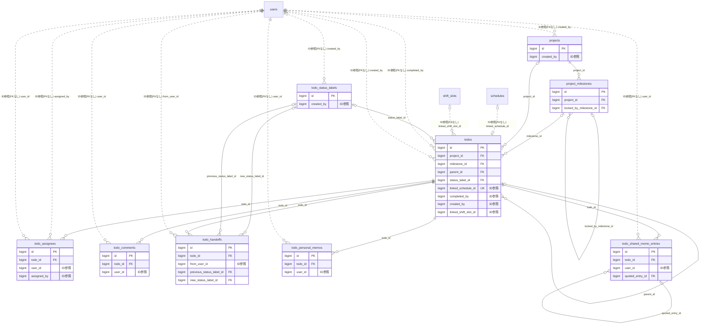

# todo ドメイン ER 図

> このファイルは自動生成されます。手で編集しないでください。再生成: `cd backend && ./gradlew generateErDiagrams`

- テーブル数: 9
- ビュー数: 0

## ER 図

実線 = 外部キー、点線 = ID参照(FKなし)。図中の `FK` は実外部キーの列だけ（ID参照列は `FK` を付けず "ID参照" と注記）。図にはキー列（PK / FK / 参照推定列 / 単一列 UNIQUE）のみを描く。全列は下の「テーブル定義」を参照。

## 被参照（他ドメインから）

このドメインのテーブルを参照している他ドメインの側（実 FK と ID参照のみ。多態参照と推定不能参照は含まない。同一ドメイン内の参照は上の図を参照）。

| 参照元ドメイン | 参照元テーブル | 列 | 種別 | 参照先テーブル |
| --- | --- | --- | --- | --- |
| [actionmemo](actionmemo.md) | `action_memos` | `related_todo_id` | ID参照 | `todos` |
| [quickmemo](quickmemo.md) | `quick_memos` | `converted_to_todo_id` | ID参照 | `todos` |
| [quickmemo](quickmemo.md) | `todo_tag_links` | `todo_id` | ID参照 | `todos` |
| [schedule](schedule.md) | `schedules` | `linked_todo_id` | ID参照 | `todos` |
| [shift](shift.md) | `shift_schedules` | `linked_project_id` | ID参照 | `projects` |
| [shiftbudget](shiftbudget.md) | `shift_budget_allocations` | `project_id` | ID参照 | `projects` |
| [shiftbudget](shiftbudget.md) | `todo_budget_links` | `project_id` | ID参照 | `projects` |
| [shiftbudget](shiftbudget.md) | `todo_budget_links` | `todo_id` | ID参照 | `todos` |

## 自己参照

mermaid は同一テーブルの自己参照を複数描けず 1 本に畳むため、図に線が欠けることがある。自己参照はこの表を正とする。

| テーブル | 列 | 種別 |
| --- | --- | --- |
| `project_milestones` | `locked_by_milestone_id` | 外部キー |
| `todo_shared_memo_entries` | `quoted_entry_id` | 外部キー |
| `todos` | `parent_id` | 外部キー |

## 多態参照（線を引かない）

| テーブル | 種別列 | ID列 |
| --- | --- | --- |
| `projects` | `scope_type` | `scope_id` |
| `todo_status_labels` | `scope_type` | `scope_id` |
| `todos` | `scope_type` | `scope_id` |

## テーブル定義

### `project_milestones`

| 列名 | 型 | NULL | 既定値 | コメント |
| --- | --- | --- | --- | --- |
| `id` | `bigint unsigned` | NO | （なし） auto_increment |  |
| `project_id` | `bigint unsigned` | NO | （なし） |  |
| `title` | `varchar(200)` | NO | （なし） |  |
| `due_date` | `date` | YES | NULL |  |
| `sort_order` | `smallint unsigned` | NO | `0` |  |
| `is_completed` | `tinyint(1)` | NO | `0` |  |
| `progress_rate` | `decimal(5,2)` | NO | `0.00` |  |
| `is_locked` | `tinyint(1)` | NO | `0` |  |
| `locked_by_milestone_id` | `bigint unsigned` | YES | NULL |  |
| `completion_mode` | `varchar(16)` | NO | `AUTO` |  |
| `locked_at` | `datetime` | YES | NULL |  |
| `unlocked_at` | `datetime` | YES | NULL |  |
| `force_unlocked` | `tinyint(1)` | NO | `0` |  |
| `version` | `bigint unsigned` | NO | `0` |  |
| `completed_at` | `datetime` | YES | NULL |  |
| `created_at` | `datetime` | NO | `CURRENT_TIMESTAMP` （式） |  |
| `updated_at` | `datetime` | NO | `CURRENT_TIMESTAMP` （式） |  |

### `projects`

| 列名 | 型 | NULL | 既定値 | コメント |
| --- | --- | --- | --- | --- |
| `id` | `bigint unsigned` | NO | （なし） auto_increment |  |
| `scope_type` | `varchar(20)` | NO | （なし） | スコープ種別: PERSONAL / TEAM / ORGANIZATION / COMMITTEE |
| `scope_id` | `bigint unsigned` | NO | （なし） | users.id / teams.id / organizations.id |
| `title` | `varchar(200)` | NO | （なし） |  |
| `description` | `text` | YES | NULL |  |
| `emoji` | `varchar(10)` | YES | NULL | アイコン絵文字 |
| `color` | `varchar(7)` | YES | NULL | テーマカラー HEX |
| `due_date` | `date` | YES | NULL |  |
| `status` | `varchar(20)` | NO | `ACTIVE` | ACTIVE / COMPLETED / ARCHIVED |
| `progress_rate` | `decimal(5,2)` | NO | `0.00` | 進捗率 0.00〜100.00 |
| `total_todos` | `smallint unsigned` | NO | `0` |  |
| `completed_todos` | `smallint unsigned` | NO | `0` |  |
| `visibility` | `varchar(20)` | NO | `MEMBERS_ONLY` | PRIVATE / MEMBERS_ONLY / PUBLIC |
| `created_by` | `bigint unsigned` | NO | （なし） |  |
| `completed_at` | `datetime` | YES | NULL |  |
| `created_at` | `datetime` | NO | `CURRENT_TIMESTAMP` （式） |  |
| `updated_at` | `datetime` | NO | `CURRENT_TIMESTAMP` （式） |  |
| `deleted_at` | `datetime` | YES | NULL |  |

### `todo_assignees`

| 列名 | 型 | NULL | 既定値 | コメント |
| --- | --- | --- | --- | --- |
| `id` | `bigint unsigned` | NO | （なし） auto_increment |  |
| `todo_id` | `bigint unsigned` | NO | （なし） |  |
| `user_id` | `bigint unsigned` | NO | （なし） |  |
| `assigned_by` | `bigint unsigned` | YES | NULL |  |
| `created_at` | `datetime` | NO | `CURRENT_TIMESTAMP` （式） |  |

### `todo_comments`

| 列名 | 型 | NULL | 既定値 | コメント |
| --- | --- | --- | --- | --- |
| `id` | `bigint unsigned` | NO | （なし） auto_increment |  |
| `todo_id` | `bigint unsigned` | NO | （なし） |  |
| `user_id` | `bigint unsigned` | NO | （なし） |  |
| `body` | `text` | NO | （なし） |  |
| `created_at` | `datetime` | NO | `CURRENT_TIMESTAMP` （式） |  |
| `updated_at` | `datetime` | NO | `CURRENT_TIMESTAMP` （式） |  |

### `todo_handoffs`

| 列名 | 型 | NULL | 既定値 | コメント |
| --- | --- | --- | --- | --- |
| `id` | `bigint unsigned` | NO | （なし） auto_increment |  |
| `todo_id` | `bigint unsigned` | NO | （なし） |  |
| `from_user_id` | `bigint unsigned` | NO | （なし） |  |
| `from_assignee_user_ids` | `json` | NO | （なし） |  |
| `to_assignee_user_ids` | `json` | NO | （なし） |  |
| `previous_status` | `varchar(20)` | NO | （なし） |  |
| `previous_status_label_id` | `bigint unsigned` | YES | NULL |  |
| `previous_status_label_name` | `varchar(50)` | YES | NULL |  |
| `new_status` | `varchar(20)` | NO | （なし） |  |
| `new_status_label_id` | `bigint unsigned` | YES | NULL |  |
| `new_status_label_name` | `varchar(50)` | YES | NULL |  |
| `message` | `varchar(500)` | YES | NULL |  |
| `created_at` | `datetime` | NO | `CURRENT_TIMESTAMP` （式） |  |

### `todo_personal_memos`

| 列名 | 型 | NULL | 既定値 | コメント |
| --- | --- | --- | --- | --- |
| `id` | `bigint unsigned` | NO | （なし） auto_increment |  |
| `todo_id` | `bigint unsigned` | NO | （なし） | 対象TODOのID |
| `user_id` | `bigint unsigned` | NO | （なし） | メモ所有者のユーザーID |
| `body` | `text` | NO | （なし） | メモ本文（Markdown対応） |
| `created_at` | `datetime` | NO | `CURRENT_TIMESTAMP` （式） |  |
| `updated_at` | `datetime` | NO | `CURRENT_TIMESTAMP` （式） |  |

### `todo_shared_memo_entries`

| 列名 | 型 | NULL | 既定値 | コメント |
| --- | --- | --- | --- | --- |
| `id` | `bigint unsigned` | NO | （なし） auto_increment |  |
| `todo_id` | `bigint unsigned` | NO | （なし） | 対象TODOのID |
| `user_id` | `bigint unsigned` | NO | （なし） | 投稿者ユーザーID（FK制約なし：退会後も内容を保持） |
| `body` | `text` | NO | （なし） | メモ本文（Markdown対応） |
| `quoted_entry_id` | `bigint unsigned` | YES | NULL | 引用元エントリID（自己参照。NULLの場合は引用なし） |
| `created_at` | `datetime` | NO | `CURRENT_TIMESTAMP` （式） |  |
| `updated_at` | `datetime` | NO | `CURRENT_TIMESTAMP` （式） |  |
| `deleted_at` | `datetime` | YES | NULL | 論理削除日時 |

### `todo_status_labels`

| 列名 | 型 | NULL | 既定値 | コメント |
| --- | --- | --- | --- | --- |
| `id` | `bigint unsigned` | NO | （なし） auto_increment |  |
| `scope_type` | `varchar(20)` | NO | （なし） |  |
| `scope_id` | `bigint unsigned` | YES | NULL |  |
| `name` | `varchar(50)` | NO | （なし） |  |
| `bucket` | `varchar(20)` | NO | （なし） |  |
| `color` | `varchar(7)` | YES | NULL |  |
| `sort_order` | `int` | NO | `0` |  |
| `is_system_default` | `tinyint(1)` | NO | `0` |  |
| `created_by` | `bigint unsigned` | YES | NULL |  |
| `created_at` | `datetime` | NO | `CURRENT_TIMESTAMP` （式） |  |
| `updated_at` | `datetime` | NO | `CURRENT_TIMESTAMP` （式） |  |
| `deleted_at` | `datetime` | YES | NULL |  |

### `todos`

| 列名 | 型 | NULL | 既定値 | コメント |
| --- | --- | --- | --- | --- |
| `id` | `bigint unsigned` | NO | （なし） auto_increment |  |
| `scope_type` | `varchar(20)` | NO | （なし） | PERSONAL / TEAM / ORGANIZATION |
| `scope_id` | `bigint unsigned` | NO | （なし） | users.id / teams.id / organizations.id |
| `project_id` | `bigint unsigned` | YES | NULL |  |
| `milestone_id` | `bigint unsigned` | YES | NULL |  |
| `milestone_locked` | `tinyint(1)` | NO | `0` |  |
| `position` | `smallint unsigned` | NO | `0` |  |
| `parent_id` | `bigint unsigned` | YES | NULL |  |
| `depth` | `tinyint unsigned` | NO | `0` |  |
| `title` | `varchar(300)` | NO | （なし） |  |
| `description` | `text` | YES | NULL |  |
| `status` | `varchar(20)` | NO | `OPEN` | OPEN / IN_PROGRESS / COMPLETED |
| `status_label_id` | `bigint unsigned` | YES | NULL |  |
| `priority` | `varchar(10)` | NO | `MEDIUM` | LOW / MEDIUM / HIGH / URGENT |
| `due_date` | `date` | YES | NULL |  |
| `due_time` | `time` | YES | NULL |  |
| `start_date` | `date` | YES | NULL | 開始日（ガントバー表示用。NULLの場合はガントバー対象外） |
| `linked_schedule_id` | `bigint unsigned` | YES | NULL | 連携スケジュールID（FKはV13.016で追加） |
| `progress_rate` | `decimal(5,2)` | NO | `0.00` | 進捗率（0.00〜100.00。手動設定またはサブタスク完了率から算出） |
| `progress_manual` | `tinyint(1)` | NO | `0` | 進捗率手動設定フラグ（1=手動設定中・自動更新を停止） |
| `completed_at` | `datetime` | YES | NULL |  |
| `completed_by` | `bigint unsigned` | YES | NULL |  |
| `created_by` | `bigint unsigned` | NO | （なし） |  |
| `sort_order` | `int` | NO | `0` |  |
| `created_at` | `datetime` | NO | `CURRENT_TIMESTAMP` （式） |  |
| `updated_at` | `datetime` | NO | `CURRENT_TIMESTAMP` （式） |  |
| `deleted_at` | `datetime` | YES | NULL |  |
| `linked_shift_slot_id` | `bigint unsigned` | YES | NULL |  |
