# tournament ドメイン ER 図

> このファイルは自動生成されます。手で編集しないでください。再生成: `cd backend && ./gradlew generateErDiagrams`

- テーブル数: 31
- ビュー数: 0

## ER 図

実線 = 外部キー、点線 = ID参照(FKなし)。図中の `FK` は実外部キーの列だけ（ID参照列は `FK` を付けず "ID参照" と注記）。図にはキー列（PK / FK / 参照推定列 / 単一列 UNIQUE）のみを描く。全列は下の「テーブル定義」を参照。

```mermaid
erDiagram
    league_transfer {
        binary id PK
        bigint team_id "ID参照"
        bigint from_organization_id "ID参照"
        bigint to_organization_id "ID参照"
        bigint initiated_by "ID参照"
        bigint responded_by "ID参照"
    }
    match_roster_staff {
        binary id PK
        bigint user_id "ID参照"
    }
    system_tournament_preset_stat_defs {
        bigint id PK
        bigint preset_id FK
    }
    system_tournament_preset_tiebreakers {
        bigint id PK
        bigint preset_id FK
    }
    system_tournament_presets {
        bigint id PK
    }
    tournament_contact_space {
        binary id PK
    }
    tournament_divisions {
        bigint id PK
        bigint tournament_id FK
    }
    tournament_entry_members {
        binary id PK
        bigint participant_id FK
        bigint user_id "ID参照"
    }
    tournament_entry_template_members {
        binary id PK
        binary template_id FK
        bigint user_id "ID参照"
    }
    tournament_entry_template_staff {
        binary id PK
        binary template_id FK
        bigint user_id "ID参照"
    }
    tournament_entry_templates {
        binary id PK
        bigint team_id "ID参照"
        bigint created_by "ID参照"
    }
    tournament_fee {
        binary id PK
        bigint tournament_id "ID参照"
        bigint payment_item_id "ID参照"
        bigint organization_id "ID参照"
        bigint created_by "ID参照"
    }
    tournament_fee_target {
        binary id PK
        binary fee_id FK
        bigint team_id "ID参照"
    }
    tournament_individual_rankings {
        bigint id PK
        bigint tournament_id FK
        bigint user_id "ID参照"
        bigint participant_id FK
    }
    tournament_match_player_stats {
        bigint id PK
        bigint match_id FK
        bigint participant_id FK
        bigint user_id "ID参照"
    }
    tournament_match_rosters {
        bigint id PK
        bigint match_id FK
        bigint participant_id FK
        bigint user_id "ID参照"
    }
    tournament_match_sets {
        bigint id PK
        bigint match_id FK
    }
    tournament_matchdays {
        bigint id PK
        bigint division_id FK
    }
    tournament_matches {
        bigint id PK
        bigint matchday_id FK
        bigint home_participant_id FK
        bigint away_participant_id FK
        bigint winner_participant_id FK
        bigint next_match_id FK
        bigint schedule_id "ID参照"
    }
    tournament_participants {
        bigint id PK
        bigint division_id FK
        bigint team_id "ID参照"
    }
    tournament_promotion_records {
        bigint id PK
        bigint tournament_id FK
        bigint team_id "ID参照"
        bigint from_division_id FK
        bigint to_division_id FK
        bigint executed_by "ID参照"
    }
    tournament_scorekeepers {
        binary id PK
        bigint tournament_id "ID参照"
        bigint user_id "ID参照"
        bigint created_by "ID参照"
    }
    tournament_standings {
        bigint id PK
        bigint division_id FK
        bigint participant_id FK
    }
    tournament_stat_defs {
        bigint id PK
        bigint tournament_id FK
    }
    tournament_submission_requirement {
        binary id PK
        bigint tournament_id "ID参照"
        bigint form_template_id "ID参照"
        bigint organization_id "ID参照"
        bigint created_by "ID参照"
    }
    tournament_submission_requirement_target {
        binary id PK
        binary requirement_id FK
        bigint team_id "ID参照"
    }
    tournament_template_stat_defs {
        bigint id PK
        bigint template_id FK
    }
    tournament_template_tiebreakers {
        bigint id PK
        bigint template_id FK
    }
    tournament_templates {
        bigint id PK
        bigint organization_id "ID参照"
        bigint source_preset_id FK
        bigint created_by "ID参照"
    }
    tournament_tiebreakers {
        bigint id PK
        bigint tournament_id FK
    }
    tournaments {
        bigint id PK
        bigint organization_id "ID参照"
        bigint template_id FK
        bigint previous_tournament_id FK
        bigint created_by "ID参照"
    }
    form_templates
    organizations
    payment_items
    schedules
    teams
    users
    organizations ||..o{ league_transfer : "ID参照(FKなし) from_organization_id"
    organizations ||..o{ league_transfer : "ID参照(FKなし) to_organization_id"
    teams ||..o{ league_transfer : "ID参照(FKなし) team_id"
    users ||..o{ league_transfer : "ID参照(FKなし) initiated_by"
    users |o..o{ league_transfer : "ID参照(FKなし) responded_by"
    users |o..o{ match_roster_staff : "ID参照(FKなし) user_id"
    system_tournament_presets ||--o{ system_tournament_preset_stat_defs : "preset_id"
    system_tournament_presets ||--o{ system_tournament_preset_tiebreakers : "preset_id"
    tournaments ||--o{ tournament_divisions : "tournament_id"
    tournament_participants ||--o{ tournament_entry_members : "participant_id"
    users ||..o{ tournament_entry_members : "ID参照(FKなし) user_id"
    tournament_entry_templates ||--o{ tournament_entry_template_members : "template_id"
    users ||..o{ tournament_entry_template_members : "ID参照(FKなし) user_id"
    tournament_entry_templates ||--o{ tournament_entry_template_staff : "template_id"
    users |o..o{ tournament_entry_template_staff : "ID参照(FKなし) user_id"
    teams ||..o{ tournament_entry_templates : "ID参照(FKなし) team_id"
    users ||..o{ tournament_entry_templates : "ID参照(FKなし) created_by"
    organizations ||..o{ tournament_fee : "ID参照(FKなし) organization_id"
    payment_items ||..o{ tournament_fee : "ID参照(FKなし) payment_item_id"
    tournaments ||..o{ tournament_fee : "ID参照(FKなし) tournament_id"
    users ||..o{ tournament_fee : "ID参照(FKなし) created_by"
    teams ||..o{ tournament_fee_target : "ID参照(FKなし) team_id"
    tournament_fee ||--o{ tournament_fee_target : "fee_id"
    tournament_participants ||--o{ tournament_individual_rankings : "participant_id"
    tournaments ||--o{ tournament_individual_rankings : "tournament_id"
    users ||..o{ tournament_individual_rankings : "ID参照(FKなし) user_id"
    tournament_matches ||--o{ tournament_match_player_stats : "match_id"
    tournament_participants ||--o{ tournament_match_player_stats : "participant_id"
    users ||..o{ tournament_match_player_stats : "ID参照(FKなし) user_id"
    tournament_matches ||--o{ tournament_match_rosters : "match_id"
    tournament_participants ||--o{ tournament_match_rosters : "participant_id"
    users ||..o{ tournament_match_rosters : "ID参照(FKなし) user_id"
    tournament_matches ||--o{ tournament_match_sets : "match_id"
    tournament_divisions ||--o{ tournament_matchdays : "division_id"
    schedules |o..o{ tournament_matches : "ID参照(FKなし) schedule_id"
    tournament_matchdays ||--o{ tournament_matches : "matchday_id"
    tournament_matches |o--o{ tournament_matches : "next_match_id"
    tournament_participants |o--o{ tournament_matches : "away_participant_id"
    tournament_participants |o--o{ tournament_matches : "home_participant_id"
    tournament_participants |o--o{ tournament_matches : "winner_participant_id"
    teams ||..o{ tournament_participants : "ID参照(FKなし) team_id"
    tournament_divisions ||--o{ tournament_participants : "division_id"
    teams ||..o{ tournament_promotion_records : "ID参照(FKなし) team_id"
    tournament_divisions ||--o{ tournament_promotion_records : "from_division_id"
    tournament_divisions ||--o{ tournament_promotion_records : "to_division_id"
    tournaments ||--o{ tournament_promotion_records : "tournament_id"
    users ||..o{ tournament_promotion_records : "ID参照(FKなし) executed_by"
    tournaments ||..o{ tournament_scorekeepers : "ID参照(FKなし) tournament_id"
    users ||..o{ tournament_scorekeepers : "ID参照(FKなし) created_by"
    users ||..o{ tournament_scorekeepers : "ID参照(FKなし) user_id"
    tournament_divisions ||--o{ tournament_standings : "division_id"
    tournament_participants ||--o{ tournament_standings : "participant_id"
    tournaments ||--o{ tournament_stat_defs : "tournament_id"
    form_templates ||..o{ tournament_submission_requirement : "ID参照(FKなし) form_template_id"
    organizations ||..o{ tournament_submission_requirement : "ID参照(FKなし) organization_id"
    tournaments ||..o{ tournament_submission_requirement : "ID参照(FKなし) tournament_id"
    users ||..o{ tournament_submission_requirement : "ID参照(FKなし) created_by"
    teams ||..o{ tournament_submission_requirement_target : "ID参照(FKなし) team_id"
    tournament_submission_requirement ||--o{ tournament_submission_requirement_target : "requirement_id"
    tournament_templates ||--o{ tournament_template_stat_defs : "template_id"
    tournament_templates ||--o{ tournament_template_tiebreakers : "template_id"
    organizations ||..o{ tournament_templates : "ID参照(FKなし) organization_id"
    system_tournament_presets |o--o{ tournament_templates : "source_preset_id"
    users ||..o{ tournament_templates : "ID参照(FKなし) created_by"
    tournaments ||--o{ tournament_tiebreakers : "tournament_id"
    organizations ||..o{ tournaments : "ID参照(FKなし) organization_id"
    tournament_templates |o--o{ tournaments : "template_id"
    tournaments |o--o{ tournaments : "previous_tournament_id"
    users ||..o{ tournaments : "ID参照(FKなし) created_by"
```

## 被参照（他ドメインから）

このドメインのテーブルを参照している他ドメインの側（実 FK と ID参照のみ。多態参照と推定不能参照は含まない。同一ドメイン内の参照は上の図を参照）。

なし

## 自己参照

mermaid は同一テーブルの自己参照を複数描けず 1 本に畳むため、図に線が欠けることがある。自己参照はこの表を正とする。

| テーブル | 列 | 種別 |
| --- | --- | --- |
| `tournament_matches` | `next_match_id` | 外部キー |
| `tournaments` | `previous_tournament_id` | 外部キー |

## 多態参照（線を引かない）

| テーブル | 種別列 | ID列 |
| --- | --- | --- |
| `tournament_contact_space` | `scope_type` | `scope_id` |

## 推定不能参照

| テーブル | 列 | 理由 |
| --- | --- | --- |
| `league_transfer` | `source_division_id` | 参照先テーブルを特定できない |
| `league_transfer` | `target_division_id` | 参照先テーブルを特定できない |
| `match_roster_staff` | `match_id` | 型が参照先 matches.id と不一致（bigint ≠ binary） |
| `match_roster_staff` | `participant_id` | 参照先テーブルを特定できない |
| `tournament_contact_space` | `ref_id` | 参照先テーブルを特定できない |
| `tournament_fee` | `division_id` | 参照先テーブルを特定できない |
| `tournament_match_rosters` | `uniform_set_id` | 参照先テーブルを特定できない |
| `tournament_submission_requirement` | `division_id` | 参照先テーブルを特定できない |

## テーブル定義

### `league_transfer`

| 列名 | 型 | NULL | 既定値 | コメント |
| --- | --- | --- | --- | --- |
| `id` | `binary(16)` | NO | （なし） | UUIDv7（原則6） |
| `direction` | `varchar(20)` | NO | （なし） | PROMOTION / RELEGATION |
| `team_id` | `bigint unsigned` | NO | （なし） | 移籍対象チーム（teams.id・FK なし／原則1）。team_id は不変 |
| `from_organization_id` | `bigint unsigned` | NO | （なし） | 手放す側 org（昇格時=下位県協会 / 降格時=上位協会・FK なし） |
| `to_organization_id` | `bigint unsigned` | NO | （なし） | 受け入れる側 org（昇格時=上位協会 / 降格時=出身県協会・FK なし） |
| `source_division_id` | `bigint unsigned` | YES | NULL | 移籍元ディビジョン（tournament_divisions.id・FK なし） |
| `target_division_id` | `bigint unsigned` | YES | NULL | 移籍先ディビジョン（承認・配属確定時にセット・FK なし） |
| `season` | `varchar(20)` | NO | （なし） | シーズン識別子（二重起票抑止キーの一部） |
| `final_rank` | `int` | YES | NULL | 移籍元での最終順位（昇格枠/降格枠判定の根拠） |
| `status` | `varchar(20)` | NO | `DISPATCHED` | DISPATCHED / PLACED / DECLINED / CANCELLED（§3.2） |
| `initiated_by` | `bigint` | NO | （なし） | 起票者（手放す側 org ADMIN）の user_id（退会時も証跡保持・§7） |
| `responded_by` | `bigint` | YES | NULL | 応答者（受け入れ側 org ADMIN）の user_id（退会時も証跡保持・§7） |
| `message` | `varchar(500)` | YES | NULL | 送り出しメッセージ |
| `created_at` | `datetime` | NO | `CURRENT_TIMESTAMP` （式） |  |
| `responded_at` | `datetime` | YES | NULL | 応答（承認/拒否/取消）日時 |

### `match_roster_staff`

| 列名 | 型 | NULL | 既定値 | コメント |
| --- | --- | --- | --- | --- |
| `id` | `binary(16)` | NO | （なし） | UUIDv7（原則6） |
| `match_id` | `bigint unsigned` | NO | （なし） | tournament_matches.id への ID 参照（同一 tournament ドメイン・FK なし） |
| `participant_id` | `bigint unsigned` | NO | （なし） | tournament_participants.id への ID 参照（自チーム分・FK なし） |
| `role` | `varchar(32)` | NO | （なし） | 役職（監督/コーチ/トレーナー/帯同審判 等。アプリ層で許容値検証） |
| `name` | `varchar(128)` | NO | （なし） | 氏名（アプリ未登録者も記載可のため文字列で保持） |
| `user_id` | `bigint unsigned` | YES | NULL | 紐付くユーザー（user ドメインへの ID 参照・FK なし／原則1・NULL 可） |
| `created_at` | `datetime` | NO | `CURRENT_TIMESTAMP` （式） |  |
| `updated_at` | `datetime` | NO | `CURRENT_TIMESTAMP` （式） |  |

### `system_tournament_preset_stat_defs`

| 列名 | 型 | NULL | 既定値 | コメント |
| --- | --- | --- | --- | --- |
| `id` | `bigint unsigned` | NO | （なし） auto_increment |  |
| `preset_id` | `bigint unsigned` | NO | （なし） |  |
| `name` | `varchar(50)` | NO | （なし） |  |
| `stat_key` | `varchar(30)` | NO | （なし） |  |
| `unit` | `varchar(20)` | YES | NULL |  |
| `data_type` | `enum('INTEGER','DECIMAL','TIME')` | NO | `INTEGER` |  |
| `aggregation_type` | `enum('SUM','AVG','MAX','MIN')` | NO | `SUM` |  |
| `is_ranking_target` | `tinyint(1)` | NO | `1` |  |
| `ranking_label` | `varchar(50)` | YES | NULL |  |
| `sort_order` | `int` | NO | `0` |  |

### `system_tournament_preset_tiebreakers`

| 列名 | 型 | NULL | 既定値 | コメント |
| --- | --- | --- | --- | --- |
| `id` | `bigint unsigned` | NO | （なし） auto_increment |  |
| `preset_id` | `bigint unsigned` | NO | （なし） |  |
| `priority` | `tinyint unsigned` | NO | （なし） |  |
| `criteria` | `enum('POINTS','SCORE_DIFFERENCE','SCORE_FOR','HEAD_TO_HEAD_POINTS','HEAD_TO_HEAD_SCORE_DIFFERENCE','WINS','SET_RATIO','POINT_RATIO','LOSSES','DRAWS')` | NO | （なし） |  |
| `direction` | `enum('DESC','ASC')` | NO | `DESC` |  |

### `system_tournament_presets`

| 列名 | 型 | NULL | 既定値 | コメント |
| --- | --- | --- | --- | --- |
| `id` | `bigint unsigned` | NO | （なし） auto_increment |  |
| `name` | `varchar(100)` | NO | （なし） |  |
| `sport_category` | `varchar(50)` | NO | （なし） |  |
| `description` | `varchar(500)` | YES | NULL |  |
| `icon` | `varchar(30)` | YES | NULL |  |
| `supported_formats` | `json` | NO | （なし） |  |
| `win_points` | `tinyint unsigned` | NO | `3` |  |
| `draw_points` | `tinyint unsigned` | NO | `1` |  |
| `loss_points` | `tinyint unsigned` | NO | `0` |  |
| `has_draw` | `tinyint(1)` | NO | `1` |  |
| `has_sets` | `tinyint(1)` | NO | `0` |  |
| `sets_to_win` | `tinyint unsigned` | YES | NULL |  |
| `has_extra_time` | `tinyint(1)` | NO | `0` |  |
| `has_penalties` | `tinyint(1)` | NO | `0` |  |
| `score_unit_label` | `varchar(20)` | NO | `点` |  |
| `bonus_point_rules` | `json` | YES | NULL |  |
| `sort_order` | `int` | NO | `0` |  |
| `created_at` | `datetime` | NO | `CURRENT_TIMESTAMP` （式） |  |
| `updated_at` | `datetime` | NO | `CURRENT_TIMESTAMP` （式） |  |
| `deleted_at` | `datetime` | YES | NULL |  |

### `tournament_contact_space`

| 列名 | 型 | NULL | 既定値 | コメント |
| --- | --- | --- | --- | --- |
| `id` | `binary(16)` | NO | （なし） | UUIDv7（原則6） |
| `scope_type` | `varchar(30)` | NO | （なし） | TOURNAMENT / TOURNAMENT_DIVISION |
| `scope_id` | `bigint unsigned` | NO | （なし） | tournaments.id または tournament_divisions.id（FK なし・原則1） |
| `space_kind` | `varchar(20)` | NO | （なし） | BULLETIN / CHAT |
| `ref_id` | `bigint unsigned` | NO | （なし） | 払い出した実体の ID（BULLETIN=bulletin_categories.id / CHAT=chat_channels.id）。FK なし |
| `is_public` | `tinyint(1)` | NO | `0` | 公開トグル（TRUE で PUBLIC 閲覧可。CHAT も既定 FALSE） |
| `created_at` | `datetime` | NO | `CURRENT_TIMESTAMP` （式） |  |
| `updated_at` | `datetime` | NO | `CURRENT_TIMESTAMP` （式） |  |
| `deleted_at` | `datetime` | YES | NULL | 論理削除（大会/ディビジョン削除時に archive） |

### `tournament_divisions`

| 列名 | 型 | NULL | 既定値 | コメント |
| --- | --- | --- | --- | --- |
| `id` | `bigint unsigned` | NO | （なし） auto_increment |  |
| `tournament_id` | `bigint unsigned` | NO | （なし） |  |
| `name` | `varchar(100)` | NO | （なし） |  |
| `level` | `tinyint unsigned` | NO | `1` |  |
| `promotion_slots` | `tinyint unsigned` | NO | `0` |  |
| `relegation_slots` | `tinyint unsigned` | NO | `0` |  |
| `playoff_promotion_slots` | `tinyint unsigned` | NO | `0` |  |
| `max_participants` | `smallint unsigned` | YES | NULL |  |
| `min_entry_count` | `smallint unsigned` | YES | NULL | エントリー最少人数（NULL = 制限なし） |
| `max_entry_count` | `smallint unsigned` | YES | NULL | エントリー最大人数（NULL = 制限なし） |
| `sort_order` | `int` | NO | `0` |  |
| `created_at` | `datetime` | NO | `CURRENT_TIMESTAMP` （式） |  |
| `updated_at` | `datetime` | NO | `CURRENT_TIMESTAMP` （式） |  |

### `tournament_entry_members`

| 列名 | 型 | NULL | 既定値 | コメント |
| --- | --- | --- | --- | --- |
| `id` | `binary(16)` | NO | （なし） |  |
| `participant_id` | `bigint unsigned` | NO | （なし） |  |
| `user_id` | `bigint unsigned` | NO | （なし） | クロスドメイン参照: users.id（FK なし） |
| `member_number` | `varchar(50)` | YES | NULL | チームメンバー番号 |
| `jersey_number` | `smallint unsigned` | YES | NULL |  |
| `position` | `varchar(30)` | YES | NULL |  |
| `notes` | `varchar(200)` | YES | NULL |  |
| `sort_order` | `smallint unsigned` | NO | `0` |  |
| `created_at` | `datetime` | NO | `CURRENT_TIMESTAMP` （式） |  |
| `updated_at` | `datetime` | NO | `CURRENT_TIMESTAMP` （式） |  |

### `tournament_entry_template_members`

| 列名 | 型 | NULL | 既定値 | コメント |
| --- | --- | --- | --- | --- |
| `id` | `binary(16)` | NO | （なし） |  |
| `template_id` | `binary(16)` | NO | （なし） |  |
| `user_id` | `bigint unsigned` | NO | （なし） | クロスドメイン参照: users.id（FK なし） |
| `jersey_number` | `smallint unsigned` | YES | NULL |  |
| `position` | `varchar(30)` | YES | NULL |  |
| `sort_order` | `smallint unsigned` | NO | `0` |  |
| `registration_number` | `varchar(32)` | YES | NULL | 協会選手登録番号（背番号とは別・NULL 可）。テンプレ適用時に roster へ複製 |
| `created_at` | `datetime` | NO | `CURRENT_TIMESTAMP` （式） |  |
| `updated_at` | `datetime` | NO | `CURRENT_TIMESTAMP` （式） |  |

### `tournament_entry_template_staff`

| 列名 | 型 | NULL | 既定値 | コメント |
| --- | --- | --- | --- | --- |
| `id` | `binary(16)` | NO | （なし） | UUIDv7（原則6） |
| `template_id` | `binary(16)` | NO | （なし） | 親 tournament_entry_templates.id（BINARY(16)） |
| `role` | `varchar(32)` | NO | （なし） | 役職（監督/コーチ/トレーナー 等） |
| `name` | `varchar(128)` | NO | （なし） | 氏名（アプリ未登録者も記載可） |
| `user_id` | `bigint unsigned` | YES | NULL | user ドメインへの ID 参照（FK なし／原則1・NULL 可） |
| `sort_order` | `smallint unsigned` | NO | `0` | 並び順 |
| `created_at` | `datetime` | NO | `CURRENT_TIMESTAMP` （式） |  |
| `updated_at` | `datetime` | NO | `CURRENT_TIMESTAMP` （式） |  |

### `tournament_entry_templates`

| 列名 | 型 | NULL | 既定値 | コメント |
| --- | --- | --- | --- | --- |
| `id` | `binary(16)` | NO | （なし） |  |
| `team_id` | `bigint unsigned` | NO | （なし） | クロスドメイン参照: teams.id（FK なし） |
| `name` | `varchar(50)` | NO | （なし） |  |
| `description` | `varchar(200)` | YES | NULL |  |
| `sort_order` | `tinyint unsigned` | NO | `0` |  |
| `created_by` | `bigint unsigned` | NO | （なし） | クロスドメイン参照: users.id（FK なし） |
| `created_at` | `datetime` | NO | `CURRENT_TIMESTAMP` （式） |  |
| `updated_at` | `datetime` | NO | `CURRENT_TIMESTAMP` （式） |  |
| `deleted_at` | `datetime` | YES | NULL |  |

### `tournament_fee`

| 列名 | 型 | NULL | 既定値 | コメント |
| --- | --- | --- | --- | --- |
| `id` | `binary(16)` | NO | （なし） | UUIDv7（原則6） |
| `tournament_id` | `bigint unsigned` | NO | （なし） | 対象大会（tournaments.id・FK なし／原則1） |
| `division_id` | `bigint unsigned` | YES | NULL | 対象ディビジョン（tournament_divisions.id。NULL=大会全体・FK なし） |
| `payment_item_id` | `bigint unsigned` | NO | （なし） | payment ドメインの payment_items.id（FK なし／原則1） |
| `title` | `varchar(255)` | NO | （なし） | 表示名（例「2026 春季リーグ 参加費」） |
| `target_scope` | `varchar(20)` | NO | `ALL_TEAMS` | 対象＝全参加チーム(ALL_TEAMS) / 特定チーム(SPECIFIC_TEAMS) |
| `payment_due` | `datetime` | YES | NULL | 支払期限（NULL=期限なし）。grace_period は payment_item 側 |
| `organization_id` | `bigint unsigned` | NO | （なし） | 主催組織（入金先・テナント絞り込み） |
| `created_by` | `bigint` | NO | （なし） | 作成した主催組織 ADMIN の user_id（退会時も履歴保持） |
| `created_at` | `datetime` | NO | `CURRENT_TIMESTAMP` （式） |  |
| `updated_at` | `datetime` | NO | `CURRENT_TIMESTAMP` （式） |  |
| `deleted_at` | `datetime` | YES | NULL | 論理削除（履歴保持・クロスドメイン CASCADE なし） |

### `tournament_fee_target`

| 列名 | 型 | NULL | 既定値 | コメント |
| --- | --- | --- | --- | --- |
| `id` | `binary(16)` | NO | （なし） | UUIDv7（原則6） |
| `fee_id` | `binary(16)` | NO | （なし） | 親 tournament_fee.id（同一ドメイン） |
| `team_id` | `bigint unsigned` | NO | （なし） | 対象チーム（teams.id・FK なし／原則1） |
| `created_at` | `datetime` | NO | `CURRENT_TIMESTAMP` （式） |  |

### `tournament_individual_rankings`

| 列名 | 型 | NULL | 既定値 | コメント |
| --- | --- | --- | --- | --- |
| `id` | `bigint unsigned` | NO | （なし） auto_increment |  |
| `tournament_id` | `bigint unsigned` | NO | （なし） |  |
| `user_id` | `bigint unsigned` | NO | （なし） |  |
| `participant_id` | `bigint unsigned` | NO | （なし） |  |
| `stat_key` | `varchar(30)` | NO | （なし） |  |
| `rank` | `smallint unsigned` | NO | （なし） |  |
| `total_value_int` | `int` | YES | NULL |  |
| `total_value_decimal` | `decimal(15,4)` | YES | NULL |  |
| `total_value_time` | `time` | YES | NULL |  |
| `matches_played` | `smallint unsigned` | NO | `0` |  |
| `last_calculated_at` | `datetime` | NO | `CURRENT_TIMESTAMP` （式） |  |

### `tournament_match_player_stats`

| 列名 | 型 | NULL | 既定値 | コメント |
| --- | --- | --- | --- | --- |
| `id` | `bigint unsigned` | NO | （なし） auto_increment |  |
| `match_id` | `bigint unsigned` | NO | （なし） |  |
| `participant_id` | `bigint unsigned` | NO | （なし） |  |
| `user_id` | `bigint unsigned` | NO | （なし） |  |
| `stat_key` | `varchar(30)` | NO | （なし） |  |
| `value_int` | `int` | YES | NULL |  |
| `value_decimal` | `decimal(15,4)` | YES | NULL |  |
| `value_time` | `time` | YES | NULL |  |
| `created_at` | `datetime` | NO | `CURRENT_TIMESTAMP` （式） |  |
| `updated_at` | `datetime` | NO | `CURRENT_TIMESTAMP` （式） |  |

### `tournament_match_rosters`

| 列名 | 型 | NULL | 既定値 | コメント |
| --- | --- | --- | --- | --- |
| `id` | `bigint unsigned` | NO | （なし） auto_increment |  |
| `match_id` | `bigint unsigned` | NO | （なし） |  |
| `participant_id` | `bigint unsigned` | NO | （なし） |  |
| `user_id` | `bigint unsigned` | NO | （なし） |  |
| `is_starter` | `tinyint(1)` | NO | `1` |  |
| `jersey_number` | `smallint unsigned` | YES | NULL |  |
| `position` | `varchar(30)` | YES | NULL |  |
| `created_at` | `datetime` | NO | `CURRENT_TIMESTAMP` （式） |  |
| `registration_number` | `varchar(32)` | YES | NULL | 協会選手登録番号（背番号とは別・NULL 可） |
| `uniform_set_id` | `binary(16)` | YES | NULL | 着用 team_uniform_set への ID 参照（team ドメイン・クロスドメイン FK なし／原則1・NULL 可） |

### `tournament_match_sets`

| 列名 | 型 | NULL | 既定値 | コメント |
| --- | --- | --- | --- | --- |
| `id` | `bigint unsigned` | NO | （なし） auto_increment |  |
| `match_id` | `bigint unsigned` | NO | （なし） |  |
| `set_number` | `tinyint unsigned` | NO | （なし） |  |
| `home_score` | `smallint unsigned` | NO | （なし） |  |
| `away_score` | `smallint unsigned` | NO | （なし） |  |

### `tournament_matchdays`

| 列名 | 型 | NULL | 既定値 | コメント |
| --- | --- | --- | --- | --- |
| `id` | `bigint unsigned` | NO | （なし） auto_increment |  |
| `division_id` | `bigint unsigned` | NO | （なし） |  |
| `name` | `varchar(100)` | NO | （なし） |  |
| `matchday_number` | `smallint unsigned` | NO | （なし） |  |
| `scheduled_date` | `date` | YES | NULL |  |
| `status` | `enum('SCHEDULED','IN_PROGRESS','COMPLETED')` | NO | `SCHEDULED` |  |
| `created_at` | `datetime` | NO | `CURRENT_TIMESTAMP` （式） |  |
| `updated_at` | `datetime` | NO | `CURRENT_TIMESTAMP` （式） |  |

### `tournament_matches`

| 列名 | 型 | NULL | 既定値 | コメント |
| --- | --- | --- | --- | --- |
| `id` | `bigint unsigned` | NO | （なし） auto_increment |  |
| `matchday_id` | `bigint unsigned` | NO | （なし） |  |
| `home_participant_id` | `bigint unsigned` | YES | NULL |  |
| `away_participant_id` | `bigint unsigned` | YES | NULL |  |
| `match_number` | `smallint unsigned` | YES | NULL |  |
| `scheduled_datetime` | `datetime` | YES | NULL |  |
| `venue` | `varchar(200)` | YES | NULL |  |
| `home_score` | `smallint unsigned` | YES | NULL |  |
| `away_score` | `smallint unsigned` | YES | NULL |  |
| `home_penalty_score` | `smallint unsigned` | YES | NULL |  |
| `away_penalty_score` | `smallint unsigned` | YES | NULL |  |
| `winner_participant_id` | `bigint unsigned` | YES | NULL |  |
| `result` | `enum('HOME_WIN','AWAY_WIN','DRAW','PENDING','CANCELLED','BYE','FORFEIT_HOME_WIN','FORFEIT_AWAY_WIN')` | NO | `PENDING` |  |
| `leg` | `tinyint unsigned` | NO | `1` |  |
| `next_match_id` | `bigint unsigned` | YES | NULL |  |
| `next_match_slot` | `enum('HOME','AWAY')` | YES | NULL |  |
| `notes` | `text` | YES | NULL |  |
| `schedule_id` | `bigint unsigned` | YES | NULL |  |
| `version` | `bigint` | NO | `0` |  |
| `status` | `enum('SCHEDULED','IN_PROGRESS','COMPLETED','POSTPONED','CANCELLED')` | NO | `SCHEDULED` |  |
| `created_at` | `datetime` | NO | `CURRENT_TIMESTAMP` （式） |  |
| `updated_at` | `datetime` | NO | `CURRENT_TIMESTAMP` （式） |  |
| `roster_deadline` | `datetime` | YES | NULL | メンバー表提出締切（NULL=締切なし）。締切後の自チーム提出は 409 でロック |

### `tournament_participants`

| 列名 | 型 | NULL | 既定値 | コメント |
| --- | --- | --- | --- | --- |
| `id` | `bigint unsigned` | NO | （なし） auto_increment |  |
| `division_id` | `bigint unsigned` | NO | （なし） |  |
| `team_id` | `bigint unsigned` | NO | （なし） |  |
| `seed` | `smallint unsigned` | YES | NULL |  |
| `display_name` | `varchar(100)` | YES | NULL |  |
| `status` | `enum('REGISTERED','ACTIVE','WITHDRAWN','DISQUALIFIED')` | NO | `REGISTERED` |  |
| `joined_at` | `datetime` | NO | `CURRENT_TIMESTAMP` （式） |  |

### `tournament_promotion_records`

| 列名 | 型 | NULL | 既定値 | コメント |
| --- | --- | --- | --- | --- |
| `id` | `bigint unsigned` | NO | （なし） auto_increment |  |
| `tournament_id` | `bigint unsigned` | NO | （なし） |  |
| `team_id` | `bigint unsigned` | NO | （なし） |  |
| `from_division_id` | `bigint unsigned` | NO | （なし） |  |
| `to_division_id` | `bigint unsigned` | NO | （なし） |  |
| `type` | `enum('PROMOTION','RELEGATION','PLAYOFF_PROMOTION','PLAYOFF_RELEGATION')` | NO | （なし） |  |
| `final_rank` | `smallint unsigned` | NO | （なし） |  |
| `reason` | `varchar(200)` | YES | NULL |  |
| `executed_by` | `bigint unsigned` | NO | （なし） |  |
| `executed_at` | `datetime` | NO | `CURRENT_TIMESTAMP` （式） |  |

### `tournament_scorekeepers`

| 列名 | 型 | NULL | 既定値 | コメント |
| --- | --- | --- | --- | --- |
| `id` | `binary(16)` | NO | （なし） | UUIDv7（原則6） |
| `tournament_id` | `bigint unsigned` | NO | （なし） | 対象大会（tournaments.id・FK なし／原則1） |
| `user_id` | `bigint unsigned` | NO | （なし） | スコアキーパーに指名されたユーザー（users.id・FK なし／原則1） |
| `created_by` | `bigint` | NO | （なし） | 指名した主催組織 ADMIN の user_id（退会時も履歴保持） |
| `created_at` | `datetime` | NO | `CURRENT_TIMESTAMP` （式） |  |

### `tournament_standings`

| 列名 | 型 | NULL | 既定値 | コメント |
| --- | --- | --- | --- | --- |
| `id` | `bigint unsigned` | NO | （なし） auto_increment |  |
| `division_id` | `bigint unsigned` | NO | （なし） |  |
| `participant_id` | `bigint unsigned` | NO | （なし） |  |
| `rank` | `smallint unsigned` | NO | （なし） |  |
| `played` | `smallint unsigned` | NO | `0` |  |
| `wins` | `smallint unsigned` | NO | `0` |  |
| `draws` | `smallint unsigned` | NO | `0` |  |
| `losses` | `smallint unsigned` | NO | `0` |  |
| `score_for` | `int` | NO | `0` |  |
| `score_against` | `int` | NO | `0` |  |
| `score_difference` | `int` | NO | `0` |  |
| `points` | `int` | NO | `0` |  |
| `bonus_points` | `smallint` | NO | `0` |  |
| `sets_won` | `smallint unsigned` | NO | `0` |  |
| `sets_lost` | `smallint unsigned` | NO | `0` |  |
| `form` | `varchar(10)` | YES | NULL |  |
| `promotion_zone` | `enum('PROMOTED','PLAYOFF','SAFE','RELEGATED')` | YES | NULL |  |
| `last_calculated_at` | `datetime` | NO | `CURRENT_TIMESTAMP` （式） |  |

### `tournament_stat_defs`

| 列名 | 型 | NULL | 既定値 | コメント |
| --- | --- | --- | --- | --- |
| `id` | `bigint unsigned` | NO | （なし） auto_increment |  |
| `tournament_id` | `bigint unsigned` | NO | （なし） |  |
| `name` | `varchar(50)` | NO | （なし） |  |
| `stat_key` | `varchar(30)` | NO | （なし） |  |
| `unit` | `varchar(20)` | YES | NULL |  |
| `data_type` | `enum('INTEGER','DECIMAL','TIME')` | NO | `INTEGER` |  |
| `aggregation_type` | `enum('SUM','AVG','MAX','MIN')` | NO | `SUM` |  |
| `is_ranking_target` | `tinyint(1)` | NO | `1` |  |
| `ranking_label` | `varchar(50)` | YES | NULL |  |
| `sort_order` | `int` | NO | `0` |  |

### `tournament_submission_requirement`

| 列名 | 型 | NULL | 既定値 | コメント |
| --- | --- | --- | --- | --- |
| `id` | `binary(16)` | NO | （なし） | UUIDv7（原則6） |
| `tournament_id` | `bigint unsigned` | NO | （なし） | 対象大会（tournaments.id・FK なし／原則1） |
| `division_id` | `bigint unsigned` | YES | NULL | 対象ディビジョン（tournament_divisions.id。NULL=大会全体・FK なし） |
| `form_template_id` | `bigint unsigned` | NO | （なし） | forms/workflow ドメインの form_templates.id（FK なし／原則1） |
| `title` | `varchar(255)` | NO | （なし） | 提出枠の表示名（例「参加申込書」「選手登録一覧」） |
| `description` | `text` | YES | NULL | 補足説明 |
| `deadline` | `datetime` | YES | NULL | 提出締切（NULL=締切なし） |
| `target_scope` | `varchar(20)` | NO | `ALL_TEAMS` | 対象＝全参加チーム(ALL_TEAMS) / 特定チーム(SPECIFIC_TEAMS) |
| `requires_payment` | `tinyint(1)` | NO | `0` | 受理条件に「大会参加費の支払い済み」を課すか（領域⑦連携） |
| `organization_id` | `bigint unsigned` | NO | （なし） | 主催組織（テナント絞り込み・クォータ帰属） |
| `created_by` | `bigint` | NO | （なし） | 作成した主催組織 ADMIN の user_id（退会時も履歴保持／設計書 §7） |
| `created_at` | `datetime` | NO | `CURRENT_TIMESTAMP` （式） |  |
| `updated_at` | `datetime` | NO | `CURRENT_TIMESTAMP` （式） |  |
| `deleted_at` | `datetime` | YES | NULL | 論理削除（履歴保持・クロスドメイン CASCADE なし） |

### `tournament_submission_requirement_target`

| 列名 | 型 | NULL | 既定値 | コメント |
| --- | --- | --- | --- | --- |
| `id` | `binary(16)` | NO | （なし） | UUIDv7（原則6） |
| `requirement_id` | `binary(16)` | NO | （なし） | 親 tournament_submission_requirement.id（同一ドメイン） |
| `team_id` | `bigint unsigned` | NO | （なし） | 対象チーム（teams.id・FK なし／原則1） |
| `created_at` | `datetime` | NO | `CURRENT_TIMESTAMP` （式） |  |

### `tournament_template_stat_defs`

| 列名 | 型 | NULL | 既定値 | コメント |
| --- | --- | --- | --- | --- |
| `id` | `bigint unsigned` | NO | （なし） auto_increment |  |
| `template_id` | `bigint unsigned` | NO | （なし） |  |
| `name` | `varchar(50)` | NO | （なし） |  |
| `stat_key` | `varchar(30)` | NO | （なし） |  |
| `unit` | `varchar(20)` | YES | NULL |  |
| `data_type` | `enum('INTEGER','DECIMAL','TIME')` | NO | `INTEGER` |  |
| `aggregation_type` | `enum('SUM','AVG','MAX','MIN')` | NO | `SUM` |  |
| `is_ranking_target` | `tinyint(1)` | NO | `1` |  |
| `ranking_label` | `varchar(50)` | YES | NULL |  |
| `sort_order` | `int` | NO | `0` |  |

### `tournament_template_tiebreakers`

| 列名 | 型 | NULL | 既定値 | コメント |
| --- | --- | --- | --- | --- |
| `id` | `bigint unsigned` | NO | （なし） auto_increment |  |
| `template_id` | `bigint unsigned` | NO | （なし） |  |
| `priority` | `tinyint unsigned` | NO | （なし） |  |
| `criteria` | `enum('POINTS','SCORE_DIFFERENCE','SCORE_FOR','HEAD_TO_HEAD_POINTS','HEAD_TO_HEAD_SCORE_DIFFERENCE','WINS','SET_RATIO','POINT_RATIO','LOSSES','DRAWS')` | NO | （なし） |  |
| `direction` | `enum('DESC','ASC')` | NO | `DESC` |  |

### `tournament_templates`

| 列名 | 型 | NULL | 既定値 | コメント |
| --- | --- | --- | --- | --- |
| `id` | `bigint unsigned` | NO | （なし） auto_increment |  |
| `organization_id` | `bigint unsigned` | NO | （なし） |  |
| `source_preset_id` | `bigint unsigned` | YES | NULL |  |
| `name` | `varchar(100)` | NO | （なし） |  |
| `description` | `varchar(500)` | YES | NULL |  |
| `icon` | `varchar(30)` | YES | NULL |  |
| `supported_formats` | `json` | NO | （なし） |  |
| `win_points` | `tinyint unsigned` | NO | `3` |  |
| `draw_points` | `tinyint unsigned` | NO | `1` |  |
| `loss_points` | `tinyint unsigned` | NO | `0` |  |
| `has_draw` | `tinyint(1)` | NO | `1` |  |
| `has_sets` | `tinyint(1)` | NO | `0` |  |
| `sets_to_win` | `tinyint unsigned` | YES | NULL |  |
| `has_extra_time` | `tinyint(1)` | NO | `0` |  |
| `has_penalties` | `tinyint(1)` | NO | `0` |  |
| `score_unit_label` | `varchar(20)` | NO | `点` |  |
| `bonus_point_rules` | `json` | YES | NULL |  |
| `version` | `bigint` | NO | `0` |  |
| `created_by` | `bigint unsigned` | NO | （なし） |  |
| `created_at` | `datetime` | NO | `CURRENT_TIMESTAMP` （式） |  |
| `updated_at` | `datetime` | NO | `CURRENT_TIMESTAMP` （式） |  |
| `deleted_at` | `datetime` | YES | NULL |  |

### `tournament_tiebreakers`

| 列名 | 型 | NULL | 既定値 | コメント |
| --- | --- | --- | --- | --- |
| `id` | `bigint unsigned` | NO | （なし） auto_increment |  |
| `tournament_id` | `bigint unsigned` | NO | （なし） |  |
| `priority` | `tinyint unsigned` | NO | （なし） |  |
| `criteria` | `enum('POINTS','SCORE_DIFFERENCE','SCORE_FOR','HEAD_TO_HEAD_POINTS','HEAD_TO_HEAD_SCORE_DIFFERENCE','WINS','SET_RATIO','POINT_RATIO','LOSSES','DRAWS')` | NO | （なし） |  |
| `direction` | `enum('DESC','ASC')` | NO | `DESC` |  |

### `tournaments`

| 列名 | 型 | NULL | 既定値 | コメント |
| --- | --- | --- | --- | --- |
| `id` | `bigint unsigned` | NO | （なし） auto_increment |  |
| `organization_id` | `bigint unsigned` | NO | （なし） |  |
| `template_id` | `bigint unsigned` | YES | NULL |  |
| `previous_tournament_id` | `bigint unsigned` | YES | NULL |  |
| `name` | `varchar(200)` | NO | （なし） |  |
| `description` | `text` | YES | NULL |  |
| `format` | `enum('LEAGUE','KNOCKOUT','GROUP_KNOCKOUT')` | NO | （なし） |  |
| `sport` | `varchar(32)` | NO | `SOCCER` | 競技種別（match.domain.Sport の列挙名・既定 SOCCER・F08.10 多競技対応） |
| `season` | `varchar(50)` | YES | NULL |  |
| `start_date` | `date` | YES | NULL |  |
| `end_date` | `date` | YES | NULL |  |
| `win_points` | `tinyint unsigned` | NO | `3` |  |
| `draw_points` | `tinyint unsigned` | NO | `1` |  |
| `loss_points` | `tinyint unsigned` | NO | `0` |  |
| `has_draw` | `tinyint(1)` | NO | `1` |  |
| `has_sets` | `tinyint(1)` | NO | `0` |  |
| `sets_to_win` | `tinyint unsigned` | YES | NULL |  |
| `has_extra_time` | `tinyint(1)` | NO | `0` |  |
| `has_penalties` | `tinyint(1)` | NO | `0` |  |
| `score_unit_label` | `varchar(20)` | NO | `点` |  |
| `bonus_point_rules` | `json` | YES | NULL |  |
| `league_round_type` | `enum('SINGLE','DOUBLE')` | NO | `SINGLE` |  |
| `knockout_legs` | `tinyint unsigned` | NO | `1` |  |
| `visibility` | `enum('PUBLIC','SUPPORTERS_AND_ABOVE','MEMBERS_AND_ABOVE','ADMINS_AND_ABOVE','SCOPE_AFFILIATED','PARTICIPANTS_ONLY')` | NO | `PUBLIC` |  |
| `status` | `enum('DRAFT','OPEN','IN_PROGRESS','COMPLETED','CANCELLED','ARCHIVED')` | NO | `DRAFT` |  |
| `version` | `bigint` | NO | `0` |  |
| `created_by` | `bigint unsigned` | NO | （なし） |  |
| `created_at` | `datetime` | NO | `CURRENT_TIMESTAMP` （式） |  |
| `updated_at` | `datetime` | NO | `CURRENT_TIMESTAMP` （式） |  |
| `deleted_at` | `datetime` | YES | NULL |  |
