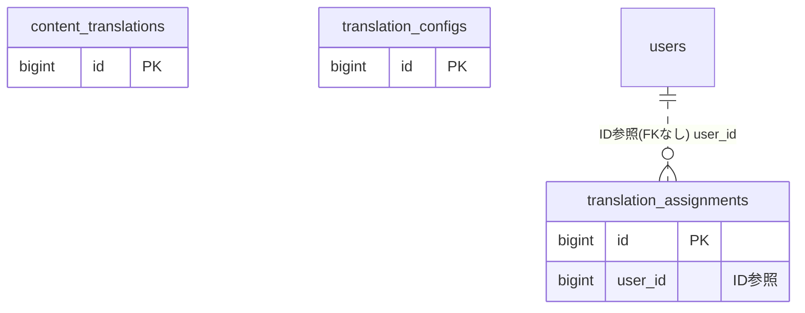

# translation ドメイン ER 図

> このファイルは自動生成されます。手で編集しないでください。再生成: `cd backend && ./gradlew generateErDiagrams`

- テーブル数: 3
- ビュー数: 0

## ER 図

実線 = 外部キー、点線 = ID参照(FKなし)。図中の `FK` は実外部キーの列だけ（ID参照列は `FK` を付けず "ID参照" と注記）。図にはキー列（PK / FK / 参照推定列 / 単一列 UNIQUE）のみを描く。全列は下の「テーブル定義」を参照。

## 被参照（他ドメインから）

このドメインのテーブルを参照している他ドメインの側（実 FK と ID参照のみ。多態参照と推定不能参照は含まない。同一ドメイン内の参照は上の図を参照）。

なし

## 多態参照（線を引かない）

| テーブル | 種別列 | ID列 |
| --- | --- | --- |
| `content_translations` | `scope_type` | `scope_id` |
| `content_translations` | `source_type` | `source_id` |
| `translation_assignments` | `scope_type` | `scope_id` |
| `translation_configs` | `scope_type` | `scope_id` |

## 推定不能参照

| テーブル | 列 | 理由 |
| --- | --- | --- |
| `content_translations` | `reviewer_id` | 参照先テーブルを特定できない |
| `content_translations` | `translator_id` | 参照先テーブルを特定できない |

## テーブル定義

### `content_translations`

| 列名 | 型 | NULL | 既定値 | コメント |
| --- | --- | --- | --- | --- |
| `id` | `bigint unsigned` | NO | （なし） auto_increment |  |
| `scope_type` | `varchar(50)` | NO | （なし） |  |
| `scope_id` | `bigint unsigned` | NO | （なし） |  |
| `source_type` | `varchar(50)` | NO | （なし） | BLOG_POST/ANNOUNCEMENT/KNOWLEDGE_BASE |
| `source_id` | `bigint unsigned` | NO | （なし） |  |
| `language` | `varchar(10)` | NO | （なし） |  |
| `translated_title` | `varchar(300)` | YES | NULL |  |
| `translated_body` | `mediumtext` | YES | NULL |  |
| `translated_excerpt` | `varchar(1000)` | YES | NULL |  |
| `status` | `varchar(20)` | NO | `DRAFT` | DRAFT/IN_REVIEW/PUBLISHED/NEEDS_UPDATE |
| `translator_id` | `bigint unsigned` | YES | NULL |  |
| `reviewer_id` | `bigint unsigned` | YES | NULL |  |
| `source_updated_at` | `datetime` | NO | （なし） | 原文のupdated_atスナップショット |
| `published_at` | `datetime` | YES | NULL |  |
| `version` | `bigint` | NO | `0` |  |
| `created_at` | `datetime(6)` | NO | `CURRENT_TIMESTAMP(6)` （式） |  |
| `updated_at` | `datetime(6)` | NO | `CURRENT_TIMESTAMP(6)` （式） |  |
| `deleted_at` | `datetime` | YES | NULL |  |

### `translation_assignments`

| 列名 | 型 | NULL | 既定値 | コメント |
| --- | --- | --- | --- | --- |
| `id` | `bigint unsigned` | NO | （なし） auto_increment |  |
| `scope_type` | `varchar(50)` | NO | （なし） |  |
| `scope_id` | `bigint unsigned` | NO | （なし） |  |
| `user_id` | `bigint unsigned` | NO | （なし） |  |
| `language` | `varchar(10)` | NO | （なし） |  |
| `is_active` | `tinyint(1)` | NO | `1` |  |
| `created_at` | `datetime(6)` | NO | `CURRENT_TIMESTAMP(6)` （式） |  |
| `updated_at` | `datetime(6)` | NO | `CURRENT_TIMESTAMP(6)` （式） |  |

### `translation_configs`

| 列名 | 型 | NULL | 既定値 | コメント |
| --- | --- | --- | --- | --- |
| `id` | `bigint unsigned` | NO | （なし） auto_increment |  |
| `scope_type` | `varchar(50)` | NO | （なし） |  |
| `scope_id` | `bigint unsigned` | NO | （なし） |  |
| `primary_language` | `varchar(10)` | NO | `ja` | 原文言語 |
| `enabled_languages` | `json` | NO | `_utf8mb4\'[]\'` （式） | 有効な翻訳対象言語コードの配列 |
| `is_auto_detect_reader_language` | `tinyint(1)` | NO | `0` | Accept-Language自動検出 |
| `version` | `bigint` | NO | `0` |  |
| `created_at` | `datetime(6)` | NO | `CURRENT_TIMESTAMP(6)` （式） |  |
| `updated_at` | `datetime(6)` | NO | `CURRENT_TIMESTAMP(6)` （式） |  |
