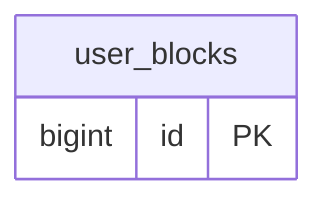

# user ドメイン ER 図

> このファイルは自動生成されます。手で編集しないでください。再生成: `cd backend && ./gradlew generateErDiagrams`

- テーブル数: 1
- ビュー数: 0

## ER 図

実線 = 外部キー、点線 = ID参照(FKなし)。図にはキー列（PK / FK / 参照推定列 / 単一列 UNIQUE）のみを描く。全列は下の「テーブル定義」を参照。

## 推定不能参照

| テーブル | 列 | 理由 |
| --- | --- | --- |
| `user_blocks` | `blocked_id` | 参照先テーブルを特定できない |
| `user_blocks` | `blocker_id` | 参照先テーブルを特定できない |

## テーブル定義

### `user_blocks`

| 列名 | 型 | NULL | 既定値 | コメント |
| --- | --- | --- | --- | --- |
| `id` | `bigint unsigned` | NO | （なし） auto_increment |  |
| `blocker_id` | `bigint unsigned` | NO | （なし） | ブロックした側のユーザーID |
| `blocked_id` | `bigint unsigned` | NO | （なし） | ブロックされた側のユーザーID |
| `created_at` | `datetime` | NO | `CURRENT_TIMESTAMP` （式） |  |
