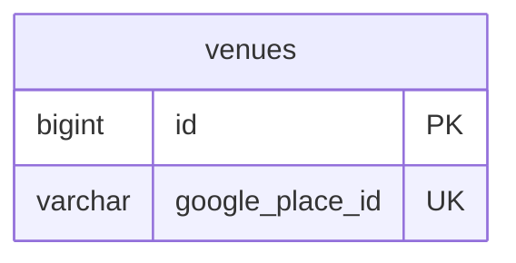

# venue ドメイン ER 図

> このファイルは自動生成されます。手で編集しないでください。再生成: `cd backend && ./gradlew generateErDiagrams`

- テーブル数: 1
- ビュー数: 0

## ER 図

実線 = 外部キー、点線 = ID参照(FKなし)。図中の `FK` は実外部キーの列だけ（ID参照列は `FK` を付けず "ID参照" と注記）。図にはキー列（PK / FK / 参照推定列 / 単一列 UNIQUE）のみを描く。全列は下の「テーブル定義」を参照。

## 被参照（他ドメインから）

このドメインのテーブルを参照している他ドメインの側（実 FK と ID参照のみ。多態参照と推定不能参照は含まない。同一ドメイン内の参照は上の図を参照）。

| 参照元ドメイン | 参照元テーブル | 列 | 種別 | 参照先テーブル |
| --- | --- | --- | --- | --- |
| [activity](activity.md) | `activity_results` | `venue_id` | ID参照 | `venues` |
| [schedule](schedule.md) | `schedules` | `venue_id` | ID参照 | `venues` |

## 推定不能参照

| テーブル | 列 | 理由 |
| --- | --- | --- |
| `venues` | `google_place_id` | 参照先テーブルを特定できない |

## テーブル定義

### `venues`

| 列名 | 型 | NULL | 既定値 | コメント |
| --- | --- | --- | --- | --- |
| `id` | `bigint unsigned` | NO | （なし） auto_increment |  |
| `google_place_id` | `varchar(300)` | YES | NULL | Google Places place_id（手動登録時はNULL） |
| `name` | `varchar(200)` | NO | （なし） | 施設名 |
| `address` | `varchar(500)` | YES | NULL | 住所 |
| `latitude` | `decimal(10,7)` | YES | NULL | 緯度 |
| `longitude` | `decimal(10,7)` | YES | NULL | 経度 |
| `prefecture` | `varchar(20)` | YES | NULL | 都道府県 |
| `city` | `varchar(50)` | YES | NULL | 市区町村 |
| `category` | `varchar(50)` | YES | NULL | 施設カテゴリ（park / stadium / gym 等） |
| `phone_number` | `varchar(30)` | YES | NULL | 電話番号 |
| `website_url` | `varchar(500)` | YES | NULL | WebサイトURL |
| `usage_count` | `int unsigned` | NO | `0` | 利用回数（キャッシュ優先度用） |
| `created_at` | `datetime` | NO | `CURRENT_TIMESTAMP` （式） |  |
| `updated_at` | `datetime` | NO | `CURRENT_TIMESTAMP` （式） |  |
