# village ドメイン ER 図

> このファイルは自動生成されます。手で編集しないでください。再生成: `cd backend && ./gradlew generateErDiagrams`

- テーブル数: 40
- ビュー数: 0

## ER 図

実線 = 外部キー、点線 = ID参照(FKなし)。図中の `FK` は実外部キーの列だけ（ID参照列は `FK` を付けず "ID参照" と注記）。図にはキー列（PK / FK / 参照推定列 / 単一列 UNIQUE）のみを描く。全列は下の「テーブル定義」を参照。

```mermaid
erDiagram
    user_village_nicknames {
        binary id PK
        bigint user_id "ID参照"
        binary village_id "ID参照"
        varchar nickname UK
    }
    user_village_pins {
        binary id PK
        bigint user_id "ID参照"
        binary village_id FK
    }
    village_calendar_event_logs {
        binary id PK
        bigint created_by_user_id "ID参照"
    }
    village_calendar_events {
        binary id PK
        binary village_id FK
        bigint created_by_user_id "ID参照"
    }
    village_categories {
        binary id PK
        binary parent_id FK
    }
    village_charter_articles {
        binary id PK
        binary charter_id FK
        binary village_id "ID参照"
    }
    village_charter_drafters {
        binary id PK
        binary charter_id FK
        bigint user_id "ID参照"
    }
    village_charter_revisions {
        binary id PK
        binary charter_id FK
    }
    village_charters {
        binary id PK
        binary village_id UK "ID参照"
    }
    village_chronicles {
        binary id PK
        binary village_id FK
    }
    village_creation_requests {
        binary id PK
        bigint requester_user_id "ID参照"
        bigint reviewer_user_id "ID参照"
        binary created_village_id "ID参照"
    }
    village_event_archives {
        binary id PK
        binary village_id "ID参照"
    }
    village_festival_live_posts {
        binary festival_id PK
        bigint timeline_post_id PK "ID参照"
    }
    village_festival_rsvps {
        binary id PK
        bigint user_id "ID参照"
    }
    village_festivals {
        binary id PK
        binary village_id FK
        bigint created_by_user_id "ID参照"
    }
    village_invitations {
        binary id PK
        binary village_id "ID参照"
        varchar token_hash UK
        bigint target_user_id "ID参照"
    }
    village_join_requests {
        binary id PK
        binary village_id FK
        bigint requester_user_id "ID参照"
    }
    village_lobby_daily_threads {
        binary id PK
        binary village_id FK
        bigint chat_channel_id "ID参照"
    }
    village_match_recruit_applications {
        binary id PK
        binary recruit_id FK
        bigint applicant_user_id "ID参照"
        bigint applicant_team_id "ID参照"
        bigint reviewed_by_user_id "ID参照"
    }
    village_match_recruits {
        binary id PK
        binary village_id FK
        bigint posted_by_user_id "ID参照"
        bigint posted_by_team_id "ID参照"
        binary category_id FK
    }
    village_meetup_attendances {
        binary id PK
        bigint user_id "ID参照"
    }
    village_meetup_candidate_dates {
        binary id PK
        binary meetup_id FK
    }
    village_meetup_comments {
        binary id PK
        bigint author_user_id "ID参照"
    }
    village_meetup_todos {
        binary id PK
        bigint assignee_user_id "ID参照"
        bigint created_by "ID参照"
    }
    village_meetup_votes {
        binary id PK
        binary candidate_date_id FK
        bigint voter_user_id "ID参照"
    }
    village_meetups {
        binary id PK
        binary village_id FK
        bigint organizer_user_id "ID参照"
    }
    village_memberships {
        binary id PK
        binary village_id FK
    }
    village_newsletter_issue_tags {
        binary id PK
        binary issue_id FK
        binary tag_id FK
    }
    village_newsletter_issues {
        binary id PK
        binary village_id FK
        bigint comment_updated_by "ID参照"
    }
    village_newsletter_opt_outs {
        binary id PK
        binary village_id FK
        bigint user_id "ID参照"
    }
    village_newsletter_send_logs {
        binary id PK
        binary newsletter_id FK
    }
    village_newsletter_tags {
        binary id PK
        binary village_id FK
    }
    village_newsletters {
        binary id PK
        binary village_id FK
    }
    village_pilgrimage_recommendations {
        binary id PK
        bigint user_id "ID参照"
        binary recommended_village_id FK
    }
    village_recruit_categories {
        binary id PK
        binary village_id FK
        bigint created_by "ID参照"
    }
    village_reports {
        binary id PK
        binary village_id FK
        bigint reporter_user_id "ID参照"
    }
    village_representatives {
        binary id PK
        binary village_id FK
        binary membership_id FK
        bigint representative_user_id "ID参照"
        bigint granted_by_user_id "ID参照"
        bigint revoked_by_user_id "ID参照"
    }
    village_serendipity_scores {
        binary id PK
        binary village_id FK
        bigint user_id "ID参照"
    }
    village_user_admission_locks {
        binary id PK
        bigint user_id UK "ID参照"
    }
    villages {
        binary id PK
        varchar slug UK
        varchar name UK
        bigint created_by_user_id "ID参照"
    }
    chat_channels
    teams
    timeline_posts
    users
    users ||..o{ user_village_nicknames : "ID参照(FKなし) user_id"
    villages |o..o{ user_village_nicknames : "ID参照(FKなし) village_id"
    users ||..o{ user_village_pins : "ID参照(FKなし) user_id"
    villages ||--o{ user_village_pins : "village_id"
    users ||..o{ village_calendar_event_logs : "ID参照(FKなし) created_by_user_id"
    users ||..o{ village_calendar_events : "ID参照(FKなし) created_by_user_id"
    villages ||--o{ village_calendar_events : "village_id"
    village_categories |o--o{ village_categories : "parent_id"
    village_charters ||--o{ village_charter_articles : "charter_id"
    villages ||..o{ village_charter_articles : "ID参照(FKなし) village_id"
    users |o..o{ village_charter_drafters : "ID参照(FKなし) user_id"
    village_charters ||--o{ village_charter_drafters : "charter_id"
    village_charters ||--o{ village_charter_revisions : "charter_id"
    villages ||..o| village_charters : "ID参照(FKなし) village_id"
    villages ||--o{ village_chronicles : "village_id"
    users ||..o{ village_creation_requests : "ID参照(FKなし) requester_user_id"
    users |o..o{ village_creation_requests : "ID参照(FKなし) reviewer_user_id"
    villages |o..o{ village_creation_requests : "ID参照(FKなし) created_village_id"
    villages ||..o{ village_event_archives : "ID参照(FKなし) village_id"
    timeline_posts ||..o{ village_festival_live_posts : "ID参照(FKなし) timeline_post_id"
    users ||..o{ village_festival_rsvps : "ID参照(FKなし) user_id"
    users ||..o{ village_festivals : "ID参照(FKなし) created_by_user_id"
    villages ||--o{ village_festivals : "village_id"
    users |o..o{ village_invitations : "ID参照(FKなし) target_user_id"
    villages ||..o{ village_invitations : "ID参照(FKなし) village_id"
    users ||..o{ village_join_requests : "ID参照(FKなし) requester_user_id"
    villages ||--o{ village_join_requests : "village_id"
    chat_channels ||..o{ village_lobby_daily_threads : "ID参照(FKなし) chat_channel_id"
    villages ||--o{ village_lobby_daily_threads : "village_id"
    teams |o..o{ village_match_recruit_applications : "ID参照(FKなし) applicant_team_id"
    users ||..o{ village_match_recruit_applications : "ID参照(FKなし) applicant_user_id"
    users |o..o{ village_match_recruit_applications : "ID参照(FKなし) reviewed_by_user_id"
    village_match_recruits ||--o{ village_match_recruit_applications : "recruit_id"
    teams |o..o{ village_match_recruits : "ID参照(FKなし) posted_by_team_id"
    users ||..o{ village_match_recruits : "ID参照(FKなし) posted_by_user_id"
    village_recruit_categories |o--o{ village_match_recruits : "category_id"
    villages ||--o{ village_match_recruits : "village_id"
    users ||..o{ village_meetup_attendances : "ID参照(FKなし) user_id"
    village_meetups ||--o{ village_meetup_candidate_dates : "meetup_id"
    users ||..o{ village_meetup_comments : "ID参照(FKなし) author_user_id"
    users |o..o{ village_meetup_todos : "ID参照(FKなし) assignee_user_id"
    users ||..o{ village_meetup_todos : "ID参照(FKなし) created_by"
    users ||..o{ village_meetup_votes : "ID参照(FKなし) voter_user_id"
    village_meetup_candidate_dates ||--o{ village_meetup_votes : "candidate_date_id"
    users ||..o{ village_meetups : "ID参照(FKなし) organizer_user_id"
    villages ||--o{ village_meetups : "village_id"
    villages ||--o{ village_memberships : "village_id"
    village_newsletter_issues ||--o{ village_newsletter_issue_tags : "issue_id"
    village_newsletter_tags ||--o{ village_newsletter_issue_tags : "tag_id"
    users |o..o{ village_newsletter_issues : "ID参照(FKなし) comment_updated_by"
    villages ||--o{ village_newsletter_issues : "village_id"
    users ||..o{ village_newsletter_opt_outs : "ID参照(FKなし) user_id"
    villages ||--o{ village_newsletter_opt_outs : "village_id"
    village_newsletters ||--o{ village_newsletter_send_logs : "newsletter_id"
    villages ||--o{ village_newsletter_tags : "village_id"
    villages ||--o{ village_newsletters : "village_id"
    users ||..o{ village_pilgrimage_recommendations : "ID参照(FKなし) user_id"
    villages ||--o{ village_pilgrimage_recommendations : "recommended_village_id"
    users |o..o{ village_recruit_categories : "ID参照(FKなし) created_by"
    villages ||--o{ village_recruit_categories : "village_id"
    users ||..o{ village_reports : "ID参照(FKなし) reporter_user_id"
    villages ||--o{ village_reports : "village_id"
    users ||..o{ village_representatives : "ID参照(FKなし) granted_by_user_id"
    users ||..o{ village_representatives : "ID参照(FKなし) representative_user_id"
    users |o..o{ village_representatives : "ID参照(FKなし) revoked_by_user_id"
    village_memberships ||--o{ village_representatives : "membership_id"
    villages ||--o{ village_representatives : "village_id"
    users ||..o{ village_serendipity_scores : "ID参照(FKなし) user_id"
    villages ||--o{ village_serendipity_scores : "village_id"
    users ||..o| village_user_admission_locks : "ID参照(FKなし) user_id"
    users |o..o{ villages : "ID参照(FKなし) created_by_user_id"
```

## 被参照（他ドメインから）

このドメインのテーブルを参照している他ドメインの側（実 FK と ID参照のみ。多態参照と推定不能参照は含まない。同一ドメイン内の参照は上の図を参照）。

| 参照元ドメイン | 参照元テーブル | 列 | 種別 | 参照先テーブル |
| --- | --- | --- | --- | --- |
| [bulletin](bulletin.md) | `bulletin_archive_folders` | `scope_village_id` | ID参照 | `villages` |
| [bulletin](bulletin.md) | `bulletin_categories` | `scope_village_id` | ID参照 | `villages` |
| [bulletin](bulletin.md) | `bulletin_threads` | `scope_village_id` | ID参照 | `villages` |
| [chat](chat.md) | `chat_channels` | `village_id` | ID参照 | `villages` |
| [timeline](timeline.md) | `timeline_posts` | `scope_village_id` | ID参照 | `villages` |

## 自己参照

mermaid は同一テーブルの自己参照を複数描けず 1 本に畳むため、図に線が欠けることがある。自己参照はこの表を正とする。

| テーブル | 列 | 種別 |
| --- | --- | --- |
| `village_categories` | `parent_id` | 外部キー |

## 多態参照（線を引かない）

| テーブル | 種別列 | ID列 |
| --- | --- | --- |
| `village_event_archives` | `source_type` | `source_id` |
| `village_join_requests` | `subject_type` | `subject_id` |
| `village_memberships` | `subject_type` | `subject_id` |

## 推定不能参照

| テーブル | 列 | 理由 |
| --- | --- | --- |
| `village_calendar_event_logs` | `calendar_event_id` | 型が参照先 events.id と不一致（binary ≠ bigint） |
| `village_festival_live_posts` | `festival_id` | 参照先テーブルを特定できない |
| `village_festival_rsvps` | `festival_id` | 参照先テーブルを特定できない |
| `village_invitations` | `created_by_membership_id` | 型が参照先 memberships.id と不一致（binary ≠ bigint） |
| `village_join_requests` | `reviewer_membership_id` | 型が参照先 memberships.id と不一致（binary ≠ bigint） |
| `village_meetup_attendances` | `meetup_id` | 参照先テーブルを特定できない |
| `village_meetup_comments` | `meetup_id` | 参照先テーブルを特定できない |
| `village_meetup_todos` | `meetup_id` | 参照先テーブルを特定できない |
| `village_memberships` | `invited_by_membership_id` | 型が参照先 memberships.id と不一致（binary ≠ bigint） |
| `village_newsletter_issues` | `newsletter_id` | 参照先テーブルを特定できない |
| `village_newsletter_send_logs` | `issue_id` | 参照先テーブルを特定できない |
| `village_reports` | `handler_membership_id` | 型が参照先 memberships.id と不一致（binary ≠ bigint） |
| `village_reports` | `target_ref_id` | 参照先テーブルを特定できない |

## テーブル定義

### `user_village_nicknames`

| 列名 | 型 | NULL | 既定値 | コメント |
| --- | --- | --- | --- | --- |
| `id` | `binary(16)` | NO | （なし） | UUIDv7 PK |
| `user_id` | `bigint unsigned` | NO | （なし） | ユーザーID（FK 張らない） |
| `village_id` | `binary(16)` | YES | NULL | NULL=全村共通（Phase 1）/ 値=村別上書き（Phase 2） |
| `nickname` | `varchar(40)` | NO | （なし） | 村ニックネーム（プラットフォーム全体で一意） |
| `avatar_r2_key` | `varchar(255)` | YES | NULL | アバター（NULL なら共通アバター） |
| `bio` | `varchar(500)` | YES | NULL | 村内プロフィール一言 |
| `last_changed_at` | `datetime(6)` | NO | `CURRENT_TIMESTAMP(6)` （式） | スロットリング用 |
| `change_count_this_month` | `bigint unsigned` | NO | `0` | 月内変更回数（ロールバック式） |
| `created_at` | `datetime(6)` | NO | `CURRENT_TIMESTAMP(6)` （式） |  |
| `updated_at` | `datetime(6)` | NO | `CURRENT_TIMESTAMP(6)` （式） |  |

### `user_village_pins`

| 列名 | 型 | NULL | 既定値 | コメント |
| --- | --- | --- | --- | --- |
| `id` | `binary(16)` | NO | （なし） | UUIDv7 PK |
| `user_id` | `bigint unsigned` | NO | （なし） | ユーザーID（FK 張らない） |
| `village_id` | `binary(16)` | NO | （なし） |  |
| `sort_order` | `bigint unsigned` | NO | `0` | 並び順（小さいほど上） |
| `pinned_at` | `datetime(6)` | NO | `CURRENT_TIMESTAMP(6)` （式） |  |

### `village_calendar_event_logs`

| 列名 | 型 | NULL | 既定値 | コメント |
| --- | --- | --- | --- | --- |
| `id` | `binary(16)` | NO | （なし） | UUIDv7 PK |
| `calendar_event_id` | `binary(16)` | NO | （なし） | → village_calendar_events.id（同一ドメイン・FK非付与/index） |
| `year` | `smallint` | NO | （なし） | 記録対象の西暦年（例 2026） |
| `photo_r2_key` | `varchar(255)` | YES | NULL | 写真（R2キー・MediaUrlResolver で署名URL化） |
| `note` | `varchar(300)` | YES | NULL | 一言メモ |
| `created_by_user_id` | `bigint unsigned` | NO | （なし） | 記録者（FK 張らない・原則1） |
| `deleted_at` | `datetime(6)` | YES | NULL | 論理削除 |
| `created_at` | `datetime(6)` | NO | `CURRENT_TIMESTAMP(6)` （式） |  |
| `updated_at` | `datetime(6)` | NO | `CURRENT_TIMESTAMP(6)` （式） |  |
| `version` | `bigint` | NO | `0` | 楽観ロック |

### `village_calendar_events`

| 列名 | 型 | NULL | 既定値 | コメント |
| --- | --- | --- | --- | --- |
| `id` | `binary(16)` | NO | （なし） | UUIDv7 PK |
| `village_id` | `binary(16)` | NO | （なし） | FK → villages.id（同一ドメイン CASCADE） |
| `title` | `varchar(100)` | NO | （なし） | イベント名 |
| `description` | `text` | YES | NULL | 説明 |
| `event_date` | `date` | NO | （なし） | 基準日（is_annual_recurring=TRUE 時は年無視・月日のみ意味あり） |
| `event_end_date` | `date` | YES | NULL | 複数日イベントの終了日（NULL = 単日） |
| `is_annual_recurring` | `tinyint(1)` | NO | `1` | 毎年繰返すか（TRUE: 年中行事 / FALSE: 単発） |
| `icon_emoji` | `varchar(20)` | YES | NULL | 表示絵文字（? ? ⛄ など） |
| `color_hex` | `char(7)` | YES | NULL | カレンダー表示色 #RRGGBB |
| `created_by_user_id` | `bigint unsigned` | NO | （なし） | 作成者ユーザーID（FK 張らない・原則1） |
| `deleted_at` | `datetime(6)` | YES | NULL | 論理削除 |
| `created_at` | `datetime(6)` | NO | `CURRENT_TIMESTAMP(6)` （式） |  |
| `updated_at` | `datetime(6)` | NO | `CURRENT_TIMESTAMP(6)` （式） |  |
| `version` | `bigint` | NO | `0` | 楽観ロック |

### `village_categories`

| 列名 | 型 | NULL | 既定値 | コメント |
| --- | --- | --- | --- | --- |
| `id` | `binary(16)` | NO | （なし） | UUIDv7 主キー |
| `name` | `varchar(64)` | NO | （なし） | カテゴリ名 |
| `parent_id` | `binary(16)` | YES | NULL | 親カテゴリID（NULL = ルート） |
| `display_order` | `int` | NO | `0` | 表示順（10刻み推奨） |
| `created_at` | `datetime(6)` | NO | （なし） |  |
| `updated_at` | `datetime(6)` | NO | （なし） |  |
| `deleted_at` | `datetime(6)` | YES | NULL |  |

### `village_charter_articles`

| 列名 | 型 | NULL | 既定値 | コメント |
| --- | --- | --- | --- | --- |
| `id` | `binary(16)` | NO | （なし） | UUIDv7 PK |
| `charter_id` | `binary(16)` | NO | （なし） | → village_charters.id（同一ドメイン・FK CASCADE） |
| `village_id` | `binary(16)` | NO | （なし） | 村スコープの冗長列（IDOR 照合用・§AC-08） |
| `sort_order` | `int` | NO | （なし） | 0始まり連番（表示採番の元・UNIQUE張らない・§6.2） |
| `body` | `text` | NO | （なし） | 条文（必須） |
| `supplement` | `text` | YES | NULL | 付則（任意） |
| `version` | `bigint` | NO | `0` | @Version（本文更新＝層1 楽観ロック・§7） |
| `deleted_at` | `datetime(6)` | YES | NULL | 論理削除（原則3・削除後は再連番から除外） |
| `created_at` | `datetime(6)` | NO | `CURRENT_TIMESTAMP(6)` （式） |  |
| `updated_at` | `datetime(6)` | NO | `CURRENT_TIMESTAMP(6)` （式） |  |

### `village_charter_drafters`

| 列名 | 型 | NULL | 既定値 | コメント |
| --- | --- | --- | --- | --- |
| `id` | `binary(16)` | NO | （なし） | UUIDv7 PK |
| `charter_id` | `binary(16)` | NO | （なし） | → village_charters.id（同一ドメイン・FK CASCADE） |
| `user_id` | `bigint unsigned` | YES | NULL | 策定者（FK非付与・退会時 NULL 化・原則1/4） |
| `nickname_snapshot` | `varchar(40)` | NO | （なし） | 制定/追加時の村ニックネーム焼付（退会後も残置・§5.2） |
| `sort_order` | `int` | NO | （なし） | 表示順（0始まり・末尾追加） |
| `created_at` | `datetime(6)` | NO | `CURRENT_TIMESTAMP(6)` （式） |  |
| `updated_at` | `datetime(6)` | NO | `CURRENT_TIMESTAMP(6)` （式） |  |

### `village_charter_revisions`

| 列名 | 型 | NULL | 既定値 | コメント |
| --- | --- | --- | --- | --- |
| `id` | `binary(16)` | NO | （なし） | UUIDv7 PK |
| `charter_id` | `binary(16)` | NO | （なし） | → village_charters.id（同一ドメイン・FK CASCADE） |
| `revised_at` | `datetime(6)` | NO | （なし） | 改定日時（「改正を確定」時刻・§8.2） |
| `note` | `varchar(200)` | YES | NULL | 任意メモ（条文スナップショット無し・§8.3） |
| `created_at` | `datetime(6)` | NO | `CURRENT_TIMESTAMP(6)` （式） |  |

### `village_charters`

| 列名 | 型 | NULL | 既定値 | コメント |
| --- | --- | --- | --- | --- |
| `id` | `binary(16)` | NO | （なし） | UUIDv7 PK |
| `village_id` | `binary(16)` | NO | （なし） | 村スコープ（FK非付与＋UNIQUE・原則1/村既存作法） |
| `enacted_at` | `datetime(6)` | NO | （なし） | 制定日（初回作成時に自動セット・不変・§8.1） |
| `last_revised_at` | `datetime(6)` | YES | NULL | 改定日（手動「改正を確定」・未改正はNULL・§8.2） |
| `version` | `bigint` | NO | `0` | @Version（層2・PATCH order 楽観検査＋全構造変更でバンプ・§7） |
| `deleted_at` | `datetime(6)` | YES | NULL | 論理削除（原則3） |
| `created_at` | `datetime(6)` | NO | `CURRENT_TIMESTAMP(6)` （式） |  |
| `updated_at` | `datetime(6)` | NO | `CURRENT_TIMESTAMP(6)` （式） |  |

### `village_chronicles`

| 列名 | 型 | NULL | 既定値 | コメント |
| --- | --- | --- | --- | --- |
| `id` | `binary(16)` | NO | （なし） | UUIDv7 PK |
| `village_id` | `binary(16)` | NO | （なし） | FK → villages.id（同一ドメイン CASCADE） |
| `year_month` | `date` | NO | （なし） | 対象年月の1日（例: 2026-05-01） |
| `generated_at` | `datetime(6)` | NO | （なし） | 本レコード生成時刻 |
| `post_count` | `int unsigned` | NO | `0` | 当月の投稿数（bulletin_threads + timeline_posts の VILLAGE スコープ） |
| `new_member_count` | `int unsigned` | NO | `0` | 当月新規参加メンバー数 |
| `topic_1_name` | `varchar(100)` | YES | NULL | TOP1 トピック名 |
| `topic_1_count` | `int unsigned` | NO | `0` | TOP1 出現数 |
| `topic_2_name` | `varchar(100)` | YES | NULL | TOP2 トピック名 |
| `topic_2_count` | `int unsigned` | NO | `0` | TOP2 出現数 |
| `topic_3_name` | `varchar(100)` | YES | NULL | TOP3 トピック名 |
| `topic_3_count` | `int unsigned` | NO | `0` | TOP3 出現数 |
| `created_at` | `datetime(6)` | NO | `CURRENT_TIMESTAMP(6)` （式） |  |
| `updated_at` | `datetime(6)` | NO | `CURRENT_TIMESTAMP(6)` （式） |  |
| `version` | `bigint` | NO | `0` | 楽観ロック |

### `village_creation_requests`

| 列名 | 型 | NULL | 既定値 | コメント |
| --- | --- | --- | --- | --- |
| `id` | `binary(16)` | NO | （なし） | UUIDv7 PK |
| `requester_user_id` | `bigint unsigned` | NO | （なし） | 申請者（FK 張らない） |
| `proposed_name` | `varchar(100)` | NO | （なし） |  |
| `proposed_slug` | `varchar(64)` | NO | （なし） |  |
| `proposed_category` | `varchar(64)` | YES | NULL |  |
| `purpose` | `text` | NO | （なし） | 申請理由 |
| `proposed_guideline_md` | `mediumtext` | YES | NULL |  |
| `status` | `varchar(20)` | NO | `PENDING` | PENDING/APPROVED/REJECTED/WITHDRAWN |
| `reviewer_user_id` | `bigint unsigned` | YES | NULL | 審査担当（運営） |
| `review_comment` | `text` | YES | NULL |  |
| `reviewed_at` | `datetime(6)` | YES | NULL |  |
| `created_village_id` | `binary(16)` | YES | NULL | 承認時に作成された村ID |
| `created_at` | `datetime(6)` | NO | `CURRENT_TIMESTAMP(6)` （式） |  |
| `updated_at` | `datetime(6)` | NO | `CURRENT_TIMESTAMP(6)` （式） |  |

### `village_event_archives`

| 列名 | 型 | NULL | 既定値 | コメント |
| --- | --- | --- | --- | --- |
| `id` | `binary(16)` | NO | （なし） | UUIDv7 PK |
| `village_id` | `binary(16)` | NO | （なし） | 村スコープ（FK非付与・原則1） |
| `source_type` | `varchar(20)` | NO | （なし） | FESTIVAL / CALENDAR_EVENT / MEETUP |
| `source_id` | `binary(16)` | NO | （なし） | 元行事の UUID（ID参照のみ・FK非付与） |
| `title` | `varchar(200)` | NO | （なし） | 編纂時に焼き付けた表題 |
| `summary` | `text` | YES | NULL | 編纂サマリ（RSVP集計・実況件数等をテキスト化） |
| `thumbnail_r2_key` | `varchar(255)` | YES | NULL | 代表画像（祭バナー等の複写・任意） |
| `archived_at` | `datetime(6)` | NO | （なし） | 編纂時刻 |
| `deleted_at` | `datetime(6)` | YES | NULL | 論理削除 |
| `created_at` | `datetime(6)` | NO | `CURRENT_TIMESTAMP(6)` （式） |  |
| `updated_at` | `datetime(6)` | NO | `CURRENT_TIMESTAMP(6)` （式） |  |
| `version` | `bigint` | NO | `0` | 楽観ロック |

### `village_festival_live_posts`

| 列名 | 型 | NULL | 既定値 | コメント |
| --- | --- | --- | --- | --- |
| `festival_id` | `binary(16)` | NO | （なし） | → village_festivals.id（同一ドメイン・FK非付与） |
| `timeline_post_id` | `bigint unsigned` | NO | （なし） | → timeline_posts.id（別ドメイン timeline・ID参照のみ・FK非付与・原則1） |
| `created_at` | `datetime(6)` | NO | `CURRENT_TIMESTAMP(6)` （式） |  |

### `village_festival_rsvps`

| 列名 | 型 | NULL | 既定値 | コメント |
| --- | --- | --- | --- | --- |
| `id` | `binary(16)` | NO | （なし） | UUIDv7 PK |
| `festival_id` | `binary(16)` | NO | （なし） | → village_festivals.id（同一ドメイン・FK非付与/index） |
| `user_id` | `bigint unsigned` | NO | （なし） | 参加表明した村人（FK 張らない・原則1） |
| `status` | `varchar(20)` | NO | （なし） | GOING / MAYBE（ABSENT なし） |
| `role_label` | `varchar(60)` | YES | NULL | 役割の自由記述ラベル（NULL=役割なし・§5.3） |
| `created_at` | `datetime(6)` | NO | `CURRENT_TIMESTAMP(6)` （式） |  |
| `updated_at` | `datetime(6)` | NO | `CURRENT_TIMESTAMP(6)` （式） |  |
| `version` | `bigint` | NO | `0` | 楽観ロック |

### `village_festivals`

| 列名 | 型 | NULL | 既定値 | コメント |
| --- | --- | --- | --- | --- |
| `id` | `binary(16)` | NO | （なし） | UUIDv7 PK |
| `village_id` | `binary(16)` | NO | （なし） | FK → villages.id（同一ドメイン CASCADE） |
| `title` | `varchar(100)` | NO | （なし） | お祭り名 |
| `description` | `text` | YES | NULL | お祭り紹介文 |
| `starts_at` | `datetime(6)` | NO | （なし） | 開始（UTC） |
| `ends_at` | `datetime(6)` | NO | （なし） | 終了（UTC） |
| `banner_r2_key` | `varchar(255)` | YES | NULL | バナー画像 R2 キー |
| `theme_color_hex` | `char(7)` | YES | NULL | テーマ色 #RRGGBB |
| `status` | `varchar(20)` | NO | `SCHEDULED` | SCHEDULED / ACTIVE / ENDED / CANCELLED |
| `created_by_user_id` | `bigint unsigned` | NO | （なし） | 作成者ユーザーID（FK 張らない・原則1） |
| `deleted_at` | `datetime(6)` | YES | NULL | 論理削除 |
| `created_at` | `datetime(6)` | NO | `CURRENT_TIMESTAMP(6)` （式） |  |
| `updated_at` | `datetime(6)` | NO | `CURRENT_TIMESTAMP(6)` （式） |  |
| `version` | `bigint` | NO | `0` | 楽観ロック |

### `village_invitations`

| 列名 | 型 | NULL | 既定値 | コメント |
| --- | --- | --- | --- | --- |
| `id` | `binary(16)` | NO | （なし） | UUIDv7 PK |
| `village_id` | `binary(16)` | NO | （なし） |  |
| `token_hash` | `varchar(64)` | NO | （なし） | トークンのSHA-256ハッシュ(hex)。平文は保存しない |
| `target_user_id` | `bigint unsigned` | YES | NULL | 指名制招待の宛先。NULLならリンク型招待 |
| `expires_at` | `timestamp(6)` | NO | （なし） | 無期限の招待を作れないようNOT NULL |
| `max_uses` | `int` | NO | （なし） | 無制限の招待を作れないようNOT NULL |
| `used_count` | `int` | NO | `0` |  |
| `revoked_at` | `timestamp(6)` | YES | NULL |  |
| `created_by_membership_id` | `binary(16)` | NO | （なし） | 発行した村長/長老の村メンバーシップID |
| `created_at` | `timestamp(6)` | NO | `CURRENT_TIMESTAMP(6)` （式） |  |
| `updated_at` | `timestamp(6)` | NO | `CURRENT_TIMESTAMP(6)` （式） |  |

### `village_join_requests`

| 列名 | 型 | NULL | 既定値 | コメント |
| --- | --- | --- | --- | --- |
| `id` | `binary(16)` | NO | （なし） | UUIDv7 PK |
| `village_id` | `binary(16)` | NO | （なし） |  |
| `subject_type` | `varchar(20)` | NO | （なし） | USER/TEAM/ORGANIZATION |
| `subject_id` | `bigint unsigned` | NO | （なし） |  |
| `requester_user_id` | `bigint unsigned` | NO | （なし） | 申請を出した操作者 |
| `message` | `varchar(500)` | YES | NULL | 志望動機 |
| `status` | `varchar(20)` | NO | `PENDING` | PENDING/APPROVED/REJECTED/WITHDRAWN |
| `reviewer_membership_id` | `binary(16)` | YES | NULL | 審査した村長/長老のメンバーシップID |
| `reviewed_at` | `datetime(6)` | YES | NULL |  |
| `review_comment` | `varchar(500)` | YES | NULL |  |
| `created_at` | `datetime(6)` | NO | `CURRENT_TIMESTAMP(6)` （式） |  |
| `updated_at` | `datetime(6)` | NO | `CURRENT_TIMESTAMP(6)` （式） |  |

### `village_lobby_daily_threads`

| 列名 | 型 | NULL | 既定値 | コメント |
| --- | --- | --- | --- | --- |
| `id` | `binary(16)` | NO | （なし） | UUIDv7 PK |
| `village_id` | `binary(16)` | NO | （なし） |  |
| `thread_date` | `date` | NO | （なし） | スレッドの日付（村のローカル日） |
| `chat_channel_id` | `bigint unsigned` | NO | （なし） | 対応するチャットチャンネル（FK 張らない / 原則1） |
| `summary` | `text` | YES | NULL | AI による日次サマリ（Phase 2 以降） |
| `message_count_cache` | `bigint unsigned` | NO | `0` |  |
| `created_at` | `datetime(6)` | NO | `CURRENT_TIMESTAMP(6)` （式） |  |
| `updated_at` | `datetime(6)` | NO | `CURRENT_TIMESTAMP(6)` （式） |  |
| `deleted_at` | `datetime(6)` | YES | NULL |  |

### `village_match_recruit_applications`

| 列名 | 型 | NULL | 既定値 | コメント |
| --- | --- | --- | --- | --- |
| `id` | `binary(16)` | NO | （なし） | UUIDv7 PK |
| `recruit_id` | `binary(16)` | NO | （なし） | FK → village_match_recruits.id（同一ドメイン CASCADE） |
| `applicant_user_id` | `bigint unsigned` | NO | （なし） | 応募者ユーザーID（FK 張らない・原則1） |
| `applicant_team_id` | `bigint unsigned` | YES | NULL | チーム応募の場合のチームID（FK 張らない・原則1） |
| `message` | `text` | YES | NULL | 応募メッセージ |
| `status` | `varchar(20)` | NO | `PENDING` | PENDING / ACCEPTED / REJECTED / WITHDRAWN |
| `reviewed_by_user_id` | `bigint unsigned` | YES | NULL | 審査ユーザーID（FK 張らない・原則1） |
| `reviewed_at` | `datetime(6)` | YES | NULL | 審査日時 |
| `review_comment` | `text` | YES | NULL | 審査コメント |
| `created_at` | `datetime(6)` | NO | `CURRENT_TIMESTAMP(6)` （式） |  |
| `updated_at` | `datetime(6)` | NO | `CURRENT_TIMESTAMP(6)` （式） |  |
| `version` | `bigint` | NO | `0` | 楽観ロック |

### `village_match_recruits`

| 列名 | 型 | NULL | 既定値 | コメント |
| --- | --- | --- | --- | --- |
| `id` | `binary(16)` | NO | （なし） | UUIDv7 PK |
| `village_id` | `binary(16)` | NO | （なし） | FK → villages.id（同一ドメイン CASCADE） |
| `posted_by_user_id` | `bigint unsigned` | NO | （なし） | 募集投稿者ユーザーID（FK 張らない・原則1） |
| `posted_by_team_id` | `bigint unsigned` | YES | NULL | チーム代表として投稿の場合のチームID（FK 張らない・原則1） |
| `category` | `varchar(30)` | NO | （なし） | PRACTICE_MATCH / REFEREE / VENUE / OTHER |
| `category_id` | `binary(16)` | YES | NULL | FK → village_recruit_categories.id（同一ドメイン） |
| `title` | `varchar(100)` | NO | （なし） | 募集タイトル |
| `description` | `text` | YES | NULL | 詳細説明 |
| `match_date` | `date` | YES | NULL | 予定日（任意。日付を持たない募集もあるため NULL 可・F17.1 §5.6） |
| `match_time_start` | `time` | YES | NULL | 開始時刻 |
| `match_time_end` | `time` | YES | NULL | 終了時刻 |
| `venue` | `varchar(200)` | YES | NULL | 場所（自由文字列） |
| `required_count` | `smallint unsigned` | YES | NULL | 募集人数 / チーム数 |
| `contact_method` | `varchar(200)` | YES | NULL | 連絡方法（自由文字列） |
| `application_deadline` | `datetime(6)` | YES | NULL | 応募締切（UTC） |
| `status` | `varchar(20)` | NO | `OPEN` | OPEN / CLOSED / FULFILLED / CANCELLED |
| `deleted_at` | `datetime(6)` | YES | NULL | 論理削除 |
| `created_at` | `datetime(6)` | NO | `CURRENT_TIMESTAMP(6)` （式） |  |
| `updated_at` | `datetime(6)` | NO | `CURRENT_TIMESTAMP(6)` （式） |  |
| `version` | `bigint` | NO | `0` | 楽観ロック |

### `village_meetup_attendances`

| 列名 | 型 | NULL | 既定値 | コメント |
| --- | --- | --- | --- | --- |
| `id` | `binary(16)` | NO | （なし） | UUIDv7 PK |
| `meetup_id` | `binary(16)` | NO | （なし） | → village_meetups.id（同一ドメイン・FK非付与/index） |
| `user_id` | `bigint unsigned` | NO | （なし） | 出欠を答えた村人（FK 張らない・原則1） |
| `status` | `varchar(20)` | NO | （なし） | GOING / MAYBE / ABSENT |
| `created_at` | `datetime(6)` | NO | `CURRENT_TIMESTAMP(6)` （式） |  |
| `updated_at` | `datetime(6)` | NO | `CURRENT_TIMESTAMP(6)` （式） |  |
| `version` | `bigint` | NO | `0` | 楽観ロック |

### `village_meetup_candidate_dates`

| 列名 | 型 | NULL | 既定値 | コメント |
| --- | --- | --- | --- | --- |
| `id` | `binary(16)` | NO | （なし） | UUIDv7 PK |
| `meetup_id` | `binary(16)` | NO | （なし） | FK → village_meetups.id（同一ドメイン CASCADE） |
| `candidate_date` | `date` | NO | （なし） | 候補日 |
| `candidate_time` | `time` | YES | NULL | 候補の時刻（任意・NULL は終日） |
| `sort_order` | `smallint unsigned` | NO | `0` | 表示順 |
| `created_at` | `datetime(6)` | NO | `CURRENT_TIMESTAMP(6)` （式） |  |

### `village_meetup_comments`

| 列名 | 型 | NULL | 既定値 | コメント |
| --- | --- | --- | --- | --- |
| `id` | `binary(16)` | NO | （なし） | UUIDv7 PK |
| `meetup_id` | `binary(16)` | NO | （なし） | → village_meetups.id（同一ドメイン・FK非付与/index） |
| `author_user_id` | `bigint unsigned` | NO | （なし） | 投稿者ユーザーID（FK 張らない・原則1） |
| `body` | `text` | NO | （なし） | コメント本文 |
| `deleted_at` | `datetime(6)` | YES | NULL | 論理削除 |
| `created_at` | `datetime(6)` | NO | `CURRENT_TIMESTAMP(6)` （式） |  |
| `updated_at` | `datetime(6)` | NO | `CURRENT_TIMESTAMP(6)` （式） |  |
| `version` | `bigint` | NO | `0` | 楽観ロック |

### `village_meetup_todos`

| 列名 | 型 | NULL | 既定値 | コメント |
| --- | --- | --- | --- | --- |
| `id` | `binary(16)` | NO | （なし） | UUIDv7 PK |
| `meetup_id` | `binary(16)` | NO | （なし） | → village_meetups.id（同一ドメイン・FK非付与/index） |
| `title` | `varchar(200)` | NO | （なし） | 宿題のタイトル |
| `assignee_user_id` | `bigint unsigned` | YES | NULL | 担当者（NULL=手挙げ待ち・未割当。FK 張らない・原則1） |
| `done_at` | `datetime(6)` | YES | NULL | 完了時刻（NULL=未完） |
| `created_by` | `bigint unsigned` | NO | （なし） | 作成者（幹事想定・FK 張らない・原則1） |
| `deleted_at` | `datetime(6)` | YES | NULL | 論理削除 |
| `created_at` | `datetime(6)` | NO | `CURRENT_TIMESTAMP(6)` （式） |  |
| `updated_at` | `datetime(6)` | NO | `CURRENT_TIMESTAMP(6)` （式） |  |
| `version` | `bigint` | NO | `0` | 楽観ロック |

### `village_meetup_votes`

| 列名 | 型 | NULL | 既定値 | コメント |
| --- | --- | --- | --- | --- |
| `id` | `binary(16)` | NO | （なし） | UUIDv7 PK |
| `candidate_date_id` | `binary(16)` | NO | （なし） | FK → village_meetup_candidate_dates.id（同一ドメイン CASCADE） |
| `voter_user_id` | `bigint unsigned` | NO | （なし） | 投票者ユーザーID（FK 張らない・原則1） |
| `vote_type` | `varchar(20)` | NO | （なし） | AVAILABLE / MAYBE / UNAVAILABLE |
| `voted_at` | `datetime(6)` | NO | `CURRENT_TIMESTAMP(6)` （式） |  |

### `village_meetups`

| 列名 | 型 | NULL | 既定値 | コメント |
| --- | --- | --- | --- | --- |
| `id` | `binary(16)` | NO | （なし） | UUIDv7 PK |
| `village_id` | `binary(16)` | NO | （なし） | FK → villages.id（同一ドメイン CASCADE） |
| `title` | `varchar(200)` | NO | （なし） | 寄合のタイトル |
| `description` | `text` | YES | NULL | 寄合の説明 |
| `organizer_user_id` | `bigint unsigned` | NO | （なし） | 幹事ユーザーID（FK 張らない・原則1） |
| `status` | `varchar(20)` | NO | `PLANNING` | PLANNING / CONFIRMED / CANCELLED |
| `confirmed_date` | `date` | YES | NULL | 確定日（CONFIRMED 時のみセット） |
| `confirmed_time` | `time` | YES | NULL | 確定時刻（CONFIRMED 時のみセット・NULL は終日） |
| `location` | `varchar(300)` | YES | NULL | 集合場所（任意） |
| `decisions_note` | `text` | YES | NULL | 決まったこと（幹事が記す自由記述メモ） |
| `capacity` | `int` | YES | NULL | GOING出欠の定員（NULL=無制限・GOINGのみに効く） |
| `deleted_at` | `datetime(6)` | YES | NULL | 論理削除 |
| `created_at` | `datetime(6)` | NO | `CURRENT_TIMESTAMP(6)` （式） |  |
| `updated_at` | `datetime(6)` | NO | `CURRENT_TIMESTAMP(6)` （式） |  |
| `version` | `bigint` | NO | `0` | 楽観ロック |

### `village_memberships`

| 列名 | 型 | NULL | 既定値 | コメント |
| --- | --- | --- | --- | --- |
| `id` | `binary(16)` | NO | （なし） | UUIDv7 PK |
| `village_id` | `binary(16)` | NO | （なし） | FK → villages.id（同一ドメイン） |
| `subject_type` | `varchar(20)` | NO | （なし） | 参加主体 (USER/TEAM/ORGANIZATION) |
| `subject_id` | `bigint unsigned` | NO | （なし） | 参加主体ID（FK 張らない / 原則1） |
| `role` | `varchar(20)` | NO | `VILLAGER` | 村内ロール (HEADMAN/ELDER/VILLAGER/VISITOR) |
| `joined_at` | `datetime(6)` | NO | `CURRENT_TIMESTAMP(6)` （式） |  |
| `left_at` | `datetime(6)` | YES | NULL | 退村日（論理削除） |
| `banned_at` | `datetime(6)` | YES | NULL | BAN日（モデレーション） |
| `banned_reason` | `varchar(500)` | YES | NULL |  |
| `profile_public` | `tinyint(1)` | NO | `0` | この村への所属を所属村一覧（GET /users/{id}/villages）に公開してよいか（既定 FALSE=非公開） |
| `invited_by_membership_id` | `binary(16)` | YES | NULL | 招待元メンバーシップ（オプション・同一ドメイン） |
| `created_at` | `datetime(6)` | NO | `CURRENT_TIMESTAMP(6)` （式） |  |
| `updated_at` | `datetime(6)` | NO | `CURRENT_TIMESTAMP(6)` （式） |  |
| `version` | `bigint` | NO | `0` |  |
| `user_slot` | `smallint unsigned` | YES | NULL | USERの在籍村slot。現役は1..天井（1000）、退村履歴は保持可 |
| `active_user_slot` | `smallint unsigned` | YES | NULL |  |
| `active_marker` | `tinyint unsigned` | YES | NULL |  |

### `village_newsletter_issue_tags`

| 列名 | 型 | NULL | 既定値 | コメント |
| --- | --- | --- | --- | --- |
| `id` | `binary(16)` | NO | （なし） | UUIDv7 PK（原則6） |
| `issue_id` | `binary(16)` | NO | （なし） | FK → village_newsletter_issues.id（同一ドメイン CASCADE） |
| `tag_id` | `binary(16)` | NO | （なし） | FK → village_newsletter_tags.id（同一ドメイン CASCADE） |
| `created_at` | `datetime(6)` | NO | `CURRENT_TIMESTAMP(6)` （式） |  |

### `village_newsletter_issues`

| 列名 | 型 | NULL | 既定値 | コメント |
| --- | --- | --- | --- | --- |
| `id` | `binary(16)` | NO | （なし） | UUIDv7 PK（原則6） |
| `village_id` | `binary(16)` | NO | （なし） | FK → villages.id（同一ドメイン CASCADE） |
| `newsletter_id` | `binary(16)` | YES | NULL | village_newsletters.id。号外は NULL。FK は張らない（設定削除で号 archive を巻き込まない） |
| `frequency` | `varchar(20)` | YES | NULL | WEEKLY / MONTHLY。EXTRA(号外)では NULL |
| `issue_type` | `varchar(20)` | NO | `REGULAR` | REGULAR / EXTRA |
| `status` | `varchar(20)` | NO | `AGGREGATED` | AGGREGATED→FROZEN→PUBLISHED→CANCELED |
| `title` | `varchar(200)` | NO | （なし） | 号タイトル（既定は自動生成・村長編集可） |
| `visibility` | `varchar(30)` | NO | `VILLAGE_MEMBERS` | VILLAGE_MEMBERS / PUBLIC（§4.7.2） |
| `period_start` | `datetime(6)` | NO | （なし） | 集計対象期間の開始 [from |
| `period_end` | `datetime(6)` | NO | （なし） | 集計対象期間の終了 to) |
| `aggregated_at` | `datetime(6)` | YES | NULL | 集計・凍結を実施した時刻 |
| `scheduled_publish_at` | `datetime(6)` | YES | NULL | 配信予定（ラグの終端） |
| `published_at` | `datetime(6)` | YES | NULL | 実配信時刻 |
| `digest_post_count` | `int unsigned` | NO | `0` |  |
| `digest_new_member_count` | `int unsigned` | NO | `0` |  |
| `digest_festival_count` | `int unsigned` | NO | `0` | §5.3（採否 §14 Q1） |
| `digest_meetup_count` | `int unsigned` | NO | `0` | §5.3 |
| `digest_recruit_count` | `int unsigned` | NO | `0` | §5.3 |
| `digest_topic_1_name` | `varchar(100)` | YES | NULL |  |
| `digest_topic_1_count` | `int unsigned` | NO | `0` |  |
| `digest_topic_2_name` | `varchar(100)` | YES | NULL |  |
| `digest_topic_2_count` | `int unsigned` | NO | `0` |  |
| `digest_topic_3_name` | `varchar(100)` | YES | NULL |  |
| `digest_topic_3_count` | `int unsigned` | NO | `0` |  |
| `headman_comment` | `text` | YES | NULL |  |
| `comment_updated_by` | `bigint unsigned` | YES | NULL | user_id（FK 張らない・原則1） |
| `comment_updated_at` | `datetime(6)` | YES | NULL |  |
| `deleted_at` | `datetime(6)` | YES | NULL | 論理削除（原則3） |
| `created_at` | `datetime(6)` | NO | `CURRENT_TIMESTAMP(6)` （式） |  |
| `updated_at` | `datetime(6)` | NO | `CURRENT_TIMESTAMP(6)` （式） |  |
| `version` | `bigint` | NO | `0` | 楽観ロック |

### `village_newsletter_opt_outs`

| 列名 | 型 | NULL | 既定値 | コメント |
| --- | --- | --- | --- | --- |
| `id` | `binary(16)` | NO | （なし） |  |
| `village_id` | `binary(16)` | NO | （なし） |  |
| `user_id` | `bigint unsigned` | NO | （なし） |  |
| `opted_out_at` | `datetime(6)` | NO | `CURRENT_TIMESTAMP(6)` （式） |  |

### `village_newsletter_send_logs`

| 列名 | 型 | NULL | 既定値 | コメント |
| --- | --- | --- | --- | --- |
| `id` | `binary(16)` | NO | （なし） |  |
| `newsletter_id` | `binary(16)` | NO | （なし） |  |
| `issue_id` | `binary(16)` | YES | NULL | village_newsletter_issues.id（号モデル導入前は NULL） |
| `sent_at` | `datetime(6)` | NO | （なし） |  |
| `recipient_count` | `int unsigned` | NO | `0` |  |
| `success_count` | `int unsigned` | NO | `0` |  |
| `failure_count` | `int unsigned` | NO | `0` |  |

### `village_newsletter_tags`

| 列名 | 型 | NULL | 既定値 | コメント |
| --- | --- | --- | --- | --- |
| `id` | `binary(16)` | NO | （なし） | UUIDv7 PK（原則6） |
| `village_id` | `binary(16)` | NO | （なし） | FK → villages.id（同一ドメイン CASCADE） |
| `name` | `varchar(50)` | NO | （なし） |  |
| `color` | `varchar(7)` | NO | `#6B7280` | #RRGGBB（ブログ既定色に倣う） |
| `sort_order` | `int` | NO | `0` |  |
| `deleted_at` | `datetime(6)` | YES | NULL | 論理削除（原則3） |
| `created_at` | `datetime(6)` | NO | `CURRENT_TIMESTAMP(6)` （式） |  |
| `updated_at` | `datetime(6)` | NO | `CURRENT_TIMESTAMP(6)` （式） |  |
| `version` | `bigint` | NO | `0` | 楽観ロック |

### `village_newsletters`

| 列名 | 型 | NULL | 既定値 | コメント |
| --- | --- | --- | --- | --- |
| `id` | `binary(16)` | NO | （なし） |  |
| `village_id` | `binary(16)` | NO | （なし） |  |
| `frequency` | `varchar(20)` | NO | （なし） | WEEKLY / MONTHLY |
| `is_enabled` | `tinyint(1)` | NO | `1` | 村単位で配信全体を停止するときに FALSE |
| `last_sent_at` | `datetime(6)` | YES | NULL | 直近の配信実行時刻（バッチ更新） |
| `next_scheduled_at` | `datetime(6)` | YES | NULL | 次回配信予定時刻（運用観測用、必須ではない） |
| `aggregate_day` | `tinyint unsigned` | NO | （なし） | WEEKLY:1-7(月=1) / MONTHLY:1-28, 0=月末 |
| `dispatch_day` | `tinyint unsigned` | NO | （なし） | WEEKLY:1-7(月=1) / MONTHLY:1-28, 0=月末 |
| `dispatch_hour` | `tinyint unsigned` | NO | `18` | 配信時刻（UTC 時・0-23） |
| `deleted_at` | `datetime(6)` | YES | NULL |  |
| `created_at` | `datetime(6)` | NO | `CURRENT_TIMESTAMP(6)` （式） |  |
| `updated_at` | `datetime(6)` | NO | `CURRENT_TIMESTAMP(6)` （式） |  |
| `version` | `bigint` | NO | `0` |  |

### `village_pilgrimage_recommendations`

| 列名 | 型 | NULL | 既定値 | コメント |
| --- | --- | --- | --- | --- |
| `id` | `binary(16)` | NO | （なし） | UUIDv7 PK |
| `user_id` | `bigint unsigned` | NO | （なし） | 推薦先ユーザーID（FK 張らない・原則1） |
| `recommended_village_id` | `binary(16)` | NO | （なし） | FK → villages.id（同一ドメイン CASCADE） |
| `recommended_date` | `date` | NO | （なし） | 推薦日（日次バッチが生成） |
| `reason` | `varchar(100)` | YES | NULL | 推薦理由（カテゴリ一致など） |
| `visited_at` | `datetime(6)` | YES | NULL | 訪問時に記録 |
| `created_at` | `datetime(6)` | NO | `CURRENT_TIMESTAMP(6)` （式） |  |

### `village_recruit_categories`

| 列名 | 型 | NULL | 既定値 | コメント |
| --- | --- | --- | --- | --- |
| `id` | `binary(16)` | NO | （なし） | UUIDv7 PK |
| `village_id` | `binary(16)` | NO | （なし） | FK → villages.id（同一ドメイン CASCADE） |
| `name` | `varchar(40)` | NO | （なし） | カテゴリ名（村長/長老の自由入力・i18n対象外のユーザーデータ） |
| `description` | `varchar(200)` | YES | NULL | 補足説明（任意） |
| `color` | `varchar(7)` | YES | NULL | 表示色 #RRGGBB（任意） |
| `display_order` | `int` | NO | `0` | 表示順（10刻み推奨） |
| `is_preset` | `tinyint(1)` | NO | `0` | 自動投入された既定プリセット由来か（由来の記録のみ。変更・削除は禁じない） |
| `preset_key` | `varchar(30)` | YES | NULL | プリセット識別子。旧 enum 値（PRACTICE_MATCH/REFEREE/VENUE/OTHER）または汎用プリセットキー（PARTICIPANT/HELPER/OTHER）。移行時のバックフィル結合キー兼トレーサビリティ。村長が作ったカスタムは NULL。表示には使わない |
| `created_by` | `bigint unsigned` | YES | NULL | 作成者ユーザーID（FK 張らない・原則1） |
| `created_at` | `datetime(6)` | NO | `CURRENT_TIMESTAMP(6)` （式） |  |
| `updated_at` | `datetime(6)` | NO | `CURRENT_TIMESTAMP(6)` （式） |  |
| `deleted_at` | `datetime(6)` | YES | NULL | 論理削除 |
| `version` | `bigint` | NO | `0` | 楽観ロック |

### `village_reports`

| 列名 | 型 | NULL | 既定値 | コメント |
| --- | --- | --- | --- | --- |
| `id` | `binary(16)` | NO | （なし） | UUIDv7 PK |
| `village_id` | `binary(16)` | NO | （なし） |  |
| `reporter_user_id` | `bigint unsigned` | NO | （なし） | 通報者（FK 張らない） |
| `target_type` | `varchar(20)` | NO | （なし） | 通報対象種別 (POST/MESSAGE/MEMBERSHIP/VILLAGE) |
| `target_ref_id` | `varchar(64)` | NO | （なし） | 対象 ID（型は target_type に依存） |
| `reason_code` | `varchar(64)` | NO | （なし） | 通報理由コード |
| `detail` | `text` | YES | NULL |  |
| `status` | `varchar(20)` | NO | `PENDING` | PENDING/REVIEWING/RESOLVED/DISMISSED |
| `handler_membership_id` | `binary(16)` | YES | NULL | 処理担当の村長/長老メンバーシップID |
| `handler_action` | `varchar(64)` | YES | NULL | POST_DELETED/USER_BANNED/NONE 等 |
| `handled_at` | `datetime(6)` | YES | NULL |  |
| `created_at` | `datetime(6)` | NO | `CURRENT_TIMESTAMP(6)` （式） |  |
| `updated_at` | `datetime(6)` | NO | `CURRENT_TIMESTAMP(6)` （式） |  |

### `village_representatives`

| 列名 | 型 | NULL | 既定値 | コメント |
| --- | --- | --- | --- | --- |
| `id` | `binary(16)` | NO | （なし） | UUIDv7 PK |
| `village_id` | `binary(16)` | NO | （なし） | FK → villages.id（村全体検索のためのキャッシュ） |
| `membership_id` | `binary(16)` | NO | （なし） | FK → village_memberships.id（TEAM/ORG メンバーシップ） |
| `representative_user_id` | `bigint unsigned` | NO | （なし） | 代表権を委任されたユーザーID（FK 張らない・原則1） |
| `granted_by_user_id` | `bigint unsigned` | NO | （なし） | 委任を実行した HEADMAN ユーザーID（FK 張らない・原則1） |
| `granted_at` | `datetime(6)` | NO | `CURRENT_TIMESTAMP(6)` （式） | 委任日時 |
| `revoked_at` | `datetime(6)` | YES | NULL | 委任取消し日時（論理削除） |
| `revoked_by_user_id` | `bigint unsigned` | YES | NULL | 取消し実行ユーザーID（FK 張らない・原則1） |
| `note` | `varchar(200)` | YES | NULL | 委任理由メモ |
| `created_at` | `datetime(6)` | NO | `CURRENT_TIMESTAMP(6)` （式） |  |
| `updated_at` | `datetime(6)` | NO | `CURRENT_TIMESTAMP(6)` （式） |  |
| `version` | `bigint` | NO | `0` | 楽観的ロック |

### `village_serendipity_scores`

| 列名 | 型 | NULL | 既定値 | コメント |
| --- | --- | --- | --- | --- |
| `id` | `binary(16)` | NO | （なし） |  |
| `village_id` | `binary(16)` | NO | （なし） |  |
| `user_id` | `bigint unsigned` | NO | （なし） |  |
| `encounter_count` | `int unsigned` | NO | `0` |  |
| `interaction_score` | `int unsigned` | NO | `0` |  |
| `last_updated_at` | `datetime(6)` | NO | （なし） |  |
| `created_at` | `datetime(6)` | NO | `CURRENT_TIMESTAMP(6)` （式） |  |
| `updated_at` | `datetime(6)` | NO | `CURRENT_TIMESTAMP(6)` （式） |  |
| `version` | `bigint` | NO | `0` |  |

### `village_user_admission_locks`

| 列名 | 型 | NULL | 既定値 | コメント |
| --- | --- | --- | --- | --- |
| `id` | `binary(16)` | NO | （なし） | UUIDv7 PK |
| `user_id` | `bigint unsigned` | NO | （なし） | 入村を直列化するUSER（FK 張らない / 原則1） |
| `locked_at` | `datetime(6)` | NO | （なし） | 最後に入村ロックを取った時刻 |

### `villages`

| 列名 | 型 | NULL | 既定値 | コメント |
| --- | --- | --- | --- | --- |
| `id` | `binary(16)` | NO | （なし） | UUIDv7 PK |
| `slug` | `varchar(64)` | NO | （なし） | URL スラッグ（半角英数ハイフン） |
| `name` | `varchar(100)` | NO | （なし） | 村名（表示用） |
| `description` | `text` | YES | NULL | 村の紹介文 |
| `type` | `varchar(20)` | NO | `COMMUNITY` | 公式村 / 任意村 (OFFICIAL/COMMUNITY) |
| `join_policy` | `varchar(20)` | NO | `FREE` | 参加方式 (FREE/APPROVAL) |
| `visibility` | `varchar(20)` | NO | `PUBLIC` | 検索可否 (PUBLIC/UNLISTED) |
| `bulletin_visibility` | `varchar(20)` | NO | `MEMBERS_ONLY` | 掲示板の公開範囲 (PUBLIC/MEMBERS_ONLY) |
| `category` | `varchar(64)` | YES | NULL | カテゴリ（業種/地域/趣味 等） |
| `icon_r2_key` | `varchar(255)` | YES | NULL | R2 上のアイコンキー |
| `cover_r2_key` | `varchar(255)` | YES | NULL | カバー画像 R2 キー |
| `monsho_r2_key` | `varchar(255)` | YES | NULL | Phase 2: 村紋 R2 キー |
| `guideline_md` | `mediumtext` | YES | NULL | 村ガイドライン Markdown |
| `member_count_cache` | `bigint unsigned` | NO | `0` | メンバー数キャッシュ |
| `created_by_user_id` | `bigint unsigned` | YES | NULL | 作成者（FK 張らない / 退会時 NULL 化） |
| `created_at` | `datetime(6)` | NO | `CURRENT_TIMESTAMP(6)` （式） |  |
| `updated_at` | `datetime(6)` | NO | `CURRENT_TIMESTAMP(6)` （式） |  |
| `deleted_at` | `datetime(6)` | YES | NULL | 論理削除（村長判断） |
| `archived_at` | `datetime(6)` | YES | NULL | 永久凍結（運営判断・違反村） |
| `version` | `bigint` | NO | `0` | 楽観ロック |
