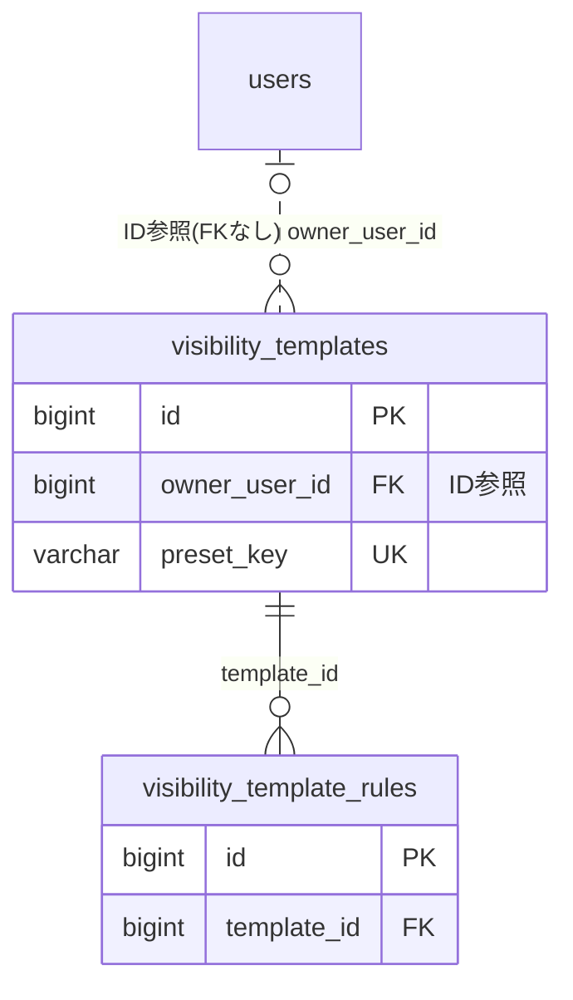

# visibility ドメイン ER 図

> このファイルは自動生成されます。手で編集しないでください。再生成: `cd backend && ./gradlew generateErDiagrams`

- テーブル数: 2
- ビュー数: 0

## ER 図

実線 = 外部キー、点線 = ID参照(FKなし)。図にはキー列（PK / FK / 参照推定列 / 単一列 UNIQUE）のみを描く。全列は下の「テーブル定義」を参照。

## 推定不能参照

| テーブル | 列 | 理由 |
| --- | --- | --- |
| `visibility_template_rules` | `rule_target_id` | 参照先テーブルを特定できない |

## テーブル定義

### `visibility_template_rules`

| 列名 | 型 | NULL | 既定値 | コメント |
| --- | --- | --- | --- | --- |
| `id` | `bigint unsigned` | NO | （なし） auto_increment |  |
| `template_id` | `bigint unsigned` | NO | （なし） |  |
| `rule_type` | `varchar(40)` | NO | （なし） |  |
| `rule_target_id` | `bigint unsigned` | YES | NULL |  |
| `rule_target_text` | `varchar(120)` | YES | NULL |  |
| `sort_order` | `int` | NO | `0` |  |
| `created_at` | `datetime(6)` | NO | `CURRENT_TIMESTAMP(6)` （式） |  |

### `visibility_templates`

| 列名 | 型 | NULL | 既定値 | コメント |
| --- | --- | --- | --- | --- |
| `id` | `bigint unsigned` | NO | （なし） auto_increment |  |
| `owner_user_id` | `bigint unsigned` | YES | NULL |  |
| `name` | `varchar(60)` | NO | （なし） |  |
| `description` | `varchar(240)` | YES | NULL |  |
| `icon_emoji` | `varchar(16)` | YES | NULL |  |
| `is_system_preset` | `tinyint(1)` | NO | `0` |  |
| `preset_key` | `varchar(64)` | YES | NULL |  |
| `created_at` | `datetime(6)` | NO | `CURRENT_TIMESTAMP(6)` （式） |  |
| `updated_at` | `datetime(6)` | NO | `CURRENT_TIMESTAMP(6)` （式） |  |
