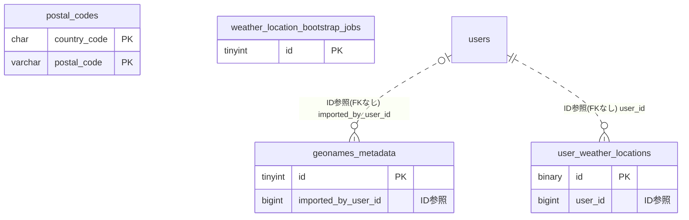

# weather ドメイン ER 図

> このファイルは自動生成されます。手で編集しないでください。再生成: `cd backend && ./gradlew generateErDiagrams`

- テーブル数: 4
- ビュー数: 0

## ER 図

実線 = 外部キー、点線 = ID参照(FKなし)。図中の `FK` は実外部キーの列だけ（ID参照列は `FK` を付けず "ID参照" と注記）。図にはキー列（PK / FK / 参照推定列 / 単一列 UNIQUE）のみを描く。全列は下の「テーブル定義」を参照。

## 被参照（他ドメインから）

このドメインのテーブルを参照している他ドメインの側（実 FK と ID参照のみ。多態参照と推定不能参照は含まない。同一ドメイン内の参照は上の図を参照）。

なし

## テーブル定義

### `geonames_metadata`

| 列名 | 型 | NULL | 既定値 | コメント |
| --- | --- | --- | --- | --- |
| `id` | `tinyint unsigned` | NO | （なし） | 固定値 1（シングルトン制約） |
| `last_imported_at` | `datetime` | NO | （なし） | 最終取り込み日時 |
| `source_version` | `varchar(50)` | NO | （なし） | GeoNames のダウンロードファイル更新日（例: allCountries-20260501） |
| `imported_row_count` | `bigint unsigned` | NO | （なし） | 取り込み行数 |
| `imported_by_user_id` | `bigint unsigned` | YES | NULL | 手動実行ユーザー（cron 自動実行は NULL） |

### `postal_codes`

| 列名 | 型 | NULL | 既定値 | コメント |
| --- | --- | --- | --- | --- |
| `country_code` | `char(2)` | NO | （なし） | ISO 3166-1 alpha-2 |
| `postal_code` | `varchar(20)` | NO | （なし） | 国別フォーマット（JP は半角ハイフン除去後の 7 桁） |
| `place_name` | `varchar(180)` | NO | （なし） | 地名（表示用、GeoNames の生値） |
| `admin1_name` | `varchar(100)` | YES | NULL | 第1行政区画（都道府県・州） |
| `admin2_name` | `varchar(100)` | YES | NULL | 第2行政区画（市区町村） |
| `latitude` | `decimal(8,5)` | NO | （なし） | 緯度（生値、丸め前） |
| `longitude` | `decimal(8,5)` | NO | （なし） | 経度（生値、丸め前） |
| `accuracy` | `tinyint unsigned` | YES | NULL | GeoNames の精度コード（1-6） |
| `updated_at` | `datetime` | NO | `CURRENT_TIMESTAMP` （式） |  |

### `user_weather_locations`

| 列名 | 型 | NULL | 既定値 | コメント |
| --- | --- | --- | --- | --- |
| `id` | `binary(16)` | NO | （なし） | UUIDv7（UuidV7Entity 継承） |
| `user_id` | `bigint unsigned` | NO | （なし） | auth ドメインの users.id（FK は張らない・原則準拠） |
| `label` | `varchar(50)` | NO | `home` | 地点ラベル（将来複数地点拡張用、本機能では home 固定） |
| `country_code` | `char(2)` | NO | （なし） | users.country_code のスナップショット |
| `postal_code_hash` | `char(64)` | NO | （なし） | 平文郵便番号の HMAC-SHA256（APP_HMAC_SECRET 使用） |
| `latitude_rounded` | `decimal(4,1)` | NO | （なし） | 0.5 度丸めの緯度（キャッシュキー兼） |
| `longitude_rounded` | `decimal(4,1)` | NO | （なし） | 0.5 度丸めの経度 |
| `place_name_snapshot` | `varchar(180)` | NO | （なし） | UI 表示用の地名スナップショット |
| `derived_at` | `datetime` | NO | `CURRENT_TIMESTAMP` （式） | 導出日時 |
| `created_at` | `datetime` | NO | `CURRENT_TIMESTAMP` （式） |  |
| `updated_at` | `datetime` | NO | `CURRENT_TIMESTAMP` （式） |  |

### `weather_location_bootstrap_jobs`

| 列名 | 型 | NULL | 既定値 | コメント |
| --- | --- | --- | --- | --- |
| `id` | `tinyint unsigned` | NO | （なし） | 固定値 1（シングルトン制約） |
| `completed_at` | `datetime` | YES | NULL | ジョブ完了日時。NULL のときは未完了 |
| `processed_user_count` | `int unsigned` | YES | NULL | 処理済みユーザー数 |
| `skipped_user_count` | `int unsigned` | YES | NULL | スキップユーザー数（郵便番号未ヒット等） |
