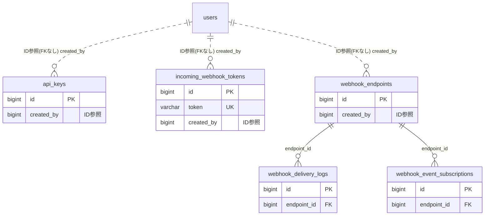

# webhook ドメイン ER 図

> このファイルは自動生成されます。手で編集しないでください。再生成: `cd backend && ./gradlew generateErDiagrams`

- テーブル数: 5
- ビュー数: 0

## ER 図

実線 = 外部キー、点線 = ID参照(FKなし)。図中の `FK` は実外部キーの列だけ（ID参照列は `FK` を付けず "ID参照" と注記）。図にはキー列（PK / FK / 参照推定列 / 単一列 UNIQUE）のみを描く。全列は下の「テーブル定義」を参照。

## 被参照（他ドメインから）

このドメインのテーブルを参照している他ドメインの側（実 FK と ID参照のみ。多態参照と推定不能参照は含まない。同一ドメイン内の参照は上の図を参照）。

なし

## 多態参照（線を引かない）

| テーブル | 種別列 | ID列 |
| --- | --- | --- |
| `api_keys` | `scope_type` | `scope_id` |
| `incoming_webhook_tokens` | `scope_type` | `scope_id` |
| `webhook_delivery_logs` | `event_type` | `event_id` |
| `webhook_endpoints` | `scope_type` | `scope_id` |

## テーブル定義

### `api_keys`

| 列名 | 型 | NULL | 既定値 | コメント |
| --- | --- | --- | --- | --- |
| `id` | `bigint unsigned` | NO | （なし） auto_increment |  |
| `scope_type` | `varchar(50)` | NO | （なし） |  |
| `scope_id` | `bigint unsigned` | NO | （なし） |  |
| `name` | `varchar(100)` | NO | （なし） |  |
| `key_prefix` | `varchar(8)` | NO | （なし） | 先頭8文字（プレフィックス検索用） |
| `key_hash` | `varchar(255)` | NO | （なし） | パスワードハッシュ（DelegatingPasswordEncoder: 既定argon2 / 旧bcrypt互換） |
| `scope_permission` | `varchar(20)` | NO | `READ_WRITE` | READ_ONLY/READ_WRITE |
| `rate_limit_per_hour` | `int` | NO | `1000` |  |
| `expires_at` | `datetime` | YES | NULL | NULL=無期限 |
| `last_used_at` | `datetime` | YES | NULL |  |
| `is_active` | `tinyint(1)` | NO | `1` |  |
| `created_by` | `bigint unsigned` | NO | （なし） |  |
| `version` | `bigint` | NO | `0` |  |
| `created_at` | `datetime` | NO | （なし） |  |
| `updated_at` | `datetime` | NO | （なし） |  |
| `deleted_at` | `datetime` | YES | NULL |  |

### `incoming_webhook_tokens`

| 列名 | 型 | NULL | 既定値 | コメント |
| --- | --- | --- | --- | --- |
| `id` | `bigint unsigned` | NO | （なし） auto_increment |  |
| `scope_type` | `varchar(50)` | NO | （なし） |  |
| `scope_id` | `bigint unsigned` | NO | （なし） |  |
| `token` | `varchar(36)` | NO | （なし） | UUID v4 |
| `name` | `varchar(100)` | NO | （なし） |  |
| `default_username` | `varchar(100)` | YES | NULL |  |
| `default_avatar_url` | `varchar(500)` | YES | NULL |  |
| `is_active` | `tinyint(1)` | NO | `1` |  |
| `last_used_at` | `datetime` | YES | NULL |  |
| `created_by` | `bigint unsigned` | NO | （なし） |  |
| `version` | `bigint` | NO | `0` |  |
| `created_at` | `datetime` | NO | （なし） |  |
| `updated_at` | `datetime` | NO | （なし） |  |
| `deleted_at` | `datetime` | YES | NULL |  |

### `webhook_delivery_logs`

| 列名 | 型 | NULL | 既定値 | コメント |
| --- | --- | --- | --- | --- |
| `id` | `bigint unsigned` | NO | （なし） auto_increment |  |
| `endpoint_id` | `bigint unsigned` | NO | （なし） |  |
| `event_type` | `varchar(100)` | NO | （なし） |  |
| `event_id` | `varchar(36)` | NO | （なし） | UUID v4 冪等性キー |
| `request_payload` | `mediumtext` | YES | NULL |  |
| `response_status` | `int` | YES | NULL |  |
| `delivery_status` | `varchar(20)` | NO | （なし） | SUCCESS/FAILED/RETRYING |
| `retry_count` | `int` | NO | `0` |  |
| `error_message` | `text` | YES | NULL |  |
| `created_at` | `datetime` | NO | （なし） |  |
| `updated_at` | `datetime` | NO | （なし） |  |

### `webhook_endpoints`

| 列名 | 型 | NULL | 既定値 | コメント |
| --- | --- | --- | --- | --- |
| `id` | `bigint unsigned` | NO | （なし） auto_increment |  |
| `scope_type` | `varchar(50)` | NO | （なし） |  |
| `scope_id` | `bigint unsigned` | NO | （なし） |  |
| `name` | `varchar(100)` | NO | （なし） |  |
| `url` | `varchar(1000)` | NO | （なし） | HTTPS必須 |
| `signing_secret` | `varchar(64)` | NO | （なし） | HMAC-SHA256署名用シークレット |
| `is_active` | `tinyint(1)` | NO | `1` |  |
| `timeout_ms` | `int` | NO | `5000` |  |
| `consecutive_failure_count` | `int` | NO | `0` | 連続失敗回数 |
| `last_failure_at` | `datetime` | YES | NULL |  |
| `created_by` | `bigint unsigned` | NO | （なし） |  |
| `version` | `bigint` | NO | `0` |  |
| `created_at` | `datetime` | NO | （なし） |  |
| `updated_at` | `datetime` | NO | （なし） |  |
| `deleted_at` | `datetime` | YES | NULL |  |

### `webhook_event_subscriptions`

| 列名 | 型 | NULL | 既定値 | コメント |
| --- | --- | --- | --- | --- |
| `id` | `bigint unsigned` | NO | （なし） auto_increment |  |
| `endpoint_id` | `bigint unsigned` | NO | （なし） |  |
| `event_type` | `varchar(100)` | NO | （なし） |  |
| `created_at` | `datetime` | NO | （なし） |  |
| `updated_at` | `datetime` | NO | `CURRENT_TIMESTAMP` （式） |  |
