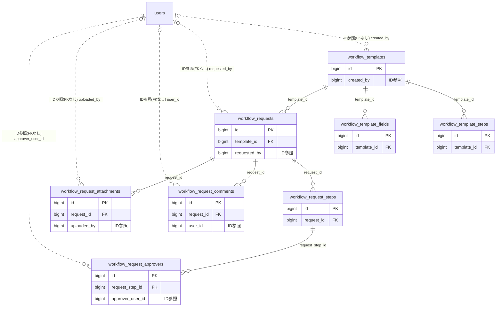

# workflow ドメイン ER 図

> このファイルは自動生成されます。手で編集しないでください。再生成: `cd backend && ./gradlew generateErDiagrams`

- テーブル数: 8
- ビュー数: 0

## ER 図

実線 = 外部キー、点線 = ID参照(FKなし)。図中の `FK` は実外部キーの列だけ（ID参照列は `FK` を付けず "ID参照" と注記）。図にはキー列（PK / FK / 参照推定列 / 単一列 UNIQUE）のみを描く。全列は下の「テーブル定義」を参照。

## 被参照（他ドメインから）

このドメインのテーブルを参照している他ドメインの側（実 FK と ID参照のみ。多態参照と推定不能参照は含まない。同一ドメイン内の参照は上の図を参照）。

| 参照元ドメイン | 参照元テーブル | 列 | 種別 | 参照先テーブル |
| --- | --- | --- | --- | --- |
| [budget](budget.md) | `budget_configs` | `workflow_template_id` | ID参照 | `workflow_templates` |
| [budget](budget.md) | `budget_transactions` | `workflow_request_id` | ID参照 | `workflow_requests` |
| [event](event.md) | `events` | `workflow_request_id` | ID参照 | `workflow_requests` |
| [forms](forms.md) | `form_submissions` | `workflow_request_id` | ID参照 | `workflow_requests` |
| [forms](forms.md) | `form_templates` | `workflow_template_id` | ID参照 | `workflow_templates` |
| [incident](incident.md) | `incidents` | `workflow_request_id` | ID参照 | `workflow_requests` |
| [shiftbudget](shiftbudget.md) | `budget_threshold_alerts` | `workflow_request_id` | ID参照 | `workflow_requests` |

## 多態参照（線を引かない）

| テーブル | 種別列 | ID列 |
| --- | --- | --- |
| `workflow_requests` | `scope_type` | `scope_id` |
| `workflow_requests` | `source_type` | `source_id` |
| `workflow_templates` | `scope_type` | `scope_id` |

## 推定不能参照

| テーブル | 列 | 理由 |
| --- | --- | --- |
| `workflow_request_approvers` | `seal_id` | 参照先テーブルを特定できない |

## テーブル定義

### `workflow_request_approvers`

| 列名 | 型 | NULL | 既定値 | コメント |
| --- | --- | --- | --- | --- |
| `id` | `bigint unsigned` | NO | （なし） auto_increment |  |
| `request_step_id` | `bigint unsigned` | NO | （なし） |  |
| `approver_user_id` | `bigint unsigned` | NO | （なし） |  |
| `decision` | `varchar(20)` | NO | `PENDING` |  |
| `decision_at` | `datetime` | YES | NULL |  |
| `decision_comment` | `varchar(1000)` | YES | NULL |  |
| `seal_id` | `bigint unsigned` | YES | NULL |  |
| `created_at` | `datetime` | NO | `CURRENT_TIMESTAMP` （式） |  |
| `updated_at` | `datetime` | NO | `CURRENT_TIMESTAMP` （式） |  |

### `workflow_request_attachments`

| 列名 | 型 | NULL | 既定値 | コメント |
| --- | --- | --- | --- | --- |
| `id` | `bigint unsigned` | NO | （なし） auto_increment |  |
| `request_id` | `bigint unsigned` | NO | （なし） |  |
| `file_key` | `varchar(500)` | NO | （なし） |  |
| `original_filename` | `varchar(255)` | NO | （なし） |  |
| `file_size` | `bigint unsigned` | NO | （なし） |  |
| `uploaded_by` | `bigint unsigned` | YES | NULL |  |
| `created_at` | `datetime` | NO | `CURRENT_TIMESTAMP` （式） |  |
| `updated_at` | `datetime` | NO | `CURRENT_TIMESTAMP` （式） |  |

### `workflow_request_comments`

| 列名 | 型 | NULL | 既定値 | コメント |
| --- | --- | --- | --- | --- |
| `id` | `bigint unsigned` | NO | （なし） auto_increment |  |
| `request_id` | `bigint unsigned` | NO | （なし） |  |
| `user_id` | `bigint unsigned` | YES | NULL |  |
| `body` | `varchar(2000)` | NO | （なし） |  |
| `created_at` | `datetime` | NO | `CURRENT_TIMESTAMP` （式） |  |
| `updated_at` | `datetime` | NO | `CURRENT_TIMESTAMP` （式） |  |
| `deleted_at` | `datetime` | YES | NULL |  |

### `workflow_request_steps`

| 列名 | 型 | NULL | 既定値 | コメント |
| --- | --- | --- | --- | --- |
| `id` | `bigint unsigned` | NO | （なし） auto_increment |  |
| `request_id` | `bigint unsigned` | NO | （なし） |  |
| `step_order` | `tinyint` | NO | （なし） |  |
| `status` | `varchar(20)` | NO | `WAITING` |  |
| `completed_at` | `datetime` | YES | NULL |  |
| `created_at` | `datetime` | NO | `CURRENT_TIMESTAMP` （式） |  |
| `updated_at` | `datetime` | NO | `CURRENT_TIMESTAMP` （式） |  |

### `workflow_requests`

| 列名 | 型 | NULL | 既定値 | コメント |
| --- | --- | --- | --- | --- |
| `id` | `bigint unsigned` | NO | （なし） auto_increment |  |
| `template_id` | `bigint unsigned` | NO | （なし） |  |
| `scope_type` | `varchar(20)` | NO | （なし） |  |
| `scope_id` | `bigint unsigned` | NO | （なし） |  |
| `title` | `varchar(200)` | NO | （なし） |  |
| `status` | `varchar(20)` | NO | `DRAFT` |  |
| `requested_by` | `bigint unsigned` | YES | NULL |  |
| `requested_at` | `datetime` | YES | NULL |  |
| `current_step_order` | `tinyint` | YES | NULL |  |
| `field_values` | `json` | YES | NULL |  |
| `version` | `bigint unsigned` | NO | `0` |  |
| `source_type` | `varchar(30)` | YES | NULL |  |
| `source_id` | `bigint unsigned` | YES | NULL |  |
| `created_at` | `datetime` | NO | `CURRENT_TIMESTAMP` （式） |  |
| `updated_at` | `datetime` | NO | `CURRENT_TIMESTAMP` （式） |  |
| `deleted_at` | `datetime` | YES | NULL |  |

### `workflow_template_fields`

| 列名 | 型 | NULL | 既定値 | コメント |
| --- | --- | --- | --- | --- |
| `id` | `bigint unsigned` | NO | （なし） auto_increment |  |
| `template_id` | `bigint unsigned` | NO | （なし） |  |
| `field_key` | `varchar(50)` | NO | （なし） |  |
| `field_label` | `varchar(100)` | NO | （なし） |  |
| `field_type` | `varchar(20)` | NO | （なし） |  |
| `is_required` | `tinyint(1)` | NO | `0` |  |
| `sort_order` | `int` | NO | `0` |  |
| `options_json` | `json` | YES | NULL |  |
| `created_at` | `datetime` | NO | `CURRENT_TIMESTAMP` （式） |  |
| `updated_at` | `datetime` | NO | `CURRENT_TIMESTAMP` （式） |  |

### `workflow_template_steps`

| 列名 | 型 | NULL | 既定値 | コメント |
| --- | --- | --- | --- | --- |
| `id` | `bigint unsigned` | NO | （なし） auto_increment |  |
| `template_id` | `bigint unsigned` | NO | （なし） |  |
| `step_order` | `tinyint` | NO | （なし） |  |
| `name` | `varchar(100)` | NO | （なし） |  |
| `approval_type` | `varchar(10)` | NO | `ALL` |  |
| `approver_type` | `varchar(10)` | NO | （なし） |  |
| `approver_user_ids` | `json` | YES | NULL |  |
| `approver_role` | `varchar(30)` | YES | NULL |  |
| `auto_approve_days` | `smallint` | YES | NULL |  |
| `created_at` | `datetime` | NO | `CURRENT_TIMESTAMP` （式） |  |
| `updated_at` | `datetime` | NO | `CURRENT_TIMESTAMP` （式） |  |

### `workflow_templates`

| 列名 | 型 | NULL | 既定値 | コメント |
| --- | --- | --- | --- | --- |
| `id` | `bigint unsigned` | NO | （なし） auto_increment |  |
| `scope_type` | `varchar(20)` | NO | （なし） |  |
| `scope_id` | `bigint unsigned` | NO | （なし） |  |
| `name` | `varchar(100)` | NO | （なし） |  |
| `description` | `varchar(500)` | YES | NULL |  |
| `icon` | `varchar(50)` | YES | NULL |  |
| `color` | `varchar(7)` | YES | NULL |  |
| `is_seal_required` | `tinyint(1)` | NO | `0` |  |
| `is_active` | `tinyint(1)` | NO | `1` |  |
| `sort_order` | `int` | NO | `0` |  |
| `created_by` | `bigint unsigned` | YES | NULL |  |
| `version` | `bigint unsigned` | NO | `0` |  |
| `created_at` | `datetime` | NO | `CURRENT_TIMESTAMP` （式） |  |
| `updated_at` | `datetime` | NO | `CURRENT_TIMESTAMP` （式） |  |
| `deleted_at` | `datetime` | YES | NULL |  |
