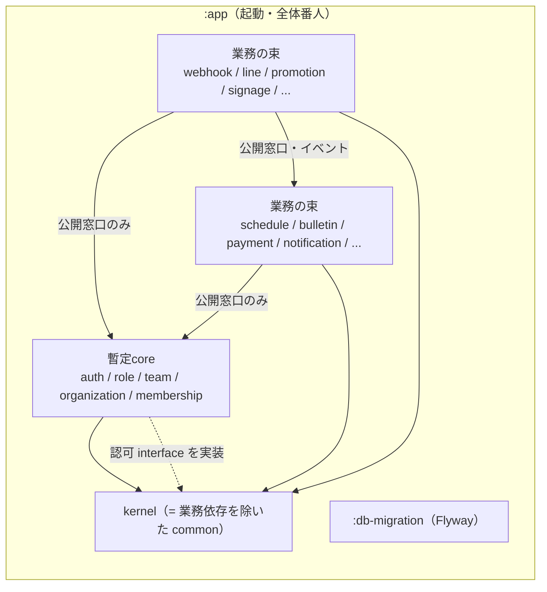
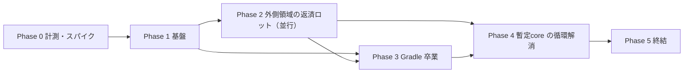
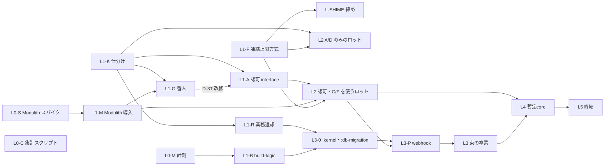

# モジュラーモノリス境界負債の返済と Gradle/Modulith 卒業 計画書

> 起票日: 2026-10-21
> 台帳: CMP-261021-0017（親・傘行。子 CMP は §8.3 に従い Phase・レーン単位で着手時に採番）
> 担当: kenta
> **ステータス**: 🟡 起草（精査待ち。精査第1パス反映済み）
> 帰属: [`domain_db_design_principles.md`](domain_db_design_principles.md) 原則1・5、[`db_scalability.md`](db_scalability.md) 今後課題「イベント駆動アーキテクチャへの移行」（:107）

---

## §0. 決定事項（マスター御裁可・2026-10-21）

| # | 論点 | 決定 |
|---|---|---|
| Q1 | D-2b（UuidV7Entity 未継承 569 行）の扱い | **本計画の対象外**。別戦役 CMP-261021-0115「UUIDv7 継承負債（D-2b 凍結）の返済」で扱う（ローカル開発中で既存データは考慮不要、モジュール化とは独立）。本書の「凍結ストア空」は **D-2b を除く**（D-1 / D-3 / D-3T / D-5 / ServiceAPI を指す） |
| Q2 | notification を暫定core に入れるか | **入れない**。通常の業務モジュールとして扱う |
| Q3 | 粒度 | **Modulith は全トップレベルパッケージを個別モジュール**、**Gradle サブプロジェクトは関連領域の束（10〜20 程度）**（§3.2） |
| Q4 | 台帳の単位 | **子 CMP は Phase・レーン単位（10〜15 行程度）**。領域ごとのロットは親 Issue のチェックリストで管理し、台帳の「1戦役1行」を守る（§8.3） |
| Q5 | 凍結定数の運用 | **`EXPECTED_LINES_*` を「上限」方式へ変更**し、専用の締めレーン（L-SHIME）が定期的に実測値へ引き下げる。返済 PR は定数を触らない＝並行マージ可（§7.4） |

殿判断（上記方針から導出）:

- (a) イベントのペイロードは ID と scope（`organization_id` 等）のみ。自由記述・PII は禁止し番人化する。`event_publication` は完了時に削除（または短期保持）する。退会 purge との整合 IT を置き、削除済み利用者への再配信でデータが復活しないことを確かめる（§4.5・§11.2）。
- (b) チャット自動作成（`JobChatService`）は目玉機能で `chatRoomId` が API に出るため「即時に結果が要る」。ただし**同一トランザクションは要らない**ので、台帳（パターン E）には入れず、パターン F「コミット後の同期呼び出し＋確実配信の保険」で解く（§4.3）。
- (c) Gradle 卒業から撤退した場合、本計画の完了条件は「凍結ストア空（D-2b 除く）＋ Modulith verify 全体必須」と読み替える（§14）。
- (d) CMP-260918-1406 の着手済みロットは例外としてそのまま継続を認める（§5.3）。

---

## §1. 背景と目的

### 1.1 経緯（事実）

- Mannschaft は「将来のマイクロサービス分割を見据えたモジュラーモノリス」を掲げている（CLAUDE.md「アーキテクチャ思想」）が、ビルドは**単一 Gradle プロジェクト**のままである。`backend/settings.gradle.kts` は初期セットアップ `6d58cf6a89`（2026-03-19）以来 `include` を持たず、`rootProject.name = "app"` のみ。
- 単一 Gradle を選んだ ADR は存在しない。`backend/gradle.properties:8-9` に「現在はシングルモジュール構成のため効果は限定的だが、将来のマルチプロジェクト化に備えて有効化」とあるだけである。
- ドメイン境界は ArchUnit の凍結（FreezingArchRule）で**悪化防止**だけを担い、既存違反は返済計画のないまま凍結ストアに積まれている（§2）。
- 越境 `@Transactional` は原則5で「将来のイベント駆動化候補として記録する」とされ（`domain_db_design_principles.md:78-79`）、`db_scalability.md:107` の今後課題にも「イベント駆動アーキテクチャへの移行」が残っている。

### 1.2 経緯（推測・未検証）

- 単一 Gradle でも開発が回っていたのは、ルートパッケージの暗黙スキャン（§2.5）で全ドメインが同居でき、境界違反がコンパイルを止めなかったためと推測する。
- ビルド時間の大半は分割と無関係な要因（fork 固定費・Flyway 再生テスト・コンテキスト数・CPU/IO 競合。§13.1）と実測されており、**分割でビルドが速くなるかは未計測**である。本計画は速度改善を目的に据えず、効果は Phase 0 / Phase 3 の計測で判断する。

### 1.3 目的

1. ドメイン間の越境依存（Entity・Repository の直接参照、越境トランザクション）を返済し、凍結ストア（D-2b を除く）を空にする。
2. 越境連携を「公開 API の同期呼び出し」と「ドメインイベント（確実配信つき）」に揃え、将来の分割が機械的にできる状態にする。
3. 境界を **Spring Modulith（論理境界）** と **Gradle サブプロジェクト（コンパイル時強制）** の二重で担保し、最終的に全領域を個別モジュールへ分離する。

### 1.4 目的外（マスター御裁可済み）

- 起動・デプロイ単位は**1つのまま**。マイクロサービス化はしない（将来分割できる状態を目指すだけ）。
- 外部 HTTP API の変更（§10）。
- ビルド時間短縮を目標値として約束すること（§13.1）。
- D-2b の返済（CMP-261021-0115）。

---

## §2. 現状の数値（2026-10-21 origin/main `9530c75ddc` で再確認）

### 2.1 凍結ストア（`ArchUnitFreezeStoreIntegrityTest` の `EXPECTED_LINES_*` が正）

ストア: `backend/src/test/resources/archunit_store/`。1違反1行で、各行に発生元 FQCN が含まれるため発生元ドメイン別に集計できる（L0-C）。

| 番人 | 定数（行） | ストア UUID | 発生元ドメイン上位 |
|---|---:|---|---|
| D-1 越境 Entity 参照（`CrossDomainEntityImportArchTest`） | 2,037（:713） | `584c3a46-…` | publicview 176 / dashboard 176 / gdpr 153 / social 101 / contact 100 / disclosure 91 |
| D-3 越境 `@Transactional`（`CrossDomainTransactionalArchTest`） | 1,295（:743） | `f14374b1-…` | publicview 127 / village 79 / contact 72 / tournament 55 / admin 48 / social 47 |
| D-3T 推移的越境 tx（`CrossDomainTransactionalTransitiveArchTest`） | 7,137（:883） | `296295dd-…` | bulletin 530 / schedule 439 / shiftbudget 343 / payment 333 / tournament 323 / social 301 |
| D-5 越境 Repository 依存（`CrossDomainRepositoryDependencyArchTest`） | 1,853（:976） | `427c445d-…` | gdpr 142 / dashboard 133 / publicview 127 / village 86 / contact 72 / social 65 |
| ServiceAPI Entity 露出（`ServiceApiEntityBoundaryArchTest`） | 600（:989） | `93124b52-…` | timetable 62 / schedule 41 / match 38 / jobmatching 31 / payment 27 / notification 23 |
| D-2b UuidV7Entity 未継承（`EntityUuidV7ConventionArchTest`）※対象外 | 569（:926） | `2c0ba995-…` | tournament 19 / advertising 16 / recruitment 14 / parking 14 |
| AUTHZ_WAVE4（`AuthzControllerGuardArchTest`） | 0（:682） | `9ed4737d-…` | — |

- D-3T は推移展開のため、1つの越境呼び出しが多数の tx 入口から数えられ、行数は返済量の目安にならない。さらに静的解析は interface 呼び出しから runtime proxy の具象実装を追わずに打ち切る（`CrossDomainTransactionalTransitiveArchTest.java:48-54`）。このため**呼び出し先を interface にしただけで行が消える「偽の返済」**が起こりうる（対策は §3.4・L1-G）。

### 2.2 依存グラフと流入速度

| 指標 | 値 | 出典 |
|---|---:|---|
| main の Java ファイル | 8,407（2026-10-21）。参考: 2026-09-21 時点 7,559、2026-10-14 時点 7,945 | `git ls-tree -r <各日の origin/main 最終コミット> backend/src/main/java` |
| `com.mannschaft.app` 直下のトップレベルパッケージ | 120 | `find -mindepth 1 -maxdepth 1 -type d` |
| 越境 import | 9,376（偵察値・未再計測） | 偵察 |
| 強連結成分（SCC）の最大 | 83 パッケージ（common を含む。偵察値・未再計測） | 偵察 |
| common → 業務の import | 167 件／35 パッケージ（import 文の単純集計） | `grep '^import com.mannschaft.app.<x>' common/**` |
| config → 業務の import | 41 件 | 同上 |
| JPA 関連（`@ManyToOne` 等）の越境 | 5 件・すべて notification → `auth.UserEntity`（例 `notification/confirmable/entity/ConfirmableNotificationEntity.java:155`） | 偵察 |

**コードは今も増え続けている。** 直近30日で main の Java ファイルは約 850 本増えた（7,559 → 8,407。途中の日次値は増減があり単調ではないが、傾向は増加）。返済の速度が新規コードの流入に負ければ負債は減らない。このため本計画は次を前提にする。

- 新規の越境は凍結で止める（既存の運用）。加えて Phase 1 で公開窓口の規約（§3.4）とイベントの規約（§4.5）を先に決め、新規コードを最初から規約どおりに書けるようにする。
- 締めレーン（L-SHIME）の集計で、ドメイン別の行数の推移を毎回記録し、増えているドメインを親 Issue で知らせる。

common の業務依存の代表（いずれも §6.1 で kernel から追い出す対象）:

- `common/AccessControlService.java:3-14` — family の Repository、gdpr の `GdprErrorCode`（:5、使用は :748）、membership の Repository・enum、organization の Service、role の Entity・Repository・Service。
- `common/NameResolverService.java:3-9` — auth / organization / team の Entity・Repository。
- `common/activityschedule/ActivityScheduleFacade.java:3-21` — activity と schedule の Service・DTO を束ねる業務ファサード。
- `common/visibility/mapping/*VisibilityMapper.java` — 21 ファイル。
- `common/storage/quota/StorageUsageQueryService.java:3-10` — organization / team の Service。

### 2.3 越境の代表例

| 箇所 | 内容 | 想定パターン（§4） |
|---|---|---|
| `dashboard/controller/DashboardController.java:5` | bulletin の Repository を Controller が直接 import | A / D |
| `billing/ScopeMemberCountService.java:4` | membership の Repository | A |
| `gdpr/service/PersonalDataCollector.java:52` | resume の Repository（収集系。同様の import 多数） | A（SPI 化） |
| `actionmemo/service/ActionMemoAdminService.java:74-76` | todo / role / auth をまたぐ tx。既存 TODO に「将来は TodoRevertedByAdminEvent で分離予定」 | B / C |
| `jobmatching/service/JobChatService.java:58-92` | chat の Channel / Member / Message Repository に直接 save し channelId を返す。呼び出し元 `JobContractService.java:154-156` が `contract.assignChatRoom(chatRoomId)` | F（§4.3 手本） |
| `role/service/BlockService.java` `blockUser`（:51） | role から他ドメインへの書き込み越境 | B / C |
| `contact/service/ContactService.java` `addToDefaultFolder`（:157） | contact からの越境 | A / B |

### 2.4 イベント資産（コメント行を除いた単純 grep）

| 指標 | 値 |
|---|---:|
| `@TransactionalEventListener` | 263 件／170 ファイル |
| `publishEvent(` | 260 件 |
| `@Async`（main） | 266 件。うち `event-pool` 指定は約 168 箇所（`config/AsyncConfig.java` のコメント） |
| 他ドメインの `*Event` 型 import | 113 件（偵察値・未再計測） |
| Spring Modulith | 未導入 |

既存の確実配信は通知専用の transactional outbox（[`notification_outbox.md`](notification_outbox.md)）だけである。イベント基底 `common/event/BaseEvent.java` は**抽象クラス**で、コンストラクタで `occurredAt = LocalDateTime.now()` を設定する（§4.5 で扱う）。

### 2.5 Spring・ビルド・テストの構成

- `MannschaftApplication.java:7` に `@SpringBootApplication` のみ。`@EntityScan` / `@EnableJpaRepositories` / `@ComponentScan` は無く、ルートパッケージ `com.mannschaft.app` 配下を暗黙スキャンしている。`@Entity` を持つファイルは 815。
- Spring Boot 3.5.13（`build.gradle.kts:7`）、Gradle 8.14.4、ArchUnit 1.3.0（`build.gradle.kts:126`）。buildSrc・version catalog 無し。`build.gradle.kts` は 1,211 行。configuration cache は無効。jacoco は単一プロジェクト前提（:6・:1042）、OWASP Dependency-Check は `dependencyCheckAnalyze`（:1105-1111）。
- テストの実測記録（`build.gradle.kts` のコメント）:
  - fork 1回あたり +447 秒、shard4 の `:test` 41.96 分のうちテスト正味 7.4 分（:395-417）。
  - Flyway 再生テストが計測時間の 72〜88%（:683-686 付近）。
  - Spring テストコンテキスト 17 個がヒープの 59%（:561-567）。上限 10 に制限済み（`backend/.claudecode.md` §30「テストコンテキストキャッシュ上限 10」）。
  - shard 分割（:597-642）、`archUnitTest`（:751）、`archTest`（:836）。
- ローカルの遅延は CPU/IO 競合で、ロック待ちは 0 件。`gradle-turnstile.sh` で直列化する（`docs/development/worktree_operations.md:96-109`）。
- CI: `.github/workflows/backend-ci.yml` の matrix 6 shard（:412-413）、`shard-weights.properties`、`verifyShardCoverage`、`cancel-in-progress: true`（:51）。
- Flyway: `backend/src/main/resources/db/migration` の単一ディレクトリに 1,223 ファイル（他に `rollback/` 2）。番人 `FlywayTimestampNamingGuardTest`。
- 非同期: `@Primary` の `event-pool` は core 2 / max 5 / queue 100、拒否は AbortPolicy（`config/AsyncConfig.java:47-60`）。executor 無指定の `@Async` は禁止（`backend/.claudecode.md:464`、Issue #2953）。
- レプリカ振り分け: `config/ReplicaRoutingAspect.java:56` はメソッドに付いた `@Transactional`（`@annotation`）だけを見る。クラスレベルの `readOnly` は振り分けに使われない。

### 2.6 番人の限界

- `DomainPackages.java:24` の `SHARED_DOMAIN = "common"` は、相手先・発生元のどちらが common でも許容する。common に業務ロジックを置けば全番人をすり抜ける（§2.2 の 167 件）。
- `--tests` で絞り込んで実行すると凍結ストアが壊れる（`backend/.claudecode.md` §30「凍結ストアは `--tests` 絞り込み実行で破壊される」）。
- D-3T は interface 経由・リフレクション・動的ディスパッチを追わない（§2.1）。
- `NotificationTransactionBoundaryGuardTest.java:784-792` の `isAllowedEntryPoint` は、ソース上の `@TransactionalEventListener` の文字列だけを入口と認める。`@ApplicationModuleListener`（メタアノテーションで `@TransactionalEventListener` を含む）は入口と認識されない。

---

## §3. 目標アーキテクチャ

### 3.1 モジュールの3層

| 層 | 中身 | 依存してよい先 |
|---|---|---|
| **kernel** | 業務を知らない基盤だけ（下の列挙） | JDK・Spring・ライブラリのみ |
| **暫定core** | auth / role / team / organization / membership | kernel、暫定core の構成領域同士（Phase 4 まで循環を許容） |
| **業務モジュール群** | 上記以外の全トップレベルパッケージ（notification を含む） | kernel、暫定core と他業務モジュールの**公開窓口のみ** |

**暫定core の構成領域は本書で固定する。** 追加にはマスターの裁可が要る。番人 `ProvisionalCoreMembershipGuardTest`（L1-G で新設）が構成領域の一覧を定数で持ち、一覧外のパッケージが暫定core 扱いの例外を受けたら fail させる。

**kernel に入れてよいもの（列挙。これ以外は入れない）:**

- 例外基盤（`BusinessException`・ErrorCode の interface）、`ApiResponse` 等の共通レスポンス型
- `UuidV7Entity` / `UuidV7` など Entity 基底・ID 生成
- `AbstractTenantAwareRepository` などテナント基盤
- 時刻・ゾーン、ページング、JSON などの汎用ユーティリティ
- イベントの基底型（`DomainEvent` interface、`BaseEvent`）
- ストレージ・キャッシュ・ロックなどインフラのアダプタ（業務の判断を含まないもの）
- **認可の interface**（`common.AccessControlService`。実装は暫定core。§6.1）

kernel に入れてはならないもの: 業務ドメインの型の import、業務判断（誰が見えるか・誰が操作できるか・何人いるか）、特定ドメインのファサード。番人 `KernelNoBusinessDependencyArchTest`（L1-G）が「kernel から業務パッケージへの import 0 件」を**凍結なしの0件必須**で強制する。

**パッケージ名の扱い:** kernel は新しいパッケージを作らず、**`common` から業務依存を追い出した残りをそのまま kernel とする**。`BusinessException` 等は数千ファイルが import しており、改名すると全レーンと衝突する PR になるため。

### 3.2 粒度（Q3）

- **Modulith の論理モジュール = トップレベルパッケージ**（120。パッケージは動かさない）。全領域が個別モジュールになる。
- **Gradle サブプロジェクト = 関連する論理モジュールの束（10〜20 程度）**。パッケージとサブプロジェクトは1対1にしない。

束の決め方の基準:

1. **業務のまとまり**: 同じ利用者の行為・同じ画面群を扱うもの（例: shift・shiftbudget・timetable のような勤務系、bulletin・social・village のような交流系）。
2. **依存の向きがそろう**: 束の外への依存が同じ相手（暫定core と kernel だけ、など）になるもの。束の中の循環は許すが、束同士の循環は許さない（Gradle が循環依存を拒むため、束の境界は循環の外に引く）。
3. **大きさ**: 1束あたりの目安は 300〜900 ファイル（main 8,407 本 ÷ 10〜20）。極端に小さい束は隣の束に合わせ、極端に大きい束は業務のまとまりで割る。
4. **葉を先に**: 被依存 0 の葉は小さくても単独で先に卒業させてよい（パイロット）。後で束に合流させてもよい。
5. **暫定core は Phase 4 まで1束**。Phase 4 で循環を解いたあと、必要なら複数束へ割る。

束の具体的な割り当ては L0-S（verify の初回結果）と L1-K（仕分け）の後、L3-0 で決めて本書に追記する。

### 3.3 依存方向



- 矢印の逆向き（kernel → 業務、暫定core → 業務モジュール）は禁止。暫定core が業務の情報を必要とする場合は、業務側がイベントを発行し暫定core が購読するか、業務側が暫定core の SPI を実装する。

### 3.4 公開窓口の規約

- 他モジュールから参照してよいのは `<domain>.api` パッケージ（とその下）だけ。Modulith では `@NamedInterface("api")` を `package-info.java` に付ける。
- `api` に置いてよいもの: 公開 Service（**final なファサードクラス**）、引数・戻り値の DTO（record 推奨）、**発行するイベント型**、他モジュールが実装する SPI interface。
- `api` に置いてはならないもの: `@Entity`、Repository、Spring Data の型を含むシグネチャ。
- **公開 Service を interface にしない（偽の返済の防止）**。D-3T は interface 呼び出しの先を追わないため、公開 Service を interface にすると、越境 tx が残ったまま D-3T の行だけが消える。公開 Service は final なファサードクラスとし、interface は SPI（相手が実装するもの）に限る。L1-G で D-3T を「本番クラス内に実装が1つだけの interface は、その実装へ展開して判定する」よう改修したあとは、この制限を緩めてよい。例外は §6.1 の `common.AccessControlService`（呼び出し側 1,000 ファイル超の差分を避けるため interface とする。実装へ展開する改修を L1-A の前提にする）。
- **イベント型の置き場所は発行側の `api`**（例: `jobmatching.api.JobContractConcludedEvent`）。購読側が発行側の `api` に依存する向きになる。
- 公開 Service の命名: `<Domain><用途>Api`（例: `ChatRoomApi`）。実装の詳細は非公開パッケージに置く。
- **窓口の持ち主**: 各モジュールの `api` には持ち主のレーン（そのドメインを担当するロット、暫定core は L4 または L1-A）がいる。他ロットが相手の `api` に窓口を足すときは、持ち主に依頼するか、持ち主が未着手なら親 Issue で一時的に持ち主を引き受けて宣言する（§7.1）。同じ用途の窓口を別々に足して乱立させない。

---

## §4. 越境の解き方カタログ

### 4.1 パターンと判定基準

| パターン | 中身 | 使う条件 | 挙動の変化 |
|---|---|---|---|
| **A 公開 API 同期** | 相手モジュールの `api` を同期で呼ぶ | 即時に結果が要る**読み取り**。または相手の業務判断を問う（認可など） | 戻り値は変わらない。相手の内部型に依存しなくなるだけ |
| **B AFTER_COMMIT イベント** | 自分の tx 内で `publishEvent`、相手は AFTER_COMMIT で購読 | 書き込みを伴うが、**取りこぼしても業務上許容できる**連携（キャッシュ無効化・統計・補助的な通知など） | 相手側の反映は commit 後で遅れる。相手が失敗しても自分は巻き戻らない。取りこぼしうる |
| **C Registry 確実配信** | B に加え、Spring Modulith の Event Publication Registry に記録し、未完了なら再配信 | 書き込みを伴い、**業務上必ず起きなければならない**連携 | B に加え、未完了の購読は Registry に残り再配信される。**購読側は冪等必須** |
| **D tx 外読み取り snapshot** | 自分の tx の外（または前）で相手の API から値を読み、値として持ち込む | 書き込みの判断材料として他モジュールの状態が要るが、同一 tx の一貫性までは要らない | 読んだ値が古くなりうる（決定の根拠をログ・列に残す） |
| **F コミット後の同期呼び出し＋確実配信の保険** | トランザクションを持たない調停役が、①自モジュールの tx で保存してコミット（同じ tx で Registry にイベントを記録）→ ②コミット後に相手の公開 API を相手自身の tx で同期呼び出しし、結果を応答に載せる → ③ ②が失敗しても①は成立済みのまま、Registry のイベントを相手のリスナーが拾って後から確実に作る | **即時に結果が要る書き込み連携**（応答に相手の作成物の ID を返すなど）で、同一 tx までは要らないもの | 通常は応答に結果が入る。②が失敗したときだけ結果が欠け（null 等）、後で③が補う。**相手側は②と③が両方走っても1件だけ作る冪等性が必須** |
| **E 同一 tx 不可欠の台帳化** | 越境のまま残し、理由つきで台帳に載せる | F でも整合が保てない**不可分な更新**（片方だけ確定した状態が一瞬でも外から見えると業務が壊れ、補償でも代替できない） | 変化なし。台帳に理由・代替不能の根拠・見直し条件を書く |

**判定の順序**: まず A（読み取りか）→ 書き込みで即時に結果が要らなければ C か B（取りこぼし許容か）→ **即時に結果が要る書き込みでも、まず F を検討する** → 判断材料の読み取りなら D → **E は F でも整合が保てない不可分な更新に限る**。「即時に結果が要る」ことは「同一トランザクションが要る」ことではない。

**`@Transactional` を外すだけの修正は禁止**（原子性を黙って失う症状隠し。CMP-260912-1524 で自己呼び出しにより原子性が失われていた事例がある）。

E の台帳は凍結ストアに入れない。D-3P と同じく**監査済み例外の一覧**（test ソースの定数、理由必須、実在しなくなった例外は fail）として `CrossDomainTransactionLedger` を L1-G で新設する。

### 4.2 各パターンに必要なテスト

| パターン | 必須テスト |
|---|---|
| A | 公開 API の契約テスト（正常・不在・権限なし）。呼び出し側の既存テストが無変更で緑 |
| B | 発行 → 購読側反映の IT（commit 後に反映）。発行側 tx が巻き戻ったら購読されない IT |
| C | B に加え、(1) 購読側が例外を投げたら Registry に未完了として残る、(2) 再配信で反映される、(3) 同じイベントを2回配信しても二重作成されない（冪等）、(4) 発行側 tx の巻き戻しで Registry にも残らない、(5) **配信時の再検証**: イベント発行後に権限・所属を剥奪してから再配信すると、購読側は作用しない（§4.5）、(6) **退会 purge 後の再配信**で削除済み利用者のデータが復活しない、(7) イベント型のシリアライズ往復で全項目（`occurredAt` を含む）が一致する |
| D | 読んだ値が後で変わっても書き込みが壊れない（または判断根拠が残る）ことの単体テスト |
| F | (1) 正常時は応答に相手の結果（ID 等）が入る、(2) ②を失敗させても①は保存され、③の再配信で相手の作成物が**1つだけ**できる、(3) ②と③が競合しても重複しない、(4) C の (5)〜(7) |
| E | 台帳の番人（理由必須・実在確認）が緑。原子性が要る根拠を示すテスト（途中失敗で両方巻き戻る） |

**AFTER_COMMIT を観測するテストの注意**: `@Transactional` が効いたテストでは業務 tx がコミットされず AFTER_COMMIT が発火しないため、「0件であること」を検証するテストは必ず通る（偽の緑）。B / C / F のテストは `backend/.claudecode.md` §6.1（:293〜）の手順（クラスから `@Transactional` を外し `TransactionTemplate` で明示コミット、または `@RecordApplicationEvents` で発行を検証、直す前の本番コードで赤くなることを実測）に従う。

### 4.3 手本: チャット自動作成（`JobChatService.createRoomForContract`、パターン F）

**before**（`jobmatching/service/JobChatService.java:58-92`、呼び出し `JobContractService.java:154-156`）:

```java
// jobmatching の tx 内で chat の Repository に直接 save
ChatChannelEntity saved = channelRepository.save(channel);   // chat ドメインの表
channelMemberRepository.save(...);                            // 同上
messageRepository.save(initialMessage);                       // 同上
return saved.getId();
// 呼び出し側（同じ tx）
Long chatRoomId = jobChatService.createRoomForContract(contract, posting);
contract.assignChatRoom(chatRoomId);
```

**after**:

```java
// 調停役（@Transactional を持たない）
public JobContractResponse acceptApplication(...) {
    // ① jobmatching の tx。契約を保存し、同じ tx で JobContractConcludedEvent を Registry に記録してコミット
    JobContract contract = jobContractCommandService.conclude(...);
    // ② コミット後に chat の公開 API を同期呼び出し（chat 自身の tx）
    Long chatRoomId = null;
    try {
        chatRoomId = chatRoomApi.createRoomForSource("JOB_CONTRACT", contract.id(), members, initialMessageKey);
        jobContractCommandService.assignChatRoom(contract.id(), chatRoomId);   // jobmatching の tx
    } catch (RuntimeException e) {
        log.warn(...);   // 握りつぶしではない: ③が後で必ず作る。失敗はメトリクスに計上する
    }
    return JobContractResponse.of(contract, chatRoomId);   // ②失敗時のみ null
}

// ③ chat 側の保険リスナー（Registry 経由で確実配信）
@ModuleEventListener   // §4.4 の自前アノテーション（専用 executor）
void on(JobContractConcludedEvent e) {
    chatRoomApi.createRoomForSource("JOB_CONTRACT", e.contractId(), ...);   // 冪等
}
// chatRoomId の列を埋める側は、chat が ChatRoomCreatedForSourceEvent を発行し jobmatching が購読して埋める
```

- **冪等性**: chat の `chat_channels` には既に `UNIQUE KEY uk_channel_source (source_type, source_id)` がある（`V4.013__create_chat_channels_table.sql:22`。以後の migration で消されていないことを確認済み）。`createRoomForSource` は「既存があればその ID を返す」実装にし、一意制約違反も既存の取得で扱う。②と③が二重に走っても1部屋だけになる。DDL の追加は不要の見込みだが、実装時に実 DB で制約の実在を再確認する。
- **応答の `chatRoomId`**: openapi.json では `chatRoomId?: number`（必須ではない。`frontend/app/types/generated/index.ts:69856`）、手動型は `chatRoomId: number | null`（`frontend/app/types/jobmatching.ts:225`）で、**既に null を許す型**である。②失敗時のみ null になる。現時点で `chatRoomId` を使う画面（`.vue`）は無い（`frontend/app` を grep して型定義のみ）。このため現状の画面挙動は変わらない。将来この値を画面で使う場合は「null なら契約詳細を再取得する。それでも null なら『チャットを準備中です』と表示する」とし、その表示文言は i18n キー（6言語）を追加する。
- **失敗時**: ②が失敗しても契約は成立したまま。Registry に未完了で残り、③で作られる。②の失敗件数をメトリクスにして監視する（§11.3）。
- **テスト**: §4.2 F の (1)〜(4)。B/C 相当の変更なので実機E2E＋アリシゼーションを必須とする（§8.4）。

### 4.4 Registry の購読と executor・既存 outbox との関係

- **`@ApplicationModuleListener` をそのまま使わない。** これは `@Async`（executor 無指定）＋ `@Transactional(REQUIRES_NEW)` ＋ `@TransactionalEventListener` の合成で、executor 無指定の `@Async` は `@Primary` の `event-pool`（2/5/100・AbortPolicy）に載る。これは executor 無指定の禁止（`backend/.claudecode.md:464`、Issue #2953）に抵触し、Registry の再配信で一度に大量投入すると拒否例外が起きる。
- 代わりに自前の合成アノテーション（仮称 `@ModuleEventListener`）を kernel に置き、`@Async("module-event-pool")` で**専用 executor** を指定する。拒否方針は CallerRuns ではなく、投入をバッチに分けて流量を抑える（下記）ことで溢れさせない。
- **再配信の流量制御**: Modulith の「起動時に未完了を一括再投入」は使わない（起動直後に全件が専用プールへ流れ込むため）。自前の再投入バッチ（`@Scheduled`＋`@SchedulerLock`。`ScheduledBatchGuardTest` の規約に従う）が、一定時間より古い未完了を1回あたり上限件数まで再投入する。ShedLock で多重起動を防ぐ。
- 既存の `@Async`（266 件、うち `event-pool` 約 168 箇所）と `@TransactionalEventListener` は**一括では移さない**。C / F に該当する連携をロットで返済するときだけ、その購読を `@ModuleEventListener` に置き換える。
- 番人 `NotificationTransactionBoundaryGuardTest` は `@ModuleEventListener`（および `@ApplicationModuleListener`）を入口と認識しないため、L1-G で入口の判定に加える。

| | 通知 outbox（`notification_outbox.md`） | Modulith Event Publication Registry |
|---|---|---|
| 対象 | 通知 push の予約（送り手ドメイン → notification） | 通知以外のモジュール間イベント全般 |
| 表 | 送り手ドメインごと（`team_notification_outbox` 等） | ライブラリ管理の単一表（`event_publication`） |
| 配信 | relay と予備ポーラー（5秒）、claim_token、DEAD | `@ModuleEventListener`（専用 executor）と自前の再投入バッチ |
| 方針 | **既存の通知 outbox は置き換えない**。通知の push 予約は引き続き outbox を使う。通知以外の確実配信は Registry を使う。一本化するかは Phase 5 で判断する |

### 4.5 イベントの規約（ペイロード・型・再検証）

- **ペイロードは ID と scope のみ**: 対象の ID（契約 ID・利用者 ID など）と、所属の scope（`organization_id`・`team_id` など）だけを持つ。**自由記述（本文・タイトル）・PII（氏名・メール等）は持たない**。必要な値は購読側が配信時に公開 API で取り直す。番人 `DomainEventPayloadGuardTest`（L1-G）が、`api` パッケージのイベント型の項目を「ID・scope・enum・時刻・真偽値」に限り、`String` の自由記述項目を禁止する（例外は理由つきの一覧で管理）。
- **scope は必須**: テナントに属するイベントは scope の項目を必ず持つ。
- **配信時の再検証**: 購読側は、配信時点で対象の状態と所属を**取り直して確かめてから**作用する。再配信は system の文脈で遅れて走るため、発行後に権限・所属が剥奪された利用者や、退会した利用者に作用してはならない。これは `docs/security/README.md` の A01 アクセス制御の不備（:36。deny-by-default・テナント絞り込み）と A04 安全が考慮されない設計（:39。退会時匿名化・モジュラーモノリスのドメイン境界）に対応する。
- **イベント型**: Registry に記録するイベントは `DomainEvent` interface を実装する **record** とし、`occurredAt` を record の項目として明示的に持つ。`BaseEvent` は抽象クラスなので record から継承できず、またコンストラクタで `occurredAt = now()` を入れるため、Registry から復元するとき発生時刻が復元時刻で上書きされる恐れがある。既存の `BaseEvent` 継承イベント（B で使うもの）はそのままでよいが、C / F で Registry に載せる時点で record へ置き換える。シリアライズの往復テスト（§4.2 C (7)）を必須とする。
- **退会 purge との整合**: Registry の行（`serialized_event`）には ID だけが残る。退会 purge の後に再配信されたイベントは、購読側の再検証で「利用者が削除済み」と判定して作用しない。この IT を L1-M で置く。

---

## §5. Phase 計画

Phase は大きな区切りで、実際の作業単位は §8 のレーンである。Phase 2 と Phase 3 は並走する。



### 5.1 Phase 0 計測とスパイク

- **L0-M ビルド/テスト時間の基準計測**
  - 手順: `./scripts/gradle-turnstile.sh ./gradlew <task> --profile --offline`。キャッシュを温めて**1回目は捨てる**。各条件3回。
  - 3条件: (1) クリーンビルド（`compileJava` まで）、(2) 1ファイル変更後の増分（葉の領域・暫定core の領域それぞれ）、(3) `test`（JUnit XML の `testsuite@time` を合計し、正味テスト時間と壁時計の差＝固定費を出す）。
  - 記録する条件: 対象コミットの SHA、JDK の版、CPU とコア数・メモリ、Gradle デーモンの有無（計測は各回デーモンを止めて新しく起動するか、温めた同じデーモンかを固定して書く）、Testcontainers の reuse 設定、同時に動いていた heavy build の有無。
  - turnstile を長時間占有するため、**夜間か、他のセッションが heavy build を止めている時間**に行い、開始と終了を親 Issue に書く。
  - 出力: 子 CMP の証拠（`docs/evidence/`）に表で残す。
- **L0-S Spring Modulith スパイク**（捨てるブランチで行い、結果だけを文書化）
  - Spring Boot 3.5.13 と互換の Modulith の版を確定する（候補は 1.4 系。2.x は Boot 4 系向けとされるため対象外。公式の互換表で確認する）。
  - その版の JPA Event Publication Registry の公式スキーマ（表名・列・索引）と、完了時の扱い（削除・保持の設定の有無）を確定し、§11.2 の DDL を差し替える。
  - **ArchUnit の版**: Modulith が ArchUnit に依存するため、依存解決で ArchUnit が 1.3.0 から上がるかを確認する。上がる場合、凍結ストアの行の文言が変わって全ストアが入れ替わる恐れがあるため、(a) 1.3.0 に固定できるか、(b) 上げる場合はストアの再生成を単独 PR で先に行うか、を決める。
  - `ApplicationModules.of(MannschaftApplication.class).verify()` を実行し、違反件数と種類を記録する（循環の件数を含む）。common を起点とする違反は別に数える。
  - 「あるモジュールを発生元とする違反」だけを取り出す方法（`detectViolations()` の結果をモジュール名で絞り込むか、モジュール単位の検証 API があるか）を確定する（§9.5 の定義に使う）。
  - `@ApplicationModuleTest` で葉の1モジュール（webhook 想定）のテストが起動するか、所要時間とコンテキスト数への影響を記録する。
- **L0-C ドメイン別違反集計スクリプト**
  - 凍結ストアを発生元ドメイン別・番人別に集計する小さなスクリプト（`backend/scripts/` に置く）。ロットの着手判断・完了判定・残件確認・締めレーンで毎回使うため、各セッションが手作業で書き直すより一本化する。
- 入口条件: なし（即着手可）。
- 出口条件: 計測表・Modulith の版とスキーマ・ArchUnit の版の方針・verify の初回結果・集計スクリプトがそろい、§11.2 を更新済み。

### 5.2 Phase 1 基盤

- **L1-K kernel の確定**: common の各クラスを「kernel に残す／業務へ返す／認可 interface」に仕分けた一覧を作り、kernel に残すものだけで業務 import 0 件になる見通しを示す。`AccessControlService` の `GdprErrorCode` 依存（:5・:748）もここで仕分ける（ErrorCode を kernel の共通コードへ寄せるか、実装側へ移すか）。config → 業務の import（41 件）も仕分けに含める。
- **L1-A 認可の interface 化**: `common.AccessControlService` は**同じ完全修飾名のまま interface にし、実装だけを暫定core へ移す**（実装クラスの置き場所は L1-K で決める）。呼び出し側（main 538 ファイル・test 533 ファイル）の差分はゼロにする。確認事項: (a) テストで `new AccessControlService(...)` のように直接生成している箇所が無いか（あれば実装クラスへ直す）、(b) トランザクションの属性（現状クラスに `@Transactional(readOnly = true)`）を実装クラスへそのまま移し、`ReplicaRoutingAspect`（メソッドの `@Transactional` だけを見る）の振り分けが前後で変わらないこと、(c) D-3T が interface の先を追わないため、L1-G の改修（単一実装への展開）を先に入れるか同じ PR に含め、偽の返済にしないこと。
- **L1-R common の業務ロジック返却**: `NameResolverService`、`ActivityScheduleFacade`、`*VisibilityMapper`（21）、`StorageUsageQueryService` などを持ち主の業務へ移す。対象ごとの進捗は親 Issue のチェックリストで管理する。
- **L1-M Modulith 導入**: 依存追加（Phase 0 で確定した版）、`event_publication` 表の Flyway、`@ModuleEventListener` と専用 executor、再投入バッチ、`ApplicationModules` の verify テストを**レポートのみ（失敗させない）**で追加、`@NamedInterface` の規約（§3.4）。
- **L1-B build-logic**: `build.gradle.kts` の Test 設定・shard 分割・番人タスクを `build-logic`（included build の convention plugin）へ移す。単一プロジェクトのまま行い、挙動は変えない。
- **L1-F 凍結番人の上限方式化**（単独オーナー。§7.4）: `ArchUnitFreezeStoreIntegrityTest` の `EXPECTED_LINES_*` を「上限」に変え、ストア形式の健全性チェックを追加し、定数横の履歴コメントを `docs/architecture/archunit_freeze_history.md`（新設）へ移す。
- **L1-G 番人の新設・改修**: `KernelNoBusinessDependencyArchTest`、`ProvisionalCoreMembershipGuardTest`、`CrossDomainTransactionLedger`、`DomainEventPayloadGuardTest`、Modulith verify 必須化リスト（§9.5）を新設。D-3T を単一実装の interface へ展開するよう改修。`NotificationTransactionBoundaryGuardTest` の入口判定に `@ModuleEventListener` を追加。`DomainPackages` の common 例外は L1-R 完了までは現状維持（先に外すと全ストアが一斉に増える）。
- 入口条件: L1-M は L0-S 完了。L1-B は L0-M 完了。L1-K・L1-F は即可。L1-A・L1-R は L1-K 完了。L1-G は L1-K・L1-M 完了（D-3T 改修だけは即可）。
- 出口条件: kernel の業務 import が 0 件で番人が0件必須として緑、認可 interface が kernel にあり、Modulith verify がレポートを出し、凍結番人が上限方式、build-logic 化後もタスク・shard 割当が不変。

### 5.3 Phase 2 外側領域の返済ロット（並行）

- 1ロット = 発生元が1ドメイン（または少数の束）。そのドメイン発の D-1 / D-3 / D-5 / ServiceAPI を**まとめて**返済し、D-3T も当該ドメイン発の行を0にするか E 台帳へ移す。ロットは親 Issue のチェックリストの1項目で、子 CMP は Phase 2 の波（§8.3）単位で起票する。
- 順序の目安: 被依存が少なく負債が多い「集約・閲覧系」から（dashboard・publicview・gdpr・contact・social・village など）。読み取りが主なので A / D で解けるものが多い。gdpr の収集は SPI（各ドメインが `PersonalDataContributor` を `api` で実装）で解く。notification は通常の業務ロットとし、JPA 関連の越境5件を ID 参照へ置き換える。
- 既存戦役との関係:
  - **CMP-260918-1406**（D-5 段階返済、対応中、Issue #3354。次ロット TeamRegionNormalizer）は**例外として独自に継続を認める**。重複しないよう、(1) 着手済み・予定のロットの対象ドメイン（recruitment・matching の地域マスタ窓口、TeamRegionNormalizer の対象）を親 Issue のチェックリストに「CMP-260918-1406 担当」として載せ、他ロットは取らない、(2) CMP-260918-1406 は L1-F の前でも後でも自身の手順で定数を扱ってよいが、L1-F の後は上限方式に従い定数を触らない、(3) 新しい窓口を置くときは §3.4 の `api` 規約に合わせる（既存の窓口は無理に移さない）、(4) CMP-260918-1406 を完了にした時点で、残りの D-5 返済は本計画の Phase 2 に合流する。
  - **CMP-260930-2126**（member の D-3T 約40行）は Phase 2 の member ロットとして扱う（行はそのまま使い、本書の完了条件雛形を満たす）。
  - **Issue #3002**（ServiceAPI 凍結）は各ロットで当該ドメイン分を返済する。
- 入口条件: L1-F 完了（並行マージのため）。L1-A 完了（認可を使うロット）、L1-M 完了（C / F を使うロット）。A / D だけで解けるロットは L1-K と L1-F が済めば着手してよい。
- 出口条件: 暫定core 以外の全ドメインについて、発生元の凍結行が0（または E 台帳）で、Modulith verify の必須化リストに載っている。

### 5.4 Phase 3 Gradle 卒業（Phase 2 と並走可）

- **L3-0 `:kernel` と `:db-migration` のサブプロジェクト化**: kernel（common の残り）を `:kernel` に、Flyway の migration を `:db-migration`（リソースのみ）に移す。束の割り当て（§3.2）を決めて本書に追記する。
- **L3-P パイロット webhook**: webhook（26 ファイル、common の import 31 件、`AccessControlService` 使用 4 ファイル）を単独のサブプロジェクトにする。Spring のスキャン・Entity/Repository 検出・テスト・CI が成り立つかを確認し、計測する（§14 の撤退条件を判定）。
- **L3-xx 束の卒業**: 葉の候補 line（36）、promotion（49）、次点 signage（25）、service（58）、workflow（55。shiftbudget から被依存3件 `shiftbudget/service/ThresholdAlertEvaluationService.java:15-17` があるため先に workflow の公開窓口化が要る）から、§3.2 の束ごとに卒業させる。
- 入口条件: L3-0 は L1-K・L1-B・L1-R 完了。L3-P は L3-0 完了＋ webhook ロット完了＋ L1-A 完了。L3-xx は L3-P の判定が「継続」かつ束の全ドメインのロット完了。
- 出口条件: 卒業した束は、他の束への未宣言の依存があると**コンパイルが失敗**する。

### 5.5 Phase 4 暫定core の循環解消

- auth / role / team / organization / membership の間の循環を、§4 のパターンで解く。順序は Phase 0 の verify 結果で決める。
- 入口条件: 暫定core 以外の Phase 2 ロットがおおむね完了（暫定core が業務モジュールへ依存していない状態）。
- 出口条件: 暫定core の各領域が独立したモジュールとして verify を通り、循環が0。暫定core という区分を廃止する。

### 5.6 Phase 5 終結

- 凍結ストアのうち D-1 / D-3 / D-3T / D-5 / ServiceAPI が空になり、ストアファイルと定数を削除する（D-2b は CMP-261021-0115 の所管で、本計画では触らない）。
- `DomainPackages` の common 例外を撤廃する（kernel は Gradle `:kernel` と `KernelNoBusinessDependencyArchTest` で担保）。
- Modulith verify を全体で必須にする。残る番人は「凍結」から「0件必須」へ格上げする（§9.4）。
- 通知 outbox と Registry の一本化の要否を判断する。
- 入口条件: Phase 2〜4 の出口条件がすべて満たされる（Gradle 撤退時は §14 の読み替え）。
- 出口条件: 上記がすべて main で緑。CMP-261021-0017 を完了にする。

---

## §6. Phase 1 の補足

### 6.1 common の三分割

| 区分 | 行き先 | 代表 |
|---|---|---|
| kernel | `common` に残す | `BusinessException`、`UuidV7Entity`、`AbstractTenantAwareRepository`、`DomainEvent` / `BaseEvent`、`MediaUrlResolver` 等（§3.1 の列挙に該当するもの） |
| 認可 interface | `common.AccessControlService` を interface として残し、実装は暫定core | family・gdpr・membership・organization・role に依存する実装部分 |
| 業務ロジック返却 | 持ち主の業務モジュールの `api` | `NameResolverService`（auth/team/organization）、`ActivityScheduleFacade`（activity/schedule）、`*VisibilityMapper`（各ドメイン）、`StorageUsageQueryService` |

`AccessControlService` の実装が family（ケアリンク）を参照している点は、family が暫定core に入らないため、暫定core から業務への依存になる。family の参照は SPI（family が暫定core の interface を実装する）にする。

### 6.2 config の扱い

config → 業務の import 41 件は、Spring 設定が業務の Bean を直接組み立てていることを示す。設定は持ち主の業務モジュールへ移すのを基本とし、横断の設定（Security など）は `:app` に残す。

---

## §7. 並行作業の規律

### 7.1 担当単位

- 担当単位は **レーン**（§8）。Phase 2 のレーンの中の作業単位は **ロット**＝発生元ドメイン単位（または少数の束）で、親 Issue のチェックリストで管理する。同じドメインを2つのロットに分けない。
- ロットは、自分のドメイン（発生元）の中と、相手ドメインの `api` パッケージへの**新規ファイル追加**だけを触る。相手の `api` の既存ファイルを変える必要があるときは、§3.4「窓口の持ち主」に従う。

### 7.2 単独オーナーの共有資産

以下はロット間で同時に触ってはならない。触るのは括弧内のレーンだけで、他レーンは変更が必要になったら親 Issue で依頼する。

- kernel（`common` の残り）と認可 interface（L1-K / L1-A）
- 番人（`common/architecture/` 配下。L1-F / L1-G。凍結ストアの行の減少は各ロットが §7.4 の手順で行う）
- `build-logic` と `build.gradle.kts`・`settings.gradle.kts`（L1-B、Phase 3 では L3-*）
- `.github/workflows/backend-ci.yml`・`shard-weights.properties`（L1-B / L3-*）
- Modulith の設定・`@ModuleEventListener`・専用 executor・`event_publication` の Flyway（L1-M）

### 7.3 着手宣言・解放・引継ぎ（CLAUDE.md「横展開型の戦役における担当重複の防止」準拠）

1. **親 Issue**: Phase 1 の最初のレーンに着手するセッションが、親 Issue「CMP-261021-0017 境界負債の返済（レーン管理）」を1本立て、本書へのリンク、レーン一覧の表、Phase 2 のロットのチェックリスト（ドメイン名・担当・状態）をコメントに貼る。以後、全レーン・ロットの宣言・解放はこの Issue で行う。
2. **着手前**: 親 Issue と `docs/task-list.md` を読み、対象のレーン・ロットが宣言済みでないか確認する。残件は**移設先も確認して**判定する（ストアの行が減っているか、相手の `api` に窓口ができているか。集計は L0-C のスクリプトで行う）。
3. **着手時**: レーンの子 CMP が未起票なら採番して台帳末尾に起票する（§8.3）。親 Issue に「着手: <レーン/ロット> / 子 CMP / 対象ドメイン / ブランチ名」をコメントし、チェックリストの担当欄を埋める。宣言は PR を立てる前に行う。
4. **中断時**: `/引継` で引き継ぎ書を作り、親 Issue に「中断: <レーン/ロット> / 引き継ぎ書の所在 / 担当を保持するか解放するか」をコメントする。
5. **断念・完了時**: 親 Issue に「解放」または「完了: PR #」をコメントし、チェックリストを更新する。黙って離脱しない。
6. **放置の扱い**: 宣言から 3 日間、親 Issue にも PR にも更新が無いロットは、他セッションが親 Issue で問い合わせ、さらに 24 時間応答が無ければ引き取ってよい（引き取った旨をコメントする）。

**同一ドメインを2セッションが触らない仕組み**: (a) 親 Issue のチェックリストの担当欄、(b) ブランチ名を `feature/<issue>-boundary-<domain>` に統一し、着手前に `gh pr list --search "boundary-<domain>"` で確認する、(c) 競合が起きた場合は親 Issue で先に宣言した側を正とし、後から宣言した側が撤退する。

### 7.4 凍結ストアと定数（上限方式・Q5）

**L1-F 完了前**（現行方式）: 定数は実測と完全一致を要求するため、ストアを減らす PR は並行マージすると必ず衝突する。L1-F 完了前のロットは、親 Issue に「マージ待ち」をコメントした順（先着順）に1本ずつマージし、マージ直前に `git merge origin/main` → 絞り込みなしの `archUnitTest` でストアを再生成 → `wc -l` で定数を更新 → 同一コミット、の手順を踏む。

**L1-F 完了後**（上限方式）:

- `EXPECTED_LINES_*` は**上限**とする。ストアの行数が上限を**超えたら fail**（新規違反の混入）、上限以下なら pass する。
- **返済 PR は定数を触らない。** ストアの行の減少（返済の証跡）は commit してよい。定数を触らないので、返済 PR 同士は並行にマージできる。
- **ストアの衝突の解き方**: 返済 PR 同士がストアの隣接行を消して衝突した場合は、ファイルを手で解かず、**main 側のストアを採って**から、マージ後のツリーで絞り込みなしの `./scripts/gradle-turnstile.sh ./gradlew archUnitTest` を実行してストアを再生成する。
- **ストア形式の健全性チェック（常時）**: 行が整列していること、重複が無いこと、各行が対応する番人の文言の形式に合うこと、ストアの対応表（`stored.rules`）と実ファイルが一致することを、毎回の CI で検査する。
- **締めレーン L-SHIME**（常設・単独オーナー）: 定期的に（**週1回**、または親 Issue のチェックリストでロットが3つ完了するごとの早い方）、main のストアの実測行数へ定数を引き下げる PR を出す。PR では前回の締めからストアで**減った行の diff を人が確認**し、各行がどの返済 PR で消えたかを突き合わせる（説明のつかない減少は `--tests` 絞り込み等による事故として扱い、行を戻す）。あわせて L0-C の集計でドメイン別の推移を親 Issue に報告する。
- **意図しない減少の検出が遅れるリスク**: 上限方式では、`--tests` 絞り込み等でストアの行が誤って消えても、締めまで fail しない。緩和策は (1) 締めの頻度（週1回以上）、(2) 締め時の減少行の人による確認、(3) 常時の形式健全性チェック、(4) ストアの変更を CODEOWNERS のレビュー必須のまま維持（`backend/.claudecode.md` §30）、(5) `--tests` での絞り込み実行の禁止を各 PR の手順に明記、の5つである。
- **定数横の履歴コメント**: 現在 `EXPECTED_LINES_*` の横に積まれている減少履歴のコメントは、L1-F で `docs/architecture/archunit_freeze_history.md` へ移し、以後の締めの記録もそこへ追記する（定数行をコメントで膨らませず、衝突の種を減らす）。

**`--tests` での絞り込み実行は、どちらの方式でも禁止**（凍結ストアが壊れる）。

### 7.5 main 追従の頻度

- レーンが開いている間は、**作業を再開するたび**と **push の前**に `git merge origin/main` する（少なくとも1日1回）。rebase はしない（同一 PR への push で force push を誘発するため）。
- 他の PR の状態は、語る直前に `gh pr view --json state,mergedAt` で取り直す。
- main の CI は `cancel-in-progress: true` で打ち切られうるため、ストアを触る PR のマージ後は main の CI の結果を確認する。

### 7.6 PR の粒度

- 1ロット = 1 PR を基本とする。差分が大きいロットは、「読み取り（A/D）」と「書き込み（B/C/F）」に PR を分けてよい。
- 1 PR で触る発生元ドメインは宣言したものだけ。

---

## §8. レーン一覧

### 8.1 レーン一覧表

| レーン | 内容 | 入口条件（依存レーン） | 触ってよい範囲 | 触ってはならない共有資産 | 出口条件 |
|---|---|---|---|---|---|
| L0-M | ビルド/テスト時間の基準計測 | なし | `docs/evidence/` | コード・設定すべて | 3条件×3回の計測表（条件の記録つき） |
| L0-S | Modulith スパイク（版・スキーマ・ArchUnit の版・verify 初回・`@ApplicationModuleTest`） | なし | 捨てブランチ、`docs/evidence/`、本書 §11.2 | main のコード | 版とスキーマ確定、verify 件数記録 |
| L0-C | ドメイン別違反集計スクリプト | なし | `backend/scripts/` の新規ファイル | 番人・凍結ストア | 全ストアを番人別・ドメイン別に集計できる |
| L1-K | common・config の仕分け | なし | 本書の付録表、`docs/evidence/` | コード（移動は L1-A/L1-R） | 全クラスの仕分け表、認可実装の置き場所の決定 |
| L1-A | 認可の interface 化 | L1-K、L1-G の D-3T 改修 | `common/AccessControlService`、暫定core の実装 | 番人、build 設定 | FQCN 不変の interface、呼び出し側の差分ゼロ |
| L1-R | common の業務ロジック返却（対象は親 Issue のチェックリスト） | L1-K | 対象クラスと持ち主ドメインの `api`、呼び出し側 | 他の対象クラス（宣言外）、番人 | 対象が common から消え、持ち主の `api` 経由になる |
| L1-M | Modulith 導入・`event_publication`・`@ModuleEventListener`・専用 executor・再投入バッチ・verify レポート | L0-S | `build.gradle.kts` の dependencies 節のみ、Flyway 新規1本、Modulith 設定、kernel の新規ファイル、verify テスト | shard 設定、凍結ストア | §9.1 の L1-M 条件 |
| L1-B | build-logic convention plugin 化 | L0-M | `build-logic/`、`build.gradle.kts`、`settings.gradle.kts` | 番人の中身 | タスク一覧・shard 割当が前後一致 |
| L1-F | 凍結番人の上限方式化・形式健全性・履歴の docs 移設 | なし | `ArchUnitFreezeStoreIntegrityTest` とその自己テスト、`docs/architecture/archunit_freeze_history.md` | ストアの中身 | §9.1 の L1-F 条件 |
| L1-G | 番人の新設・改修（D-3T 展開・payload・ledger・kernel・暫定core・verify リスト・通知境界） | L1-K、L1-M（D-3T 改修は即可） | `common/architecture/`（L1-F の対象を除く） | 凍結ストアの中身 | §9.1 の L1-G 条件 |
| L2 | 返済ロット（ロットは親 Issue のチェックリスト） | L1-K・L1-F（A/D のみ）、L1-A（認可）、L1-M（C/F） | 発生元ドメイン、相手の `api` への新規ファイル、ストアの行の減少 | kernel、番人、定数、build 設定、他ロットの発生元 | §8.4 雛形 |
| L-SHIME | 締め（定数の引き下げ・減少行の確認・推移報告） | L1-F | `EXPECTED_LINES_*`、`archunit_freeze_history.md` | ストアの中身（説明のつかない減少を戻す場合を除く） | 定数が実測と一致、減少行の突き合わせ記録 |
| L3-0 | `:kernel`・`:db-migration` 化と束の割り当て | L1-K、L1-B、L1-R | `settings.gradle.kts`、`build-logic/`、`kernel/`、`db-migration/` | 業務ドメインのコード | `:kernel` が業務に依存せずコンパイル |
| L3-P | パイロット webhook の卒業 | L3-0、webhook ロット、L1-A | 該当サブプロジェクト、build 設定、CI | 他の業務モジュール | §9.2 の L3 条件、§14 の撤退判定 |
| L3 | 束の卒業 | L3-P の判定「継続」、束の全ロット完了 | 対象の束と build 設定 | 他の束 | 未宣言依存でコンパイル失敗する |
| L4 | 暫定core の循環解消 | 暫定core 以外の L2 がおおむね完了 | 暫定core の該当領域 | kernel | 当該領域が verify を通る |
| L5 | 終結 | L2・L3・L4 全完了（Gradle 撤退時は §14） | 番人・凍結ストア削除・`DomainPackages` | — | §5.6 |

### 8.2 レーン間の依存と同時実行



**同時に走らせてよい組合せ:**

- L0-M・L0-S・L0-C・L1-K・L1-F は互いに独立で、同時に走らせてよい。ただし L0-M の計測中は同じマシンで heavy build を走らせない（計測が狂うため）。
- L1-A・L1-R（対象が異なる項目同士）・L1-M・L1-B・L1-G（ファイルが重ならない番人同士）は同時に走らせてよい。
- L2 のロットは**発生元ドメインが重ならない限り何本でも**同時に走らせ、並行にマージしてよい（L1-F 完了後）。L-SHIME とも同時に走らせてよい。
- L3 と L2 は、対象が重ならなければ同時に走らせてよい。L3 同士は build 設定を触るため**同時に1本**。
- 同時に走らせてはならない: L1-B と L3（どちらも build 設定）、L1-K と L1-A/L1-R（仕分け確定前）、同一ドメインの L2 ロット2本、L4 の同一領域2本、L-SHIME 2本、L5 と他すべて。

### 8.3 子 CMP の運用（Q4）

- CMP-261021-0017 は全体を束ねる親行（傘）。**本 PR では子 CMP 行を作らない。**
- 子 CMP は **Phase・レーン単位**で、全体で 10〜15 行程度とする。領域ごとのロットは子 CMP にせず、親 Issue のチェックリストで管理する（台帳の「1戦役1行」を守る）。予定する子 CMP:

| # | 子 CMP の単位 | 含むレーン |
|---|---|---|
| 1 | Phase 0 計測とスパイク | L0-M・L0-S・L0-C |
| 2 | common・config の仕分け | L1-K |
| 3 | 認可の interface 化 | L1-A |
| 4 | common の業務ロジック返却 | L1-R |
| 5 | Modulith 導入とイベント基盤 | L1-M |
| 6 | build-logic 化 | L1-B |
| 7 | 凍結番人の上限方式化 | L1-F |
| 8 | 番人の新設・改修 | L1-G |
| 9 | 締め（常設） | L-SHIME |
| 10 | 返済ロット 第1波（集約・閲覧系） | L2 |
| 11 | 返済ロット 第2波（書き込み連携系） | L2 |
| 12 | 返済ロット 第3波（残り） | L2 |
| 13 | Gradle 卒業（`:kernel`・パイロット・束） | L3-0・L3-P・L3 |
| 14 | 暫定core の循環解消 | L4 |
| 15 | 終結 | L5 |

- 子 CMP は、そのレーンに最初に着手するセッションが着手時に `TZ=Asia/Tokyo date '+%y%m%d-%H%M'` で採番し、`docs/task-list.md` の**表の末尾**に起票する（worktree + PR）。
- 子 CMP 行の書き方: 戦役列は「CMP-261021-0017 子: <単位名>」、依存列に `CMP-261021-0017` と依存する子 CMP、完了条件に §8.4 の雛形、証拠列に PR 番号と親 Issue のチェックリストへのリンク。
- 既存の CMP-260918-1406・CMP-260930-2126 は採番し直さず、親 Issue のチェックリストで対応づける。

### 8.4 子 CMP の完了条件の雛形

**L2（返済ロットの波）**: 波に含む全ロットが次を満たす。

- 当該ドメイン発の D-1 / D-3 / D-5 / ServiceAPI の凍結行が0（L0-C の集計で確認）。
- 当該ドメイン発の D-3T の行が0、または E 台帳（`CrossDomainTransactionLedger`）に理由つきで移っている。D-3T の行が interface 化だけで消えていないこと（L1-G の改修後の番人で判定）。
- Modulith verify の必須化リストに当該モジュールが載り、verify が緑（§9.5 の定義）。
- `docs/openapi.json` の差分ゼロ。
- イベント化した連携ごとに §4.2 のテストがある。
- **実機E2E**: パターン B / C / F を使うロットは、実機E2E（権限あり／なし／他テナント）＋アリシゼーションを**既定で必須**とする。A / D だけのロットは、openapi.json の差分ゼロと既存 IT の無変更の緑をもって免除してよい（免除する場合は PR 本文にその旨と根拠を書く）。

**L1 / L3 / L4 / L5**: 該当 Phase の出口条件（§5）を満たし、受け入れ条件（§9）のテストが緑。L3 は、卒業した束に未宣言依存を足すとコンパイルが失敗することを確認した記録がある。

**L-SHIME**: 毎回の締めで、定数が実測と一致し、減少行の突き合わせ記録が `archunit_freeze_history.md` にある。

---

## §9. 受け入れ条件

### 9.1 Phase 0・1

- [ ] L0-M: 3条件×3回の計測値、JUnit XML 集計（正味・固定費）、計測条件（SHA・JDK・CPU・デーモン・Testcontainers reuse）が `docs/evidence/` にある。
- [ ] L0-S: Modulith の版、Registry の公式スキーマ、ArchUnit の版の方針、verify 初回の違反件数（種類別・common 起点を別集計）、モジュール別の違反の取り出し方が記録されている。
- [ ] L0-C: 集計スクリプトの出力の合計が各ストアの行数と一致する（境界: 空のストアで 0 を出す）。
- [ ] L1-A: `common.AccessControlService` が interface で、呼び出し側の差分がゼロ。既存の認可 IT が無変更で緑。`ReplicaRoutingAspect` の振り分けが前後で同じ（読み取り系のメソッドを呼んだときのデータソース種別が変わらないテスト）。
- [ ] L1-R: 返却した各クラスが common に存在せず、呼び出し側が持ち主の `api` 経由。common → 業務の import 件数が単調減少。
- [ ] L1-M: `event_publication` 表が Flyway で作られ、照合順序が `utf8mb4_0900_ai_ci`（`MigrationCollationDeclarationGuardTest` が緑）。購読側が例外を投げると未完了で残り、再投入バッチで完了する IT が緑。完了した行が削除（または保持期間後に削除）される IT が緑。
- [ ] L1-M: `@ModuleEventListener` の購読が専用 executor で動く（スレッド名で確認）。未完了が上限件数を超えて溜まっていても、再投入バッチ1回で投入されるのは上限件数まで。再投入バッチが2つのインスタンスで同時に起動しても片方しか動かない（ShedLock）。
- [ ] L1-M: 退会 purge の後に再配信されたイベントが、削除済み利用者のデータを作らない IT が緑。
- [ ] L1-M: 未完了の行の件数と最古の経過時間がメトリクスとして出る（§11.3）。
- [ ] L1-M: verify テストは違反があっても fail しない（レポートのみ）ことを確認するテストがある。
- [ ] L1-B: build-logic 化の前後で `./gradlew tasks --all` の差分が無く、`verifyShardCoverage` が緑、各テストクラスの shard 割当が一致する。
- [ ] L1-F: ストアの行数が上限を1行超えると fail、上限ちょうど・上限未満は pass（境界）。行の重複・整列崩れ・形式不正・`stored.rules` との不一致はそれぞれ fail する（陽性の検体テスト付き）。
- [ ] L1-G: `KernelNoBusinessDependencyArchTest` は kernel に業務 import を1件足すと fail する。`ProvisionalCoreMembershipGuardTest` は一覧外パッケージを暫定core 扱いにすると fail する。`CrossDomainTransactionLedger` は理由の空欄・実在しない例外で fail する。`DomainEventPayloadGuardTest` は `api` のイベント型に自由記述の `String` 項目を足すと fail し、scope の無いテナントイベントで fail する。D-3T の改修後、単一実装の interface 経由の越境 tx が検出される（検体テスト）。`NotificationTransactionBoundaryGuardTest` が `@ModuleEventListener` を入口として認める。

### 9.2 Phase 2（ロットごと）・Phase 3

- [ ] §8.4 の L2 雛形をすべて満たす。
- [ ] イベント化した連携ごとに §4.2 のテスト（B: 反映・巻き戻し、C: (1)〜(7)、F: (1)〜(4)）。
- [ ] 異常系: 相手モジュールの公開 API が不在・権限なしを返したときの既存のエラーコード・HTTP ステータスが変わらない。
- [ ] L3: 卒業した束が他の束の非公開型を参照するとコンパイルが失敗する。`build.gradle.kts` に宣言していない束の `api` を参照してもコンパイルが失敗する。
- [ ] L3: 起動した Spring コンテキストで、卒業した束の `@Entity`・Repository・`@Component` が卒業前と同じ件数検出される（Bean 名一覧の比較）。Modulith の Registry の Entity も検出される。
- [ ] L3: 卒業した束のテストが CI のいずれか1 shard でちょうど1回実行される（`verifyShardCoverage` 相当）。
- [ ] L3: ArchUnit 番人が卒業した束のクラスを含む全クラスパスで実行される（ストアの行数が卒業の前後で変わらない）。
- [ ] L3: `:db-migration` の migration を各束のテストが参照でき、Flyway の適用順が分割前と同じ。

### 9.3 Phase 4・5

- [ ] 暫定core の各領域が verify を通り、モジュール循環が0。
- [ ] D-1 / D-3 / D-3T / D-5 / ServiceAPI のストアファイルと定数が削除され、各番人が凍結なしの0件必須として緑。
- [ ] `DomainPackages` の common 例外が無く、それでも全番人が緑。
- [ ] Modulith verify が全体で必須（違反1件で fail）。

### 9.4 番人の対応表（卒業後に Modulith/Gradle で代替して廃止できるか）

| 番人 | Modulith verify で代替 | Gradle で代替 | 卒業後の扱い |
|---|---|---|---|
| D-1 `CrossDomainEntityImportArchTest` | **大部分は可**（Entity を非公開パッケージに置けば、他モジュールからの参照は違反になる） | 束の間は不可（宣言済み依存なら public な型は全部見える） | Modulith で代替して廃止。ただし「`api` に `@Entity` を置かない」番人を小さく残す |
| D-5 `CrossDomainRepositoryDependencyArchTest` | **大部分は可**（Repository を非公開に置く） | 同上 | 同上（「`api` に Repository を置かない」番人を残す） |
| ServiceAPI `ServiceApiEntityBoundaryArchTest` | 不可（シグネチャに内部型を露出していること自体は見ない） | 不可 | 残す（`api` の公開シグネチャの番人として） |
| D-3 / D-3T 越境 tx | **不可** | 不可 | 残す。Phase 5 で0件必須へ |
| D-3P `CrossDomainMandatoryPropagationArchTest` | 不可 | 不可 | 残す |
| `CrossDomainForeignKeyArchTest`（クロスドメイン FK） | 不可 | 不可 | 残す |
| D-2b `EntityUuidV7ConventionArchTest` | 不可 | 不可 | 残す（CMP-261021-0115 の所管） |
| 認可系（`AuthzControllerGuardArchTest`・`SelfScopedEndpointMarkerGuardTest` ほか） | 不可 | 不可 | 残す |
| `NotificationTransactionBoundaryGuardTest` | 不可 | 不可 | 残す（入口判定を L1-G で改修） |
| 新設 `DomainEventPayloadGuardTest` | 不可 | 不可 | 残す |
| `ArchUnitFreezeStoreIntegrityTest` | — | — | 境界系ストアの削除後は D-2b 等の残るストアだけを見る |
| `DomainPackages` の common 例外 | — | `:kernel` が業務に依存できないことで代替 | Phase 5 で撤廃 |
| モジュール循環（現状、専用の番人なし） | **可** | 束の間は可（Gradle は循環依存を許さない） | Modulith verify が担う |
| 新設 `KernelNoBusinessDependencyArchTest` | 一部可 | 可（`:kernel` 卒業後） | `:kernel` 卒業後に廃止してよい |

**Modulith の限界（誇張しないための注記）:**

- Modulith verify が代替できるのは、モジュール間の依存・非公開パッケージの参照・モジュール循環（D-1 / D-5 に相当する部分の大半）だけである。越境トランザクション（D-3 / D-3T）、クロスドメイン FK、UuidV7、認可系の番人は代替しない。
- Modulith には**凍結の仕組みが無い**。移行中は ArchUnit の凍結で悪化を止め、違反0になったモジュールから verify を必須にする（§9.5）。
- テストの高速化は断定しない。`@ApplicationModuleTest` は1つのコンテキストを小さくできるが、コンテキストの**種類**が増えるため、fork 固定費やコンテキストキャッシュ上限 10 と組み合わさって**遅くなることもありうる**。Phase 0（L0-S）と Phase 3（L3-P）で計測して採否を決める。

### 9.5 Modulith verify の段階必須化と「当該モジュール違反0」の定義

- L1-G で「verify 必須モジュール一覧」を定数で持つ番人を作る。一覧に載ったモジュールは違反1件で fail、載っていないモジュールはレポートのみ。一覧から外すことは禁止（番人が拒否する）。
- **「当該モジュール違反0」の定義**: (1) 当該モジュールを**発生元**とする依存違反（他モジュールの非公開型への参照）が0、かつ (2) 当該モジュールを**含む**循環が0。循環は複数モジュールにまたがるため、循環に含まれる全モジュールが同時に一覧へ載れない。循環を解くロットは、循環を作る相手のロットと親 Issue で調整し、解いた側の PR で循環の全モジュールを一覧に載せる（相手のロットが依存違反0を満たしている場合）。
- **common を起点とする違反**: 初回 verify で common（kernel）を発生元とする違反は、ロットの完了判定に数えない（L1-K / L1-R の出口条件で0にする）。
- **違反の取り出し方**: `ApplicationModules.detectViolations()` の結果を、発生元モジュール名・循環に含まれるモジュール名で絞り込む（方法は L0-S で確定。版の API にモジュール単位の検証があればそれを使う）。
- ロットの完了時に、そのモジュールを一覧に追加する。

---

## §10. API 契約

- **外部 HTTP API は変更しない。** 各 PR で `docs/openapi.json` の差分ゼロを条件にする（再生成して差分が出たらロットを止める）。パターン F の `chatRoomId` は既に必須でない項目（`chatRoomId?: number`）で、型は変わらない。
- エラーコード・HTTP ステータス・レスポンスの形も変えない（`ErrorCodeHttpStatusDeclarationGuardTest` 等の既存番人が緑のまま）。
- 内部の公開 API は §3.4 の命名規約に従う。内部 API はモジュール間の契約で、外部へは出さない。

---

## §11. DDL / Flyway / Registry の運用

### 11.1 方針

- Modulith の JPA Event Publication Registry の表を **Flyway で作る**（Modulith の自動スキーマ作成は使わない）。
- 版の採番: major はマージ時点の origin/main の最大 major + 1、minor は `date -u '+%Y%m%d%H%M%S'`（`FlywayTimestampNamingGuardTest`）。マージ直前に origin/main の最大 major を再確認し、必要なら採番し直す。
- **Flyway の migration は Phase 3 で `:db-migration` サブプロジェクト（リソースのみ）に独立させる。** ディレクトリは1つのまま（1,223 本の適用順は全体で1列で、モジュールごとに分けると順序の保証が崩れるため）。`:app` と各束のテストが `:db-migration` に依存し、Testcontainers の Flyway が同じ migration を参照できる形にする。`FlywayTimestampNamingGuardTest`・`MigrationCollationDeclarationGuardTest` などの migration 走査番人は、走査するパスを `:db-migration` へ付け替える（L3-0）。表の持ち主は既存の `TableDomainResolver` で引ける。

### 11.2 `event_publication` 表（暫定。L0-S で公式スキーマに差し替える）

以下は Spring Modulith 1.x の JPA Registry の既知の形を元にした**暫定案**で、列名・型・索引は L0-S で確定させる。確定までこの DDL で実装してはならない。

```sql
CREATE TABLE event_publication (
    id               BINARY(16)   NOT NULL,           -- Modulith が採番する UUID（UUIDv7 ではない）
    listener_id      VARCHAR(512) NOT NULL,
    event_type       VARCHAR(512) NOT NULL,
    serialized_event TEXT         NOT NULL,           -- ID と scope のみ（§4.5）
    publication_date DATETIME(6)  NOT NULL,
    completion_date  DATETIME(6)  NULL,
    PRIMARY KEY (id),
    KEY idx_event_publication_incomplete (completion_date, publication_date)
) ENGINE=InnoDB DEFAULT CHARSET=utf8mb4 COLLATE=utf8mb4_0900_ai_ci;
```

- **原則6（UuidV7Entity）の例外**: この表はライブラリが管理し、主キーはライブラリが採番する。`UuidV7Entity` を継承させる余地が無いため、マスタ・シングルトン表と同じく例外とする。Modulith の Entity は `com.mannschaft.app` 配下でないため D-2b の番人の対象外になる見込み（L0-S で確認）。
- 照合順序は `utf8mb4_0900_ai_ci`（`MigrationCollationDeclarationGuardTest`）。
- **完了した行は削除する**: 版が対応していれば完了時に削除する設定を使い、無ければ短期（目安 7 日）保持のあと掃除バッチで削除する。完了済みの行を長く残さない（ID だけとはいえ利用者 ID が残るため）。

### 11.3 Registry の運用

- 再投入バッチ（§4.4）は `@SchedulerLock` で多重起動を防ぐ。
- 観測点: 未完了の行の件数、最古の未完了の経過時間、再投入の件数、パターン F の②の失敗件数。未完了の最古が閾値（目安 30 分）を超えたら警告ログとアラート対象にする（閾値は L1-M で決めて本書に追記する）。
- 再投入を繰り返しても完了しない行（目安 10 回）は、警告を出して再投入の対象から外し、人が調べる。

---

## §12. エラーコード・i18n

- **エラーコード**: 新規なし。必要になった場合は、その時点の最大 + 1 で予約し、マージ時に再確認する。
- **i18n**: 本計画の範囲では表示文字列を変えない。パターン F で `chatRoomId` が null になりうるが、現時点でこの値を表示する画面は無い（§4.3）。将来の画面で「チャットを準備中です」等を表示する場合は、そのとき i18n キーを6言語に追加する（本計画の各ロットで新しい表示を足す場合も同じ）。

---

## §13. 非機能

### 13.1 ビルド・テスト時間

| 区分 | 中身 |
|---|---|
| 分割で改善しうる | 変更した束だけの再コンパイル（コンパイル回避）、変更の無い束のテスト結果の再利用（build cache）、束単位の並列化 |
| 改善しない | fork 固定費（1回 +447 秒）、Flyway 再生テスト（計測時間の 72〜88%）、コンテキストの種類の多さ、CPU/IO 競合、キャッシュ削除直後の再生成 |
| 悪化しうる | 束ごとのテスト JVM でコンテナ・コンテキストの起動が増える。`@ApplicationModuleTest` でコンテキストの種類が増える。ArchUnit 番人は全クラスパスで `:app` に残るため、束の変更でも `:app` の番人は走る |

数値の目標は置かない。L0-M の基準と L3-P の計測を比べ、悪化していれば §14 の撤退条件で判断する。

### 13.2 Spring の起動・DI・検出

- 別 jar（サブプロジェクト）でも、クラスが `com.mannschaft.app` 配下にあればルートパッケージの暗黙スキャンで検出される**見込み**。`@Entity`・Repository・`@Component` が検出されることを L3-P で確認する（§9.2）。
- **`@EntityScan` は足さない。** `@EntityScan` を付けると `AutoConfigurationPackages` によるパッケージ登録が上書きされ、Modulith の Registry の Entity（ライブラリ側のパッケージ）が検出されなくなる恐れがある。検出に問題が出たら、`@EntityScan` ではなく原因（パッケージ配置・依存の向き）を直す。直せない場合は §14 に従い Gradle 卒業を保留する。

### 13.3 テスト構成

- `AbstractMySqlIntegrationTest`（`backend/src/test/java/com/mannschaft/app/support/test/AbstractMySqlIntegrationTest.java:66`）等の共有テスト基盤は `java-test-fixtures` で `:kernel`（または `:test-support`）から各束へ配る。
- ArchUnit の番人と凍結ストアは `:app` に残し、全束を含むクラスパスで走らせる（番人の多くが `ProductionClasses` で全クラスを取り込むため）。
- CMP-261004-2047（テストコンテキストの構成統一、実装中）はビルド時間の本丸で本計画の外だが、L0-M の計測時点でその進捗（SHA）を記録して比較できるようにする。

### 13.4 CI・品質ゲート

- shard 分割・`verifyShardCoverage`・`shard-weights.properties` は束ごとのテストタスクを数え直す必要がある（L3-P で作り直し、build-logic に集約）。
- OWASP Dependency-Check は複数プロジェクトを1回で見る `dependencyCheckAggregate` へ切り替える（現状は `dependencyCheckAnalyze`、`build.gradle.kts:1105-1111`）。
- jacoco は束ごとの実行データを集約したレポート（`jacoco-report-aggregation` 等）へ切り替える（現状は単一プロジェクトの `jacocoTestReport`、:1042）。
- パスフィルタ（docs-only の判定）と openapi 生成の手順は、分割後も `:app` から生成できることを確認する。
- `cancel-in-progress: true` により main の CI が打ち切られうるため、ストアを触る PR のマージ後は main の CI の結果を確認する。

### 13.5 シャーディング耐性・ロールバック

- イベントと公開 API に揃えることで、将来 DB をドメイン単位に分けるときの障害（越境 tx・越境 FK）が減る。Registry の表は1つだが、分割時には持ち主のモジュールごとに割り直せる。
- ロールバック: 各ロットは独立した PR で、revert で戻せる。イベント化したロットを revert する場合、Registry に未完了の行が残っていれば先に完了させるか削除してから revert する。Gradle 卒業は `settings.gradle.kts` の `include` を外しソースを `:app` に戻せば元に戻る（パッケージは動かさないため）。

---

## §14. リスクと撤退条件

| リスク | 兆候 | 撤退・対処 |
|---|---|---|
| Gradle 卒業でテスト時間が悪化 | L3-P で `test` の壁時計が L0-M 基準より悪化 | Gradle 卒業を保留し、Modulith のみで境界を担保して Phase 2・4・5 を続ける。**このとき本計画の完了条件は「凍結ストア空（D-2b 除く）＋ Modulith verify 全体必須」と読み替える**（殿判断 (c)） |
| 別 jar で Entity・Bean が検出されない | L3-P で Bean 名一覧が不一致 | 原因を直す（`@EntityScan` は足さない）。直せなければ Gradle 卒業を保留し、上の読み替えを適用 |
| Modulith が Boot 3.5.13 と合わない／ArchUnit の版が衝突 | L0-S で互換版が無い、ストアの文言が変わる | Modulith を保留し ArchUnit 凍結だけで Phase 2 を進める。Registry の代わりに既存 outbox の型を一般化するかを上奏 |
| イベント化で外部 API が変わる | openapi.json に差分、または画面の挙動が変わる | そのロットを止める。F で解けるか再検討し、だめなら E に倒すかを上奏 |
| 上限方式で意図しないストア減少を見逃す | 締めで説明のつかない減少行 | 行を戻し、原因の PR を特定する。頻発するなら締めの頻度を上げる（§7.4） |
| 返済が流入に負ける | 締めの集計でドメイン別の行数が増加 | 増えているドメインのロットを優先し、新規コードの規約違反を親 Issue で知らせる（§2.2） |
| Registry の再配信で専用 executor が溢れる | 投入拒否のログ・未完了の滞留 | 再投入の上限件数を下げ、executor の大きさを見直す（§4.4） |
| 並行セッションの二重実装 | 同一ドメインの PR が2本 | 後から宣言した側が撤退。親 Issue の宣言を正とする |
| 暫定core の肥大化 | 構成領域の追加要求が続く | 番人で拒否。追加はマスター裁可 |

---

## 未解決事項（要裁可）

なし（Q1〜Q5 は §0 で決定済み）。

---

## 関連ドキュメント

- [`domain_db_design_principles.md`](domain_db_design_principles.md) — 原則1（クロスドメイン FK 禁止）・原則5（`@Transactional` はドメイン内）・原則6（UuidV7Entity）
- [`db_scalability.md`](db_scalability.md) — 今後課題「イベント駆動アーキテクチャへの移行」（:107）
- [`notification_outbox.md`](notification_outbox.md) — 既存の通知 outbox と番人 D-3P
- [`account_purge_cross_domain_refactor.md`](account_purge_cross_domain_refactor.md) — 越境 DELETE をイベント化した前例
- [`../security/README.md`](../security/README.md) — A01（:36）・A04（:39）
- [`../development/worktree_operations.md`](../development/worktree_operations.md) — turnstile と並列ビルドの交通整理
- `backend/.claudecode.md` §6.1（AFTER_COMMIT へ移すときの必須手順）、§15（非同期ジョブ実行規約・:464）、§30（番人テストと凍結ストアの運用）
- 関連戦役: CMP-261021-0115（D-2b 返済・本計画の対象外）、CMP-260918-1406（D-5 段階返済、Issue #3354）、CMP-260930-2126（member の D-3T）、Issue #3002（ServiceAPI 凍結）、CMP-261004-1816（IntegrityTest の行数減少の確認）、CMP-261004-2047（テストコンテキスト統一）、CMP-260912-1524（自己呼び出しによる `@Transactional` 失効、2026-10-21 完了）

---

## 変更履歴

| 日付 | 内容 |
|---|---|
| 2026-10-21 | 初版起草（CMP-261021-0017）。マスター御裁可済みの方針（起動単位1つ・全領域分離・イベント＋確実配信・Modulith と ArchUnit 凍結の併用）を反映。レーン分解・子 CMP 運用・番人の対応表を追加 |
| 2026-10-21 | 精査第1パスを反映。御裁可 Q1〜Q5 を §0 に決定事項として記載（D-2b は対象外で CMP-261021-0115 へ、notification は通常領域、Modulith 全領域・Gradle 10〜20 束、子 CMP は Phase・レーン単位、凍結定数は上限方式＋締めレーン）。パターン F を追加し JobChatService を F の手本に変更。イベントの規約（ID＋scope のみ・record・配信時の再検証・purge 整合）、専用 executor と再投入の流量制御、D-3T の偽の返済の防止、認可 interface 化を FQCN 不変へ、`:db-migration` の独立、`@EntityScan` を足さない方針、OWASP・jacoco の集約、Registry の運用と観測点、verify 違反0の定義、流入速度を追記 |
