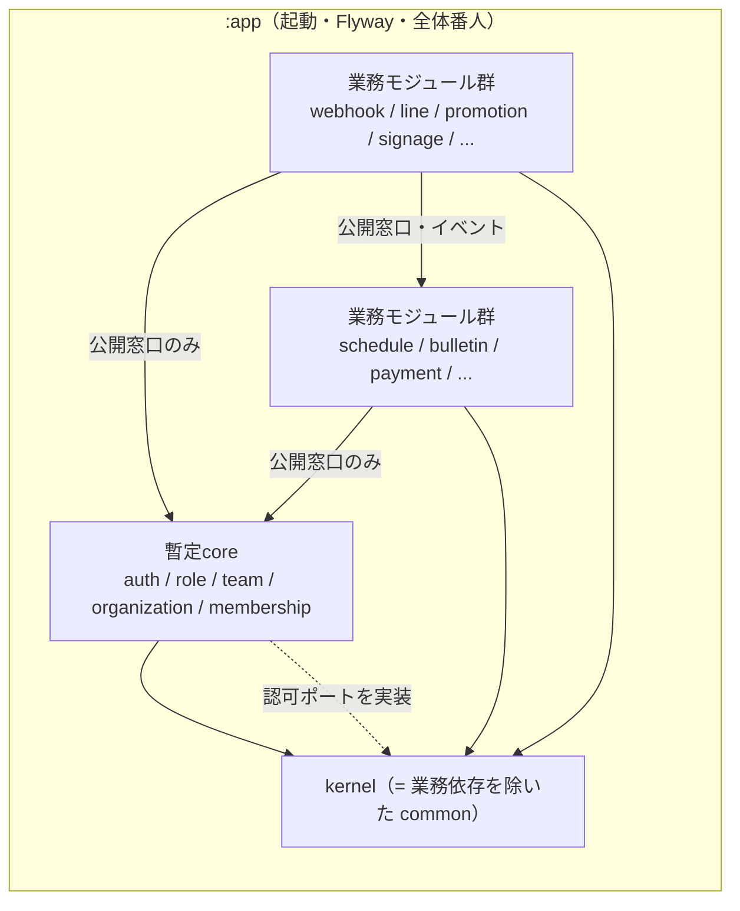
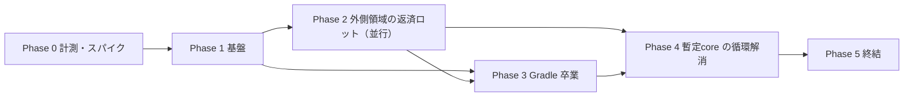
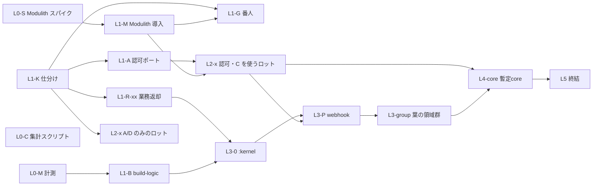

# モジュラーモノリス境界負債の返済と Gradle/Modulith 卒業 計画書

> 起票日: 2026-10-21
> 台帳: CMP-261021-0017（親・傘行。子 CMP は §8 レーン一覧に従い着手時に採番）
> 担当: kenta
> **ステータス**: 🟡 起草（精査待ち）
> 帰属: [`domain_db_design_principles.md`](domain_db_design_principles.md) 原則1・5、[`db_scalability.md`](db_scalability.md) 今後課題「イベント駆動アーキテクチャへの移行」（:107）

---

## §1. 背景と目的

### 1.1 経緯（事実）

- Mannschaft は「将来のマイクロサービス分割を見据えたモジュラーモノリス」を掲げている（CLAUDE.md「アーキテクチャ思想」）が、ビルドは**単一 Gradle プロジェクト**のままである。`backend/settings.gradle.kts` は初期セットアップ `6d58cf6a89`（2026-03-19）以来 `include` を一度も持たず、`rootProject.name = "app"` のみ。
- 単一 Gradle を選んだ ADR は存在しない。`backend/gradle.properties:8-9` に「現在はシングルモジュール構成のため効果は限定的だが、将来のマルチプロジェクト化に備えて有効化」とあるだけで、分割は「いずれやる」扱いのまま放置されてきた。
- ドメイン境界は ArchUnit の凍結（FreezingArchRule）で**悪化防止**だけを担っており、既存違反は返済計画のないまま凍結ストアに積まれている（§2）。
- 越境 `@Transactional` は原則5で「将来のイベント駆動化候補として記録する」とされ（`domain_db_design_principles.md:78-79`）、`db_scalability.md:107` の今後課題にも「イベント駆動アーキテクチャへの移行」が中優先度で残っている。

### 1.2 経緯（推測・未検証）

- 単一 Gradle のままでも開発が回っていたのは、ルートパッケージ暗黙スキャン（§2.5）で全ドメインが同居でき、境界違反がコンパイルを止めなかったためと推測する。
- ビルド時間の大半は分割と無関係な要因（fork 固定費・Flyway 再生テスト・コンテキスト数・CPU/IO 競合。§13.1）と実測されており、**分割でビルドが速くなるかは未計測**である。本計画は速度改善を目的に据えず、効果は Phase 0 / Phase 3 の計測で判断する。

### 1.3 目的

1. ドメイン間の越境依存（Entity・Repository 直接参照、越境トランザクション）を返済し、凍結ストアを空にする。
2. 越境連携を「公開 API の同期呼び出し」と「ドメインイベント（確実配信つき）」に揃え、将来の分割が機械的に可能な状態にする。
3. 境界を **Spring Modulith（論理境界）** と **Gradle サブプロジェクト（コンパイル時強制）** で二重に担保し、最終的に全領域を個別モジュールへ分離する。

### 1.4 目的外（マスター御裁可済み）

- 起動・デプロイ単位は**1つのまま**。マイクロサービス化はしない（将来分割できる状態を目指すだけ）。
- 外部 HTTP API の変更（§10）。
- ビルド時間短縮を目標値として約束すること（§13.1）。

---

## §2. 現状の数値（2026-10-21 origin/main `9530c75ddc` で再確認）

### 2.1 凍結ストア（`ArchUnitFreezeStoreIntegrityTest` の `EXPECTED_LINES_*` が正）

ストア: `backend/src/test/resources/archunit_store/`。1違反1行で、各行に発生元 FQCN が含まれるため発生元ドメイン別に集計できる（集計方法は §5.1 L0-C）。

| 番人 | 定数（行） | ストア UUID | 発生元ドメイン上位 |
|---|---:|---|---|
| D-1 越境 Entity 参照（`CrossDomainEntityImportArchTest`） | 2,037（:713） | `584c3a46-…` | publicview 176 / dashboard 176 / gdpr 153 / social 101 / contact 100 / disclosure 91 |
| D-3 越境 `@Transactional`（`CrossDomainTransactionalArchTest`） | 1,295（:743） | `f14374b1-…` | publicview 127 / village 79 / contact 72 / tournament 55 / admin 48 / social 47 |
| D-3T 推移的越境 tx（`CrossDomainTransactionalTransitiveArchTest`） | 7,137（:883） | `296295dd-…` | bulletin 530 / schedule 439 / shiftbudget 343 / payment 333 / tournament 323 / social 301 |
| D-5 越境 Repository 依存（`CrossDomainRepositoryDependencyArchTest`） | 1,853（:976） | `427c445d-…` | gdpr 142 / dashboard 133 / publicview 127 / village 86 / contact 72 / social 65 |
| ServiceAPI Entity 露出（`ServiceApiEntityBoundaryArchTest`） | 600（:989） | `93124b52-…` | timetable 62 / schedule 41 / match 38 / jobmatching 31 / payment 27 / notification 23 |
| D-2b UuidV7Entity 未継承（`EntityUuidV7ConventionArchTest`） | 569（:926） | `2c0ba995-…` | tournament 19 / advertising 16 / recruitment 14 / parking 14 |
| AUTHZ_WAVE4（`AuthzControllerGuardArchTest`） | 0（:682） | `9ed4737d-…` | — |

- D-3T は静的解析の打ち切り（`CrossDomainTransactionalTransitiveArchTest.java:48-54`）と推移展開の性質上、**過大計上の可能性がある**。1つの越境呼び出しが多数の tx 入口から数え上げられるため、行数は返済量の目安にならない。
- D-2b は既存テーブルの BIGINT 主キーで、原則6が「既存テーブルの BIGINT ID は原則として変更しない」と定めるため、境界負債ではない（扱いは 未解決事項 Q1）。

### 2.2 依存グラフ

| 指標 | 値 | 出典 |
|---|---:|---|
| main の Java ファイル | 8,407（再確認値。偵察時の集計は 7,854。数え方の違いとみられるが未特定） | `find backend/src/main/java -name '*.java'` |
| `com.mannschaft.app` 直下のトップレベルパッケージ | 120（再確認値。偵察時 118） | `find -mindepth 1 -maxdepth 1 -type d` |
| 越境 import | 9,376（偵察値・未再計測） | 偵察 |
| 強連結成分（SCC）の最大 | 83 パッケージ（common を含む。偵察値・未再計測） | 偵察 |
| common → 業務ドメインの import | 167 件／35 パッケージ（再確認値。偵察時 151 件／33 ドメイン／54 ファイル。再確認は import 文の単純集計で config 等を含む） | `grep '^import com.mannschaft.app.<x>' common/**` |
| config → 業務の import | 41 件（偵察時 40） | 同上 |
| JPA 関連（`@ManyToOne` 等）の越境 | 5 件・すべて notification → `auth.UserEntity`（例 `notification/confirmable/entity/ConfirmableNotificationEntity.java:155`） | 偵察 |

common の業務依存の代表（いずれも §6.1 で kernel から追い出す対象）:

- `common/AccessControlService.java:3-14` — family の Repository、membership の Repository・enum、organization の Service、role の Entity・Repository・Service を import（認可の中枢が common に業務依存を持つ）。
- `common/NameResolverService.java:3-9` — auth / organization / team の Entity・Repository。
- `common/activityschedule/ActivityScheduleFacade.java:3-21` — activity と schedule の Service・DTO を束ねる業務ファサード。
- `common/visibility/mapping/*VisibilityMapper.java` — 21 ファイル（偵察時「約25」）。
- `common/storage/quota/StorageUsageQueryService.java:3-10` — organization / team の Service。

### 2.3 越境の代表例

| 箇所 | 内容 | 想定パターン（§4） |
|---|---|---|
| `dashboard/controller/DashboardController.java:5` | bulletin の Repository を Controller が直接 import | A / D |
| `billing/ScopeMemberCountService.java:4` | membership の Repository | A |
| `gdpr/service/PersonalDataCollector.java:52` | resume の Repository（収集系。同様の import 多数） | A（SPI 化） |
| `actionmemo/service/ActionMemoAdminService.java:74-76` | todo / role / auth をまたぐ tx。既存 TODO コメントに「将来は TodoRevertedByAdminEvent で分離予定」 | B / C |
| `jobmatching/service/JobChatService.java:58-92` | chat の Channel / Member / Message Repository に直接 save し channelId を返す。呼び出し元 `JobContractService.java:154-156` が `contract.assignChatRoom(chatRoomId)` | C（§4.3 手本） |
| `role/service/BlockService.java` `blockUser`（:51） | role から他ドメインへの書き込み越境（偵察で検出） | B / C |
| `contact/service/ContactService.java` `addToDefaultFolder`（:157） | contact からの越境（偵察で検出） | A / B |

### 2.4 イベント資産（再確認値。コメント行を除いた単純 grep）

| 指標 | 再確認値 | 偵察値 |
|---|---:|---:|
| `@TransactionalEventListener` | 263 件／170 ファイル | 302 件／185 ファイル |
| `publishEvent(` | 260 件 | 233 件 |
| 他ドメインの `*Event` 型 import | 未再計測 | 113 件 |
| Spring Modulith | 未導入（`build.gradle.kts` に記載なし） | 同 |

既存の確実配信は通知専用の transactional outbox（[`notification_outbox.md`](notification_outbox.md)）だけである。

### 2.5 Spring・ビルド・テストの構成

- `MannschaftApplication.java:7` に `@SpringBootApplication` のみ。`@EntityScan` / `@EnableJpaRepositories` / `@ComponentScan` は無く、ルートパッケージ `com.mannschaft.app` 配下を暗黙スキャンしている。`@Entity` を持つファイルは 815（再確認値。偵察時 778）。
- Spring Boot 3.5.13（`build.gradle.kts:7`）、Gradle 8.14.4。buildSrc・version catalog 無し。`build.gradle.kts` は 1,211 行（偵察時「約1,100行」）。configuration cache は無効。
- テストの実測記録（`build.gradle.kts` のコメント）:
  - fork 1回あたり +447 秒、shard4 の `:test` 41.96 分のうちテスト正味 7.4 分（:395-417）。
  - Flyway 再生テストが計測時間の 72〜88%（:683-686 付近）。
  - Spring テストコンテキスト 17 個がヒープの 59%（:561-567）。上限 10 に制限済み（`backend/.claudecode.md` §30「テストコンテキストキャッシュ上限 10」）。
  - shard 分割（:597-642）、`archUnitTest`（:751）、`archTest`（:836）。
- ローカルの遅延は CPU/IO 競合で、ロック待ちは 0 件。`gradle-turnstile.sh` で直列化する（`docs/development/worktree_operations.md:96-109`）。
- CI: `.github/workflows/backend-ci.yml` の matrix 6 shard（:412-413）、`shard-weights.properties`、`verifyShardCoverage`、`cancel-in-progress: true`（:51）。
- Flyway: `backend/src/main/resources/db/migration` の単一ディレクトリに 1,223 ファイル（他に `rollback/` 2）。番人 `FlywayTimestampNamingGuardTest`。

### 2.6 番人の限界

- `DomainPackages.java:24` の `SHARED_DOMAIN = "common"` は、相手先・発生元のどちらが common でも許容する。common に業務ロジックを置けば全番人をすり抜ける（実際に §2.2 の 167 件がある）。
- `--tests` で絞り込んで実行すると凍結ストアが壊れる（`backend/.claudecode.md` §30「凍結ストアは `--tests` 絞り込み実行で破壊される」）。
- D-3T は静的解析で打ち切るため、interface 経由・リフレクション・動的ディスパッチは見ない（§2.1）。

---

## §3. 目標アーキテクチャ

### 3.1 モジュールの3層

| 層 | 中身 | 依存してよい先 |
|---|---|---|
| **kernel** | 業務を知らない基盤だけ（下の列挙） | JDK・Spring・ライブラリのみ |
| **暫定core** | auth / role / team / organization / membership（＋ notification は 未解決事項 Q2） | kernel、暫定core の構成領域同士（Phase 4 まで循環を許容） |
| **業務モジュール群** | 上記以外の全トップレベルパッケージ | kernel、暫定core と他業務モジュールの**公開窓口のみ** |

**暫定core の構成領域は本書で固定する。** 追加にはマスターの裁可が要る。暫定core に「何でも入れる」ことを防ぐため、番人 `ProvisionalCoreMembershipGuardTest`（L1-G で新設）が構成領域の一覧を定数で持ち、一覧外のパッケージが暫定core 扱いの例外を受けたら fail させる。

**kernel に入れてよいもの（列挙。これ以外は入れない）:**

- 例外基盤（`BusinessException`・ErrorCode の interface）、`ApiResponse` 等の共通レスポンス型
- `UuidV7Entity` / `UuidV7` など Entity 基底・ID 生成
- `AbstractTenantAwareRepository` などテナント基盤
- 時刻・ゾーン、ページング、JSON などの汎用ユーティリティ
- イベント基底（`common.event.BaseEvent`）
- ストレージ・キャッシュ・ロックなどインフラのアダプタ（業務の判断を含まないもの）
- **認可ポート**（interface のみ。実装は暫定core。§6.1）

kernel に入れてはならないもの: 業務ドメインの型の import、業務判断（誰が見えるか・誰が操作できるか・何人いるか）、特定ドメインのファサード。番人 `KernelNoBusinessDependencyArchTest`（L1-G）が「kernel から業務パッケージへの import 0 件」を**凍結なしの0件必須**で強制する。

**パッケージ名の扱い（本書で判断）:** kernel は新しいパッケージを作らず、**`common` から業務依存を追い出した残りをそのまま kernel とする**。`BusinessException` 等は数千ファイルが import しており、改名すると全レーンと衝突する PR になるため。

### 3.2 まとめ方の基準（過剰細分化の回避）

- **Modulith の論理モジュール = トップレベルパッケージ**（現状の 120 のまま。パッケージは動かさない）。
- **Gradle サブプロジェクト = 1つ以上の論理モジュールの束**。パッケージとサブプロジェクトは1対1にしない。
- 同じサブプロジェクトに**束ねる**基準: (a) 互いに循環し、業務上ひとまとまり（例: shift と shiftbudget）、(b) 単独では小さい（目安 20 ファイル未満）うえ依存先が同じ、(c) 同じ画面群・同じ集約を扱う。
- **分ける**基準: (a) 被依存 0 の葉、(b) 単独でテストできる、(c) 変更頻度が他と大きく違う。
- 巨大な common を作らない。共通化したくなったものは、まず「どの業務が持ち主か」を決めてその業務の公開窓口に置く。kernel に入れるのは §3.1 の列挙に該当するときだけ。

### 3.3 依存方向



- 矢印の逆向き（kernel → 業務、暫定core → 業務モジュール）は禁止。暫定core が業務の情報を必要とする場合は、業務側がイベントを発行し暫定core が購読する。

### 3.4 公開窓口の規約

- 他モジュールから参照してよいのは `<domain>.api` パッケージ（とその下）だけ。Modulith では `@NamedInterface("api")` を `package-info.java` に付ける。
- `api` に置いてよいもの: 公開 Service の interface（または final なファサード）、引数・戻り値の DTO（record 推奨）、**発行するイベント型**、他モジュールが実装する SPI interface。
- `api` に置いてはならないもの: `@Entity`、Repository、Spring Data の型を含むシグネチャ。
- **イベント型の置き場所は発行側の `api`**（例: `jobmatching.api.JobContractMatchedEvent`）。購読側が発行側の `api` に依存する向きになる。
- 公開 Service の命名: `<Domain><用途>Api`（例: `ChatRoomQueryApi`）。実装クラスは非公開パッケージに置く。

---

## §4. 越境の解き方カタログ

### 4.1 パターンと判定基準

| パターン | 中身 | 使う条件 | 挙動の変化 |
|---|---|---|---|
| **A 公開 API 同期** | 相手モジュールの `api` を同期で呼ぶ | 即時に結果が要る**読み取り**。または相手の業務判断を問う（認可など） | 戻り値は変わらない。相手の内部型に依存しなくなるだけ |
| **B AFTER_COMMIT イベント** | 自分の tx 内で `publishEvent`、相手は `@TransactionalEventListener(AFTER_COMMIT)` | 書き込みを伴うが、**取りこぼしても業務上許容できる**連携（キャッシュ無効化・統計・補助的な通知など） | 相手側の反映は commit 後で遅れる。相手が失敗しても自分は巻き戻らない。取りこぼしうる |
| **C Registry 確実配信** | B に加えて Spring Modulith の Event Publication Registry に記録し、未完了なら再配信 | 書き込みを伴い、**業務上必ず起きなければならない**連携 | B に加え、未完了の購読は Registry に残り再配信される。**購読側は冪等必須** |
| **D tx 外読み取り snapshot** | 自分の tx の外（または前）で相手の API から値を読み、値として持ち込む | 書き込みの判断材料として他モジュールの状態が要るが、同一 tx の一貫性までは要らない | 読んだ値が古くなりうる（決定の根拠をログ・列に残す） |
| **E 同一 tx 不可欠の台帳化** | 越境のまま残し、理由つきで台帳に載せる | 原子性が業務上絶対に要り、補償でも代替できない | 変化なし。台帳に理由・代替不能の根拠・見直し条件を書く |

判定の順序: まず A（読み取りか）→ 書き込みなら C か B（取りこぼし許容か）→ 判断材料の読み取りなら D → どれも不可なら E。**`@Transactional` を外すだけの修正は禁止**（原子性を黙って失う症状隠し。CMP-260912-1524 で自己呼び出しにより原子性が失われていた事例がある）。

E の台帳は凍結ストアに入れない。D-3P と同じく**監査済み例外の一覧**（test ソースの定数、理由必須、実在しなくなった例外は fail）として `CrossDomainTransactionLedger` を L1-G で新設する。

### 4.2 各パターンに必要なテスト

| パターン | 必須テスト |
|---|---|
| A | 公開 API の契約テスト（正常・不在・権限なし）。呼び出し側の既存テストが無変更で緑 |
| B | 発行 → 購読側反映の IT（commit 後に反映）。発行側 tx が巻き戻ったら購読されない IT |
| C | B に加え、(1) 購読側が例外を投げたら Registry に未完了として残る、(2) 再配信で反映される、(3) 同じイベントを2回配信しても二重作成されない（冪等）、(4) 発行側 tx の巻き戻しで Registry にも残らない |
| D | 読んだ値が後で変わっても書き込みが壊れない（または判断根拠が残る）ことの単体テスト |
| E | 台帳の番人（理由必須・実在確認）が緑。原子性が要る根拠を示すテスト（途中失敗で両方巻き戻る） |

### 4.3 手本: `JobChatService.createRoomForContract`（パターン C）

**before**（`jobmatching/service/JobChatService.java:58-92`、呼び出し `JobContractService.java:154-156`）:

```java
// jobmatching の tx 内で chat の Repository に直接 save
ChatChannelEntity saved = channelRepository.save(channel);   // chat ドメインの表
channelMemberRepository.save(...);                            // 同上
messageRepository.save(initialMessage);                       // 同上
return saved.getId();
// 呼び出し側
Long chatRoomId = jobChatService.createRoomForContract(contract, posting);
contract.assignChatRoom(chatRoomId);
```

**after**:

```java
// jobmatching（発行側）: 自分の表だけを書き、イベントを発行する
contract = contractRepository.save(contract);
eventPublisher.publishEvent(new JobContractMatchedEvent(
        contract.getId(), posting.getTitle(),
        contract.getRequesterUserId(), contract.getWorkerUserId()));  // jobmatching.api に置く

// chat（購読側）: Registry 経由で確実配信。冪等に作る
@ApplicationModuleListener   // AFTER_COMMIT + 別 tx + Registry 記録
void on(JobContractMatchedEvent e) {
    if (channelRepository.existsBySourceTypeAndSourceId("JOB_CONTRACT", e.contractId())) return;  // 冪等
    // チャンネル・メンバー・初期メッセージを chat の tx で作る
}

// jobmatching が channelId を要るとき: 戻り値ではなく chat の公開 API で逆引き（パターン A）
Optional<Long> id = chatRoomQueryApi.findChannelIdBySource("JOB_CONTRACT", contractId);
```

挙動の変化と対処:

- **戻り値が無くなる**。`contract.assignChatRoom(chatRoomId)` で持っていた列は、(a) chat の公開 API で `sourceType`/`sourceId` から逆引きする（列を廃止）か、(b) chat が `ChatRoomCreatedForSourceEvent` を発行し jobmatching が購読して列を埋めるか、のどちらか。どちらを採るかはロットで決める。
- **遅延**: 契約成立の応答時点ではチャンネルがまだ無いことがある。応答 DTO に `chatRoomId` を含む場合は、外部 API 不変（§10）を守るため、(a) 応答時に null を許す仕様が既にあるかを確認し、無ければ (b) この連携は E に倒すかロットを保留する。**openapi.json の差分ゼロと画面の挙動不変が条件**であり、満たせない場合はロットを止めて上奏する。
- **失敗時**: chat 側が失敗しても契約は成立したまま。Registry に未完了で残り、再配信で作られる。
- **冪等性**: `sourceType + sourceId` の一意性で二重作成を防ぐ（一意制約が無ければ同ロットで Flyway 追加を検討）。
- 必要なテスト: §4.2 C の (1)〜(4) と、既存の契約成立 IT が無変更で緑であること。

### 4.4 既存 outbox との棲み分け

| | 通知 outbox（`notification_outbox.md`） | Modulith Event Publication Registry |
|---|---|---|
| 対象 | 通知 push の予約（送り手ドメイン → notification） | 通知以外のモジュール間イベント全般 |
| 表 | 送り手ドメインごと（`team_notification_outbox` 等） | ライブラリ管理の単一表（`event_publication`。§11.2 で理由） |
| 配信 | relay と予備ポーラー（5秒）、claim_token、DEAD | Modulith の再配信（起動時・定期の再投入は L1-M で設定） |
| 方針 | **既存の通知 outbox は置き換えない**。通知の push 予約は引き続き outbox を使う。新規の通知以外の確実配信は Registry を使う。両者を一本化するかは Phase 5 で判断する |

---

## §5. Phase 計画

Phase は大きな区切りで、実際の作業単位は §8 のレーンである。Phase 2 と Phase 3 は並走する。



### 5.1 Phase 0 計測とスパイク

- **L0-M ビルド/テスト時間の基準計測**
  - 手順: `./scripts/gradle-turnstile.sh ./gradlew <task> --profile --offline`。キャッシュを温めて**1回目は捨てる**。同一マシン・他の heavy build 無しで各条件3回。
  - 3条件: (1) クリーンビルド（`compileJava` まで）、(2) 1ファイル変更後の増分（葉の領域・暫定core の領域それぞれ）、(3) `test`（JUnit XML の `testsuite@time` を合計し、正味テスト時間と壁時計の差＝固定費を出す）。
  - 出力: `docs/evidence/CMP-xxxx.md`（子 CMP の証拠）に表で残す。
- **L0-S Spring Modulith スパイク**（コードは捨てるブランチで行い、結果だけを文書化）
  - Spring Boot 3.5.13 と互換の Modulith の版を確定する（候補は 1.4 系。2.x は Boot 4 系向けとされるため対象外。公式の互換表で確認する）。
  - その版の JPA Event Publication Registry の公式スキーマ（表名・列・索引）を確定し、§11.2 の DDL を確定版に差し替える。
  - `ApplicationModules.of(MannschaftApplication.class).verify()` を実行し、違反件数と種類を記録する（現状 120 モジュール。循環の件数を含む）。
  - `@ApplicationModuleTest` で葉の1モジュール（webhook 想定）のテストが起動するか、所要時間を記録する。
- **L0-C ドメイン別違反集計スクリプト**（本書で「要」と判断）
  - 凍結ストア7本を発生元ドメイン別・番人別に集計する小さなスクリプト（`backend/scripts/` に置く）。ロットの着手判断・完了判定・残件確認に毎回使うため、手作業の awk を各セッションが書き直すより一本化する方がよい。
- 入口条件: なし（即着手可）。
- 出口条件: 計測表・Modulith の版とスキーマ・verify の初回結果・集計スクリプトがそろい、§11.2 と未解決事項の該当箇所を更新済み。

### 5.2 Phase 1 基盤

- **L1-K kernel の確定**: common の各クラスを「kernel に残す／業務へ返す／認可ポートへ」に仕分けた一覧を作り、kernel に残すものだけで業務 import 0 件になる見通しを示す（コードの移動は L1-A・L1-R が行う）。
- **L1-A 認可ポート化**: `AccessControlService` の公開メソッドを kernel の interface（例 `common.authz.AccessControlPort`）に抽出し、実装を暫定core（membership か role。L1-K で決める）へ移す。呼び出し側は interface に依存させる（呼び出し側の差分は import の付け替えのみ）。葉の領域が卒業する前提条件。
- **L1-R common の業務ロジック返却**: `NameResolverService`、`ActivityScheduleFacade`、`*VisibilityMapper`（21）、`StorageUsageQueryService` などを持ち主の業務へ移す。対象ごとに子 CMP を分けてよい（§8）。
- **L1-M Modulith 導入**: 依存追加（Phase 0 で確定した版）、`event_publication` 表の Flyway、`ApplicationModules` の verify テストを**レポートのみ（失敗させない）**で追加、`@NamedInterface` の規約（§3.4）を決める。
- **L1-B build-logic**: `build.gradle.kts` の Test 設定・shard 分割・番人タスクを `build-logic`（included build の convention plugin）へ移す。単一プロジェクトのまま行い、挙動は変えない（タスク一覧と shard 割当が前後で一致することを確認）。
- **L1-G 番人の更新**: `KernelNoBusinessDependencyArchTest`、`ProvisionalCoreMembershipGuardTest`、`CrossDomainTransactionLedger`、Modulith verify 必須化リスト（§9.5）を新設。`DomainPackages` の common 例外は、L1-R 完了までは現状維持（先に外すと全ストアが一斉に増える）。
- 入口条件: L1-M は L0-S 完了。L1-B は L0-M 完了（計測の基準を先に取るため）。L1-K は即可。L1-A・L1-R は L1-K 完了。L1-G は L1-K・L1-M 完了。
- 出口条件: kernel の業務 import が 0 件で番人が0件必須として緑、認可ポートが kernel にあり、Modulith verify がレポートを出し、build-logic 化後もタスク・shard 割当が不変。

### 5.3 Phase 2 外側領域の返済ロット（並行）

- 1ロット = 発生元が1ドメイン（または少数ドメインの束）。そのドメイン発の D-1 / D-3 / D-5 / ServiceAPI を**まとめて**返済し、D-3T も当該ドメイン発の行を0にするか E 台帳へ移す。
- 順序の目安: 被依存が少なく、負債が多い「集約・閲覧系」から（dashboard・publicview・gdpr・contact・social・village など）。読み取りが主なので A / D で解けるものが多い。gdpr の収集は SPI（各ドメインが `PersonalDataContributor` を `api` で実装）で解く。
- 既存戦役の吸収:
  - **CMP-260918-1406**（D-5 段階返済、対応中、Issue #3354。次ロット TeamRegionNormalizer）は本 Phase に包含する。**進行中のロットは尊重し、そのまま CMP-260918-1406 で完了させる**。以後のロットは本書のレーン運用に合流する。
  - **CMP-260930-2126**（member の D-3T 約40行）は member ロットとして本 Phase に含める（行はそのまま使い、本書の完了条件雛形を満たすこと）。
  - **Issue #3002**（ServiceAPI 凍結）は各ロットで当該ドメイン分を返済する。
- 入口条件: L1-A 完了（認可を使うロット）、L1-M 完了（パターン C を使うロット）。A / D だけで解けるロットは L1-K の仕分けが済めば着手してよい。
- 出口条件: 暫定core 以外の全ドメインについて、発生元の凍結行が0（または E 台帳）で、Modulith verify が当該モジュールで通る。

### 5.4 Phase 3 Gradle 卒業（Phase 2 と並走可）

- **L3-0 `:kernel` サブプロジェクト化**: kernel（common の残り）を `:kernel` に移し、`:app` が依存する。Flyway は `:app` に残す（§11.2）。
- **L3-P パイロット webhook**: webhook（26 ファイル、common の import 31 件、`AccessControlService` 使用 4 ファイル）を `:module-webhook` に移す。Spring のスキャン・Entity/Repository 検出・テスト・CI が成り立つかを確認し、計測する（§14 の撤退条件を判定）。
- **L3-xx 葉の領域群**: line（36）、promotion（49）、次点 signage（25）、service（58）、workflow（55。shiftbudget から被依存3件 `shiftbudget/service/ThresholdAlertEvaluationService.java:15-17` があるため、先に workflow の公開窓口化が要る）。§3.2 の基準で束ねる。
- 入口条件: L3-0 は L1-K 完了＋ L1-B 完了。L3-P は L3-0 完了＋ webhook のロット（Phase 2）完了＋ L1-A 完了。L3-xx は L3-P の判定が「継続」。
- 出口条件: 卒業したモジュールは、他モジュールへの未宣言の依存があると**コンパイルが失敗**する。

### 5.5 Phase 4 暫定core の循環解消

- auth / role / team / organization / membership（＋ Q2 次第で notification）の間の循環を、§4 のパターンで解く。順序は Phase 0 の verify 結果で決める。
- 入口条件: 暫定core 以外の Phase 2 ロットがおおむね完了（暫定core が業務モジュールへ依存していない状態）。
- 出口条件: 暫定core の各領域が独立したモジュールとして verify を通り、循環が0。暫定core という区分を廃止する。

### 5.6 Phase 5 終結

- 凍結ストアのうち D-1 / D-3 / D-3T / D-5 / ServiceAPI が空になり、ストアファイルと定数を削除する（D-2b は 未解決事項 Q1）。
- `DomainPackages` の common 例外を撤廃する（kernel は Gradle `:kernel` と `KernelNoBusinessDependencyArchTest` で担保）。
- Modulith verify を全体で必須にする。残る番人は「凍結」から「0件必須」へ格上げする（§9.4）。
- 通知 outbox と Registry の一本化の要否を判断する。
- 入口条件: Phase 2〜4 の出口条件がすべて満たされる。
- 出口条件: 上記がすべて main で緑。CMP-261021-0017 を完了にする。

---

## §6. Phase 1 の補足

### 6.1 common の三分割

| 区分 | 行き先 | 代表 |
|---|---|---|
| kernel | `common` に残す | `BusinessException`、`UuidV7Entity`、`AbstractTenantAwareRepository`、`BaseEvent`、`MediaUrlResolver` 等（§3.1 の列挙に該当するもの） |
| 認可ポート | interface は kernel、実装は暫定core | `AccessControlService`（family・membership・organization・role に依存） |
| 業務ロジック返却 | 持ち主の業務モジュールの `api` | `NameResolverService`（auth/team/organization）、`ActivityScheduleFacade`（activity/schedule）、`*VisibilityMapper`（各ドメイン）、`StorageUsageQueryService` |

`AccessControlService` が family（ケアリンク）を参照している点は、family が暫定core に入らないため、認可ポートの実装が family の公開窓口を呼ぶ形になる。family が暫定core に依存していないかを L1-K で確認する（循環するなら family の参照を SPI にする）。

### 6.2 config の扱い

config → 業務の import 41 件は、Spring 設定が業務の Bean を直接組み立てていることを示す。設定は持ち主の業務モジュールへ移すのを基本とし、横断の設定（Security など）は `:app` に残す。L1-K の仕分けに含める。

---

## §7. 並行作業の規律

### 7.1 担当単位

- 担当単位は **レーン**（§8）。Phase 2 のレーン＝ロット＝発生元ドメイン単位（または少数の束）。同じドメインを2つのレーンに分けない。
- ロットは、自分のドメイン（発生元）の中と、相手ドメインの `api` パッケージへの**新規ファイル追加**だけを触る。相手の `api` の既存ファイルを変える必要があるときは、相手ドメインのロットが着手宣言済みならその担当と正本 Issue で調整し、未着手なら自分のロットに相手ドメインを束ねて宣言し直す。

### 7.2 単独オーナーの共有資産

以下はロット間で同時に触ってはならない。触るのは該当レーン（括弧内）だけで、他レーンは変更が必要になったら正本 Issue で依頼する。

- kernel（`common` の残り）と認可ポート（L1-K / L1-A）
- 番人（`common/architecture/` 配下。L1-G。ただし凍結ストアと `EXPECTED_LINES_*` の**減算**は各ロットが §7.4 の手順で行う）
- `build-logic` と `build.gradle.kts`・`settings.gradle.kts`（L1-B、Phase 3 では L3-*）
- `.github/workflows/backend-ci.yml`・`shard-weights.properties`（L1-B / L3-*）
- Modulith の設定と `event_publication` の Flyway（L1-M）

### 7.3 着手宣言・解放・引継ぎ（CLAUDE.md「横展開型の戦役における担当重複の防止」準拠）

1. **正本 Issue**: L1 の最初のレーンに着手するセッションが、親 Issue「CMP-261021-0017 境界負債の返済（レーン管理）」を1本立て、本書へのリンクとレーン一覧の表をコメントに貼る。以後、全レーンの宣言・解放・マージ待ちはこの Issue で行う。
2. **着手前**: 親 Issue のコメントと `docs/task-list.md` を読み、対象ドメインのレーンが宣言済み・子 CMP が「実装中」でないか確認する。残件は**移設先も確認して**判定する（ストアの行が減っているか、相手の `api` に窓口ができているか。集計は L0-C のスクリプトで行う）。
3. **着手時**: 子 CMP を採番して（§8.3）台帳末尾に起票する PR を出し、同時に親 Issue に「着手: <レーン名> / 子 CMP / 対象ドメイン / ブランチ名」をコメントする。宣言は PR を立てる前に行う。
4. **中断時**: `/引継` で引き継ぎ書を作り、親 Issue に「中断: <レーン名> / 引き継ぎ書の所在 / 担当を保持するか解放するか」をコメントする。
5. **断念・完了時**: 親 Issue に「解放」または「完了: PR #」をコメントする。黙って離脱しない。
6. **放置の扱い（本書で判断）**: 宣言から 3 日間、親 Issue にも PR にも更新が無いレーンは、他セッションが親 Issue で問い合わせ、さらに 24 時間応答が無ければ引き取ってよい（引き取った旨をコメントする）。

**同一ドメインを2セッションが触らない仕組み**: (a) 親 Issue の宣言、(b) 子 CMP 行の戦役列に対象ドメイン名を必ず書く（`grep` で発見できるように）、(c) ブランチ名を `feature/<issue>-boundary-<domain>` に統一し、着手前に `gh pr list --search "boundary-<domain>"` で確認する。

### 7.4 凍結ストアと `EXPECTED_LINES_*` の直列マージ

凍結ストアのファイルと `ArchUnitFreezeStoreIntegrityTest` の定数行は全ロットが触るため、並行マージすると必ず衝突し、衝突を手で解くと行数がずれる。

- **マージ待ちの順番**: CI 緑になったロットは親 Issue に「マージ待ち: <子 CMP> PR #」をコメントする。**コメントの時刻順（先着順）**にマージする。前のロットのマージを確認してから次のロットが準備に入る。
- **マージ直前の手順**（各ロットが自分で行う）:
  1. `git fetch origin && git merge origin/main`（**rebase しない**。同一 PR への push で force push を誘発するため）。
  2. 凍結ストアの衝突はファイルを手で解かず、マージ後のツリーで `./scripts/gradle-turnstile.sh ./gradlew archUnitTest` を**絞り込みなしで**実行してストアを再生成する。
  3. `wc -l backend/src/test/resources/archunit_store/<UUID>` の実測値で `EXPECTED_LINES_*` を更新し、ストアと定数を**同一コミット**にする。
  4. push → CI 緑 → マージ。マージ後、親 Issue の自分のコメントに「マージ済み」と追記する。
- **`--tests` での絞り込み実行は禁止**（凍結ストアが壊れる）。
- 凍結ストアを触らないレーン（L0-*、L1-B 等）はこの行列に並ばない。

### 7.5 main 追従の頻度

- レーンが開いている間は、**作業を再開するたび**と **push の前**に `git merge origin/main` する（少なくとも1日1回）。
- 凍結ストアを触る PR は §7.4 のとおりマージ直前にもう一度追従する。
- 他の PR の状態は、語る直前に `gh pr view --json state,mergedAt` で取り直す。

### 7.6 PR の粒度

- 1レーン = 1 PR を基本とする。差分が大きいロット（D-3T が数百行のドメインなど）は、同じ子 CMP の下で「読み取り（A/D）」「書き込み（B/C）」に PR を分けてよい。
- 1 PR で触る発生元ドメインは宣言したものだけ。

---

## §8. レーン一覧

### 8.1 レーン一覧表

| レーン | 内容 | 入口条件（依存レーン） | 触ってよい範囲 | 触ってはならない共有資産 | 出口条件 |
|---|---|---|---|---|---|
| L0-M | ビルド/テスト時間の基準計測 | なし | `docs/evidence/` | コード・設定すべて | 3条件×3回の計測表 |
| L0-S | Modulith スパイク（版・スキーマ・verify 初回・`@ApplicationModuleTest`） | なし | 捨てブランチ、`docs/evidence/`、本書 §11.2・未解決事項 | main のコード | 版とスキーマ確定、verify 件数記録 |
| L0-C | ドメイン別違反集計スクリプト | なし | `backend/scripts/` の新規ファイル | 番人・凍結ストア | 7ストアを番人別・ドメイン別に集計できる |
| L1-K | common の仕分け（kernel／認可ポート／返却） | なし | 本書の付録表、`docs/evidence/` | コード（移動は L1-A/L1-R） | 全クラスの仕分け表、暫定core のどこに認可実装を置くか決定 |
| L1-A | 認可ポート化 | L1-K | `common/AccessControlService` と新 interface、暫定core の実装、呼び出し側の import | 番人、build 設定 | 認可の interface が kernel にあり業務 import を持たない |
| L1-R-xx | common の業務ロジック返却（対象ごとに子 CMP 可） | L1-K | 対象クラスと持ち主ドメインの `api`、呼び出し側 | 他の L1-R が対象にしたクラス、番人 | 対象が common から消え、持ち主の `api` 経由になる |
| L1-M | Modulith 導入・`event_publication` 表・verify レポート | L0-S | 依存定義（`build.gradle.kts` の dependencies 節のみ）、Flyway 新規1本、Modulith 設定、verify テスト | shard 設定、凍結ストア | verify がレポートを出す、Registry が動く IT が緑 |
| L1-B | build-logic convention plugin 化 | L0-M | `build-logic/`、`build.gradle.kts`、`settings.gradle.kts` | 番人の中身、CI の job 構成（変える場合は L1-B で単独） | タスク一覧・shard 割当が前後一致 |
| L1-G | 番人の新設・更新 | L1-K、L1-M | `common/architecture/` | 凍結ストアの中身（各ロットの減算以外） | §9.1 の L1-G 条件が緑 |
| L2-<domain> | 返済ロット（1ドメイン or 少数束） | L1-K（A/D のみ）、L1-A（認可）、L1-M（C） | 発生元ドメイン、相手の `api` への新規ファイル、凍結ストアの減算と定数 | kernel、番人、build 設定、他ロットの発生元 | §8.4 雛形 |
| L3-0 | `:kernel` サブプロジェクト化 | L1-K、L1-B、L1-R 全完了 | `settings.gradle.kts`、`build-logic/`、`kernel/` | 業務ドメインのコード | `:kernel` が業務に依存せずコンパイル |
| L3-P | パイロット webhook の卒業 | L3-0、L2-webhook、L1-A | `module-webhook/`、build 設定、CI | 他の業務モジュール | §9.2 の受け入れ条件、§14 の撤退判定 |
| L3-<group> | 葉の領域群の卒業 | L3-P の判定「継続」、対象の L2 完了 | 対象モジュールと build 設定 | 他の L3 が対象にしたモジュール | 未宣言依存でコンパイル失敗する |
| L4-<core> | 暫定core の循環解消 | 暫定core 以外の L2 がおおむね完了 | 暫定core の該当領域 | kernel（変更は L1-K の後継として単独） | 当該領域が verify を通る |
| L5 | 終結 | L2・L3・L4 全完了 | 番人・凍結ストア削除・`DomainPackages` | — | §5.6 |

### 8.2 レーン間の依存と同時実行



**同時に走らせてよい組合せ:**

- L0-M・L0-S・L0-C・L1-K は互いに独立で、4本同時に走らせてよい（L0-M と L1-B 以外の heavy build は turnstile で直列化されるため、計測中の L0-M と heavy build を伴うレーンが同じマシンで重なると計測が狂う。L0-M の計測中は同一マシンで heavy build を走らせない）。
- L1-A・L1-R-xx（対象が異なるもの同士）・L1-M・L1-B は同時に走らせてよい。L1-G は L1-M の後。
- L2-<domain> は**発生元ドメインが重ならない限り何本でも**同時に走らせてよい。マージだけは §7.4 で直列化する。
- L3-<group> と L2-<domain> は、対象が重ならなければ同時に走らせてよい。L3 同士は build 設定を触るため**同時に1本**。
- 同時に走らせてはならない: L1-B と L3-*（どちらも build 設定）、L1-K と L1-A/L1-R（仕分け確定前）、同一ドメインの L2 2本、L4 の同一領域 2本、L5 と他すべて。

### 8.3 子 CMP の運用

- CMP-261021-0017 は全体を束ねる親行（傘）。**本 PR では子 CMP 行を作らない。**
- レーンに着手するセッションが、着手時に `TZ=Asia/Tokyo date '+%y%m%d-%H%M'` で子 CMP の ID を採番し、`docs/task-list.md` の**表の末尾**に起票する（worktree + PR。CLAUDE.md の台帳運用）。
- 子 CMP 行の書き方: 戦役列は「CMP-261021-0017 子: <レーン名>（対象ドメイン: <domain>）」、依存列に `CMP-261021-0017` と依存レーンの子 CMP、完了条件に §8.4 の雛形、証拠列に PR 番号。
- 既存の CMP-260918-1406・CMP-260930-2126 は子 CMP として扱い、新たに採番し直さない（親 Issue のレーン表で対応づける）。

### 8.4 子 CMP の完了条件の雛形

**L2（返済ロット）:**

- 当該ドメイン発の D-1 / D-3 / D-5 / ServiceAPI の凍結行が0（L0-C の集計で確認）。
- 当該ドメイン発の D-3T の行が0、または E 台帳（`CrossDomainTransactionLedger`）に理由つきで移っている。
- `EXPECTED_LINES_*` が凍結ストアの実測 `wc -l` と同一コミットで一致して減算されている。
- `ApplicationModules` の verify が当該モジュールについて違反0（L1-M 以後）。
- `docs/openapi.json` の差分ゼロ。
- イベント化した連携ごとに §4.2 のテストがある。
- UI に見える挙動が変わる場合は実機E2E（権限あり／なし／他テナント）＋アリシゼーション実施。変わらない場合はその根拠を PR 本文に書く。

**L1 / L3:**

- 該当 Phase の出口条件（§5）を満たし、受け入れ条件（§9）のテストが緑。
- L3 は、卒業したモジュールに未宣言依存を足すとコンパイルが失敗することを確認した記録がある。

---

## §9. 受け入れ条件

### 9.1 Phase 0・1

- [ ] L0-M: 3条件×3回の計測値と JUnit XML 集計（正味・固定費）が `docs/evidence/` にある。
- [ ] L0-S: Modulith の版、Registry の公式スキーマ、verify 初回の違反件数（種類別）が記録されている。
- [ ] L0-C: 集計スクリプトの出力の合計が各 `EXPECTED_LINES_*` と一致する（境界: 空のストアで 0 を出す）。
- [ ] L1-A: `AccessControlPort`（仮称）が kernel にあり、kernel から業務への import が0件。既存の認可 IT が無変更で緑。
- [ ] L1-R: 返却した各クラスが common に存在せず、呼び出し側が持ち主の `api` 経由。返却後も common → 業務の import 件数が単調減少。
- [ ] L1-M: `event_publication` 表が Flyway で作られ、照合順序が `utf8mb4_0900_ai_ci`（`MigrationCollationDeclarationGuardTest` が緑）。購読側が例外を投げると未完了で残り、再投入で完了する IT が緑。
- [ ] L1-M: verify テストは違反があっても fail しない（レポートのみ）ことを確認するテストがある。
- [ ] L1-B: build-logic 化の前後で `./gradlew tasks --all` の差分が無く、`verifyShardCoverage` が緑、各テストクラスの shard 割当が一致する。
- [ ] L1-G: `KernelNoBusinessDependencyArchTest` は kernel に業務 import を1件足すと fail する（陽性の検体テスト付き）。`ProvisionalCoreMembershipGuardTest` は一覧外パッケージを暫定core 扱いにすると fail する。`CrossDomainTransactionLedger` は理由の空欄・実在しない例外で fail する。

### 9.2 Phase 2（ロットごと）・Phase 3

- [ ] §8.4 の L2 雛形をすべて満たす。
- [ ] イベント化した連携ごとに: 発行 → 購読側反映、購読側失敗時に Registry 未完了として残り再配信される、重複配信で二重作成されない、発行側の巻き戻しで購読されない（C の場合。B は前2つと巻き戻し）。
- [ ] 異常系: 相手モジュールの公開 API が不在・権限なしを返したときの既存のエラーコード・HTTP ステータスが変わらない。
- [ ] L3: 卒業モジュールが他モジュールの非公開型を参照するとコンパイルが失敗する。`build.gradle.kts` に宣言していないモジュールの `api` を参照してもコンパイルが失敗する。
- [ ] L3: 起動した Spring コンテキストで、卒業モジュールの `@Entity`・Repository・`@Component` が卒業前と同じ件数検出される（Bean 名一覧の比較）。
- [ ] L3: 卒業モジュールのテストが CI のいずれか1 shard でちょうど1回実行される（`verifyShardCoverage` 相当）。
- [ ] L3: ArchUnit 番人が卒業モジュールのクラスを含む全クラスパスで実行される（ストアの行数が卒業の前後で変わらない）。

### 9.3 Phase 4・5

- [ ] 暫定core の各領域が verify を通り、モジュール循環が0。
- [ ] D-1 / D-3 / D-3T / D-5 / ServiceAPI のストアファイルと定数が削除され、各番人が凍結なしの0件必須として緑。
- [ ] `DomainPackages` の common 例外が無く、それでも全番人が緑。
- [ ] Modulith verify が全体で必須（違反1件で fail）。

### 9.4 番人の対応表（卒業後に Modulith/Gradle で代替して廃止できるか）

| 番人 | Modulith verify で代替 | Gradle で代替 | 卒業後の扱い |
|---|---|---|---|
| D-1 `CrossDomainEntityImportArchTest` | **大部分は可**（Entity を非公開パッケージに置けば、他モジュールからの参照は違反になる） | 不可（宣言済み依存なら public な型は全部見える） | Modulith で代替して廃止。ただし「`api` に `@Entity` を置かない」番人を小さく残す |
| D-5 `CrossDomainRepositoryDependencyArchTest` | **大部分は可**（Repository を非公開に置く） | 不可 | 同上（「`api` に Repository を置かない」番人を残す） |
| ServiceAPI `ServiceApiEntityBoundaryArchTest` | 不可（シグネチャに内部型を露出していること自体は見ない） | 不可 | 残す（`api` の公開シグネチャの番人として） |
| D-3 / D-3T 越境 tx | **不可** | 不可 | 残す。Phase 5 で0件必須へ |
| D-3P `CrossDomainMandatoryPropagationArchTest` | 不可 | 不可 | 残す |
| `CrossDomainForeignKeyArchTest`（クロスドメイン FK） | 不可 | 不可 | 残す |
| D-2b `EntityUuidV7ConventionArchTest` | 不可 | 不可 | 残す（未解決事項 Q1） |
| 認可系（`AuthzControllerGuardArchTest`・`SelfScopedEndpointMarkerGuardTest` ほか） | 不可 | 不可 | 残す |
| `ArchUnitFreezeStoreIntegrityTest` | — | — | 境界系ストアの削除後は D-2b 等の残るストアだけを見る |
| `DomainPackages` の common 例外 | — | `:kernel` が業務に依存できないことで代替 | Phase 5 で撤廃 |
| モジュール循環（現状、専用の番人なし） | **可** | 卒業モジュール間は可（Gradle は循環依存を許さない） | Modulith verify が担う |
| 新設 `KernelNoBusinessDependencyArchTest` | 一部可 | 可（`:kernel` 卒業後） | `:kernel` 卒業後に廃止してよい |

**Modulith の限界（誇張しないための注記）:**

- Modulith verify が代替できるのは、モジュール間の依存・非公開パッケージの参照・モジュール循環（D-1 / D-5 に相当する部分の大半）だけである。越境トランザクション（D-3 / D-3T）、クロスドメイン FK、UuidV7、認可系の番人は代替しない。
- Modulith には**凍結の仕組みが無い**。移行中は ArchUnit の凍結で悪化を止め、違反0になったモジュールから verify を必須にする（§9.5）。
- テストの高速化は断定しない。`@ApplicationModuleTest` は1つのコンテキストを小さくできるが、コンテキストの**種類**が増えるため、fork 固定費やコンテキストキャッシュ上限 10 と組み合わさって**遅くなることもありうる**。Phase 0（L0-S）と Phase 3（L3-P）で計測して採否を決める。

### 9.5 Modulith verify の段階必須化

- L1-G で「verify 必須モジュール一覧」を定数で持つ番人を作る。一覧に載ったモジュールは verify 違反1件で fail、載っていないモジュールはレポートのみ。
- L2 ロットの完了時に、そのモジュールを一覧に追加する（凍結ストアの減算と同じ PR）。一覧から外すことは禁止（番人が拒否する）。

---

## §10. API 契約

- **外部 HTTP API は変更しない。** 各 PR で `docs/openapi.json` の差分ゼロを条件にする（再生成して差分が出たらロットを止める）。
- エラーコード・HTTP ステータス・レスポンスの形も変えない（`ErrorCodeHttpStatusDeclarationGuardTest` 等の既存番人が緑のまま）。
- 内部の公開 API は §3.4 の命名規約に従う。内部 API はモジュール間の契約で、外部へは出さない。

---

## §11. DDL / Flyway

### 11.1 方針

- Modulith の JPA Event Publication Registry の表を **Flyway で作る**（Modulith の自動スキーマ作成は使わない）。
- 版の採番: major はマージ時点の origin/main の最大 major + 1、minor は `date -u '+%Y%m%d%H%M%S'`（`FlywayTimestampNamingGuardTest`）。マージ直前に origin/main の最大 major を再確認し、必要なら採番し直す。
- **Flyway は分割後も `:app` の単一ディレクトリに残す。** 理由: (a) 1,223 本の版の順序は全体で1列であり、モジュールごとに分けると適用順の保証が崩れる、(b) `FlywayTimestampNamingGuardTest` などの番人が単一ディレクトリを前提にしている、(c) 起動・デプロイ単位は1つのままで、DB も1つである。表の持ち主は既存の `TableDomainResolver` で引ける。

### 11.2 `event_publication` 表（暫定。L0-S で公式スキーマに差し替える）

以下は Spring Modulith 1.x の JPA Registry の既知の形を元にした**暫定案**であり、列名・型・索引は L0-S で確定させる。確定までこの DDL で実装してはならない。

```sql
CREATE TABLE event_publication (
    id               BINARY(16)   NOT NULL,           -- Modulith が採番する UUID（UUIDv7 ではない）
    listener_id      VARCHAR(512) NOT NULL,
    event_type       VARCHAR(512) NOT NULL,
    serialized_event TEXT         NOT NULL,
    publication_date DATETIME(6)  NOT NULL,
    completion_date  DATETIME(6)  NULL,
    PRIMARY KEY (id),
    KEY idx_event_publication_incomplete (completion_date, publication_date)
) ENGINE=InnoDB DEFAULT CHARSET=utf8mb4 COLLATE=utf8mb4_0900_ai_ci;
```

- **原則6（UuidV7Entity）の例外**: この表はライブラリが管理し、主キーはライブラリが採番する。`UuidV7Entity` を継承させる余地が無いため、マスタ・シングルトン表と同じく例外とする。D-2b の番人はライブラリの Entity を対象にしない（L0-S で、Modulith の Entity が `com.mannschaft.app` 配下でないため対象外になることを確認する）。
- 照合順序は `utf8mb4_0900_ai_ci`（`MigrationCollationDeclarationGuardTest`）。
- 完了済みの行の掃除（保持期間）と、未完了の再投入の周期は L1-M で決め、`docs/architecture/` の本書に追記する。

---

## §12. エラーコード・i18n

- **エラーコード**: 新規なし。必要になった場合は、その時点の最大 + 1 で予約し、マージ時に再確認する。
- **i18n**: 対象外。表示文字列を変えない。

---

## §13. 非機能

### 13.1 ビルド・テスト時間

| 区分 | 中身 |
|---|---|
| 分割で改善しうる | 変更したモジュールだけの再コンパイル（コンパイル回避）、変更の無いモジュールのテスト結果の再利用（build cache）、モジュール単位の並列化 |
| 改善しない | fork 固定費（1回 +447 秒）、Flyway 再生テスト（計測時間の 72〜88%）、コンテキストの種類の多さ、CPU/IO 競合、キャッシュ削除直後の再生成 |
| 悪化しうる | モジュールごとのテスト JVM でコンテナ・コンテキストの起動が増える。`@ApplicationModuleTest` でコンテキストの種類が増える。ArchUnit 番人は全クラスパスで `:app` に残るため、モジュールの変更でも `:app` の番人は走る |

数値の目標は置かない。L0-M の基準と L3-P の計測を比べ、悪化していれば §14 の撤退条件で判断する。

### 13.2 Spring の起動・DI・検出

- 別 jar（Gradle サブプロジェクト）でも、クラスが `com.mannschaft.app` 配下にあればルートパッケージの暗黙スキャンで検出される**見込み**。`@Entity`・Repository・`@Component` が検出されることを L3-P で確認する（§9.2）。
- `@EntityScan` 等を足す必要が出た場合は、`:app` に置き、スキャン範囲をルートパッケージのまま変えない。

### 13.3 テスト構成

- `AbstractMySqlIntegrationTest`（`backend/src/test/java/com/mannschaft/app/support/test/AbstractMySqlIntegrationTest.java:66`）等の共有テスト基盤は `java-test-fixtures` で `:kernel`（または `:test-support`）から各モジュールへ配る。
- ArchUnit の番人と凍結ストアは `:app` に残し、全モジュールを含むクラスパスで走らせる（番人の多くが `ProductionClasses` で全クラスを取り込むため）。
- CMP-261004-2047（テストコンテキストの構成統一、実装中）はビルド時間の本丸であり本計画の外だが、L0-M の基準計測の時点を記録して比較できるようにする。

### 13.4 CI

- shard 分割・`verifyShardCoverage`・`shard-weights.properties` はモジュールごとのテストタスクを数え直す必要がある（L3-P で作り直し、L1-B の build-logic に集約）。
- パスフィルタ（docs-only の判定）と openapi 生成の手順は、モジュール分割後も `:app` から生成できることを確認する。
- `cancel-in-progress: true` により main の CI が打ち切られうるため、凍結ストアを触るロットのマージ後は main の CI の結果を確認してから次のロットをマージする。

### 13.5 シャーディング耐性・ロールバック

- イベントと公開 API に揃えることで、将来 DB をドメイン単位に分けるときの障害（越境 tx・越境 FK）が減る。Registry の表は1つだが、分割時には持ち主のモジュールごとに割り直せる。
- ロールバック: 各ロットは独立した PR で、revert で戻せる。イベント化したロットを revert する場合、Registry に未完了の行が残っていれば先に完了させるか削除してから revert する。Gradle 卒業は `settings.gradle.kts` の `include` を外しソースを `:app` に戻せば元に戻る（パッケージは動かさないため）。

---

## §14. リスクと撤退条件

| リスク | 兆候 | 撤退・対処 |
|---|---|---|
| Gradle 卒業でテスト時間が悪化 | L3-P で `test` の壁時計が L0-M 基準より悪化 | Gradle 卒業を保留し、Modulith のみで境界を担保して Phase 2・4・5 を続ける（Phase 3 を止めても完了条件の「全領域 Gradle 卒業」以外は達成できる。卒業の扱いはマスターに上奏） |
| 別 jar で Entity・Bean が検出されない | L3-P で Bean 名一覧が不一致 | `@EntityScan` 等で対処できるか確認し、できなければ Gradle 卒業を保留 |
| Modulith が Boot 3.5.13 と合わない | L0-S で互換版が無い | Modulith を保留し ArchUnit 凍結だけで Phase 2 を進める。Registry の代わりに既存 outbox の型を一般化するかを上奏 |
| イベント化で外部 API が変わる | openapi.json に差分、または画面の挙動が変わる | そのロットを止める。E（台帳化）に倒すかを上奏 |
| 凍結ストアの衝突・壊れ | IntegrityTest の赤、行数の不整合 | §7.4 の手順で再生成。直列マージを守らない PR は差し戻す |
| 並行セッションの二重実装 | 同一ドメインの PR が2本 | 後から宣言した側が撤退。親 Issue の宣言を正とする |
| 暫定core の肥大化 | 構成領域の追加要求が続く | 番人で拒否。追加はマスター裁可 |

---

## 未解決事項（要裁可）

- **Q1 D-2b（UuidV7 未継承 569 行）を本計画の「凍結ストア空」に含めるか。** 原則6が既存テーブルの BIGINT 主キーを原則変更しないと定めているため、境界負債ではない。推奨: **本計画の範囲外**とし、D-2b のストアは残す（完了条件の「凍結ストア空」は D-1 / D-3 / D-3T / D-5 / ServiceAPI を指す）。
- **Q2 notification を暫定core に入れるか。** notification は JPA 関連の越境（`auth.UserEntity`）を持ち、多くの業務から呼ばれる。推奨: **暫定core に入れない**。通知は既に outbox と SPI（`NotificationOutboxSource`）で業務からの依存方向が整っており、業務モジュールとして扱える。JPA 関連の5件は Phase 2 の notification ロットで ID 参照に置き換える。L0-S の verify 結果で循環が深ければ再上奏する。

---

## 関連ドキュメント

- [`domain_db_design_principles.md`](domain_db_design_principles.md) — 原則1（クロスドメイン FK 禁止）・原則5（`@Transactional` はドメイン内）・原則6（UuidV7Entity）
- [`db_scalability.md`](db_scalability.md) — 今後課題「イベント駆動アーキテクチャへの移行」（:107）
- [`notification_outbox.md`](notification_outbox.md) — 既存の通知 outbox と番人 D-3P
- [`account_purge_cross_domain_refactor.md`](account_purge_cross_domain_refactor.md) — 越境 DELETE をイベント化した前例
- [`../development/worktree_operations.md`](../development/worktree_operations.md) — turnstile と並列ビルドの交通整理
- `backend/.claudecode.md` §30 — 番人テストと凍結ストアの運用
- 関連戦役: CMP-260918-1406（D-5 段階返済、Issue #3354）、CMP-260930-2126（member の D-3T）、Issue #3002（ServiceAPI 凍結）、CMP-261004-1816（IntegrityTest の行数減少の確認）、CMP-261004-2047（テストコンテキスト統一）、CMP-260912-1524（自己呼び出しによる `@Transactional` 失効、2026-10-21 完了）

---

## 変更履歴

| 日付 | 内容 |
|---|---|
| 2026-10-21 | 初版起草（CMP-261021-0017）。マスター御裁可済みの方針（起動単位1つ・全領域分離・イベント＋確実配信・Modulith と ArchUnit 凍結の併用）を反映。レーン分解・子 CMP 運用・番人の対応表を追加 |
