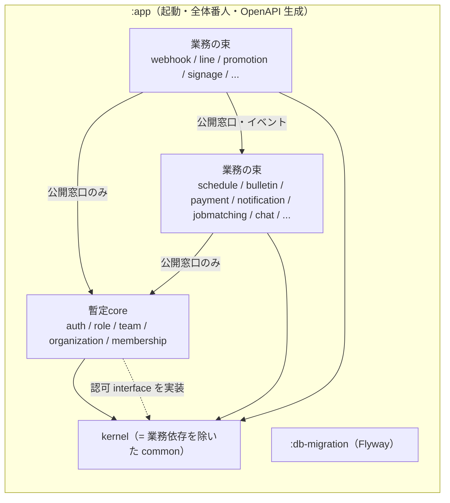
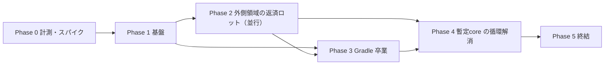
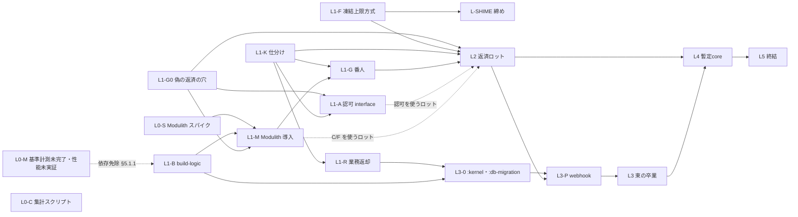

# モジュラーモノリス境界負債の返済と Gradle/Modulith 卒業 計画書

> 起票日: 2026-10-21
> 台帳: CMP-261021-0017（親・傘行。子 CMP は §8.3 に従い Phase・レーン単位で着手時に採番）
> 担当: kenta
> **ステータス**: 🟢 設計完了（2026-10-21、6観点×2パス＋実機E2E耐性クリティック＋差分再検分5回を経て未解決ゼロ）
> 帰属: [`domain_db_design_principles.md`](domain_db_design_principles.md) 原則1・5、[`db_scalability.md`](db_scalability.md) 今後課題「イベント駆動アーキテクチャへの移行」（:107）

---

## §0. 決定事項（マスター御裁可・2026-10-21）

| # | 論点 | 決定 |
|---|---|---|
| Q1 | D-2b（UuidV7Entity 未継承 569 行）の扱い | **本計画の対象外**。別戦役 CMP-261021-0115「UUIDv7 継承負債（D-2b 凍結）の返済」で扱う（ローカル開発中で既存データは考慮不要、モジュール化とは独立）。本書の「凍結ストア空」は **D-2b を除く**（D-1 / D-3 / D-3T / D-5 / ServiceAPI を指す） |
| Q2 | notification を暫定core に入れるか | **入れない**。通常の業務モジュールとして扱う |
| Q3 | 粒度 | **Modulith は全トップレベルパッケージを個別モジュール**、**Gradle サブプロジェクトは関連領域の束（10〜20 程度）**（§3.2） |
| Q4 | 台帳の単位 | **子 CMP は Phase・レーン単位（10〜15 行程度）**。領域ごとのロットは親 Issue のチェックリストで管理し、台帳の「1戦役1行」を守る（§8.3） |
| Q5 | 凍結定数の運用 | **`EXPECTED_LINES_*` を「上限」方式へ変更**し、専用の締めレーン（L-SHIME）が定期的に実測値へ引き下げる。返済 PR は定数を触らない＝並行マージ可（§7.4） |
| Q6 | 外部 API 契約 | **変えない**。たとえば採用確定の応答の `chatRoomId` は今と同じく常に整数で返す（null を返す案は不採用） |

殿判断（上記方針から導出）:

- (a) イベントのペイロードは ID と scope（`organization_id` 等）のみ。自由記述・PII は禁止し番人化する。Registry に永続化するイベントは明示的に限定する。`event_publication` は完了時に削除（または短期保持）する。退会 purge との整合 IT を置き、削除済み利用者への再配信でデータが復活しないことを確かめる（§4.5・§11）。
- (b) チャット自動作成（`JobChatService`）は目玉機能で、`chatRoomId` が API に出るため「即時に結果が要る」。ただし**同一トランザクションは要らない**ので台帳（パターン E）には入れず、パターン F「予約→確定」で解く（§4.3）。
- (c) Gradle 卒業から撤退した場合、本計画の完了条件は「凍結ストア空（D-2b 除く）＋ Modulith verify 全体必須」と読み替える（§14）。
- (d) CMP-260918-1406 の着手済みロットは例外としてそのまま継続を認める（§5.3）。

---

## §1. 背景と目的

### 1.1 経緯（事実）

- Mannschaft は「将来のマイクロサービス分割を見据えたモジュラーモノリス」を掲げている（CLAUDE.md「アーキテクチャ思想」）が、ビルドは**単一 Gradle プロジェクト**のままである。`backend/settings.gradle.kts` は初期セットアップ `6d58cf6a89`（2026-03-19）以来 `include` を持たず、`rootProject.name = "app"` のみ。
- 単一 Gradle を選んだ ADR は存在しない。`backend/gradle.properties:8-9` に「現在はシングルモジュール構成のため効果は限定的だが、将来のマルチプロジェクト化に備えて有効化」とあるだけである。
- ドメイン境界は ArchUnit の凍結（FreezingArchRule）で**悪化防止**だけを担い、既存違反は返済計画のないまま凍結ストアに積まれている（§2）。
- 越境 `@Transactional` は原則5で「将来のイベント駆動化候補として記録する」とされ（`domain_db_design_principles.md:78-79`）、`db_scalability.md:107` の今後課題にも「イベント駆動アーキテクチャへの移行」が残っている。

### 1.2 経緯（推測・未検証）

- 単一 Gradle でも開発が回っていたのは、ルートパッケージの暗黙スキャン（§2.5）で全ドメインが同居でき、境界違反がコンパイルを止めなかったためと推測する。
- ビルド時間の大半は分割と無関係な要因（fork 固定費・Flyway 再生テスト・コンテキスト数・CPU/IO 競合。§13.1）と実測されており、**分割でビルドが速くなるかは未計測**である。本計画は速度改善を目的に据えず、効果は Phase 0 / Phase 3 の計測で判断する。

### 1.3 目的

1. ドメイン間の越境依存（Entity・Repository の直接参照、越境トランザクション）を返済し、凍結ストア（D-2b を除く）を空にする。
2. 越境連携を「公開 API の同期呼び出し」と「ドメインイベント（確実配信つき）」に揃え、将来の分割が機械的にできる状態にする。
3. 境界を **Spring Modulith（論理境界）** と **Gradle サブプロジェクト（コンパイル時強制）** の二重で担保し、最終的に全領域を個別モジュールへ分離する。

### 1.4 目的外（マスター御裁可済み）

- 起動・デプロイ単位は**1つのまま**。マイクロサービス化はしない（将来分割できる状態を目指すだけ）。
- 外部 HTTP API の変更（§10）。
- ビルド時間短縮を目標値として約束すること（§13.1）。
- D-2b の返済（CMP-261021-0115）。

---

## §2. 現状の数値（2026-10-21 origin/main `9530c75ddc` で再確認）

### 2.1 凍結ストア（`ArchUnitFreezeStoreIntegrityTest` の `EXPECTED_LINES_*` が正）

ストア: `backend/src/test/resources/archunit_store/`（対応表は同ディレクトリの `stored.rules`。`git ls-files` で実在を確認）。1違反1行で、各行に発生元 FQCN が含まれるため発生元ドメイン別に集計できる（L0-C）。

| 番人 | 定数（行） | ストア UUID | 発生元ドメイン上位 |
|---|---:|---|---|
| D-1 越境 Entity 参照（`CrossDomainEntityImportArchTest`） | 2,037（:713） | `584c3a46-…` | publicview 176 / dashboard 176 / gdpr 153 / social 101 / contact 100 / disclosure 91 |
| D-3 越境 `@Transactional`（`CrossDomainTransactionalArchTest`） | 1,295（:743） | `f14374b1-…` | publicview 127 / village 79 / contact 72 / tournament 55 / admin 48 / social 47 |
| D-3T 推移的越境 tx（`CrossDomainTransactionalTransitiveArchTest`） | 7,137（:883） | `296295dd-…` | bulletin 530 / schedule 439 / shiftbudget 343 / payment 333 / tournament 323 / social 301 |
| D-5 越境 Repository 依存（`CrossDomainRepositoryDependencyArchTest`） | 1,853（:976） | `427c445d-…` | gdpr 142 / dashboard 133 / publicview 127 / village 86 / contact 72 / social 65 |
| ServiceAPI Entity 露出（`ServiceApiEntityBoundaryArchTest`） | 600（:989） | `93124b52-…` | timetable 62 / schedule 41 / match 38 / jobmatching 31 / payment 27 / notification 23 |
| D-2b UuidV7Entity 未継承（`EntityUuidV7ConventionArchTest`）※対象外 | 569（:926） | `2c0ba995-…` | tournament 19 / advertising 16 / recruitment 14 / parking 14 |
| AUTHZ_WAVE4（`AuthzControllerGuardArchTest`） | 0（:682） | `9ed4737d-…` | — |

- D-3T は推移展開のため、1つの越境呼び出しが多数の tx 入口から数えられ、行数は返済量の目安にならない。
- **偽の返済が起こりうる2つの穴**（対策は L1-G0）:
  1. D-3T は interface 呼び出しから runtime proxy の具象実装を追わずに打ち切る（`CrossDomainTransactionalTransitiveArchTest.java:48-54`）。呼び出し先を interface にしただけで行が消える。
  2. D-3 / D-3T は**直接付いた `@Transactional`** だけを入口にする（`CrossDomainTransactionalArchTest.java:110-111` の `isAnnotatedWith(Transactional.class)`、`CrossDomainTransactionalTransitiveArchTest.java:87-88`）。`@ApplicationModuleListener` のような合成アノテーション（メタアノテーションで tx 属性を持つ）を付けたリスナーから越境 Repository へ到達しても検出されない。

### 2.2 依存グラフと流入速度

| 指標 | 値 | 出典 |
|---|---:|---|
| main の Java ファイル | 8,407（2026-10-21）。参考: 2026-09-21 時点 7,559、2026-10-14 時点 7,945 | `git ls-tree -r <各日の origin/main 最終コミット> backend/src/main/java` |
| `com.mannschaft.app` 直下のトップレベルパッケージ | 120 | `find -mindepth 1 -maxdepth 1 -type d` |
| 越境 import | 9,376（偵察値・未再計測） | 偵察 |
| 強連結成分（SCC）の最大 | 83 パッケージ（common を含む。偵察値・未再計測） | 偵察 |
| common → 業務の import | 167 件／35 パッケージ（import 文の単純集計） | `grep '^import com.mannschaft.app.<x>' common/**` |
| config → 業務の import | 41 件 | 同上 |
| JPA 関連（`@ManyToOne` 等）の越境 | 5 件・すべて notification → `auth.UserEntity`（例 `notification/confirmable/entity/ConfirmableNotificationEntity.java:155`） | 偵察 |

**コードは今も増え続けている。** 直近30日で main の Java ファイルは約 850 本増えた（7,559 → 8,407。日次値は増減があり単調ではないが、傾向は増加）。返済の速度が新規コードの流入に負ければ負債は減らない。このため本計画は次を前提にする。

- 新規の越境は凍結で止める（既存の運用）。加えて Phase 1 で公開窓口の規約（§3.4）とイベントの規約（§4.5）を先に決め、新規コードを最初から規約どおりに書けるようにする。
- 締めレーン（L-SHIME）の集計で、ドメイン別の行数の推移を毎回記録し、増えているドメインを親 Issue で知らせる。

common の業務依存の代表（いずれも §6.1 で kernel から追い出す対象）:

- `common/AccessControlService.java:3-14` — family の Repository、gdpr の `GdprErrorCode`（:5、使用は :748）、membership の Repository・enum、organization の Service、role の Entity・Repository・Service。
- `common/NameResolverService.java:3-9` — auth / organization / team の Entity・Repository。
- `common/activityschedule/ActivityScheduleFacade.java:3-21` — activity と schedule の Service・DTO を束ねる業務ファサード。
- `common/visibility/mapping/*VisibilityMapper.java` — 21 ファイル。
- `common/storage/quota/StorageUsageQueryService.java:3-10` — organization / team の Service。

### 2.3 越境の代表例

| 箇所 | 内容 | 想定パターン（§4） |
|---|---|---|
| `dashboard/controller/DashboardController.java:5` | bulletin の Repository を Controller が直接 import | A / D |
| `billing/ScopeMemberCountService.java:4` | membership の Repository | A |
| `gdpr/service/PersonalDataCollector.java:52` | resume の Repository（収集系。同様の import 多数） | A（SPI 化） |
| `actionmemo/service/ActionMemoAdminService.java:74-76` | todo / role / auth をまたぐ tx。既存 TODO に「将来は TodoRevertedByAdminEvent で分離予定」 | B / C |
| `jobmatching/service/JobChatService.java:58-92` | chat の Channel / Member / Message Repository に直接 save し channelId を返す。呼び出し元 `JobContractService#acceptApplication`（:93-173）の同じ tx 内（:154-156） | F（§4.3 手本） |
| `role/service/BlockService.java` `blockUser`（:51） | role から他ドメインへの書き込み越境 | B / C |
| `contact/service/ContactService.java` `addToDefaultFolder`（:157） | contact からの越境 | A / B |

### 2.4 イベント資産（コメント行を除いた単純 grep）

| 指標 | 値 |
|---|---:|
| `@TransactionalEventListener` | 263 件／170 ファイル |
| `publishEvent(` | 260 件 |
| `@Async`（main） | 266 件。うち `event-pool` 指定は約 168 箇所（`config/AsyncConfig.java` のコメント） |
| 他ドメインの `*Event` 型 import | 113 件（偵察値・未再計測） |
| Spring Modulith | 未導入 |

- 既存の確実配信は通知専用の transactional outbox（[`notification_outbox.md`](notification_outbox.md)）だけである。
- イベント基底 `common/event/BaseEvent.java` は**抽象クラス**で、コンストラクタで `occurredAt = LocalDateTime.now()` を設定する。
- **既存のイベントには秘密情報を持つものがある**。例: `auth/event/UserRegisteredEvent.java:12-15` は `email`・`displayName`・`rawToken`（確認メール用の生トークン）を持つ。Registry がこれらを永続化すると、DB に秘密情報が残る（§4.4）。

### 2.5 Spring・ビルド・テストの構成

- `MannschaftApplication.java:7` に `@SpringBootApplication` のみ。`@EntityScan` / `@EnableJpaRepositories` / `@ComponentScan` は無く、ルートパッケージ `com.mannschaft.app` 配下を暗黙スキャンしている。`@Entity` を持つファイルは 815。
- Spring Boot 3.5.13（`build.gradle.kts:7`）、Gradle 8.14.4、ArchUnit 1.3.0（`build.gradle.kts:126`）。buildSrc・version catalog 無し。`build.gradle.kts` は 1,211 行。configuration cache は無効。
- 品質ゲート: jacoco は単一プロジェクト前提（:6・:1042）。OWASP Dependency-Check は `dependencyCheckAnalyze`（:1105-1111）で、週次の `.github/workflows/security-scan.yml:66` も `./gradlew dependencyCheckAnalyze` を呼ぶ。
- OpenAPI 生成: 出力先は `file("${projectDir.parentFile}/docs")`（`build.gradle.kts:1161`）。`projectDir` が `backend/` であることを前提にした相対指定で、サブプロジェクトへ移すと `docs/` を指さなくなる。
- テストの実測記録（`build.gradle.kts` のコメント）:
  - fork 1回あたり +447 秒、shard4 の `:test` 41.96 分のうちテスト正味 7.4 分（:395-417）。
  - Flyway 再生テストが計測時間の 72〜88%（:683-686 付近）。
  - Spring テストコンテキスト 17 個がヒープの 59%（:561-567）。上限 10 に制限済み（`backend/.claudecode.md` §30「テストコンテキストキャッシュ上限 10」）。
  - shard 分割（:597-642）、`archUnitTest`（:751）、`archTest`（:836）。
- ローカルの遅延は CPU/IO 競合で、ロック待ちは 0 件。`gradle-turnstile.sh` で直列化する（`docs/development/worktree_operations.md:96-109`）。
- CI: `.github/workflows/backend-ci.yml` の matrix 6 shard（:412-413）、テスト XML とストアの収集は `backend/build/test-results/**/*.xml` と `backend/src/test/resources/archunit_store/*`（:586-587）、jacoco レポートは `backend/build/reports/jacoco/`（:603）、`cancel-in-progress: true`（:51）。重み表は `backend/src/test/resources/shard-weights.properties`（再生成は `backend/scripts/regen-shard-weights.sh`。いずれも `git ls-files` で実在を確認）、`verifyShardCoverage`。
- Flyway: `backend/src/main/resources/db/migration` の単一ディレクトリに 1,223 ファイル（他に `rollback/` 2）。番人 `FlywayTimestampNamingGuardTest`。
- 非同期: `@Primary` の `event-pool` は core 2 / max 5 / queue 100、拒否は AbortPolicy（`config/AsyncConfig.java:47-60`）。executor 無指定の `@Async` は禁止（`backend/.claudecode.md:464`、Issue #2953）。
- レプリカ振り分け: `config/ReplicaRoutingAspect.java:56` はメソッドに付いた `@Transactional`（`@annotation`）だけを見る。クラスレベルの `readOnly` は振り分けに使われない。

### 2.6 番人の限界

- `DomainPackages.java:24` の `SHARED_DOMAIN = "common"` は、相手先・発生元のどちらが common でも許容する。common に業務ロジックを置けば全番人をすり抜ける（§2.2 の 167 件）。
- `--tests` で絞り込んで実行すると凍結ストアが壊れる（`backend/.claudecode.md` §30「凍結ストアは `--tests` 絞り込み実行で破壊される」）。
- D-3 / D-3T の偽の返済の穴（§2.1）。
- `NotificationTransactionBoundaryGuardTest.java:784-792` の `isAllowedEntryPoint` は、ソース上の `@TransactionalEventListener` の文字列だけを入口と認める。合成アノテーションのリスナーは入口と認識されない。

---

## §3. 目標アーキテクチャ

### 3.1 モジュールの3層

| 層 | 中身 | 依存してよい先 |
|---|---|---|
| **kernel** | 業務を知らない基盤だけ（下の列挙） | JDK・Spring・ライブラリのみ |
| **暫定core** | auth / role / team / organization / membership | kernel、暫定core の構成領域同士（Phase 4 まで循環を許容） |
| **業務モジュール群** | 上記以外の全トップレベルパッケージ（notification を含む） | kernel、暫定core と他業務モジュールの**公開窓口のみ** |

**暫定core の構成領域は本書で固定する。** 追加にはマスターの裁可が要る。番人 `ProvisionalCoreMembershipGuardTest`（L1-G で新設）が構成領域の一覧を定数で持ち、一覧外のパッケージが暫定core 扱いの例外を受けたら fail させる。

**kernel に入れてよいもの（列挙。これ以外は入れない）:**

- 例外基盤（`BusinessException`・ErrorCode の interface）、`ApiResponse` 等の共通レスポンス型
- `UuidV7Entity` / `UuidV7` など Entity 基底・ID 生成
- `AbstractTenantAwareRepository` などテナント基盤
- 時刻・ゾーン、ページング、JSON などの汎用ユーティリティ
- イベントの基底型（`DomainEvent` interface、`BaseEvent`、Registry 登録対象の印 `ReliableEvent`。§4.4）、合成アノテーション `@ModuleEventListener`、移行用の印 `@TransitionalBridge`（付いたクラス自体は kernel に数えない。§5.2 L1-R）
- ストレージ・キャッシュ・ロックなどインフラのアダプタ（業務の判断を含まないもの）
- **認可の interface**（`common.AccessControlService`。実装は暫定core。§6.1）

kernel に入れてはならないもの: 業務ドメインの型の import、業務判断（誰が見えるか・誰が操作できるか・何人いるか）、特定ドメインのファサード。番人 `KernelNoBusinessDependencyArchTest`（L1-G）が「kernel から業務パッケージへの import 0 件」を**凍結なしの0件必須**で強制する。

**パッケージ名の扱い:** kernel は新しいパッケージを作らず、**`common` から業務依存を追い出した残りをそのまま kernel とする**。`BusinessException` 等は数千ファイルが import しており、改名すると全レーンと衝突する PR になるため。

### 3.2 粒度（Q3）

- **Modulith の論理モジュール = トップレベルパッケージ**（120。パッケージは動かさない）。全領域が個別モジュールになる。
- **Gradle サブプロジェクト = 関連する論理モジュールの束（10〜20 程度）**。パッケージとサブプロジェクトは1対1にしない。

束の決め方の基準:

1. **業務のまとまり**: 同じ利用者の行為・同じ画面群を扱うもの（例: shift・shiftbudget・timetable のような勤務系、bulletin・social・village のような交流系）。
2. **依存の向きがそろう**: 束の外への依存が同じ相手（暫定core と kernel だけ、など）になるもの。束の中の循環は許すが、束同士の循環は許さない（Gradle が循環依存を拒むため、束の境界は循環の外に引く）。
3. **大きさ**: 1束あたりの目安は 300〜900 ファイル（main 8,407 本 ÷ 10〜20）。極端に小さい束は隣の束に合わせ、極端に大きい束は業務のまとまりで割る。
4. **葉を先に**: 被依存 0 の葉は小さくても単独で先に卒業させてよい（パイロット）。後で束に合流させてもよい。
5. **暫定core は Phase 4 まで1束**。Phase 4 で循環を解いたあと、必要なら複数束へ割る。

束の具体的な割り当ては L0-S（verify の初回結果）と L1-K（仕分け）の後、L3-0 で決めて本書に追記する。

### 3.3 依存方向



- 矢印の逆向き（kernel → 業務、暫定core → 業務モジュール）は禁止。暫定core が業務の情報を必要とする場合は、業務側がイベントを発行し暫定core が購読するか、業務側が暫定core の SPI を実装する。

### 3.4 公開窓口の規約

- 他モジュールから参照してよいのは `<domain>.api` パッケージ（とその下）だけ。Modulith では `@NamedInterface("api")` を `package-info.java` に付ける。
- `api` に置いてよいもの: 公開 Service（**final なファサードクラス**）、引数・戻り値の DTO（record 推奨）、**発行するイベント型**、他モジュールが実装する SPI interface。
- `api` に置いてはならないもの: `@Entity`、Repository、Spring Data の型を含むシグネチャ。
- **公開 Service を interface にしない（偽の返済の防止）**。L1-G0 で D-3T を「本番クラス内に実装が1つだけの interface は、その実装へ展開して判定する」よう改修するまでは、公開 Service は final なファサードクラスとし、interface は SPI（相手が実装するもの）に限る。例外は §6.1 の `common.AccessControlService`（呼び出し側 1,000 ファイル超の差分を避けるため interface とする。L1-G0 の完了を L1-A の入口条件にする）。
- **イベント型の置き場所は発行側の `api`**（例: `jobmatching.api.JobContractConcludedEvent`）。購読側が発行側の `api` に依存する向きになる。
- 公開 Service の命名: `<Domain><用途>Api`（例: `ChatRoomApi`）。実装の詳細は非公開パッケージに置く。
- **窓口の持ち主**: 各モジュールの `api` には持ち主のレーン（そのドメインを担当するロット、暫定core は L1-A または L4）がいる。他ロットが相手の `api` に窓口を足すときは、持ち主に依頼するか、持ち主が未着手なら親 Issue で一時的に持ち主を引き受けて宣言する（§7.1）。同じ用途の窓口を別々に足して乱立させない。
- **公開 API 化で OpenAPI が変わらないこと**: 内部の DTO を `api` へ移すと、springdoc のスキーマ名（型の単純名）の衝突や enum の並びが変わり、外部 API の形が変わらなくても `docs/openapi.json` が変わりうる。Controller の応答型は移動しないか、移動する場合は §7.7 の比較と契約スナップショットテストで不変を確かめる。

---

## §4. 越境の解き方カタログ

### 4.1 パターンと判定基準

| パターン | 中身 | 使う条件 | 挙動の変化 |
|---|---|---|---|
| **A 公開 API 同期** | 相手モジュールの `api` を同期で呼ぶ | 即時に結果が要る**読み取り**。または相手の業務判断を問う（認可など） | 戻り値は変わらない。相手の内部型に依存しなくなるだけ |
| **B AFTER_COMMIT イベント** | 自分の tx 内で `publishEvent`、相手は AFTER_COMMIT で購読 | 書き込みを伴うが、**取りこぼしても業務上許容できる**連携（キャッシュ無効化・統計・補助的な通知など） | 相手側の反映は commit 後で遅れる。相手が失敗しても自分は巻き戻らない。取りこぼしうる |
| **C Registry 確実配信** | B に加え、Spring Modulith の Event Publication Registry に記録し、未完了なら再配信 | 書き込みを伴い、**業務上必ず起きなければならない**連携 | B に加え、未完了の購読は Registry に残り再配信される。**購読側は冪等必須** |
| **D tx 外読み取り snapshot** | 自分の tx の外（または前）で相手の API から値を読み、値として持ち込む | 書き込みの判断材料として他モジュールの状態が要るが、同一 tx の一貫性までは要らない | 読んだ値が古くなりうる（決定の根拠をログ・列に残す） |
| **F 予約→確定** | トランザクションを持たない調停役が、(a) 相手の公開 API で「保留状態」の作成物を相手自身の tx で作って ID を得る → (b) 自モジュールの tx で本体を確定し、同じ tx で Registry にイベントを記録 → (c) コミット後に相手の API で作成物を「確定（有効化）」する。(c) が失敗したら、**自モジュールの** Registry リスナーが (c) を呼び直す。(b) が拒否されたら、調停役が相手の公開 API で予約を明示的に取り消す。取り消せなかった予約は相手が自身の掃除処理で失効させる。予約はどの状態でも物理削除せず墓標として残し、確定は保留・失効・取消のどこからでも期限なしで同一 ID のまま行える | **即時に結果（相手の作成物の ID）が要る書き込み連携**で、同一 tx までは要らないもの | 応答には (a) の ID が必ず入る（外部 API 不変）。(c) が遅れる間は作成物が保留のまま見えない。**相手側は (a)(c) の冪等性が必須** |
| **E 同一 tx 不可欠の台帳化** | 越境のまま残し、理由つきで台帳に載せる | F でも整合が保てない**不可分な更新**（片方だけ確定した状態が一瞬でも外から見えると業務が壊れ、保留・補償でも代替できない） | 変化なし。台帳に理由・代替不能の根拠・見直し条件を書く |

**判定の順序**: まず A（読み取りか）→ 書き込みで即時に結果が要らなければ C か B（取りこぼし許容か）→ **即時に結果が要る書き込みでも、まず F（予約→確定）を検討する** → 判断材料の読み取りなら D → **E は F でも整合が保てない不可分な更新に限る**。「即時に結果が要る」ことは「同一トランザクションが要る」ことではない。

**依存の向き**: F では依存は「自モジュール → 相手の `api`」の一方向だけにする。相手は自モジュールのイベント型を購読しない（相手は自分の保留を自分で掃除するだけで、自モジュールを知らない）。こうすれば Modulith の循環検査を通る。

**`@Transactional` を外すだけの修正は禁止**（原子性を黙って失う症状隠し。CMP-260912-1524 で自己呼び出しにより原子性が失われていた事例がある）。

E の台帳は凍結ストアに入れない。D-3P と同じく**監査済み例外の一覧**（test ソースの定数、理由必須、実在しなくなった例外は fail）として `CrossDomainTransactionLedger` を L1-G で新設する。

### 4.2 各パターンに必要なテスト

| パターン | 必須テスト |
|---|---|
| A | 公開 API の契約テスト（正常・不在・権限なし）。呼び出し側の既存テストが無変更で緑 |
| B | 発行 → 購読側反映の IT（commit 後に反映）。発行側 tx が巻き戻ったら購読されない IT |
| C | B に加え、(1) 購読側が例外を投げたら Registry に未完了として残る、(2) 再配信で反映される、(3) 同じイベントを2回配信しても二重作成されない（冪等）、(4) 発行側 tx の巻き戻しで Registry にも残らない、(5) **配信時の再検証**: イベント発行後に §4.5 の剥奪事象を起こしてから再配信すると、購読側は作用しない、(6) **退会 purge 後の再配信**で削除済み利用者のデータが復活しない、(7) イベント型のシリアライズ往復で全項目（`occurredAt` を含む）が一致する |
| D | 読んだ値が後で変わっても書き込みが壊れない（または判断根拠が残る）ことの単体テスト |
| F | §4.3 の受け入れ条件。加えて C の (5)〜(7) |
| E | 台帳の番人（理由必須・実在確認）が緑。原子性が要る根拠を示すテスト（途中失敗で両方巻き戻る） |

**AFTER_COMMIT を観測するテストの注意**: `@Transactional` が効いたテストでは業務 tx がコミットされず AFTER_COMMIT が発火しないため、「0件であること」を検証するテストは必ず通る（偽の緑）。B / C / F のテストは `backend/.claudecode.md` §6.1（:293〜）の手順（クラスから `@Transactional` を外し `TransactionTemplate` で明示コミット、または `@RecordApplicationEvents` で発行を検証、直す前の本番コードで赤くなることを実測）に従う。

### 4.3 手本: チャット自動作成（パターン F「予約→確定」）

**現状**（`jobmatching/service/JobContractService.java`。クラスに `@Transactional(readOnly = true)`（:49）、`acceptApplication` に `@Transactional`（:93-94））: 1つの tx の中で、`GET_LOCK('job_posting_{id}')`（:104-105）＋ `SELECT ... FOR UPDATE`（:107-108）→ 応募の ACCEPT（:135）→ 契約 INSERT（:151）→ **チャット作成**（`JobChatService.createRoomForContract`、:154。chat の Channel / Member / Message Repository へ直接 save）→ `contract.assignChatRoom` → 定員充足で CLOSED → 通知イベント発行 → Entity 返却（:170）、ロット解放（:172）。

**after**:

```java
// 調停役（@Transactional を持たない。tx が無いことはテストで保証する）
public JobContractResponse acceptApplication(Long applicationId, Long requesterId) {
    // 事前検査（読み取りのみ・ロックなし）: 認可・応募の状態・求人 OPEN・定員。通らなければ予約しない（BusinessException のまま）
    JobApplicationSummary app = jobAcceptancePrecheck.check(applicationId, requesterId);
    // (a) chat にルームを予約（chat 自身の tx。冪等キーは (b) より前に決まる値。参加者・メッセージはまだ作らない）
    Long chatRoomId = chatRoomApi.reserveRoomForSource("JOB_APPLICATION", applicationId, requesterId);
    // (b) jobmatching の tx（ロック・応募 ACCEPT・契約 INSERT・定員 CLOSED・通知イベントは現状どおり1 tx）
    //     chat は触らない。契約に chatRoomId を入れ、同じ tx で JobContractConcludedEvent を Registry に記録
    JobContractEntity contract;
    try {
        contract = jobContractCommandService.conclude(applicationId, requesterId, chatRoomId);
    } catch (BusinessException e) {
        // (b) が業務上の拒否で巻き戻った。同じ応募の別の要求が勝って契約を作っていないかを、
        // (b) と同じロックを取って jobmatching 自身のデータで確かめ、契約が無い場合だけ予約を取り消す
        // （(b) のロールバック後の新しい tx。最初の文で求人行を FOR UPDATE、契約はロック読み取りで照会。項目6）
        try {
            if (jobContractCommandService.noContractForApplicationUnderPostingLock(applicationId)) {
                chatRoomApi.cancelReservation(chatRoomId);
            }
        } catch (TransientDataAccessException | ChatRoomTemporarilyUnavailableException cancelFailure) {
            // 取消の失敗で応答を置き換えない。記録だけして、予約は保留のまま掃除で失効させる
            log.warn("予約の取消に失敗: chatRoomId={}", chatRoomId, cancelFailure);
            meter.increment("jobmatching.chat_reservation.cancel_failed");
        }
        throw e;   // エラー応答は従来どおり（元の BusinessException をそのまま返す）
    }
    // (c) コミット後に確定（chat 自身の tx。参加者と初期メッセージをここで作る。冪等）
    try {
        chatRoomApi.activateRoom(chatRoomId, contract.getRequesterUserId(), contract.getWorkerUserId());
    } catch (TransientDataAccessException | ChatRoomTemporarilyUnavailableException e) {
        // 再試行可能な障害だけ。(b) は確定済みなので応答は成功で返し、jobmatching のリスナーが後で呼び直す
        meter.increment("jobmatching.chat_activation.deferred");
    }
    return JobContractResponse.from(contract);   // chatRoomId は (a) の値で常に非 null
}

// jobmatching 自身の Registry リスナー（購読は自モジュールのイベント。依存は jobmatching → chat の一方向）
// トランザクションを持たない（@ModuleEventListener は tx 属性を持たない。§4.4）
@ModuleEventListener
void on(JobContractConcludedEvent e) {
    if (!jobContractQuery.isStillConcluded(e.contractId())) return;   // 配信時の再検証（キャンセル等。§4.5）
    chatRoomApi.activateRoom(e.chatRoomId(), e.requesterUserId(), e.workerUserId());   // 冪等・同一 ID
}
```

1. **jobmatching の tx の範囲は変えない**。ロック（GET_LOCK＋FOR UPDATE）・応募 ACCEPT・契約 INSERT・定員 CLOSED・通知イベントは現状どおり1つの tx に残す（ロック範囲・定員の原子性は不変）。この tx の中では chat を一切触らない。
2. **予約の冪等キー**: (b) の前に決まる値でなければならない（契約 ID は (b) まで無い）。応募 ID を使い、`sourceType = "JOB_APPLICATION"`、`sourceId = applicationId` とする案を第一とする。1応募から契約は最大1件（`V13.032__create_job_contracts.sql:32` の `uk_jc_application UNIQUE (job_application_id)`）なので、応募 ID で一意に決まる。chat 側の一意性は既存の `uk_channel_source (source_type, source_id)`（`V4.013__create_chat_channels_table.sql:22`）で担保され、同じ応募で (a) が二重に走っても1部屋だけになる。既存の `sourceType = "JOB_CONTRACT"` の行との互換（読み出し側が `JOB_CONTRACT` で引いている箇所の有無）はロット着手時に実コードで確認する。
3. **事前検査と予約の上限**: 予約の前に、読み取りのみ・ロックなしの事前検査（呼び出し者の認可、応募の状態、求人が OPEN か、定員に空きがあるか）を行い、通らなければ予約せず従来どおりのエラー応答にする。事前検査はあくまで無駄な予約を減らすためのもので、**最終判定は従来どおり (b) の jobmatching の1 tx 内（GET_LOCK＋FOR UPDATE のロック下）で行う**（事前検査と (b) の間に状態が変わりうるため）。さらに、並行な採用確定で事前検査をすり抜けた予約が積み上がらないよう、chat の `reserveRoomForSource` は**作成者（`created_by`）ごとの「保留」状態の予約の件数に上限**を設け、超えたら予約を拒否する（上限の初期値は 20 件。1つの冪等キーにつき予約は1件なので、同じ応募の再試行では増えない）。**枠を消費するのは「保留」だけ**で、取消・失効・有効は数えない。(b) が拒否された場合は調停役が明示的に取り消すので（項目6）、枠は即時に戻る。並行な予約で上限を超えないよう、件数の確認と予約の作成は原子的に行う（作成者単位の行ロック、条件付き INSERT など。採用方式はロット着手時に実コードで確定する）。上限超過のエラーコードは既存の流量制限系を流用できるかをロット着手時に実コードで確認し、無ければその時点の最大 + 1 で予約する（§12）。
4. **予約の中身と状態機械**: (a) の予約は**チャンネル行だけ**を作り、参加者（`chat_channel_members`）と初期メッセージは作らない。参加者と初期メッセージは (c) の確定で作る（参加者の一意性は既存の `uk_channel_user (channel_id, user_id)` が担保し、確定を繰り返しても重複しない）。チャンネル行には状態を持たせる（既存の列で表せなければ状態列を追加する。DDL の要否はロット着手時に実コードで確定）。

   ```mermaid
   stateDiagram-v2
     [*] --> 保留: (a) 予約
     保留 --> 有効: (c) 確定（参加者・初期メッセージを作る）
     保留 --> 失効: 掃除（一定時間確定されない）
     保留 --> 取消: 調停役の明示取消 cancelReservation（(b) の拒否を確認したとき）
     失効 --> 有効: 遅れて来た (c) 確定（同一 ID のまま）
     失効 --> 取消: 調停役の明示取消
     取消 --> 有効: 確定（期限なし。同一 ID のまま。誤った取消からの防御）
     有効 --> 有効: (c) の再実行（何もしない）
   ```

   - **予約は物理削除しない**。保留・失効・取消のどの予約も、墓標として恒久に残す。墓標は参加者もメッセージも持たないチャンネル行1つだけで、1行は数百バイト程度である。予約は採用確定の要求1件につき最大1件（冪等キーは応募 ID）で、作成者ごとの保留の上限もあるため、件数は採用確定の要求の数を超えない。容量への影響は軽微で、消すことで参照先を失う危険（契約が ID を持っている可能性。現状も `JobContractService.java:154-156` で契約に ID を入れている）の方が大きい。
   - **掃除**は、一定時間（初期値 24 時間）確定されない保留を「失効」にするだけで、ID は保持する。
   - **取消**は、発行側（調停役）が (b) の拒否で巻き戻ったことを項目6の手順で確かめたうえで、chat の公開 API `cancelReservation(id)` を呼んだ予約である（依存は jobmatching → chat の一方向のまま）。取消は予約枠を即時に戻すためのもので、行は消さない。
   - **確定（有効化）は、保留・失効・取消のどの状態からでも、期限なしで同一 ID のまま行える**（確定は冪等。誤った取消や長期の障害の後でも、契約が持つ ID を復旧できる）。勝者の (c)、保険リスナーの再配信、§11.3 の手動再開はすべてこれを使う。
   - **状態遷移の排他**: すべて条件付きの状態遷移 UPDATE で行う。確定は `UPDATE ... SET status = '有効' WHERE id = ? AND status IN ('保留', '失効', '取消')`（0 行なら現状を読み、有効なら何もしない＝冪等。行が無ければ ERROR）、掃除は `UPDATE ... SET status = '失効' WHERE status = '保留' AND created_at < ?`、取消は `UPDATE ... SET status = '取消' WHERE id = ? AND status IN ('保留', '失効')` とする（状態列の要否はロット着手時に確定）。確定の tx は、状態遷移の UPDATE が当たった場合にだけ参加者と初期メッセージを作る。同じ行への確定・掃除・取消が同時に走っても、InnoDB の行ロックにより1つの UPDATE が先に確定し、残りは条件で外れるため、「有効なのに参加者が無い」「失効・取消なのに参加者がいる」状態は生じない。
5. **保留・失効・取消の秘匿（遮断する箇所）**: 以下「保留・失効」と書く箇所は取消も含む。保留・失効のルームは利用者に見えてはならない。参加者を作らないため、参加者を起点にする経路（`ChatChannelRepository.java:30-32` の `findByMemberUserId`、`:38-46` の `findExistingDm`、`ChatChannelMemberRepository.java` の未読合計 `sumUnreadCountByUserIdAndChannelIds`（:117）・未読加算 `incrementUnreadCountForOthers`（:138）、通知の宛先）には自然に出ない。参加者を起点にしない経路は状態で遮断する: (i) ID の直接参照 `ChatChannelService#findChannelOrThrow`（`channelRepository.findById`。`ChatUploadController` 等のパッケージ外からも呼ばれる）、(ii) 冪等キーの参照 `findBySourceTypeAndSourceId`（:63。予約・確定の内部用途を除く）、(iii) チーム・組織の一覧（:20・:25。求人のルームはチーム・組織に属さない見込みだが、ロット着手時に確認する）、(iv) **招待経路** `ChatMembershipInviteCardService#resolveDmCounterpart`（:57-71）。共通の `findChannelOrThrow` を通らず `channelRepository.findById` を直接呼び（:58）、DM で参加者が2名でなければ 422 `CHANNEL_NOT_DM` を返すため（:67-71）、参加者0件の保留ルームでは**422 になって存在が漏れる**。参加者数の判定より前に状態で遮断し、404・`CHAT_001` を返す。同じクラスの最終メッセージ更新（:117 の `findById`）も保留・失効を対象にしない、(v) 管理・個人データ出力（`ChatPersonalDataQueryService` 等）とアーカイブ・予約投稿などのバッチ、(vi) **chat 以外のドメインが `ChatChannelRepository` を直接使っている箇所**（偵察時点: `admin/service/AdminBusinessAlertService`、`common/storage/migration/StoragePathMigrationBatchService`、`dashboard/service/ChatHubService`・`ScopeWidgetSummaryService`、`user/service/UserBlockService`、`village/service/VillageFeedService`・`VillageLobbyService`・`VillageSearchService`、および `jobmatching/service/JobChatService` 自身）。これらは D-5 の越境で、各ロットで chat の公開 API へ付け替えるまでは保留・失効を除外できているかを個別に確認する。chat 配下で `channelRepository.findById` を直接呼ぶのは、偵察時点で `ChatChannelService.java:650`・`ChatMembershipInviteCardService.java:58`・`:117` の3箇所。ロット着手時に chat の全 Repository 呼び出しと上記の越境箇所を洗い直し、遮断箇所の一覧を確定して PR 本文に載せる。**直接参照は、存在しないルームと同じ 404・同じエラーコード `CHAT_001`（`ChatErrorCode.CHANNEL_NOT_FOUND`、`GlobalExceptionHandler.java:775` で 404）を返す**（存在オラクルを作らない）。「準備中」表示は作らない。
6. **(b) が拒否・失敗した場合**: 定員超過・状態遷移エラー・認可拒否などの `BusinessException` は**従来どおりエラー応答**にする。この要求の (b) が `BusinessException` で巻き戻ったことは確定しているが、**同じ応募への別の要求（同じ冪等キーなので同じ予約 ID を共有する）が勝って (b) をコミットし、(c) がまだ終わっていない**ことがありうる（例: 2本目の要求は応募がもう APPLIED でないため `JOB_APPLICATION_NOT_PENDING` で拒否される。`JobContractService.java:117-120`）。そのまま取り消すと、勝者の契約が持つルームを取り消してしまう。このため二重に防ぐ:
   - **直列化**: 調停役は取消の前に、(b) の tx がロールバックで終わった**後に、新しいトランザクション**を開いて確認する。その tx の**最初の文**で (b) と同じ求人行を `SELECT ... FOR UPDATE`（`JobPostingRepository#findByIdForUpdate`、`JobContractService.java:107-108` と同じ）で取り、続いて**その応募に契約が存在しないこと**を**ロック読み取り**（`SELECT ... FOR SHARE` または `FOR UPDATE`）で確かめる（`uk_jc_application` により契約は応募につき最大1件）。存在しない場合だけ、確認の tx を終えてから `cancelReservation(id)` を呼ぶ。勝者の (b) は求人行の行ロックをコミットまで保持するので、敗者の行ロックの取得は必ず勝者のコミットの後になり、ロック読み取りは最新のコミット済みの契約を読むため、取り消さない。
     - **通常の SELECT で確かめてはならない**。本番の分離レベルは REPEATABLE READ で、通常の SELECT は tx の最初の読み取りで張ったスナップショットを見続ける（`schedule/repository/UserCalendarLayerSettingRepository.java:72-83` に同じ注意がある）。行ロックを取る前に通常の SELECT を1つでも実行すると、ロック待ちの後でも勝者の契約が見えない。`JobContractRepository#findByJobApplicationId`（:41）は通常の SELECT なので、この確認には使わず、ロック付きの照会を新設する。(b) の失敗した tx の中で確認しないのも同じ理由（:97 の `findById` がロック前にスナップショットを張っている）。
     - 補足: 現行コードの `GET_LOCK('job_posting_{postingId}')`（`:59-60`・`:101-105`）はメソッド内の `finally`（`:171-172`）で解放され、コミットより先に外れる。コミット後の観測の順序を保証しているのは求人行の `FOR UPDATE` である（求人行ロックがあるため、GET_LOCK の早い解放そのものは欠陥ではない）。
   - **防御**: 確認から取消の呼び出しまでの間に、さらに後続の要求が (b) をコミットする狭い窓は理屈の上で残る（ロックは確認の tx のコミットで外れ、取消は chat の別の tx で行うため）。そのため、取消済みからでも確定で同一 ID のまま有効化できる（項目4。期限なし）。勝者の (c) と保険リスナーの再配信はこれを使う。
   - 取消が成立すれば、作成者の予約枠は即時に戻る。取消済みの予約は墓標として残る。
   - **取消の呼び出し自体が失敗した場合**は、取消の失敗で応答を置き換えず、**元の `BusinessException` をそのまま返す**（同じステータス・同じエラーコード）。取消の失敗はログとメトリクスに記録し、予約は保留のまま掃除で失効して墓標になる。枠は失効した時点で解放される（枠は「保留」だけで数えるため）。(b) の結果が不明な障害（コミットの成否が分からない接続断など）の場合も取り消さない。
   - いずれの場合も、予約には参加者もメッセージも無いので誰にも見えない。chat は jobmatching を知らない。
7. **(a) が失敗した場合**: 契約は作らずエラー応答にする（現状も chat の insert が失敗すれば tx ごと巻き戻ってエラーになるので、利用者から見た挙動は同じ）。
8. **(c) が失敗した場合**: 契約は確定済みで、応答には (a) の ID が入る。jobmatching の Registry リスナーが確定を呼び直す。失効・取消になっていても同一 ID のまま有効化される（予約は物理削除しないので、復旧がどれだけ遅れても ID は失われない）。§11.3 の隔離・手動再開も**同一 ID を復旧する**（別 ID へ書き換えない）。取消済みのルームに確定が来た場合は、有効化したうえで、取消が誤っていたことを警告として記録する。
9. **例外の扱い**: 業務・認可の拒否（`BusinessException` 等）は従来どおりエラー応答にする。Registry の保険に回すのは**再試行で直りうる障害だけ**（一時的なデータアクセス障害など。対象の例外型はロットで列挙する）。`RuntimeException` の一括捕捉は禁止（握りつぶしになるため）。
10. **調停役と保険リスナーに tx が無いこと**: コメントではなく**テストで保証する**。調停役の (a) と (c) の開始時、および保険リスナーが chat を呼ぶ時点で `TransactionSynchronizationManager.isActualTransactionActive() == false` であることを検査し、外側に tx がある状態から調停役を呼んだ場合も検査する（外側 tx に巻き込まれると (c) がコミット前に走り、予約→確定の前提が崩れるため。呼ばれたら fail させる）。保険リスナーは `@ApplicationModuleListener` の既定（`REQUIRES_NEW`）を使わず、tx 属性を持たない `@ModuleEventListener`（§4.4）で購読する。
11. **初期メッセージの日本語直書き**: 現状 `JobChatService.java:61`（`"求人: " + posting.getTitle()`）と `:83`（契約成立の本文）は日本語の直書きで、DB に保存される。本計画では**現状の文言を維持**し、chat の公開 API の引数で文言（またはテンプレートのキー）を渡す形にするだけにとどめる。i18n 化は本計画の範囲外とし、別 CMP の候補として親 Issue に記録する。

**受け入れ条件**（ロットの AC。§4.2 C の (5)〜(7) も満たす）:

- [ ] 正常時、採用確定の応答の `chatRoomId` が非 null の整数で、そのルームは有効で両者が参加者として見える。
- [ ] (c) を失敗させても契約は保存され、応答の `chatRoomId` は非 null。Registry の再配信で有効化され、部屋は1つだけ。
- [ ] (b) を拒否（定員超過など）させると、エラー応答はこれまでと同じコード・ステータスで、予約は即時に「取消」になり、利用者には一度も見えない。作成者の予約枠は**即時に回復**する（拒否の直後に別の応募で予約できる）。
- [ ] 事前検査で拒否される条件（応募の状態不正・求人が OPEN でない・定員なし・認可なし）では予約が作られない。
- [ ] 負の AC: 同じ作成者が異なる応募を上限 + 1 件**同時に**採用確定しても、「保留」の予約は上限を超えず、超過分は予約されずエラー応答になる。既存の応募・契約・ルームには影響しない。取消・失効・有効の予約は枠として数えない。
- [ ] 招待経路（`resolveDmCounterpart`）に保留・失効・取消のルーム ID を渡すと、存在しない ID と同じ 404・`CHAT_001` が返る（422 `CHANNEL_NOT_DM` にならない）。
- [ ] 保留・失効のルームは、チャット一覧・既存 DM の検索・通知・参加者表示・未読数に出ない。ID を直接参照すると、存在しないルームと同じ 404・`CHAT_001` が返る（§4.3-5 の遮断箇所ごとにテスト）。
- [ ] 掃除で失効した後に確定が来ても、**同一 ID のまま**有効化される。確定済み（有効）のルームは掃除の対象にならない。確定と掃除を同時に走らせても、「有効なのに参加者が無い」「失効なのに参加者がいる」状態にならない。
- [ ] 予約の行はどの状態でも削除されない（掃除・取消の後も行が残る）。失効・取消のルームに、時刻を大きく進めた後（例: 1年後相当）で確定が来ても、同一 ID のまま有効化される。
- [ ] 墓標（失効・取消）は、一覧・既存 DM の検索・通知・参加者表示・未読数・招待・直接参照のどこにも出ない（上の遮断の AC を失効・取消の両方で実施）。
- [ ] 確定と取消が同時に走っても状態は一貫する（確定が先なら取消は外れる。取消が先でも、確定で同一 ID が有効化される）。
- [ ] スナップショットの検体: 敗者の確認の tx で、行ロックの取得前に通常の SELECT でスナップショットを張った状態を作っても、確認がロック読み取りで行われるため、勝者のコミット後の契約を見て取り消さない（通常の SELECT で確認する誤った実装ではこの検体が red になることも確かめる）。
- [ ] 勝者の (b) コミット後・(c) の有効化前に、同じ応募への敗者の要求が拒否されても、敗者は契約の存在を確認して予約を**取り消さない**。
- [ ] 万一取り消された後でも（取消を強制的に先に実行する検体）、勝者の (c) または保険リスナーの再配信で**同一 ID のまま**有効化される。
- [ ] 同じ応募への採用確定を並行に N 本（例 10 本）投げても、契約は1件・部屋は1つで、成功した応答の `chatRoomId` はすべて同じ ID。拒否された応答は従来どおりのエラーコード・ステータス。
- [ ] 取消を失敗させても、利用者には元の業務エラーが同じステータス・同じエラーコードで返る。予約は保留のまま掃除で失効し、失効の後は作成者の予約枠に数えられない。
- [ ] 同じ応募で (a) を並行に2回呼んでも部屋は1つ（`uk_channel_source`）。(c) とリスナーの確定が競合しても参加者・初期メッセージは重複しない（`uk_channel_user`、初期メッセージは状態遷移が当たったときだけ作る）。
- [ ] 調停役の (a)(c) の開始時と、保険リスナーが chat を呼ぶ時点で tx が無い。外側 tx から調停役を呼ぶと fail する。
- [ ] 隔離・手動再開で復旧したルームの ID は、契約に入っている ID と同一。
- [ ] 応答 JSON の契約スナップショットテスト（項目名・型・null と省略の区別まで）が変更前後で一致する。
- [ ] Modulith verify で jobmatching と chat の間に循環が無い（依存は jobmatching → chat の `api` のみ）。
- [ ] 通知と部屋の順序: 契約成立の通知が部屋の有効化より先に届いた場合でも、通知から開いた画面が壊れない（保留中の扱いどおり）。通知が重複・欠落しない。
- [ ] 全段失敗（(a) 成功・(b) 成功・(c) と再配信がすべて失敗）のとき、打ち切り後に隔離状態として警告が出て、手動再開で有効化できる（§11.3）。
- [ ] B/C 相当の変更のため、実機E2E（権限あり／なし／他テナント）＋アリシゼーションを実施する（§8.4）。

### 4.4 Registry の登録対象・購読・executor

- **登録対象を明示的に限定する。** Modulith の Registry は、採用版によっては AFTER_COMMIT のトランザクショナルなリスナー全般への配信を永続化する可能性がある。そうなると既存の B のイベント（例: `UserRegisteredEvent` の `email`・`displayName`・`rawToken`）が DB に永続化される。L0-S で採用版の挙動（何が永続化されるか、対象を絞る設定や拡張点があるか）を確認し、**Registry に載るのは kernel の印 `ReliableEvent` を実装したイベントの、`@ModuleEventListener` で購読される配信だけ**になる構成にする（絞れない版なら、配信の仕組みを差し替えて絞るか、Modulith の Registry を採用しない。§14）。既存の認証イベントを発行して Registry に何も保存されない（秘密情報が残らない）**負の IT** を L1-M の受け入れ条件にする。
- **`@ApplicationModuleListener` をそのまま使わない。** これは `@Async`（executor 無指定）＋ `@Transactional(REQUIRES_NEW)` ＋ `@TransactionalEventListener` の合成で、executor 無指定の `@Async` は `@Primary` の `event-pool`（2/5/100・AbortPolicy）に載る。これは executor 無指定の禁止（`backend/.claudecode.md:464`、Issue #2953）に抵触し、再配信で一度に大量投入すると拒否例外が起きる。
- 代わりに自前の合成アノテーション `@ModuleEventListener` を kernel に置き、`@Async("module-event-pool")` で**専用 executor** を指定する。拒否方針はロットではなく L1-M で決める（AbortPolicy のままにして投入側で流量を抑えるのを第一案とする）。
- **`@ModuleEventListener` はトランザクションを持たない**（`@Transactional` を含めない。中身は `@Async("module-event-pool")`＋`@TransactionalEventListener(AFTER_COMMIT)`）。購読側が自モジュールの表を書く場合は、自モジュールの Service の `@Transactional` メソッドを呼び、その中で書く。他モジュールを呼ぶ場合（パターン F の保険）は、相手の公開 API が相手自身の tx を開く。こうすると、リスナー自身は tx の入口にならず、D-3T の合成アノテーション検出（L1-G0）とも矛盾しない（tx 属性を持たないので入口として数えられず、書き込みの tx は各モジュールの Service に閉じる）。
- **Registry の完了記録**: tx を持たないリスナーで、Registry の完了記録（リスナーの正常終了を受けて完了日時を入れる処理）がどの tx で行われるかは採用版の実装に依存する。L0-S で、tx を持たない非同期リスナーでも正常終了で完了が記録され、例外で未完了のまま残ることを確認する（確認項目3に含める）。
- **再配信の流量制御**: Modulith の「起動時に未完了を一括再投入」は使わない（起動直後に全件が専用プールへ流れ込むため）。自前の再投入バッチ（`@Scheduled`＋`@SchedulerLock`。`ScheduledBatchGuardTest` の規約に従う）が、一定時間より古い未完了を1回あたり上限件数まで再投入する。ShedLock で多重起動を防ぐ。運用値は §11.3。
- **番人での扱い（一本化）**: **tx 属性を持つ合成アノテーション**（例 `@ApplicationModuleListener`。メタアノテーションで `@Transactional(REQUIRES_NEW)` を持つ）を付けたメソッドは、D-3 / D-3T の**入口として検出する**（§2.1 の穴 2。L1-G0 で改修）。**tx 属性を持たないリスナー**（本計画の `@ModuleEventListener`、パターン F の保険リスナー）は**入口ではない**。そのリスナーから呼ばれた先の `@Transactional` メソッド（各モジュールの Service、相手の公開 API）が、従来どおりそれぞれ入口になる。L1-G0 の改修後でなければ合成アノテーションを導入しない。
- 既存の `@Async`（266 件、うち `event-pool` 約 168 箇所）と `@TransactionalEventListener` は**一括では移さない**。C / F に該当する連携をロットで返済するときだけ、その購読を `@ModuleEventListener` に置き換える。
- 番人 `NotificationTransactionBoundaryGuardTest` は `@ModuleEventListener` を入口と認識しないため、L1-G で入口の判定に加える。

| | 通知 outbox（`notification_outbox.md`） | Modulith Event Publication Registry |
|---|---|---|
| 対象 | 通知 push の予約（送り手ドメイン → notification） | 通知以外のモジュール間イベントのうち `ReliableEvent` |
| 表 | 送り手ドメインごと（`team_notification_outbox` 等） | ライブラリ管理の単一表（`event_publication`） |
| 配信 | relay と予備ポーラー（5秒）、claim_token、DEAD | `@ModuleEventListener`（専用 executor）と自前の再投入バッチ |
| 方針 | **既存の通知 outbox は置き換えない**。通知の push 予約は引き続き outbox を使う。通知以外の確実配信は Registry を使う。一本化するかは Phase 5 で判断する |

### 4.5 イベントの規約（ペイロード・型・再検証）

- **ペイロードは ID と scope のみ**: 対象の ID（契約 ID・利用者 ID など）と、所属の scope（`organization_id`・`team_id` など）だけを持つ。**自由記述（本文・タイトル）・PII（氏名・メール等）・秘密（トークン等）は持たない**。必要な値は購読側が配信時に公開 API で取り直す。番人 `DomainEventPayloadGuardTest`（L1-G）が、`ReliableEvent` を実装する型と `api` パッケージのイベント型の項目を「ID・scope・enum・時刻・真偽値」に限り、`String` の自由記述項目を禁止する（例外は理由つきの一覧で管理）。
- **ID の型**: 既存表の主キーは `Long`（BIGINT）、新規表は `UUID`（UuidV7Entity）で、両方が混在する。イベントの ID 項目は**参照先の表の主キーの型をそのまま使う**（`Long` を文字列にしたり、UUID を数値にしたりしない）。D-2b の返済（CMP-261021-0115）で主キーの型が変わる表を参照するイベントは、その返済と同じ PR で型を変える。シリアライズ往復テスト（§4.2 C (7)）で両方の型を検査する。
- **scope は必須**: テナントに属するイベントは scope の項目を必ず持つ。
- **配信時の再検証**: 購読側は、配信時点で対象の状態と所属を**取り直して確かめてから**作用する。再配信は system の文脈で遅れて走るため、発行後に権利を失った利用者に作用してはならない。「剥奪」と見なす事象（ロットで該当するものを選び、テストで1つずつ再現する）:
  - 退会（論理削除・匿名化・purge）
  - 組織・チームの所属解除、ロールの剥奪・格下げ
  - ブロック（`role` の BlockService の対象になること）
  - 対象の業務状態の取り消し（例: 契約キャンセル、応募の取り下げ、投稿の削除・非公開化）
  - 組織・チーム自体の削除・停止
- これは `docs/security/README.md` の A01 アクセス制御の不備（:36。deny-by-default・テナント絞り込み）と A04 安全が考慮されない設計（:39。退会時匿名化・モジュラーモノリスのドメイン境界）に対応する。
- **イベント型**: Registry に記録するイベントは `DomainEvent` と `ReliableEvent` を実装する **record** とし、`occurredAt` を record の項目として明示的に持つ。`BaseEvent` は抽象クラスなので record から継承できず、またコンストラクタで `occurredAt = now()` を入れるため、Registry から復元するとき発生時刻が復元時刻で上書きされる恐れがある。既存の `BaseEvent` 継承イベント（B で使うもの）はそのままでよい。
- **退会 purge との整合**: Registry の行（`serialized_event`）には ID だけが残る。退会 purge の後に再配信されたイベントは、購読側の再検証で「利用者が削除済み」と判定して作用しない。この IT を L1-M で置く。

---

## §5. Phase 計画

Phase は大きな区切りで、実際の作業単位は §8 のレーンである。Phase 2 と Phase 3 は並走する。



### 5.1 Phase 0 計測とスパイク

- **L0-M ビルド/テスト時間の基準計測**
  - 手順: `./scripts/gradle-turnstile.sh ./gradlew <task> --profile --offline`。キャッシュを温めて**1回目は捨てる**。各条件3回。
  - 3条件: (1) クリーンビルド（`compileJava` まで）、(2) 1ファイル変更後の増分（葉の領域・暫定core の領域それぞれ）、(3) `test`（JUnit XML の `testsuite@time` を合計し、正味テスト時間と壁時計の差＝固定費を出す）。
  - 記録欄（`docs/evidence/` の表に必ず埋める）: 対象コミットの SHA、JDK の版、CPU とコア数・メモリ、Gradle デーモンの扱い（各回止めて新しく起動するか、温めた同じデーモンかを固定）、Testcontainers の reuse 設定、同時に動いていた heavy build の有無、3回の値と中央値。
  - **判定値**: L3-P の計測と比べ、条件ごとの中央値の変化率 r =（L3-P − L0-M）÷ L0-M で、**r ≤ −10% を「改善」、r ≥ +10% を「悪化」、−10% < r < +10% を「差なし」**と判定する。3回の値のばらつき（最大 − 最小）が中央値の 10% **を超える**（> 10%）条件は判定不能とし、計測をやり直す（ちょうど 10% は判定可）。§14 の撤退判定はこの判定を使う。
  - **計測窓の予約**: turnstile を長時間占有するため、親 Issue の「計測窓」欄に日時を予約し、**夜間か、他のセッションが heavy build を止めている時間**に行う。開始と終了を同じ欄に書く。
- **L0-S Spring Modulith スパイク**
  - 捨てるブランチ `spike/cmp-261021-0017-modulith-<YYMMDD>` で行い、main へはマージしない。成果物は `docs/evidence/CMP-<子CMP>-modulith-spike.md` に置く。
  - 確認項目と出口の判定値:
    1. Spring Boot 3.5.13 と互換の Modulith の版（候補は 1.4 系。2.x は Boot 4 系向けとされるため対象外。公式の互換表で確認）→ 版番号を1つに決める。
    2. JPA Event Publication Registry の公式スキーマ（表名・列・索引）、完了時の扱い（削除・保持の設定の有無）、試行回数や状態を永続化する列の有無 → §11.2 の DDL を確定版に差し替える。
    3. **何が Registry に永続化されるか**: 既存の `@TransactionalEventListener(AFTER_COMMIT)` のリスナーへの配信まで永続化されるか。対象を `ReliableEvent` だけに絞れるか（設定・拡張点・差し替え）→ 絞れることを、既存の認証イベントを発行して表が空のままの最小 IT で示す。あわせて、tx を持たない非同期リスナー（`@ModuleEventListener` の形）で、正常終了なら完了が記録され、例外なら未完了のまま残ることを示す。
    4. **ArchUnit の版**: Modulith の依存で ArchUnit が 1.3.0 から上がるか。上がる場合、凍結ストアの行の文言が変わって全ストアが入れ替わる恐れがあるため、(a) 1.3.0 に固定できるか、(b) 上げる場合はストアの再生成を単独 PR で先に行うか、を決める。
    5. `ApplicationModules.of(MannschaftApplication.class).verify()` の違反件数を、種類別（依存違反・循環）と common 起点の別に数える。
    6. 「あるモジュールを発生元とする違反」だけを取り出す方法（§9.5 の定義に使う）→ 方法を1つに決め、その手順で webhook の件数を出してみせる。
    7. **§4.3 の最小構成（jobmatching → chat の `api` のみの依存と、jobmatching 自身のリスナー）が Modulith の循環検査を通ること**を、捨てブランチ上の最小コードで示す。
    8. `@ApplicationModuleTest` で webhook のテストが起動するか、所要時間と、テスト全体のコンテキスト数への影響。
- **L0-C ドメイン別違反集計スクリプト**
  - 凍結ストアを発生元ドメイン別・番人別に集計する小さなスクリプト（`backend/scripts/` に置く）。ロットの着手判断・完了判定・残件確認・締めレーンで毎回使う。
- 入口条件: なし（即着手可）。
- 出口条件: L0-M の記録欄がすべて埋まった計測表、L0-S の確認項目 1〜8 の結論、L0-C のスクリプトがそろい、§11.2 を更新済み。

### 5.1.1 L0-M計測スキップの限定裁可（2026-10-27）

[御裁可](https://github.com/kenta-0420/mannschaft/issues/4022#issuecomment-6430453220)「L0-Mは計測に時間がかかりすぎるためスキップ」に従い、L1-B→L0-Mの完了依存だけを免除する。L0-Mは基準計測未完了・性能未実証として残し、既存の計測試行・rawを保持し、正式な基準計測成功やdoneを記録しない。L3-Pの比較baselineは未実証で、従来の比較による性能判定は未確定である。後続性能ゲートをgreenとする根拠や、§14のGradle全体撤退の裁可へ拡大しない。

L0-Mの担当・hold・measurement予約・履歴・証拠は変更しない。実際の計測中に同マシンでheavy buildを実行しない制約、およびL5終結前の停止・解放は別途既存ownerと調整する。L1-Bのbuild/weights予約、L1-M/GとL2の入口、他依存・gate・owner境界・L5排他は維持する。運用と新版CLI取得は[調整手順](../development/boundary-coordination.md)を参照する。

### 5.2 Phase 1 基盤

- **L1-K kernel の確定**: common と config の各クラスを付録A の表で「kernel に残す／業務へ返す／認可 interface」に仕分け、kernel に残すものだけで業務 import 0 件になる見通しを示す。`AccessControlService` の `GdprErrorCode` 依存（:5・:748）もここで仕分ける（ErrorCode を kernel の共通コードへ寄せるか、実装側へ移すか）。
- **L1-G0 偽の返済の穴を塞ぐ番人改修**（最初に切り出す単独レーン）: (1) D-3T が「本番クラス内に実装が1つだけの interface」の呼び出しを、その実装へ展開して判定する。(2) D-3 / D-3T が、合成アノテーション（メタアノテーション）を通じて持つ tx 属性を解決し、**tx 属性を持つ合成アノテーション**（`@ApplicationModuleListener` 等）を入口として検出する。**tx 属性を持たない `@ModuleEventListener` は入口にしない**（§4.4 の一本化した扱い）。検体（test ソース）で、interface 経由・tx 属性を持つ合成アノテーションのリスナー経由で越境 Repository へ到達するケースが red になり、tx 属性を持たないリスナーが自身では入口として数えられない（その先の `@Transactional` が入口になる）ことを固定する。改修で新たに検出された既存違反は凍結ストアに加える（改修の PR で行数が増えるのは想定どおりで、L1-F の前なら定数もその PR で上げる）。
- **L1-A 認可の interface 化**: `common.AccessControlService` は**同じ完全修飾名のまま interface にし、実装だけを暫定core へ移す**（実装クラスの置き場所は L1-K で決める）。呼び出し側（main 538 ファイル・test 533 ファイル）の差分はゼロにする。確認事項: (a) テストで `new AccessControlService(...)` のように直接生成している箇所が無いか（あれば実装クラスへ直す）、(b) トランザクションの属性（現状クラスに `@Transactional(readOnly = true)`）を実装クラスへそのまま移し、`ReplicaRoutingAspect`（メソッドの `@Transactional` だけを見る）の振り分けが前後で変わらないこと、(c) L1-G0 の完了後に行い、D-3T の行が interface 化だけで消えないこと。
- **L1-R common の業務ロジック返却**: `NameResolverService`、`ActivityScheduleFacade`、`*VisibilityMapper`（21）、`StorageUsageQueryService` などの実体を持ち主の業務の `api` へ移す。呼び出し側を書き換えないため（L2 のロットと同じファイルを触らないため）、旧 FQCN には**橋渡し**（`@Deprecated`、中身は持ち主の `api` を呼ぶだけ）を残す。ただし**橋渡しは kernel に含めない**:
  - 橋渡しには `@TransitionalBridge`（理由と撤去予定のレーンを必須の属性に持つ）を付ける。kernel の出口条件「kernel 内に業務 import ゼロ・単独コンパイル可」は、`@TransitionalBridge` の付いたクラスを kernel に**数えない**ことで維持する。橋渡しの数は増やしてはならない（番人が上限方式で数える）。
  - 例: `common/NameResolverService.java:3-9` は auth / organization / team の Entity・Repository を import している。実体は持ち主（auth・organization・team の名前解決をどこが持つかは L1-K で決める）の `api` に移し、旧 FQCN `com.mannschaft.app.common.NameResolverService` は持ち主の `api` を呼ぶだけの橋渡しにする（橋渡しは業務の `api` を import するので、kernel の一部ではない）。
  - Phase 3 で `:kernel` を切り出すとき（L3-0）、橋渡しは**ソースの置き場所を `:app` 側に移し**、FQCN は維持する。同じパッケージ（split package）を `:kernel` と `:app` の2つの jar が持つ形になるが、次の理由で成り立つ: (i) JPMS（`module-info.java`）を使っていないため、同一パッケージが複数 jar にまたがってもクラスパス上で問題にならない、(ii) Spring はルートパッケージ `com.mannschaft.app` 配下をクラスパス全体（全 jar）からスキャンするため、どちらの jar にあっても検出される、(iii) ArchUnit と Modulith はパッケージ名でクラスを取り込むため、論理的な所属（common モジュール）は jar が分かれても変わらない。`:kernel` の jar には橋渡しが入らず、`:kernel` は単独でコンパイルできる。Modulith 上は橋渡しも common モジュールに属し、そのままでは「各モジュール → common（橋渡し）→ 持ち主の `api`」の循環が出る。この循環の扱いは §9.5 の規則（`@TransitionalBridge` を端点とする辺だけを除外）に一本化する。
  - 橋渡しの呼び出し側は、その呼び出し側ドメインの L2 ロットが持ち主の `api` へ付け替える。呼び出しが0になった橋渡しはそのロットで削除する。**橋渡しが0になることを Phase 5 の出口条件とする**。進捗は親 Issue のチェックリストで管理する。
- **L1-B build-logic**: `build.gradle.kts` の Test 設定・shard 分割・番人タスク・依存定義を `build-logic`（included build の convention plugin）へ移す。単一プロジェクトのまま行い、挙動は変えない。**L1-M より先に行う**（同じ `build.gradle.kts` を触るため）。
- **L1-M Modulith 導入**: L1-B の後に、依存追加（Phase 0 で確定した版）を build-logic 側で行う。`event_publication` 表の Flyway、`ReliableEvent`・`@ModuleEventListener`・専用 executor、Registry の登録対象の限定、再投入バッチ、`ApplicationModules` の verify テストを**レポートのみ（失敗させない）**で追加、`@NamedInterface` の規約（§3.4）。
- **L1-F 凍結番人の上限方式化**（単独オーナー。§7.4）: `ArchUnitFreezeStoreIntegrityTest` の `EXPECTED_LINES_*` を「上限」に変え、ストア形式の健全性チェックを追加し、定数横の履歴コメントを `docs/architecture/archunit_freeze_history.md`（新設）へ移す。
- **L1-G 番人の新設・改修（L1-G0 以外）**: `KernelNoBusinessDependencyArchTest`、`ProvisionalCoreMembershipGuardTest`、`CrossDomainTransactionLedger`、`DomainEventPayloadGuardTest`、Modulith verify 必須化リスト（§9.5）を新設。`NotificationTransactionBoundaryGuardTest` の入口判定に `@ModuleEventListener` を追加。`DomainPackages`（common 例外）は L1-G の担当で、L1-R 完了までは現状維持（先に外すと全ストアが一斉に増える）。撤廃は L5。
- 入口条件: L1-K・L1-F・L1-G0 は即可。L1-A は L1-K と L1-G0 の完了。L1-R は L1-K の完了。L1-B は §5.1.1 の裁可により L0-M 完了依存を免除。L1-M は L0-S・L1-B・**L1-G0** の完了（合成アノテーションのリスナーを導入する前に、番人がそれを入口として解決できるようにするため）。L1-G は L1-K と L1-M の完了。
- 出口条件: kernel の業務 import が 0 件で番人が0件必須として緑、認可 interface が kernel にあり、偽の返済の穴が塞がり、Modulith verify がレポートを出し、凍結番人が上限方式、build-logic 化後もタスク・shard 割当が不変。

### 5.3 Phase 2 外側領域の返済ロット（並行）

- 1ロット = 発生元が1ドメイン（または少数の束）。そのドメイン発の D-1 / D-3 / D-5 / ServiceAPI を**まとめて**返済し、D-3T も当該ドメイン発の行を0にするか E 台帳へ移す。
- ロットは親 Issue のチェックリストの1項目で、子 CMP は Phase 2 の**波**（§8.3）単位で起票する。**波の子 CMP を起票するとき、その波に含むロットの一覧を親 Issue と子 CMP 行に固定する**（途中で足す場合は親 Issue でマスターの了承を得て追記する）。
- 順序の目安: 被依存が少なく負債が多い「集約・閲覧系」から（dashboard・publicview・gdpr・contact・social・village など）。読み取りが主なので A / D で解けるものが多い。gdpr の収集は SPI（各ドメインが `PersonalDataContributor` を `api` で実装）で解く。notification は通常の業務ロットとし、JPA 関連の越境5件を ID 参照へ置き換える。
- 既存戦役との関係:
  - **CMP-260918-1406**（D-5 段階返済、対応中、Issue #3354。次ロット TeamRegionNormalizer）は**例外として独自に継続を認める**。重複しないよう、(1) 着手済み・予定のロットの対象ドメイン（recruitment・matching の地域マスタ窓口、TeamRegionNormalizer の対象）を親 Issue のチェックリストに「CMP-260918-1406 担当」として載せ、他ロットは取らない、(2) CMP-260918-1406 は L1-F の前なら自身の手順で定数を扱い、L1-F の後は上限方式に従い定数を触らない、(3) 新しい窓口を置くときは §3.4 の `api` 規約に合わせる（既存の窓口は無理に移さない）、(4) CMP-260918-1406 を完了にした時点で、残りの D-5 返済は本計画の Phase 2 に合流する。
  - **CMP-260930-2126**（member の D-3T 約40行）は Phase 2 の member ロットとして扱う（行はそのまま使い、本書の完了条件雛形を満たす）。
  - **Issue #3002**（ServiceAPI 凍結）は各ロットで当該ドメイン分を返済する。
- 入口条件: **L1-G0・L1-F・L1-G の完了**（すべてのロットの前提。改修前の D-3T で interface 化を返済と誤認しないため、並行マージのため、ロットの完了判定に使う E 台帳 `CrossDomainTransactionLedger` と verify 必須化リストの番人が要るため）。加えて L1-K（全ロット）、L1-A（認可を使うロット）、L1-M（C / F を使うロット）。CMP-260918-1406 だけは (d) により例外。
- 出口条件: 暫定core 以外の全ドメインについて、発生元の凍結行が0（または E 台帳）で、Modulith verify の必須化リストに載っている。

### 5.4 Phase 3 Gradle 卒業（Phase 2 と並走可）

- **L3-0 `:kernel` と `:db-migration` のサブプロジェクト化**: kernel（common の残り）を `:kernel` に、Flyway の migration を `:db-migration`（リソースのみ）に移す。束の割り当て（§3.2）を決めて本書に追記する。
- **L3-P パイロット webhook**: webhook（26 ファイル、common の import 31 件、`AccessControlService` 使用 4 ファイル）を単独のサブプロジェクトにする。Spring のスキャン・Entity/Repository 検出・テスト・CI・品質ゲート（§13.4）が成り立つかを確認し、L0-M と同じ手順で計測する（§14 の撤退条件を判定）。
- **L3 束の卒業**: 葉の候補 line（36）、promotion（49）、次点 signage（25）、service（58）、workflow（55。shiftbudget から被依存3件 `shiftbudget/service/ThresholdAlertEvaluationService.java:15-17` があるため先に workflow の公開窓口化が要る）から、§3.2 の束ごとに卒業させる。
- 入口条件: L3-0 は L1-K・L1-B・L1-R 完了。L3-P は L3-0 完了＋ webhook ロット完了＋ L1-A 完了。L3 は L3-P の判定が「継続」かつ束の全ドメインのロット完了。
- 出口条件: 卒業した束は、`build.gradle.kts` に宣言していない束を参照すると**コンパイルが失敗**する。

### 5.5 Phase 4 暫定core の循環解消

- auth / role / team / organization / membership の間の循環を、§4 のパターンで解く。順序は Phase 0 の verify 結果で決める。
- 入口条件: 暫定core 以外の Phase 2 ロットがおおむね完了（暫定core が業務モジュールへ依存していない状態）。
- 出口条件: 暫定core の各領域が独立したモジュールとして verify を通り、循環が0。暫定core という区分を廃止する。

### 5.6 Phase 5 終結

- 凍結ストアのうち D-1 / D-3 / D-3T / D-5 / ServiceAPI が空になり、ストアファイルと定数を削除する（D-2b は CMP-261021-0115 の所管で、本計画では触らない）。
- `DomainPackages` の common 例外を撤廃する（kernel は Gradle `:kernel` と `KernelNoBusinessDependencyArchTest` で担保）。
- L1-R の橋渡し（`@TransitionalBridge`）が0件で、番人を「0件必須」にする。
- Modulith verify を全体で必須にする。残る番人は「凍結」から「0件必須」へ格上げする（§9.4）。
- 通知 outbox と Registry の一本化の要否を判断する。
- 入口条件: Phase 2〜4 の出口条件がすべて満たされる（Gradle 撤退時は §14 の読み替え）。
- 出口条件: 上記がすべて main で緑。CMP-261021-0017 を完了にする。

---

## §6. Phase 1 の補足

### 6.1 common の三分割

| 区分 | 行き先 | 代表 |
|---|---|---|
| kernel | `common` に残す | `BusinessException`、`UuidV7Entity`、`AbstractTenantAwareRepository`、`DomainEvent` / `BaseEvent`、`MediaUrlResolver` 等（§3.1 の列挙に該当するもの） |
| 認可 interface | `common.AccessControlService` を interface として残し、実装は暫定core | family・gdpr・membership・organization・role に依存する実装部分 |
| 業務ロジック返却 | 持ち主の業務モジュールの `api`（旧 FQCN に `@TransitionalBridge` の橋渡しを残す。橋渡しは kernel に数えず、Phase 3 で `:app` 側へ置き、Phase 5 で0件） | `NameResolverService`（auth/team/organization）、`ActivityScheduleFacade`（activity/schedule）、`*VisibilityMapper`（各ドメイン）、`StorageUsageQueryService` |

`AccessControlService` の実装が family（ケアリンク）を参照している点は、family が暫定core に入らないため、暫定core から業務への依存になる。family の参照は SPI（family が暫定core の interface を実装する）にする。

### 6.2 config の扱い

config → 業務の import 41 件は、Spring 設定が業務の Bean を直接組み立てていることを示す。設定は持ち主の業務モジュールへ移すのを基本とし、横断の設定（Security など）は `:app` に残す。

---

## §7. 並行作業の規律

### 7.1 担当単位

- 担当単位は **レーン**（§8）。Phase 2 のレーンの中の作業単位は **ロット**＝発生元ドメイン単位（または少数の束）で、親 Issue のチェックリストで管理する。同じドメインを2つのロットに分けない。
- ロットは、自分のドメイン（発生元）の中と、相手ドメインの `api` パッケージへの**新規ファイル追加**だけを触る。相手の `api` の既存ファイルを変える必要があるときは、§3.4「窓口の持ち主」に従う。

### 7.2 単独オーナーの共有資産

以下はロット間で同時に触ってはならない。触るのは括弧内のレーンだけで、他レーンは変更が必要になったら親 Issue で依頼する。

- kernel（`common` の残り）と認可 interface（L1-K / L1-A / L1-R）
- 番人（`common/architecture/` 配下。L1-G0 / L1-F / L1-G。`DomainPackages` は L1-G、`NotificationTransactionBoundaryGuardTest` は L1-G、D-3 / D-3T は L1-G0）。凍結ストアの行の減少は各ロットが §7.4 の手順で行う
  - L1-F（CMP-261021-2213）の記録移行例外: D-1 / D-3 / D-5 の判定・除外・Dependencyごとの検出を変えず、依存descriptionと照合群内occurrenceを付記する改修を担当する。D-3の入口判定はL1-G0の成果を保持する。初回だけ、旧記録が隠していた既存群内178件を全件説明し、§7.4の承認値へ三上限を補正する。
- `build-logic` と `build.gradle.kts`・`settings.gradle.kts`（L1-B → L1-M の順、Phase 3 では L3-*）
- `.github/workflows/backend-ci.yml`・`.github/workflows/security-scan.yml`（L1-B / L3-*）
- `backend/src/test/resources/shard-weights.properties`（再生成は L1-B / L3-* と L-SHIME。§7.7）
- Modulith の設定・`ReliableEvent`・`@ModuleEventListener`・専用 executor・`event_publication` の Flyway（L1-M）


- **Phase 3 以後の細分レーン**: §8.5 の L3-I が共有 root build / settings / build-logic / CI の単独 owner。各束の module build は対応 L3-B/P だけが持ち、共有変更は I へ依頼する。L4 の共有契約・verify一覧は L4-I、L5 の終結変更は L5-I に集約する。前 owner が解放するまで同じファイルを引き取らない。

### 7.3 着手宣言・解放・引継ぎ（CLAUDE.md「横展開型の戦役における担当重複の防止」準拠）

1. **親 Issue**: Phase 1 の最初のレーンに着手するセッションが、親 Issue「CMP-261021-0017 境界負債の返済（レーン管理）」を1本立て、本書へのリンク、レーン一覧の表、Phase 2 のロットのチェックリスト（ドメイン名・波・担当・状態）、L1-R の対象のチェックリスト、計測窓の予約欄、マージ後の確認欄をコメントに貼る。以後、全レーン・ロットの宣言・解放はこの Issue で行う。
2. **着手前**: 親 Issue と `docs/task-list.md` を読み、対象のレーン・ロットが宣言済みでないか確認する。残件は**移設先も確認して**判定する（ストアの行が減っているか、相手の `api` に窓口ができているか。集計は L0-C のスクリプトで行う）。
3. **着手時**: レーンの子 CMP が未起票なら採番して台帳末尾に起票する（§8.3）。親 Issue に「着手: <レーン/ロット> / 子 CMP / 対象ドメイン / ブランチ名」をコメントし、チェックリストの担当欄を埋める。宣言は PR を立てる前に行う。
4. **中断時**: `/引継` で引き継ぎ書を作り、親 Issue に「中断: <レーン/ロット> / 引き継ぎ書の所在 / 担当を保持するか解放するか」をコメントする。
5. **断念・完了時**: 親 Issue に「解放」または「完了: PR #」をコメントし、チェックリストを更新する。黙って離脱しない。
6. **放置の扱い**: 宣言から 3 日間、親 Issue にも PR にも更新が無いロットは、他セッションが親 Issue で問い合わせ、さらに 24 時間応答が無ければ引き取ってよい（引き取った旨をコメントする）。

**同一ドメインを2セッションが触らない仕組み**: (a) 親 Issue のチェックリストの担当欄、(b) ブランチ名を `feature/<issue>-boundary-<domain>` に統一し、着手前に `gh pr list --search "boundary-<domain>"` で確認する、(c) 競合が起きた場合は親 Issue で先に宣言した側を正とし、後から宣言した側が撤退する。

### 7.4 凍結ストアと定数（上限方式・Q5）

**L1-F 完了前**（現行方式）: 定数は実測と完全一致を要求するため、ストアを減らす PR は並行マージすると必ず衝突する。L1-F 完了前にストアを減らす PR（CMP-260918-1406 など）は、親 Issue に「マージ待ち」をコメントした順（先着順）に1本ずつマージし、マージ直前に `git merge origin/main` → 絞り込みなしの `archUnitTest` でストアを再生成 → `wc -l` で定数を更新 → 同一コミット、の手順を踏む。

**L1-F 完了後**（上限方式）:

- `EXPECTED_LINES_*` は**上限**とする。ストアの行数が上限を**超えたら fail**（新規違反の混入）、上限以下なら pass する。
- **返済 PR は定数を触らない。** 返済 PR 同士は並行にマージできる。
- **返済 PR はストアの減少行を commit し、減少行と返済内容の照合を PR 本文に必ず書く**（消えた各行について、どの変更で解消したか）。照合のない減少行は検分で差し戻す。形式は正しいが誤って消えた行（`--tests` 絞り込み等）を、締めまで待たずに PR の段階で止めるため。
- **ストアの衝突の解き方**: 返済 PR 同士がストアの隣接行を消して衝突した場合は、ファイルを手で解かず、**main 側のストアを採って**から、マージ後のツリーで絞り込みなしの `./scripts/gradle-turnstile.sh ./gradlew archUnitTest` を実行してストアを再生成する。再生成後の減少行が自分の照合と一致することを確かめる。
- **ストア形式の健全性チェック（常時）**: 行が整列していること、重複が無いこと、各行が対応する番人の文言の形式に合うこと、ストアの対応表（`stored.rules`）と実ファイルが一致することを、毎回の CI で検査する。
- **L1-Fの一度限りの記録移行**: D-1 / D-3 / D-5の既存prefixに ` | dependency: <Dependency.getDescription()> [occurrence=N]` を付ける。同じ既定fuzzy照合群内で1から番号を振り、同一行の同callも別記録で保持する。実全量候補の旧prefix射影頻度Mapを移行前と照合し、dedupしない。初回に限り、旧文言の既知Set照合で見逃されていた既存群内のD-1+119 / D-3+33 / D-5+26（延べ178、削減0・新class-pair0）を既存負債として全件説明し、三上限を2037→2156 / 1292→1325 / 1850→1876へ補正することを2026-10-22にマスターが承認した。この承認増分を差し引いた頻度Mapはbeforeと全件一致しなければならない。根拠と全72prefix群の差分は [初回移行証拠](../evidence/CMP-261021-2213-l1-f-recording-migration.md) に記録する。以後の補正や新規負債追加を許す例外ではない。他4store、UUID、`stored.rules`、他4上限は変えない。L1-G0完了後に行い、移行中は他レーンの返済による同三store変更と同時実施しない。行移動・別行と同一行の整形で件数が不変なら既定freezeが通り、増加はfail、減少はchip-awayすることを実検体で固定する。全体refreezeや常時store creationは許可しない。
- **main PR4070の新規依存1件に対する限定承認（2026-10-24）**: `ScopeWidgetSummaryService.buildLatestBlogPosts` に追加された `BlogPostEntity.getSlug()` の1依存だけを、上の初回承認178件とは別の真の新規依存として許容することをマスターが「承認」と明示した。D-1ストアへ当該descriptionをoccurrence=1で1行追加し、上限2156→2157とする。初回承認値2156と178件の履歴自体は変更しない。既存prefix群は6→7、旧2156行・他7storeファイル・他6上限・判定/除外・formatter・タグ・重み・実行時間制限は不変。この承認は当該1件だけに限り、以後の追加を認めない。根拠は[移行証拠の限定承認履歴](../evidence/CMP-261021-2213-l1-f-recording-migration.md)へ分離記録する。
- **締めレーン L-SHIME**（常設・単独オーナー）: 定期的に（**週1回**、または親 Issue のチェックリストでロットが3つ完了するごとの早い方）、main のストアの実測行数へ定数を引き下げる PR を出す。PR では前回の締めからストアで減った行の diff を人が確認し、各返済 PR の照合と突き合わせる（説明のつかない減少は事故として扱い、行を戻す）。あわせて L0-C の集計でドメイン別の推移を親 Issue に報告する。
- **意図しない減少の検出が遅れるリスク**: 上限方式では、ストアの行が誤って消えても番人は fail しない。緩和策は (1) 各返済 PR での減少行の照合（上記）、(2) 締めの頻度（週1回以上）と締め時の人による確認、(3) 常時の形式健全性チェック、(4) ストアの変更を CODEOWNERS のレビュー必須のまま維持（`backend/.claudecode.md` §30）、(5) `--tests` での絞り込み実行の禁止を各 PR の手順に明記、の5つである。
- **定数横の履歴コメント**: 現在 `EXPECTED_LINES_*` の横に積まれている減少履歴のコメントは、L1-F で `docs/architecture/archunit_freeze_history.md` へ移し、以後の締めの記録もそこへ追記する。

**`--tests` での絞り込み実行は、どちらの方式でも禁止**（凍結ストアが壊れる）。

### 7.5 main 追従の頻度

- レーンが開いている間は、**作業を再開するたび**と **push の前**に `git merge origin/main` する（少なくとも1日1回）。rebase はしない（同一 PR への push で force push を誘発するため）。
- 他の PR の状態は、語る直前に `gh pr view --json state,mergedAt` で取り直す。
- main の CI は `cancel-in-progress: true` で打ち切られうるため、ストアを触る PR のマージ後は main の CI の結果を確認し、親 Issue のマージ後確認欄に記録する。

### 7.6 PR の粒度

- 1ロット = 1 PR を基本とする。差分が大きいロットは、「読み取り（A/D）」と「書き込み（B/C/F）」に PR を分けてよい。
- 1 PR で触る発生元ドメインは宣言したものだけ。

### 7.7 共有ファイルの衝突規約

- **`docs/task-list.md`**: 子 CMP の起票は表の末尾に追記する（CLAUDE.md の台帳運用）。他セッションの末尾追記と衝突した場合は、**双方の行を残して**（自分の行を相手の行の後ろへ置き）merge して push し直す。列数は `awk -F'|'` で NF を数えて既存行と一致を確認する。
- **`docs/openapi.json`**: 各ロットは、**自ロットの変更の前と後で** `npm run generate:types` の入力になる openapi.json を同じ手順で再生成し、両者を比較して差分ゼロを確かめる（main のドリフトや手編集との混同を避けるため、main の既存ファイルとではなく、自分で生成した前後を比べる）。比較結果を PR 本文に書く。差分が出たら原因を直し、直せなければロットを止めて上奏する。
- **`shard-weights.properties` と `verifyShardCoverage`**: 実在パスは `backend/src/test/resources/shard-weights.properties`（`git ls-files | grep shard-weights` で確認）。新規テストを足したロットは重み表を更新しない（重み表に無いクラスはハッシュで必ず1 shard に割り当たる。`build.gradle.kts:597-610`）。重み表の再生成（`backend/scripts/regen-shard-weights.sh`）は L-SHIME が締めのついでに行い、テストタスクの構成を変える L1-B / L3-* はその PR で再生成する。
- **凍結ストア**: 実在パスは `backend/src/test/resources/archunit_store/`（`git ls-files | grep archunit_store` で確認）。扱いは §7.4。

---

## §8. レーン一覧

### 8.1 レーン一覧表

| レーン | 内容 | 入口条件（依存レーン） | 触ってよい範囲 | 触ってはならない共有資産 | 出口条件 |
|---|---|---|---|---|---|
| L0-M | ビルド/テスト時間の基準計測 | なし | `docs/evidence/`、親 Issue の計測窓 | コード・設定すべて | 記録欄がすべて埋まった計測表 |
| L0-S | Modulith スパイク | なし | 捨てブランチ `spike/cmp-261021-0017-modulith-<YYMMDD>`、`docs/evidence/CMP-<子CMP>-modulith-spike.md`、本書 §11.2 | main のコード | §5.1 の確認項目 1〜8 の結論 |
| L0-C | ドメイン別違反集計スクリプト | なし | `backend/scripts/` の新規ファイル | 番人・凍結ストア | 全ストアを番人別・ドメイン別に集計できる |
| L1-K | common・config の仕分け | なし | 本書の付録A、`docs/evidence/` | コード | 付録A が全クラスについて埋まる |
| L1-G0 | D-3 / D-3T の偽の返済の穴を塞ぐ | なし | D-3 / D-3T の番人と検体、ストアの追加 | 他の番人 | §9.1 の L1-G0 条件 |
| L1-A | 認可の interface 化 | L1-K、L1-G0 | `common/AccessControlService`、暫定core の実装 | 番人、build 設定 | FQCN 不変の interface、呼び出し側の差分ゼロ |
| L1-R | common の業務ロジック返却（対象は親 Issue のチェックリスト） | L1-K | 対象クラス（旧 FQCN は `@TransitionalBridge` の橋渡し）と持ち主ドメインの `api` | 呼び出し側（L2 の範囲）、番人 | 対象の実体が持ち主の `api` にあり、旧 FQCN は橋渡しのみ |
| L1-B | build-logic convention plugin 化 | L0-M依存のみ裁可免除（§5.1.1） | `build-logic/`、`build.gradle.kts`、`settings.gradle.kts`、CI の workflow、`StripeJavaVersionGuardTest` の依存定義参照先のみ（下記限定裁可） | 番人の判定・正規表現・欠損時fail、他の番人の中身 | タスク一覧・shard 割当が前後一致 |
| L1-M | Modulith 導入・イベント基盤・Registry の限定 | L0-S、L1-B、L1-G0 | `build-logic/` の依存定義、Flyway 新規1本、Modulith 設定、kernel の新規ファイル、verify テスト | shard 設定、凍結ストア | §9.1 の L1-M 条件 |
| L1-F | 凍結番人の上限方式化・形式健全性・履歴の docs 移設 | なし | `ArchUnitFreezeStoreIntegrityTest` とその自己テスト、D-1/D-3/D-5の記録formatterと実検体、3storeの一度限りの形式移行と§7.4承認値への三上限補正、初回移行証拠、`archunit_freeze_history.md`、§30の旧運用同期 | 判定・除外・Dependencyごとの検出、他4store、UUID、`stored.rules`、他4上限、build設定 | §9.1 の L1-F 条件 |
| L1-G | 番人の新設・改修（L1-G0 以外） | L1-K、L1-M | `common/architecture/`（L1-G0・L1-F の対象を除く）、`DomainPackages` | 凍結ストアの中身 | §9.1 の L1-G 条件 |
| L2 | 返済ロット（ロットは親 Issue のチェックリスト、波ごとに固定） | L1-G0・L1-F・L1-G・L1-K（全ロット）、L1-A（認可）、L1-M（C/F） | 発生元ドメイン、相手の `api` への新規ファイル、橋渡しの呼び出しの付け替えと呼び出し0の橋渡しの削除、ストアの行の減少 | kernel、番人、定数、build 設定、他ロットの発生元 | §8.4 雛形 |
| L-SHIME | 締め（定数の引き下げ・減少行の確認・推移報告・重み表の再生成） | L1-F | `EXPECTED_LINES_*`、`archunit_freeze_history.md`、`shard-weights.properties` | ストアの中身（説明のつかない減少を戻す場合を除く） | 定数が実測と一致、突き合わせ記録 |
| L3-0 | `:kernel`・`:db-migration` 化と束の割り当て | L1-K、L1-B、L1-R | `settings.gradle.kts`、`build-logic/`、`kernel/`、`db-migration/`、CI の workflow | 業務ドメインのコード | `:kernel` が業務に依存せずコンパイル |
| L3-P | パイロット webhook の卒業 | L3-0、webhook ロット、L1-A | 該当サブプロジェクト、build 設定、CI | 他の業務モジュール | §9.2 の L3 条件、§14 の撤退判定 |
| L3 | 束の卒業 | L3-P の判定「継続」、束の全ロット完了 | 対象の束と build 設定 | 他の束 | 未宣言依存でコンパイル失敗する |
| L4 | 暫定core の循環解消 | 暫定core 以外の L2 がおおむね完了 | 暫定core の該当領域 | kernel | 当該領域が verify を通る |
| L5 | 終結 | L2・L3・L4 全完了（Gradle 撤退時は §14） | 番人・凍結ストア削除・`DomainPackages` | — | §5.6 |

**L1-B番人参照先の限定裁可（2026-10-27）**: [御裁可](https://github.com/kenta-0420/mannschaft/issues/4022#issuecomment-6436425040)に従い、`backend/src/test/java/com/mannschaft/app/common/architecture/StripeJavaVersionGuardTest.java` の参照元だけを、移設後の実際の依存定義へ追従させる。28固定・29以上拒否・依存宣言欠損時fail、既存の正規表現と判定を維持し、旧buildファイルへのfallbackやコメントへの旧宣言残置で通さない。他の番人変更は認めない。これはL1-Bの範囲だけの例外であり、他レーンのowner・入口・品質ゲートは維持する。

### 8.2 レーン間の依存と同時実行



**同時実行の可否（○ 可、× 不可、△ 条件つき）:**

| | L0-M | L0-S | L0-C | L1-K | L1-G0 | L1-A | L1-R | L1-B | L1-M | L1-F | L1-G | L2 | SHIME | L3 |
|---|---|---|---|---|---|---|---|---|---|---|---|---|---|---|
| **L0-M** | — | △¹ | ○ | ○ | △¹ | △¹ | △¹ | △¹ | △¹ | △¹ | △¹ | △¹ | △¹ | △¹ |
| **L0-S** | | — | ○ | ○ | ○ | ○ | ○ | ○ | × | ○ | ○ | ○ | ○ | ○ |
| **L0-C** | | | — | ○ | ○ | ○ | ○ | ○ | ○ | ○ | ○ | ○ | ○ | ○ |
| **L1-K** | | | | — | ○ | × | × | ○ | ○ | ○ | × | × | ○ | × |
| **L1-G0** | | | | | — | × | ○ | ○ | × | ○ | △² | × | ○ | ○ |
| **L1-A** | | | | | | — | △³ | ○ | ○ | ○ | ○ | △⁴ | ○ | △⁵ |
| **L1-R** | | | | | | | △³ | ○ | ○ | ○ | ○ | ○ | ○ | × |
| **L1-B** | | | | | | | | — | × | ○ | ○ | ○ | △⁶ | × |
| **L1-M** | | | | | | | | | — | ○ | × | △⁴ | ○ | × |
| **L1-F** | | | | | | | | | | — | △² | × | × | ○ |
| **L1-G** | | | | | | | | | | | — | × | ○ | ○ |
| **L2** | | | | | | | | | | | | △⁷ | ○ | △⁸ |
| **SHIME** | | | | | | | | | | | | | × | △⁶ |
| **L3** | | | | | | | | | | | | | | × |

注: §5.1.1の依存免除後も、¹ L0-M の実際の計測中は同じマシンで heavy build を走らせない（計測窓の外なら可）。² 同じ番人ファイルを触らない場合のみ。³ 対象クラスが重ならない場合のみ。⁴ そのロットが L1-A / L1-M の成果を使わない場合のみ（使うなら完了待ち）。⁵ webhook 以外の束なら可。⁶ 重み表の再生成が重ならない場合のみ（L1-B / L3 がその PR で再生成するときは SHIME は再生成しない）。⁷ 発生元ドメインが重ならない場合のみ。⁸ ロットの対象ドメインが卒業中の束に含まれない場合のみ。L4・L5 は表に含めない（L4 は同一領域2本が不可で、L2 の残りと L3 とは対象が重ならなければ可。L5 は他のすべてと不可）。

**詳細分割の並行規則**: L3 のソース移設準備は §8.5.2 の所有分離時だけ並行可。共有 build の有効化は L3-I が直列に行い、上表の L3 同士×を共有編集について維持する。L4 / L5 の補足は §8.5.3 / §8.5.4 に従う。

### 8.3 子 CMP の運用（Q4）

- CMP-261021-0017 は全体を束ねる親行（傘）。**本 PR では子 CMP 行を作らない。**
- 子 CMP は **Phase・レーン単位**で、全体で 10〜15 行程度とする。領域ごとのロットは子 CMP にせず、親 Issue のチェックリストで管理する（台帳の「1戦役1行」を守る）。予定する子 CMP:

| # | 子 CMP の単位 | 含むレーン |
|---|---|---|
| 1 | Phase 0 計測とスパイク | L0-M・L0-S・L0-C |
| 2 | common・config の仕分け | L1-K |
| 3 | 偽の返済の穴を塞ぐ番人改修 | L1-G0 |
| 4 | 認可の interface 化 | L1-A |
| 5 | common の業務ロジック返却 | L1-R |
| 6 | build-logic 化 | L1-B |
| 7 | Modulith 導入とイベント基盤 | L1-M |
| 8 | 凍結番人の上限方式化 | L1-F |
| 9 | 番人の新設・改修 | L1-G |
| 10 | 締め（常設） | L-SHIME |
| 11 | 返済ロット 第1波（集約・閲覧系） | L2 |
| 12 | 返済ロット 第2波（書き込み連携系） | L2 |
| 13 | 返済ロット 第3波（残り） | L2 |
| 14 | Gradle 卒業（`:kernel`・パイロット・束） | L3-0・L3-P・L3 |
| 15 | 暫定core の循環解消と終結 | L4・L5 |

- 子 CMP は、そのレーンに最初に着手するセッションが着手時に `TZ=Asia/Tokyo date '+%y%m%d-%H%M'` で採番し、`docs/task-list.md` の**表の末尾**に起票する（worktree + PR）。
- 子 CMP 行の書き方: 戦役列は「CMP-261021-0017 子: <単位名>」、依存列に `CMP-261021-0017` と依存する子 CMP、完了条件に §8.4 の雛形（L2 の波は対象ロットの一覧を含める）、証拠列に PR 番号と親 Issue のチェックリストへのリンク。
- 既存の CMP-260918-1406・CMP-260930-2126 は採番し直さず、親 Issue のチェックリストで対応づける。

### 8.4 子 CMP の完了条件の雛形

**L2（返済ロットの波）**: 波に固定した全ロットが次を満たす。

- 当該ドメイン発の D-1 / D-3 / D-5 / ServiceAPI の凍結行が0（L0-C の集計で確認）。
- 当該ドメイン発の D-3T の行が0、または E 台帳（`CrossDomainTransactionLedger`）に理由つきで移っている（L1-G0 改修後の番人で判定）。
- 返済 PR の本文に、ストアの減少行と返済内容の照合がある。
- Modulith verify の必須化リストに当該モジュールが載り、verify が緑（§9.5 の定義）。
- openapi.json の前後比較で差分ゼロ（§7.7）。Controller の応答型に関わる変更がある場合は契約スナップショットテストが一致。
- イベント化した連携ごとに §4.2 のテストがある。
- **実機E2E**: パターン B / C / F を使うロットは、実機E2E（権限あり／なし／他テナント、URL 直打ちを含む）＋アリシゼーションを**既定で必須**とする。合否はそれぞれのスキル（`/実機`・`/アリシゼーション`）の判定基準による。加えて、イベント化した連携ごとに次を確かめる: 遅延中の体験（相手側の反映前に画面を開いた場合）、全段失敗時の見え方、通知と相手側の反映の順序が入れ替わった場合、通知の重複・欠落が無いこと。A / D だけのロットは、openapi.json の差分ゼロと既存 IT の無変更の緑をもって免除してよい（免除する場合は PR 本文にその旨と根拠を書く）。

**L1 / L3 / L4 / L5**: 該当 Phase の出口条件（§5）を満たし、受け入れ条件（§9）のテストが緑。

**L-SHIME**: 毎回の締めで、定数が実測と一致し、減少行の突き合わせ記録が `archunit_freeze_history.md` にある。

---

### 8.5 未完了レーンの実行地図（2026-10-22）

本節は担当と統合手順の細分化であり、§5.1.1の裁可済み依存免除を除き、§0 の決定、§5 / §8.1 の入口条件、§8.3 の子 CMP 単位を変えない。細分 ID は親 Issue #4022 のチェックリスト用であり、子 CMP を追加起票する単位ではない。以後の着手時は最新 main・親 Issue 全コメント・移設先を再確認する。

**未完了だけの一覧**（origin/main `6d3248d3ab` と親 Issue の 2026-10-22 確認時点）:

| レーン | 残作業・現在の扱い | 次の入口 |
|---|---|---|
| L0-M | 基準計測未完了（既存試行は保持）。中断・担当保持、引継書 `引継-boundary-l0-m-20261022-0844.md` を継続。完了済み L0-S / L0-C を再実施しない | §5.1.1の裁可で計測スキップ・基準計測未完了。担当保持とmeasurement予約の停止・解放は別owner調整 |
| L1-A | 認可 interface と暫定core 実装・family SPI | L1-K / L1-G0 は完了。§9.1 の既存認可・routing・D-3T 非減少を確認 |
| L1-R | 付録Aの業務返却と橋渡し。対象クラス単位で排他宣言 | L1-K は完了。L1-A の対象を除く |
| L1-B | convention plugin 化・タスク/shard 不変の検証 | §5.1.1の裁可でL0-M依存免除。共有予約・他入口は維持 |
| L1-M | Modulith / Registry / executor / 再配信と観測 | L1-B 完了待ち（L0-S / L1-G0 は完了） |
| L1-F | CMP-261021-2213 の既存担当が試練→実装を継続。登録 PR #4036 は実装完了を意味しない | §9.1 の全 AC を green にする。番人・履歴を他レーンへ重複配賦しない |
| L1-G | 公開窓口・kernel・payload・verify 必須化等の番人 | L1-M 完了待ち（L1-K は完了） |
| L2 | 全113ロット未着手。詳細は §8.5.1 | §8.1 の依存を維持 |
| L-SHIME | 定数引下げ・減少行照合・推移報告・重み表再生成。未着手 | L1-F 完了待ち |
| L3-0 | kernel / db-migration 化と束の割当。詳細は §8.5.2 | L1-K / L1-B / L1-R 完了 |
| L3-P | webhook パイロットと継続/撤退判定。詳細は §8.5.2 | L3-0 / L2-webhook / L1-A 完了 |
| L3 | 確定した各束の卒業。詳細は §8.5.2 | L3-P 継続判定・対象束の全ロット完了 |
| L4 | 暫定core の循環解消。詳細は §8.5.3 | §5.5 の入口（暫定core 以外の L2 がおおむね完了） |
| L5 | 終結。事前読取準備との区別は §8.5.4 | §5.6 の入口（L2 / L3 / L4 全完了。撤退時は §14） |

L1-K / L1-G0 も完了済みとして新規配賦から除外する。台帳親行の状態は本節では更新しない。

#### 8.5.1 L2：発生元ドメインの完全一覧と波の固定

下表は L0-C `backend/scripts/collect_archunit_debt.py` の実測（上記コミットのストア）と、同コミットの全120トップレベルパッケージを突き合わせた排他的な所有表。列は **D-1 / D-3 / D-3T / D-5 / ServiceAPI** の物理行数。合計は **2,037 / 1,292 / 7,325 / 1,850 / 600**、違反を持つ発生元は106。D-3T は推移展開数であり、行数だけで作業量や波を決めない。D-2b は集計スクリプトに出ても本表・返済対象から除外する。

- **L2 は113ロット**（負債あり100・5列すべて0が13）。`L2-<domain>` は発生元1ドメインを一意に所有する。0件でも verify・循環・公開窓口・橋渡し参照・§8.4 を点検するまで完了にしない。`common` は L1-A / L1-R、`config` は付録Aの所有先と L3-I、暫定core 5領域は L4 所有とし、L2へ重複配賦しない。
- 第1〜3波の**ロット割当は未固定**。§5.3 の集約・閲覧系は候補にすぎない。波の子 CMP 起票時に、最新計測・依存・担当保持を確認して、この一覧の対象 ID を重複なく固定する。各波の一覧の和集合が113ロットと一致することを最終波固定時に確認する。未固定ロットは未着手のまま残す。
- 全 L2 の入口は §8.1、出口は §8.4 と §9.2。各ロットは対象ソース・テスト・減少ストア行だけを変更し、他ドメイン既存 API の変更はその持ち主へ依頼する（新規 API 追加も FQCN を先に予約）。循環が相互依存なら契約を先に合意し、§9.5 の全関係領域を同時に必須化できる統合 PR を調整する。単に同時着手しただけでは完了にしない。
- 既存 CMP-260918-1406 の recruitment / matching の地域マスタ窓口と TeamRegionNormalizer 対象を保持し、該当 `L2-recruitment` / `L2-matching` / `L4-team` の対象ファイルから予約範囲を除く。先行 CMP 完了後に残件だけ合流する。`L2-member` は既存 CMP-260930-2126 をそのまま使い、重複 CMP を作らない。最新の先行担当宣言を確認せず引き取らない。

| 発生元 | D-1 | D-3 | D-3T | D-5 | ServiceAPI | 所有レーン |
|---|---:|---:|---:|---:|---:|---|
| `actionmemo` | 48 | 43 | 54 | 46 | 1 | L2-actionmemo |
| `activity` | 0 | 0 | 55 | 0 | 10 | L2-activity |
| `admin` | 13 | 48 | 36 | 64 | 4 | L2-admin |
| `advertising` | 34 | 35 | 54 | 59 | 16 | L2-advertising |
| `analytics` | 7 | 45 | 24 | 54 | 0 | L2-analytics |
| `appearance` | 0 | 0 | 0 | 0 | 0 | L2-appearance |
| `auth` | 11 | 6 | 85 | 6 | 6 | L4-auth |
| `billing` | 0 | 0 | 64 | 39 | 1 | L2-billing |
| `budget` | 0 | 0 | 73 | 0 | 0 | L2-budget |
| `bulletin` | 2 | 0 | 530 | 6 | 2 | L2-bulletin |
| `chart` | 2 | 4 | 58 | 4 | 0 | L2-chart |
| `chat` | 6 | 16 | 257 | 24 | 19 | L2-chat |
| `circulation` | 13 | 13 | 78 | 17 | 4 | L2-circulation |
| `cms` | 2 | 6 | 126 | 6 | 1 | L2-cms |
| `committee` | 9 | 4 | 36 | 4 | 17 | L2-committee |
| `common` | 0 | 0 | 0 | 0 | 4 | L1-A / L1-R → L3-0K |
| `config` | 0 | 0 | 0 | 0 | 0 | 付録Aの所有先 → L3-I |
| `contact` | 100 | 72 | 48 | 72 | 1 | L2-contact |
| `corkboard` | 2 | 3 | 54 | 3 | 3 | L2-corkboard |
| `cspreport` | 0 | 0 | 0 | 0 | 0 | L2-cspreport |
| `dashboard` | 176 | 23 | 73 | 133 | 0 | L2-dashboard |
| `devtools` | 0 | 0 | 0 | 0 | 0 | L2-devtools |
| `diagnosis` | 0 | 0 | 0 | 0 | 0 | L2-diagnosis |
| `digest` | 38 | 8 | 33 | 11 | 0 | L2-digest |
| `directmail` | 7 | 10 | 49 | 14 | 0 | L2-directmail |
| `disclosure` | 91 | 29 | 51 | 47 | 21 | L2-disclosure |
| `equipment` | 0 | 0 | 52 | 0 | 0 | L2-equipment |
| `errorreport` | 16 | 10 | 12 | 33 | 9 | L2-errorreport |
| `event` | 12 | 14 | 33 | 24 | 19 | L2-event |
| `facility` | 0 | 0 | 11 | 0 | 3 | L2-facility |
| `family` | 63 | 33 | 109 | 33 | 0 | L2-family |
| `faq` | 10 | 9 | 10 | 9 | 0 | L2-faq |
| `favorite` | 20 | 0 | 0 | 12 | 1 | L2-favorite |
| `files` | 0 | 0 | 0 | 0 | 0 | L2-files |
| `filesharing` | 0 | 0 | 326 | 0 | 22 | L2-filesharing |
| `forms` | 0 | 0 | 42 | 0 | 2 | L2-forms |
| `gallery` | 0 | 0 | 26 | 0 | 0 | L2-gallery |
| `gamification` | 0 | 0 | 0 | 0 | 13 | L2-gamification |
| `gdpr` | 153 | 8 | 48 | 142 | 2 | L2-gdpr |
| `health` | 0 | 0 | 0 | 0 | 0 | L2-health |
| `inbox` | 69 | 0 | 0 | 19 | 0 | L2-inbox |
| `incident` | 0 | 0 | 48 | 0 | 3 | L2-incident |
| `incidentbanner` | 0 | 0 | 0 | 0 | 8 | L2-incidentbanner |
| `jobmatching` | 28 | 10 | 72 | 10 | 31 | L2-jobmatching |
| `joinrequest` | 0 | 0 | 19 | 0 | 0 | L2-joinrequest |
| `knowledgebase` | 0 | 0 | 0 | 0 | 16 | L2-knowledgebase |
| `landing` | 1 | 9 | 3 | 9 | 0 | L2-landing |
| `line` | 0 | 0 | 20 | 0 | 0 | L2-line |
| `loyalty` | 0 | 0 | 0 | 0 | 0 | L2-loyalty |
| `mail` | 0 | 0 | 2 | 0 | 0 | L2-mail |
| `market` | 79 | 28 | 113 | 28 | 0 | L2-market |
| `match` | 2 | 3 | 82 | 6 | 38 | L2-match |
| `matching` | 0 | 0 | 23 | 0 | 0 | L2-matching |
| `member` | 0 | 0 | 40 | 0 | 0 | L2-member |
| `memberinfo` | 1 | 0 | 15 | 3 | 0 | L2-memberinfo |
| `membership` | 11 | 26 | 87 | 26 | 0 | L4-membership |
| `mention` | 5 | 3 | 1 | 3 | 0 | L2-mention |
| `moderation` | 1 | 4 | 30 | 4 | 2 | L2-moderation |
| `navsettings` | 0 | 0 | 4 | 0 | 0 | L2-navsettings |
| `notification` | 49 | 20 | 34 | 20 | 23 | L2-notification |
| `onboarding` | 0 | 0 | 0 | 0 | 0 | L2-onboarding |
| `organization` | 34 | 44 | 108 | 50 | 0 | L4-organization |
| `parking` | 13 | 4 | 53 | 4 | 0 | L2-parking |
| `payment` | 8 | 14 | 333 | 15 | 27 | L2-payment |
| `performance` | 4 | 3 | 35 | 3 | 3 | L2-performance |
| `pointcard` | 6 | 8 | 63 | 8 | 0 | L2-pointcard |
| `postal` | 0 | 0 | 0 | 0 | 0 | L2-postal |
| `profile` | 24 | 15 | 9 | 15 | 0 | L2-profile |
| `promotion` | 0 | 6 | 39 | 6 | 0 | L2-promotion |
| `property` | 15 | 9 | 52 | 9 | 22 | L2-property |
| `provisioning` | 0 | 0 | 31 | 0 | 0 | L2-provisioning |
| `proxy` | 6 | 4 | 20 | 4 | 4 | L2-proxy |
| `proxyvote` | 0 | 8 | 59 | 8 | 1 | L2-proxyvote |
| `publicview` | 176 | 127 | 104 | 127 | 2 | L2-publicview |
| `queue` | 0 | 0 | 3 | 0 | 7 | L2-queue |
| `quickmemo` | 24 | 6 | 19 | 6 | 0 | L2-quickmemo |
| `ranch` | 0 | 0 | 1 | 0 | 0 | L2-ranch |
| `receipt` | 4 | 3 | 74 | 3 | 0 | L2-receipt |
| `recruitment` | 14 | 25 | 122 | 39 | 14 | L2-recruitment |
| `reflection` | 0 | 0 | 24 | 0 | 5 | L2-reflection |
| `repairplan` | 10 | 6 | 70 | 13 | 2 | L2-repairplan |
| `reservation` | 18 | 5 | 113 | 12 | 13 | L2-reservation |
| `residencestatus` | 1 | 0 | 34 | 0 | 0 | L2-residencestatus |
| `resident` | 0 | 0 | 56 | 0 | 0 | L2-resident |
| `resume` | 35 | 10 | 8 | 10 | 0 | L2-resume |
| `returnstayplan` | 0 | 0 | 0 | 0 | 0 | L2-returnstayplan |
| `role` | 55 | 33 | 147 | 45 | 1 | L4-role |
| `safetycheck` | 0 | 5 | 29 | 5 | 0 | L2-safetycheck |
| `schedule` | 25 | 18 | 445 | 28 | 41 | L2-schedule |
| `school` | 0 | 2 | 43 | 2 | 4 | L2-school |
| `scopefolder` | 0 | 3 | 2 | 3 | 2 | L2-scopefolder |
| `seal` | 0 | 0 | 8 | 0 | 1 | L2-seal |
| `search` | 27 | 27 | 12 | 27 | 0 | L2-search |
| `securityincident` | 4 | 6 | 2 | 6 | 0 | L2-securityincident |
| `service` | 0 | 0 | 59 | 0 | 0 | L2-service |
| `shift` | 34 | 21 | 52 | 21 | 0 | L2-shift |
| `shiftbudget` | 50 | 23 | 343 | 32 | 2 | L2-shiftbudget |
| `signage` | 0 | 0 | 32 | 0 | 3 | L2-signage |
| `skill` | 0 | 0 | 2 | 0 | 9 | L2-skill |
| `social` | 101 | 44 | 301 | 62 | 12 | L2-social |
| `succession` | 15 | 6 | 78 | 9 | 12 | L2-succession |
| `supporter` | 11 | 10 | 19 | 10 | 0 | L2-supporter |
| `survey` | 29 | 11 | 63 | 15 | 1 | L2-survey |
| `sync` | 0 | 0 | 0 | 0 | 0 | L2-sync |
| `team` | 15 | 41 | 107 | 41 | 1 | L4-team |
| `template` | 0 | 0 | 7 | 0 | 0 | L2-template |
| `ticket` | 0 | 0 | 8 | 0 | 7 | L2-ticket |
| `timeline` | 0 | 0 | 201 | 0 | 4 | L2-timeline |
| `timetable` | 31 | 29 | 76 | 32 | 62 | L2-timetable |
| `todo` | 36 | 7 | 117 | 13 | 12 | L2-todo |
| `tournament` | 66 | 55 | 323 | 55 | 0 | L2-tournament |
| `translation` | 0 | 0 | 0 | 0 | 1 | L2-translation |
| `user` | 10 | 16 | 7 | 16 | 0 | L2-user |
| `venue` | 0 | 0 | 0 | 0 | 0 | L2-venue |
| `village` | 48 | 79 | 218 | 86 | 18 | L2-village |
| `visibility` | 0 | 11 | 3 | 11 | 0 | L2-visibility |
| `weather` | 7 | 6 | 2 | 9 | 1 | L2-weather |
| `webhook` | 0 | 0 | 24 | 0 | 2 | L2-webhook |
| `websocket` | 0 | 0 | 0 | 0 | 0 | L2-websocket |
| `workflow` | 0 | 0 | 65 | 0 | 2 | L2-workflow |

#### 8.5.2 L3：束割当の確定と移設準備を分ける

**確定済み**は `:kernel` / `:db-migration` / `:app` の役割、webhook パイロット、束は10〜20程度という §0 Q3 の方針。**具体的な束の数・名前・所属は未確定**で、§3.2 どおり L3-0 で決める。line / promotion / signage / service / workflow は候補であり確定した束ではない。

| 細分 ID | 対象・所有範囲 | 依存・並行可否 | 出口 |
|---|---|---|---|
| L3-0A | 割当設計。全トップレベルの所属、束間 DAG、公開 API、テスト・リソースの帰属を計画へ記録 | L3-0 の入口後。0K / 0D と読取調査を並行可。共有 build は編集しない | 全120パッケージの論理所有を漏れなく整理（config の所有先返却を含む）。物理配置は FQCN / ソース・テスト・リソースごとに移設先1か所を記録し、§5.2 / §9.2 の split package を許容、重複 FQCN は0。10〜20程度の束と依存順を確定し、差異は理由を記す |
| L3-0K | kernel の移設元・移設先一覧、橋渡しを app に残す差分と kernel 単独コンパイルの検証準備 | 0A と整合。common は L1-R 完了後。0D と異なるファイルで並行可 | 業務 import 0、橋渡しを kernel に混ぜず、移設案・検証証拠を I に渡す |
| L3-0D | 全 migration / rollback のリソース配置と参照方法・版一覧比較の準備 | 0K と並行可。既存 migration の内容・版・採番は変更しない | 分割前後の適用版と順序を比較でき、各束のテストから参照可能な移設案を I に渡す |
| L3-I | 共有 build 統合の単独 owner。root build/settings/build-logic、app 配線、CI、集約品質ゲート・全jar解析、重み表と coverage の変更 | 0A 確定後、0K / 0D の移設・有効化を順に適用する。P と各 B の共有変更も I だけが統合 | L3-0 全体の出口、各移設の §9.2 と §13.4 が green。部分準備の完了だけで L3-0 完了にしない |
| L3-P | webhook のソース・テスト・module build とパイロット検証 | L3-0 / L2-webhook / L1-A 完了後。共有変更は I へ渡す | §9.2 の P 必須品質ゲートと計測、§14 の継続/撤退判断が揃う |
| L3-B01〜Bnn | 0A で確定した各束のソース・テスト・リソースと**その束だけの module build** | P 継続判定、束の全 L2 ロット完了。束間 DAG の前提となる公開 API / 卒業を待つ。異なる束は準備を並行可、共有有効化は I が直列適用 | §9.2 の未宣言依存/非公開参照の負例、スキャン等前後一致、CI単一実行が全て green |

`L3-B01` 等の ID と所属を0A出口で固定し、以後並べ替え・再採番しない。論理所有表と物理配置表を区別する。common は kernel と app の橋渡しに分かれるため、§5.2 / §9.2 どおり split package を許す。物理配置表では FQCN / ソース / テスト / リソースごとに移設先を1か所だけ列挙し、重複 FQCN を0にして、共有の db-migration を重複移設しない。core 5領域の Gradle 配置も割当表に含め、循環解消が必要な卒業は L4 完了待ちと明記する。パイロットの webhook を後続束へ二重移設しない。束の同時準備は共有 build の同時編集を許可しない。L-SHIME の重み再生成は I と時間を分ける。

#### 8.5.3 L4：5所有領域と契約統合

L4 の入口は §5.5 のまま。先に L4-I が Phase 0 / 最新 verify の循環辺と公開 API 契約を整理し、必要な提供側/利用側の変更順を親 Issue に固定する。**5領域の順序は本追補では決めない**。契約が固まり所有ファイルが分離できた領域のみ並行実装し、他領域の既存 API を直接編集しない。

| 細分 ID | 単独所有範囲・具体対象 | 出口 |
|---|---|---|
| L4-auth | auth の認証・利用者 API、auth 所有へ返す設定/フィルタ（付録A）、auth 発の5番人の残件 | §8.4 相当の返済照合・契約不変と §9.3 / §9.5 の当該領域 verify が green |
| L4-role | role の権限/ブロック API と role 発の残件。L1-A 実装の配置は付録A/契約で先に固定 | 同上。認可回帰は §9.1 の既存 IT に加え実際の変更範囲を検証 |
| L4-team | team API・TeamScopeId / Converter 等の返却、team 発の残件。TeamRegionNormalizer の先行担当範囲を除く | 同上。既存先行ロットの着地後、未返済部分を再計測 |
| L4-organization | organization API・OrgScopeId / Converter 等の返却、organization 発の残件 | 同上。テナント境界のエラー/公開契約を維持 |
| L4-membership | membership API と所属/メンバーシップの越境参照・書込、membership 発の残件 | 同上。権限あり/なし/他テナントを検証 |
| L4-I | 契約準備と最終統合の単独 owner。core 間共有契約、verify 必須化リスト、暫定core区分の撤廃を統合。kernel は編集せず必要分をその owner へ依頼 | 5領域を含む循環0・verify全緑、5領域の5番人残件を説明して解消、暫定core区分の撤廃。L3卒業に必要な成果を I へ渡す |

L4-I の契約準備 → 依存の解けた5所有領域 → L4-I の全体統合の順とする。領域別の局所 green だけで L4 完了にしない。実際の依存変更には §4 のパターン、§8.4 の契約/認可/イベント/実機検証を適用する。

#### 8.5.4 L5：事前読取準備と直列終結

**L5 本体は従来どおり他の全レーンと同時実行不可**。以下の PRE は L5 の入口を満たす前にもできる読取専用の証拠準備であり、削除・必須化・終結を前倒ししない。heavy build / 計測は §7 / §13 の交通整理に従う。

| 細分 ID | 独立した対象・並行可能範囲 | 出口 |
|---|---|---|
| L5-PRE-D | 負債・橋渡しの検証準備。L0-C全5ストア、E台帳、移設先、橋渡し参照0の確認手順 | 残件/説明不能減少を列挙した証拠案。D-2bを混ぜない |
| L5-PRE-V | 全体verify・Gradle・全jar解析・残す番人の検証準備 | §9.3 / §9.4 の残す/廃止対応と実行証拠案。Gradle撤退時は §14 に読み替え |
| L5-PRE-O | 外部API不変・運用・計測・通知outbox/Registryの一本化要否の判断材料 | §10 / §11 / §14 と実機証拠の不足一覧。一本化を無断実装しない |
| L5-I | L2 / L3 / L4 全完了後、他レーンを止めて最新mainで証拠を再取得。5ストア/定数削除、common例外撤廃、橋渡し0必須化、全体verify必須化、残る番人の0必須化 | §5.6 / §9.3 がmainで全緑。通知outboxとRegistryの一本化要否の判断を記録して最終押印 |

PRE 3本は互いに別の証拠ファイルを所有し、対象コード・番人・台帳を編集しない。I は PRE の古い結果をそのまま採用せず、最新 main の再検証で未実行/失敗/残件が1つでもあれば親を閉じない。文書・台帳など共有ファイルの更新は I にまとめる。

---

### 8.6 複数大名の領地調整

全レーンの7領地への一意な配賦、各セッションへ貼る同一指令、担当の排他取得・既存担当保持・引継ぎ・解放は[複数大名運用手順](../development/boundary-coordination.md)と[manifest](../development/boundary-coordination.json)に定める。親Issueの宣言・既存担当確認は§7.3どおり維持し、同時取得の確定だけは専用Git調整台帳の通常fast-forward pushで行う。領地取得は各レーンの入口充足を意味しない。

L2の3領地は113ロットの所有を分けるもので、波・Gradle束を変更しない。L3-IとL-SHIMEは各回の証拠を残す常設レーン、L3-Bnnは具体束を親Issueで管理する全束出口の集約枠とする。共有build・番人・定数・重み表・verify一覧の変更は指定ownerと共有予約を守る。L0-M/L1-A/L1-Fの既存担当はlane単位で保持し、明示解放の確認なしに引き取らない。L5-Iは通常の全出口、または§14の裁可済みGradle撤退の代替出口を満たし、他レーンを止めて最新証拠で終結する。終結後に常設レーンを再開しない。

CLI基盤のAC1〜9と実Git競合・途中失敗・所有境界・予約・依頼追記・作業木保全の試験は運用手順の検証節を参照する。この調整機構は§5.1.1の裁可済みedge免除だけを反映し、他の§0・§5・§8.1・§8.3・§14の決定と入口を維持する。

---

## §9. 受け入れ条件

### 9.1 Phase 0・1

- [ ] L0-M: 計測スキップ裁可（§5.1.1）。§5.1の計測表・3条件各3回のばらつきは基準計測未完了であり、この項目はgreenにしない。L1-B入口だけ免除する。
- [ ] L0-S: §5.1 の確認項目 1〜8 のそれぞれに結論（版番号・確定 DDL・登録対象を絞る方法と最小 IT の結果・ArchUnit の版の方針・件数・取り出し手順と webhook の件数・最小構成の循環検査の結果・所要時間）が `docs/evidence/` にある。どれかが「不可」なら §14 に従う。
- [ ] L0-C: 集計スクリプトの出力の合計が各ストアの行数と一致する（境界: 空のストアで 0 を出す）。
- [ ] L1-G0: interface 経由（実装1つ）で越境 Repository へ到達する検体、**tx 属性を持つ合成アノテーション**（`@ApplicationModuleListener` 相当）のリスナーから越境 Repository へ到達する検体で、D-3T（後者は D-3 も）が red になる。**tx 属性を持たないリスナー**（`@ModuleEventListener` 相当）の検体では、リスナー自身は入口として数えられず、呼び出し先の `@Transactional` メソッドが入口として判定される（越境が無ければ green、呼び出し先が越境すれば呼び出し先が red）。実装が2つ以上の interface の検体では従来どおり打ち切る（誤検知が増えないことの固定）。
- [ ] L1-A: `common.AccessControlService` が interface で、呼び出し側の差分がゼロ。既存の認可 IT が無変更で緑。`ReplicaRoutingAspect` の振り分けが前後で同じ（読み取り系のメソッドを呼んだときのデータソース種別が変わらないテスト）。D-3T の行数が L1-A の前後で減っていない（interface 化だけで消えていない）。
- [ ] L1-R: 返却した各クラスの実体が持ち主の `api` にあり、旧 FQCN は `@TransitionalBridge` の付いた橋渡しだけ（持ち主の `api` 以外を import しない）。橋渡しを除いた kernel が業務 import 0 件。
- [ ] L1-M: `event_publication` 表が Flyway で作られ、照合順序が `utf8mb4_0900_ai_ci`（`MigrationCollationDeclarationGuardTest` が緑）。購読側が例外を投げると未完了で残り、再投入バッチで完了する IT が緑。完了した行が削除（または保持期間後に削除）される IT が緑。
- [ ] L1-M: **既存の認証イベント（`UserRegisteredEvent` 等）を発行しても、Registry に行が1件も保存されない負の IT** が緑。`ReliableEvent` のイベントだけが保存される。
- [ ] L1-M: `@ModuleEventListener` の購読が専用 executor で動く（スレッド名で確認）。未完了が上限件数を超えて溜まっていても、再投入バッチ1回で投入されるのは上限件数まで。
- [ ] L1-M: 再投入バッチを2つのスレッドから同時に起動しても、片方だけが動く（ShedLock）。再現は同じ DB に向けた2つの呼び出しを並行に起動する IT で行う（`@SchedulerLock` のロック表を実 DB で使う）。
- [ ] L1-M: 通常の流入と再配信が重なる負荷（未完了 1,000 件を溜めた状態で、通常のイベントを毎秒 10 件・5 分間流す）で、専用 executor の投入拒否が0件で、通常のイベントの発行から購読完了までの p99 が **5 秒以下**である負荷試験がある（1,000 件・毎秒 10 件・5 秒は初期値。L1-M の子 CMP を完了にするまでに、実際の発行頻度の計測を根拠に確定し、§11.3 に記録する）。
- [ ] L1-M: `@ModuleEventListener` の付いたメソッドの中で `isActualTransactionActive() == false`（tx を持たない）。
- [ ] L1-G: `@TransitionalBridge` の付いたクラスは kernel の番人の集計から除かれ、その数が上限を超えると fail する。
- [ ] L1-M: 退会 purge の後に再配信されたイベントが、削除済み利用者のデータを作らない IT が緑。
- [ ] L1-M: §11.3 の観測点がメトリクスとして出て、隔離状態になった行で即時の警告が出る。
- [ ] L1-M: verify テストは違反があっても fail しない（レポートのみ）ことを確認するテストがある。
- [ ] L1-B: build-logic 化の前後で `./gradlew tasks --all` の出力が一致し、`verifyShardCoverage` が緑、各テストクラスの shard 割当が一致する（前後の割当一覧を出力して比較）。
  - B-5の範囲修正（2026-10-28）: [裁可](https://github.com/kenta-0420/mannschaft/issues/4022#issuecomment-6462685947)により、公開診断artifact欠損でgate非成功とする強化は[別件 CMP-261028-1554 / Issue #4200](https://github.com/kenta-0420/mannschaft/issues/4200)へ分離する。L1-Bでは既存挙動を維持し、必須ジョブの失敗/cancel/timeout/結果欠損をgateが拒否すること、既存CI条件でのfreeze finalizer実走、番人欠損/0件拒否、ローカルTest終端検証、再生成不正入力で旧表bytes維持を確認する。公開artifactのmissing/empty/partial/upload failureの検証をgreen・解決済みとは扱わない。[準備計画](../evidence/CMP-261021-0017-l1b-plan.md) B-1〜B-8の他条件、入口・所有・予約は維持する。
- [ ] L1-F: ストアの行数が上限を1行超えると fail、上限ちょうど・上限未満は pass（境界）。行の重複・整列崩れ・形式不正・`stored.rules` との不一致はそれぞれ fail する（陽性の検体テスト付き）。
- [ ] L1-F記録移行: 全7storeでN/N-1/0と上限0を検体検証し、D-1/D-3/D-5はfield・constructor・signature・同一行の同call二回を一意に保存する。再importと走査順でmultisetが安定し、既定freezeは整形を許しN+1を拒否、N-1を縮小する。実全量候補の旧prefix射影頻度は§7.4承認の初回増分178だけを除き移行前と全件一致し、削減0・新class-pair0を証明する。三上限は2156/1325/1876に補正し、他4store・UUID・`stored.rules`・他4上限は不変。履歴原文を完全移設し、専用guardの既存2case経路とbuild設定を維持する。
- [ ] L1-F main PR4070限定承認: 初回178件の履歴を保持し、別承認のgetSlug依存1件だけをD-1へ追加して最終行数/上限2157とする。既存prefix群6→7・旧2156行の生bytes保持、他7storeファイル/他6上限/formatter/判定/除外/タグ/重み/実行時間制限の不変を照合する。旧82caのCI成功を転用せず、main統合後HEADの全CIと担当runner原本・再実行不変を確認する。
- [ ] L1-G: `KernelNoBusinessDependencyArchTest` は kernel に業務 import を1件足すと fail する。`ProvisionalCoreMembershipGuardTest` は一覧外パッケージを暫定core 扱いにすると fail する。`CrossDomainTransactionLedger` は理由の空欄・実在しない例外で fail する。`DomainEventPayloadGuardTest` は `ReliableEvent` のイベント型に自由記述の `String` 項目を足すと fail し、scope の無いテナントイベントで fail する。`NotificationTransactionBoundaryGuardTest` が `@ModuleEventListener` を入口として認める。

### 9.2 Phase 2（ロットごと）・Phase 3

- [ ] §8.4 の L2 雛形をすべて満たす。
- [ ] イベント化した連携ごとに §4.2 のテスト（B: 反映・巻き戻し、C: (1)〜(7)、F: §4.3 の受け入れ条件）。
- [ ] 異常系: 相手モジュールの公開 API が不在・権限なしを返したときの既存のエラーコード・HTTP ステータスが変わらない。
- [ ] L3: 卒業した束から、`build.gradle.kts` に**宣言していない**束のクラスを参照すると**コンパイルが失敗**する（検体で確認）。
- [ ] L3: 宣言済みの束の**非公開**（`api` 以外）の型を参照すると、コンパイルは通るが **Modulith verify の負のテスト**が fail する（Gradle は public な型を見せるため、非公開の判定は Modulith が担う）。
- [ ] L3: 卒業の前に、Spring コンテキストの Bean 名一覧・`@Entity` の一覧・凍結ストアの各行数を `docs/evidence/<子CMP>-before.txt` に保存し、卒業後に同じ手順で取った一覧と比較して一致する（Modulith の Registry の Entity も含む）。
- [ ] L3: 卒業した束のテストが CI のいずれか1 shard でちょうど1回実行される（`verifyShardCoverage` 相当）。
- [ ] L3: ArchUnit 番人が卒業した束のクラスを含む全クラスパスで実行される（ストアの行数が卒業の前後で一致）。
- [ ] L3: **同一 FQCN のクラスが複数の jar に存在しない**ことを検査する番人がある（split package は許すが、同じクラスの重複は拒否する。橋渡しを `:app` に置いたあと `:kernel` に同名クラスが残っていたら fail）。
- [ ] L3: Spring のスキャン・ArchUnit・Modulith の解析が**全 jar**（`:kernel`・各束・`:app`）を対象にしている（各ツールが取り込んだクラス数が、全 jar のクラス数の合計と一致する）。
- [ ] L3: `:db-migration` の migration を各束のテストが参照でき、Flyway の適用順が分割前と同じ（適用された版の一覧を比較）。
- [ ] L3-P（必須）: OpenAPI の生成先が分割後も `docs/openapi.json` を指し（`build.gradle.kts:1161` の相対指定の付け替え）、生成した openapi.json が分割前と一致する。
- [ ] L3-P（必須）: OWASP Dependency-Check が全束を1回で見る（集約タスク）に切り替わり、週次の `security-scan.yml:66` も新しいタスクを呼ぶ。全束の依存が報告に含まれる。
- [ ] L3-P（必須）: jacoco のカバレッジが全束・全 shard を集約したレポートになり、`backend-ci.yml:603` の収集パスがそのレポートを指す。
- [ ] L3-P（必須）: テスト XML の収集（`backend-ci.yml:586`）が全束の `build/test-results` を含む（束ごとのパスを含めた収集の件数が分割前のテスト件数と一致）。

### 9.3 Phase 4・5

- [ ] 暫定core の各領域が verify を通り、モジュール循環が0。
- [ ] D-1 / D-3 / D-3T / D-5 / ServiceAPI のストアファイルと定数が削除され、各番人が凍結なしの0件必須として緑。
- [ ] `DomainPackages` の common 例外が無く、それでも全番人が緑。
- [ ] Modulith verify が全体で必須（違反1件で fail）。

### 9.4 番人の対応表（卒業後に Modulith/Gradle で代替して廃止できるか）

| 番人 | Modulith verify で代替 | Gradle で代替 | 卒業後の扱い |
|---|---|---|---|
| D-1 `CrossDomainEntityImportArchTest` | **大部分は可**（Entity を非公開パッケージに置けば、他モジュールからの参照は違反になる） | 束の間は不可（宣言済み依存なら public な型は全部見える） | Modulith で代替して廃止。ただし「`api` に `@Entity` を置かない」番人を小さく残す |
| D-5 `CrossDomainRepositoryDependencyArchTest` | **大部分は可**（Repository を非公開に置く） | 同上 | 同上（「`api` に Repository を置かない」番人を残す） |
| ServiceAPI `ServiceApiEntityBoundaryArchTest` | 不可（シグネチャに内部型を露出していること自体は見ない） | 不可 | 残す（`api` の公開シグネチャの番人として） |
| D-3 / D-3T 越境 tx | **不可** | 不可 | 残す（L1-G0 で穴を塞ぐ）。Phase 5 で0件必須へ |
| D-3P `CrossDomainMandatoryPropagationArchTest` | 不可 | 不可 | 残す |
| `CrossDomainForeignKeyArchTest`（クロスドメイン FK） | 不可 | 不可 | 残す |
| D-2b `EntityUuidV7ConventionArchTest` | 不可 | 不可 | 残す（CMP-261021-0115 の所管） |
| 認可系（`AuthzControllerGuardArchTest`・`SelfScopedEndpointMarkerGuardTest` ほか） | 不可 | 不可 | 残す |
| `NotificationTransactionBoundaryGuardTest` | 不可 | 不可 | 残す（入口判定を L1-G で改修） |
| 新設 `DomainEventPayloadGuardTest` | 不可 | 不可 | 残す |
| `ArchUnitFreezeStoreIntegrityTest` | — | — | 境界系ストアの削除後は D-2b 等の残るストアだけを見る |
| `DomainPackages` の common 例外 | — | `:kernel` が業務に依存できないことで代替 | Phase 5 で撤廃 |
| モジュール循環（現状、専用の番人なし） | **可** | 束の間は可（Gradle は循環依存を許さない） | Modulith verify が担う |
| 新設 `KernelNoBusinessDependencyArchTest` | 一部可 | 可（`:kernel` 卒業後） | `:kernel` 卒業後に廃止してよい |

**Modulith の限界（誇張しないための注記）:**

- Modulith verify が代替できるのは、モジュール間の依存・非公開パッケージの参照・モジュール循環（D-1 / D-5 に相当する部分の大半）だけである。越境トランザクション（D-3 / D-3T）、クロスドメイン FK、UuidV7、認可系の番人は代替しない。
- Modulith には**凍結の仕組みが無い**。移行中は ArchUnit の凍結で悪化を止め、違反0になったモジュールから verify を必須にする（§9.5）。
- テストの高速化は断定しない。`@ApplicationModuleTest` は1つのコンテキストを小さくできるが、コンテキストの**種類**が増えるため、fork 固定費やコンテキストキャッシュ上限 10 と組み合わさって**遅くなることもありうる**。Phase 0（L0-S）と Phase 3（L3-P）で計測して採否を決める。

### 9.5 Modulith verify の段階必須化と「当該モジュール違反0」の定義

- L1-G で「verify 必須モジュール一覧」を定数で持つ番人を作る。一覧に載ったモジュールは違反1件で fail、載っていないモジュールはレポートのみ。一覧から外すことは禁止（番人が拒否する）。
- **「当該モジュール違反0」の定義**: (1) 当該モジュールを**発生元**とする依存違反（他モジュールの非公開型への参照）が0、かつ (2) 当該モジュールを**含む**循環が0。循環は複数モジュールにまたがるため、循環に含まれる全モジュールが同時に一覧へ載れない。循環を解くロットは、循環を作る相手のロットと親 Issue で調整し、解いた側の PR で循環の全モジュールを一覧に載せる（相手のロットが依存違反0を満たしている場合）。
- **除外してよいのは `@TransitionalBridge` を端点とする辺だけ**（規則の一本化）。判定には `ApplicationModules.of(MannschaftApplication.class, <@TransitionalBridge の付いたクラスを無視する述語>)` のように、橋渡しのクラスを解析対象から外した構成を使う（外し方は L0-S の確認項目6で確定）。橋渡し以外の common のクラスから業務モジュールへの辺は除外しない。したがって、あるモジュールを必須化リストへ載せられるのは、common の橋渡し以外のクラスからそのモジュールへの辺が無くなった（L1-R でそのモジュールに関わる返却対象が済んだ）後である。
- 検体のテスト（L1-G）: (a) 橋渡しを端点とする辺だけで成り立っている循環は、除外で消えて verify が通る、(b) 橋渡しを除外しても別の辺で循環が残る場合は、verify が fail する、の両方を固定する。
- **違反の取り出し方**: L0-S の確認項目6で決めた手順で、発生元モジュール名・循環に含まれるモジュール名で絞り込む。
- ロットの完了時に、そのモジュールを一覧に追加する。

---

### 9.6 詳細分割の完全性と統合の確認（§8.5）

- [ ] AC-LANE-1: 同じコミットの L0-C 出力の5列合計が表の合計と一致し、全トップレベル集合と所有表が重複・欠落なく一致する。新規パッケージが増えた場合は未配賦を残さず所有表を更新する。D-2b は返済対象に含めない。
- [ ] AC-LANE-2: L2 の3波をすべて固定した時点で113ロット（更新時は最新集合）を各1回だけ含み、0件ロットも §8.4 / §9.5 の検証を満たす。先行CMPの予約対象・移設先を確認し、二重担当を作らない。
- [ ] AC-LANE-3: L3-0A の論理所有表が全パッケージを網羅し、物理配置表は FQCN / ソース・テスト・リソースごとに移設先1か所を記録する。common の kernel / app 分離など §5.2 / §9.2 の split package を許容しつつ、重複 FQCN は0。束数10〜20程度・DAGと卒業順・core待ちを根拠つきで確定する。未確定の候補を着手可能な束と扱わない。パイロットを二重移設しない。
- [ ] AC-LANE-4: 同一ファイルに同時に2 owner を置かない。共有root build/settings/build-logic/CI/全jar解析は L3-I、各module buildは対応B/P、core間契約とverify一覧の統合は L4-I、終結変更は L5-I が持つ。Phase移行時は前owner完了・解放を確認する。
- [ ] AC-LANE-5: 本追補で §0・§5 / §8.1 の入口条件・§8.3 の子CMP単位・外部API契約を変えていない。L3具体束の確定をL3-0へ、L4の循環順の確定をverify結果へ委ね、L5本体の他レーン並行禁止を維持する。
- [ ] AC-LANE-6: 各出口を §8.4 / §9.1〜9.5 の実装・greenテスト・PR証拠へ対応付ける。PREや局所greenだけで親を閉じず、未実行・途中失敗・循環残存・未固定ロットは未完了として扱う。L5-Iは最新mainで全証拠を再取得する。

攻め口5類型: 空/0件＝AC-LANE-1/2（0件でもverify必須）、境界値＝AC-LANE-1/3（全件一致・束数方針）、途中失敗＝AC-LANE-6。認可＝実装時の §8.4 / §9.1〜9.3 とL4各出口へ引継ぐ（本追補は権限/データ/コードを変更しない）。性能＝§5.1.1に従いL0-M比較baseline未実証を残し、L3-Pと §14 の判定を維持（分割による速度改善は約束しない）。

---

## §10. API 契約

- **外部 HTTP API は変更しない**（Q6）。各 PR で openapi.json の前後比較の差分ゼロ（§7.7）を条件にする。差分が出たらロットを止める。
- 応答の値の意味も変えない。たとえば採用確定の応答の `chatRoomId` は今と同じく常に整数で返す（§4.3 の予約→確定は、そのための形である）。なお openapi.json 上の `chatRoomId` は必須項目として宣言されていない（`chatRoomId?: number`、`frontend/app/types/generated/index.ts:69856`）が、実際の値が常に入ることを契約スナップショットテストで固定する。
- エラーコード・HTTP ステータス・レスポンスの形も変えない（`ErrorCodeHttpStatusDeclarationGuardTest` 等の既存番人が緑のまま）。
- 内部の公開 API は §3.4 の命名規約に従う。内部 API はモジュール間の契約で、外部へは出さない。

---

## §11. DDL / Flyway / Registry の運用

### 11.1 方針

- Modulith の JPA Event Publication Registry の表を **Flyway で作る**（Modulith の自動スキーマ作成は使わない）。
- 版の採番: major はマージ時点の origin/main の最大 major + 1、minor は `date -u '+%Y%m%d%H%M%S'`（`FlywayTimestampNamingGuardTest`）。マージ直前に origin/main の最大 major を再確認し、必要なら採番し直す。
- **Flyway の migration は Phase 3 で `:db-migration` サブプロジェクト（リソースのみ）に独立させる。** ディレクトリは1つのまま（1,223 本の適用順は全体で1列で、モジュールごとに分けると順序の保証が崩れるため）。`:app` と各束のテストが `:db-migration` に依存し、Testcontainers の Flyway が同じ migration を参照できる形にする。`FlywayTimestampNamingGuardTest`・`MigrationCollationDeclarationGuardTest` などの migration 走査番人は、走査するパスを `:db-migration` へ付け替える（L3-0）。表の持ち主は既存の `TableDomainResolver` で引ける。
- パターン F の chat の状態列など、ロットで DDL が要る場合は、そのロットで同じ採番規則に従う。

### 11.2 `event_publication` 表（Modulith 1.4.13 実測DDL）

Spring Boot 3.5.13 向け Spring Modulith 1.4.13 の JPA Registry から生成したDDLを、実MySQLで確認した基準形とする。証拠は `CMP-261021-1602-modulith-spike` のRegistry suiteと実DDL記録（snapshot `2a822a4eb7878a7b3ce18ff8a44643d34ff3a6c0` / `5f8bac8a71a27cd3ecc4eb2c6f9a70fde75f64f4`）。詳細な実測値・JUnit証跡は[Modulithスパイク証拠文書](../evidence/CMP-261021-1602-modulith-spike.md)を参照。この測定は §11 全体や本計画のAC完了を意味しない。

```sql
CREATE TABLE event_publication (
    completion_date  DATETIME(6)  NULL,
    publication_date DATETIME(6)  NOT NULL,
    id               BINARY(16)   NOT NULL,
    event_type       VARCHAR(255) NOT NULL,
    listener_id      VARCHAR(255) NOT NULL,
    serialized_event VARCHAR(255) NOT NULL,
    PRIMARY KEY (id)
) ENGINE=InnoDB DEFAULT CHARSET=utf8mb4 COLLATE=utf8mb4_0900_ai_ci;
```

- 実測SHOW CREATE TABLEでは6列、SHOW INDEXではPRIMARY KEYのみ。Modulith 1.4.13 の公式Entityには副索引の宣言がない。
- **追加索引案（本計画側・公式スキーマ外）**: 旧暫定案の `(completion_date, publication_date)` は本計画が加える候補であり、公式DDLには無い。上記の公式基準DDLには含めない。残すかはL1-Mで未完了検索SQLと実行計画を確認して決める。
- `ENGINE=InnoDB`、`DEFAULT CHARSET=utf8mb4`、`COLLATE=utf8mb4_0900_ai_ci` は今回のMySQL環境のSHOW CREATE出力である。ライブラリがこれらを宣言しているという意味ではない。プロジェクトmigrationの照合順序は `MigrationCollationDeclarationGuardTest` で別途担保する。
- **原則6（UuidV7Entity）の例外**: この表はライブラリが管理し、主キーはライブラリが採番する。`UuidV7Entity` を継承させる余地が無いため、マスタ・シングルトン表と同じく例外とする。`EntityUuidV7ConventionArchTest` の対象packages (`com.mannschaft.app`) と `DoNotIncludeTests`、公式Entity FQCNをソース照合し、D-2b番人の対象外と確認した（番人自体の再実行ではない）。
- **完了時の処理**: 本計画では `spring.modulith.events.completion-mode=delete` を採用し、完了した行を削除する。別contextの実DB試験で、公開API `markCompleted` を直接呼び、行数が1から0になることを確認した。非TX非同期listenerの正常完了は、Registry suiteで `update` を明示し、completion dateの設定と行の保持を確認した。未指定時のdefault値は公式sourceで確認した。hot切替とARCHIVE設定は未測定。
- **試行回数・状態の永続化**: 実測した1.4.13の表にはattempt/state（処理中・失敗・隔離）列がない。再投入回数などの永続化は本計画側の補助表（`event_publication_attempts` 等、新規表は `UuidV7Entity` 継承）をL1-Mで設計・確定する。
- `event_type`、`listener_id`、`serialized_event` は実測上いずれも `VARCHAR(255)`。特にserialized payloadの長さをL1-Mで実イベントと測定し、必要なら拡張の要否を決める。ここで `TEXT` や512文字へ変更したDDLを確定しない。

### 11.3 Registry の運用値

運用値は**初期値**で、L1-M の完了までに根拠（負荷試験・L0-S の結果）とともに確定し、本節を更新する（期限: L1-M の子 CMP を完了にするまで）。

| 項目 | 初期値 | 根拠・決め方 |
|---|---|---|
| 再投入の対象 | 発行から 5 分以上経って未完了の行 | 通常の配信（専用 executor の待ち行列）が終わる時間より長く取り、処理中の行を再投入しないため。L1-M の負荷試験で通常配信の最大所要時間を測り、その数倍に決める |
| 再投入の間隔 | 1 分ごと（`@SchedulerLock` で1台だけ） | 再投入1回の上限件数と合わせ、通常の流入を圧迫しない量にする |
| 1回の再投入の上限件数 | 100 件 | 専用 executor の待ち行列の大きさ以下にする（投入拒否を起こさない） |
| 処理中件数の上限 | 専用 executor の最大スレッド数＋待ち行列 | これを超える投入をしない |
| 試行回数の上限 | 10 回 | 再投入間隔×10 ≒ 10 分強で、一時的な障害（再起動・DB フェイルオーバー）を越えられる長さとして置いた初期値。L1-M で障害の実例から見直す |
| 隔離状態 | 試行回数の上限を超えた行は「隔離」にし、再投入の対象から外す | 永久に再投入し続けて正常な行を圧迫しないため |
| 警告 | 隔離になった時点で**即時に** ERROR ログとアラート。未完了の最古が 30 分を超えたら警告 | 30 分は「再投入の対象 5 分＋試行上限ぶんの時間」を超えたら異常と見なすための初期値 |
| 掃除（パターン F の相手側の保留） | 24 時間確定されない保留を「失効」にする（物理削除しない。ID は保持し、失効からも同一 ID で確定できる） | §4.3-4。失効は見えなくするだけなので、週次の隔離確認・手動再開と矛盾しない |
| 物理削除（パターン F） | **行わない**。保留・失効・取消の予約はすべて墓標として恒久に残す | §4.3-4。契約が ID を持っている可能性があり、誤った取消や長期の障害の後でも同一 ID で復旧できるようにするため。墓標はチャンネル行1つで容量への影響は軽微 |
| 予約の上限（パターン F） | 作成者ごとの「保留」20 件（取消・失効・有効は数えない） | §4.3-3。並行な採用確定で事前検査をすり抜けた予約の蓄積を抑える。拒否時は明示取消で即時に枠が戻る |

- **担当と手動再開の手順**: 隔離された行は、締めレーン（L-SHIME）の担当が週次で確認する（即時の警告は受けた者が親 Issue に記録する）。手順: (1) 隔離の原因（例外のログ）を調べる、(2) 原因を直す（コードの不具合なら修正 PR）、(3) 管理用の手動再開（隔離を解き試行回数を0に戻す操作。L1-M で `@BatchEndpoint` 等の管理入口として用意し、SYSTEM_ADMIN 限定）で再投入する。再投入は元のイベントをそのまま配信し直すもので、**作成物の ID を別の ID へ書き換えない**（パターン F では、契約に入っている同一のルーム ID を失効状態からでも有効化する）、(4) 完了したことを確認して親 Issue に記録する。業務上もう不要と判断した行は、理由を記録して削除する。
- 観測点: 未完了の件数、最古の未完了の経過時間、再投入の件数、隔離の件数、パターン F の (c) の失敗件数。

---

## §12. エラーコード・i18n

- **エラーコード**: 原則新規なし。保留・失効のルームの直接参照は既存の `CHAT_001`（404）を返す。新規が要りうるのはパターン F の予約上限の超過だけで（§4.3-3）、既存の流量制限系を流用できなければ、そのロットの時点の最大 + 1 で予約し、マージ時に再確認する。
- **i18n**: 本計画の範囲では表示文字列を変えない。保留・失効のルームは存在しないルームと同じ扱い（404）とし、「準備中」表示は作らない。予約上限の超過に新規のエラーコードを足す場合は、その文言を6言語に追加する。チャットの初期メッセージ（`JobChatService.java:61`・`:83` の日本語直書き、DB に保存される）は現状維持とし、i18n 化は本計画外（別 CMP の候補）とする。

---

## §13. 非機能

### 13.1 ビルド・テスト時間

| 区分 | 中身 |
|---|---|
| 分割で改善しうる | 変更した束だけの再コンパイル（コンパイル回避）、変更の無い束のテスト結果の再利用（build cache）、束単位の並列化 |
| 改善しない | fork 固定費（1回 +447 秒）、Flyway 再生テスト（計測時間の 72〜88%）、コンテキストの種類の多さ、CPU/IO 競合、キャッシュ削除直後の再生成 |
| 悪化しうる | 束ごとのテスト JVM でコンテナ・コンテキストの起動が増える。`@ApplicationModuleTest` でコンテキストの種類が増える。ArchUnit 番人は全クラスパスで `:app` に残るため、束の変更でも `:app` の番人は走る |

数値の目標は置かない。§5.1.1によりL0-Mの比較baselineは未実証であり、L3-Pの性能比較は未確定。比較可能な基準が揃った場合にL0-M の基準と L3-P の計測を §5.1 の判定値で比べ、「悪化」なら §14 の撤退条件で判断する。

### 13.2 Spring の起動・DI・検出

- 別 jar（サブプロジェクト）でも、クラスが `com.mannschaft.app` 配下にあればルートパッケージの暗黙スキャンで検出される**見込み**。`@Entity`・Repository・`@Component` が検出されることを L3-P で確認する（§9.2）。
- **`@EntityScan` は足さない。** `@EntityScan` を付けると `AutoConfigurationPackages` によるパッケージ登録が上書きされ、Modulith の Registry の Entity（ライブラリ側のパッケージ）が検出されなくなる恐れがある。検出に問題が出たら、`@EntityScan` ではなく原因（パッケージ配置・依存の向き）を直す。直せない場合は §14 に従い Gradle 卒業を保留する。

### 13.3 テスト構成

- `AbstractMySqlIntegrationTest`（`backend/src/test/java/com/mannschaft/app/support/test/AbstractMySqlIntegrationTest.java:66`）等の共有テスト基盤は `java-test-fixtures` で `:kernel`（または `:test-support`）から各束へ配る。
- ArchUnit の番人と凍結ストアは `:app` に残し、全束を含むクラスパスで走らせる（番人の多くが `ProductionClasses` で全クラスを取り込むため）。
- CMP-261004-2047（テストコンテキストの構成統一、実装中）はビルド時間の本丸で本計画の外だが、L0-M の計測時点でその進捗（SHA）を記録して比較できるようにする。

### 13.4 CI・品質ゲート（L3-P の必須の受け入れ条件。§9.2）

- shard 分割・`verifyShardCoverage`・`shard-weights.properties` は束ごとのテストタスクを数え直す必要がある（L3-P で作り直し、build-logic に集約）。
- **OpenAPI の出力先**: `build.gradle.kts:1161` の `file("${projectDir.parentFile}/docs")` は `backend/` を前提にした相対指定で、OpenAPI 生成を担うプロジェクトの位置が変わると `docs/` を指さなくなる。ルートプロジェクト基準の指定へ付け替える。
- **OWASP Dependency-Check**: 複数プロジェクトを1回で見る `dependencyCheckAggregate` へ切り替え、週次の `.github/workflows/security-scan.yml:66`（`./gradlew dependencyCheckAnalyze`）も合わせて変える。
- **jacoco**: 束ごと・shard ごとの実行データを集約したレポートへ切り替え、`backend-ci.yml:603` の収集パスを集約レポートへ向ける。
- **テスト XML の収集**: `backend-ci.yml:586` の `backend/build/test-results/**/*.xml` は束ごとの `build/` を含まないため、全束のパスを含める。
- パスフィルタ（docs-only の判定）は、束のディレクトリを backend の変更として検出できることを確認する。
- `cancel-in-progress: true` により main の CI が打ち切られうるため、ストアを触る PR のマージ後は main の CI の結果を確認する。

### 13.5 シャーディング耐性・ロールバック

L0-Mの計測スキップは§5.1.1の限定裁可であり、性能改善・悪化の実証やGradle全体撤退を意味しない。比較baseline未実証を残し、以下の独立したロールバック要件を維持する。

- イベントと公開 API に揃えることで、将来 DB をドメイン単位に分けるときの障害（越境 tx・越境 FK）が減る。Registry の表は1つだが、分割時には持ち主のモジュールごとに割り直せる。
- ロールバック: 各ロットは独立した PR で、revert で戻せる。イベント化したロットを revert する場合、Registry に未完了の行が残っていれば先に完了させるか削除してから revert する。Gradle 卒業は `settings.gradle.kts` の `include` を外しソースを `:app` に戻せば元に戻る（パッケージは動かさないため）。

---

## §14. リスクと撤退条件

| リスク | 兆候 | 撤退・対処 |
|---|---|---|
| Gradle 卒業でテスト時間が悪化 | L3-P の計測が §5.1 の判定値で「悪化」 | Gradle 卒業を保留し、Modulith のみで境界を担保して Phase 2・4・5 を続ける。**このとき本計画の完了条件は「凍結ストア空（D-2b 除く）＋ Modulith verify 全体必須」と読み替える**（殿判断 (c)） |
| 別 jar で Entity・Bean が検出されない | L3-P で Bean 名一覧が不一致 | 原因を直す（`@EntityScan` は足さない）。直せなければ Gradle 卒業を保留し、上の読み替えを適用 |
| Modulith が Boot 3.5.13 と合わない／ArchUnit の版が衝突／Registry の登録対象を絞れない | L0-S の確認項目 1・3・4 が「不可」 | Modulith（または Registry だけ）を保留し、ArchUnit 凍結だけで Phase 2 を進める。確実配信の代わりに既存 outbox の型を一般化するかを上奏 |
| イベント化で外部 API が変わる | openapi.json の前後比較に差分、契約スナップショットの不一致、または画面の挙動が変わる | そのロットを止める。F で解けるか再検討し、だめなら E に倒すかを上奏 |
| 上限方式で意図しないストア減少を見逃す | 返済 PR の照合に無い減少行、締めで説明のつかない減少行 | 行を戻し、原因の PR を特定する。頻発するなら締めの頻度を上げる（§7.4） |
| 返済が流入に負ける | 締めの集計でドメイン別の行数が増加 | 増えているドメインのロットを優先し、新規コードの規約違反を親 Issue で知らせる（§2.2） |
| Registry の再配信で専用 executor が溢れる | 投入拒否のログ・未完了の滞留・隔離の増加 | 再投入の上限件数を下げ、executor の大きさを見直す（§11.3） |
| 並行セッションの二重実装 | 同一ドメインの PR が2本 | 後から宣言した側が撤退。親 Issue の宣言を正とする |
| 暫定core の肥大化 | 構成領域の追加要求が続く | 番人で拒否。追加はマスター裁可 |

---

## 既知課題（本計画の外で直す）

- **求人受諾の定員集計が REPEATABLE READ のスナップショットを読む**（台帳 CMP-261021-0355）: 現行の `JobContractService#acceptApplication` は、求人行の `FOR UPDATE`（:107-108）より前に `applicationRepository.findById`（:97）の通常 SELECT を実行し、tx のスナップショットを張る。その後の定員集計 `countByJobPostingIdAndStatus`（:127-128）も通常 SELECT なので、ロック待ちの後でも、先に受諾をコミットした別の要求の ACCEPTED が見えない。このため並行な受諾で定員を超える恐れがある（Codex 判定。GET_LOCK のコミット前の解放そのものは、求人行のロックがあるので欠陥ではない）。是正はロック読み取りでの集計、またはスナップショットを張る前にロックを取る順序への変更など。**本計画とは独立に、先行して直してよい**（§4.3 の (b) は jobmatching の tx の範囲を変えないので、先に直した結果をそのまま引き継ぐ）。

---

## 未解決事項（要裁可）

なし（Q1〜Q6 は §0 で決定済み）。

---

## 付録A. common・config の仕分け表（L1-K）

### A.1 対象・読み方と移行制約

固定基準は origin/main `cc751710b98b64dc8ed72524e72062c21d47631e`（CMP-261021-2158登録PR #4032取込後）。本番Javaはcommon 247本（うちpackage-info 2本）、config 47本。宣言型328件（common 273、config 55、うちnested 36）をA.2に一意に記載する。`$` はnestedのbinary name表記であり、ソース上のcanonical nameとは区別する。匿名クラス・コンパイラ生成型は宣言名がないため対象外。根拠欄のパスは `backend/src/main/java/com/mannschaft/app/` からの相対パス、行は固定基準の宣言行。業務import欄は型単位ではなく宣言を含むソースファイル単位の直接importを列挙する。`なし` は業務判断や推移依存がないことを意味しない。

- kernelは§3.1に列挙されたcommonの残りだけとし、configを加えない。業務返却と横断`:app`残置を含む分類は将来の到達先であり、現コードの依存解消完了を主張しない。Gradleの所有業務モジュールは§3.2の束に収容し、公開範囲はトップレベル論理モジュールで判定する。
- L1-Rでは既存callerを変更せず、旧common型の互換橋渡しを残す。橋渡しは `@TransitionalBridge` を付けkernelから除外し、L3-0で`:app`に分ける。橋渡しから参照する所有者側の窓口は§3.4の公開finalファサード/DTO/イベント/SPIに限定し、実装やEntity/Repositoryを公開しない。L2/L4の所有レーンでcallerを移行し、参照0と全jar重複FQCN 0を確かめてPhase 5までに撤去する。
- classの委譲とrecord/enum/annotationの移行を混同しない。旧record/enumは継承できないため旧型と所有者型を明示変換し、公開メソッド引数・返却型を維持する。annotationの旧/新型は所有者aspectが移行中だけ両方認識する。Entity/Repositoryは所有者内部へ移し、旧Entityの二重mappingや旧Repositoryの二重Beanを残さない。実施時に全参照とスキャンを再検査し、caller変更が必要なら該当L2/L4所有レーンで実施する。
- AccessControlServiceはFQCN不変のinterfaceとし、publicメソッド・定数・public nested recordを維持する。実装は暫定coreのrole内部、family照会はcore所有SPIをfamily内部adapterが実装し、gdpr固有エラーもcore所有SPIをgdpr内部adapterが実装する向きへ逆転して既存 `GdprErrorCode.GDPR_006` を `ErrorCode` として返す。Bean名、HTTPコード/本文、TX・ReplicaRoutingAspectの振舞いをL1-Aの契約試験で固定する。SPI実装の不在・複数は起動時failとする。
- NameResolverServiceの未使用Entity引数overload 2本はL1-Rで除去する。固定基準の外部main/test呼出・メソッド参照はいずれも0。内部の1呼出は所有者実装内で整理する。Long版と旧recordの互換性を維持し、caller差分0・メソッド参照0・既存テストgreenを実施時に再確認する。
- 汎用PDF生成/署名はcommon、SuccessionCovenantContextを使う業務テンプレートはsuccession内部へ分離する。`:app`のPdfFontConfigをcommon所有の純粋フォント値へ変換して注入し、kernelからconfig/PdfFontConfig.FontEntryへの直接・推移依存を断つ。
- S3ObjectDeleteEventListenerの旧FQCNに残すkernel実体は純粋削除処理のみ。adminのgate付きイベント入口はadmin内部adapterへ分離し、AFTER_COMMIT/Async入口を1箇所に保つ。L1-Rのkernel純化とL2 adminのadapter実装は担当を宣言して調整する。

### A.2 宣言型別の仕分け

| クラス（FQCN/binary name） | 区分 | 行き先（パッケージ・モジュール） | 業務 import の有無と相手 | 担当レーン | 備考（委譲を残すか・依存の解き方） |
|---|---|---|---|---|---|
| `com.mannschaft.app.common.AccessControlService` | 認可 interface | com.mannschaft.app.common.AccessControlService（認可interface、:kernel） / com.mannschaft.app.role.service.DefaultAccessControlService（内部実装、暫定core） | com.mannschaft.app.family.CareLinkStatus / com.mannschaft.app.family.repository.UserCareLinkRepository / com.mannschaft.app.gdpr.GdprErrorCode / com.mannschaft.app.membership.domain.RoleKind / com.mannschaft.app.membership.domain.ScopeType / com.mannschaft.app.membership.repository.MembershipRepository / com.mannschaft.app.organization.service.OrganizationMembershipService / com.mannschaft.app.role.entity.RoleEntity / com.mannschaft.app.role.entity.UserRoleEntity / com.mannschaft.app.role.repository.RoleRepository / com.mannschaft.app.role.repository.UserRoleRepository / com.mannschaft.app.role.service.RoleService | L1-A | 全publicメソッド/定数/public nested recordをcommon interfaceに維持。private EffectiveRoleはrole実装へ。Bean名accessControlServiceとTX/ReplicaRoutingAspect挙動維持。familyはrole.api.CareLinkQuery SPIをfamily内部adapterが実装。GDPR_006はrole.api.LastAdminWithdrawalErrorProvider SPIをgdpr内部adapterが実装し返す。 完全修飾で使用するScopeUserRoleProjection:431/434、RolePriority:489/490もrole内部型/規則へ付け替え、core→visibilityを残さない。 根拠: `common/AccessControlService.java:33`。 |
| `com.mannschaft.app.common.AccessControlService$EffectiveRole` | 業務返却 | com.mannschaft.app.role.service.DefaultAccessControlService$EffectiveRole（private、暫定core） | com.mannschaft.app.family.CareLinkStatus / com.mannschaft.app.family.repository.UserCareLinkRepository / com.mannschaft.app.gdpr.GdprErrorCode / com.mannschaft.app.membership.domain.RoleKind / com.mannschaft.app.membership.domain.ScopeType / com.mannschaft.app.membership.repository.MembershipRepository / com.mannschaft.app.organization.service.OrganizationMembershipService / com.mannschaft.app.role.entity.RoleEntity / com.mannschaft.app.role.entity.UserRoleEntity / com.mannschaft.app.role.repository.RoleRepository / com.mannschaft.app.role.repository.UserRoleRepository / com.mannschaft.app.role.service.RoleService（外側を含む同一ソース単位） | L1-A | private recordは認可実装の内部へ移し、common interfaceに公開しない。 根拠: `common/AccessControlService.java:398`。 |
| `com.mannschaft.app.common.AccessControlService$TeamMembershipState` | 認可 interface | com.mannschaft.app.common.AccessControlService$TeamMembershipState / :kernel | com.mannschaft.app.family.CareLinkStatus / com.mannschaft.app.family.repository.UserCareLinkRepository / com.mannschaft.app.gdpr.GdprErrorCode / com.mannschaft.app.membership.domain.RoleKind / com.mannschaft.app.membership.domain.ScopeType / com.mannschaft.app.membership.repository.MembershipRepository / com.mannschaft.app.organization.service.OrganizationMembershipService / com.mannschaft.app.role.entity.RoleEntity / com.mannschaft.app.role.entity.UserRoleEntity / com.mannschaft.app.role.repository.RoleRepository / com.mannschaft.app.role.repository.UserRoleRepository / com.mannschaft.app.role.service.RoleService（外側を含む同一ソース単位） | L1-A | public record契約はFQCNと構成を維持しcommon認可interfaceのnested型として残す。 根拠: `common/AccessControlService.java:47`。 |
| `com.mannschaft.app.common.AccessControlService$TeamUserKey` | 認可 interface | com.mannschaft.app.common.AccessControlService$TeamUserKey / :kernel | com.mannschaft.app.family.CareLinkStatus / com.mannschaft.app.family.repository.UserCareLinkRepository / com.mannschaft.app.gdpr.GdprErrorCode / com.mannschaft.app.membership.domain.RoleKind / com.mannschaft.app.membership.domain.ScopeType / com.mannschaft.app.membership.repository.MembershipRepository / com.mannschaft.app.organization.service.OrganizationMembershipService / com.mannschaft.app.role.entity.RoleEntity / com.mannschaft.app.role.entity.UserRoleEntity / com.mannschaft.app.role.repository.RoleRepository / com.mannschaft.app.role.repository.UserRoleRepository / com.mannschaft.app.role.service.RoleService（外側を含む同一ソース単位） | L1-A | public record契約はFQCNと構成を維持しcommon認可interfaceのnested型として残す。 根拠: `common/AccessControlService.java:44`。 |
| `com.mannschaft.app.common.ApiResponse` | kernel | com.mannschaft.app.common.ApiResponse / common (:kernel) | なし | L1-K（仕分け確定）/L3-0 | 業務を知らない汎用基盤（§3.1列挙）。FQCN維持でcommon (:kernel)に残す。 根拠: `common/ApiResponse.java:16`。 |
| `com.mannschaft.app.common.BaseEntity` | kernel | com.mannschaft.app.common.BaseEntity / common (:kernel) | なし | L1-K（仕分け確定）/L3-0 | 業務を知らない汎用基盤（§3.1列挙）。FQCN維持でcommon (:kernel)に残す。 根拠: `common/BaseEntity.java:23`。 |
| `com.mannschaft.app.common.BusinessException` | kernel | com.mannschaft.app.common.BusinessException / common (:kernel) | なし | L1-K（仕分け確定）/L3-0 | 業務を知らない汎用基盤（§3.1列挙）。FQCN維持でcommon (:kernel)に残す。 根拠: `common/BusinessException.java:12`。 |
| `com.mannschaft.app.common.CommonConstants` | kernel | com.mannschaft.app.common.CommonConstants / common (:kernel) | なし | L1-K（仕分け確定）/L3-0 | 業務を知らない汎用基盤（§3.1列挙）。FQCN維持でcommon (:kernel)に残す。 根拠: `common/CommonConstants.java:6`。 |
| `com.mannschaft.app.common.CommonErrorCode` | kernel | com.mannschaft.app.common.CommonErrorCode / common (:kernel) | なし | L1-K（仕分け確定）/L3-0 | 業務を知らない汎用基盤（§3.1列挙）。FQCN維持でcommon (:kernel)に残す。 根拠: `common/CommonErrorCode.java:12`。 |
| `com.mannschaft.app.common.CursorPagedResponse` | kernel | com.mannschaft.app.common.CursorPagedResponse / common (:kernel) | なし | L1-K（仕分け確定）/L3-0 | 業務を知らない汎用基盤（§3.1列挙）。FQCN維持でcommon (:kernel)に残す。 根拠: `common/CursorPagedResponse.java:17`。 |
| `com.mannschaft.app.common.CursorPagedResponse$CursorMeta` | kernel | 外側 com.mannschaft.app.common.CursorPagedResponse と同じ所有先（A.2当該行） | なし（外側を含む同一ソース単位） | L1-K（仕分け確定）/L3-0 | 外側の依存解消とA.1の型互換制約を適用。nested CursorMeta を同伴。 根拠: `common/CursorPagedResponse.java:38`。 |
| `com.mannschaft.app.common.DomainEventPublisher` | kernel | com.mannschaft.app.common.DomainEventPublisher / common (:kernel) | なし | L1-K（仕分け確定）/L3-0 | 業務を知らない汎用基盤（§3.1列挙）。FQCN維持でcommon (:kernel)に残す。 根拠: `common/DomainEventPublisher.java:9`。 |
| `com.mannschaft.app.common.EmailTemplateRenderer` | kernel | com.mannschaft.app.common.EmailTemplateRenderer / common (:kernel) | なし | L1-K（仕分け確定）/L3-0 | 業務を知らない汎用基盤（§3.1列挙）。FQCN維持でcommon (:kernel)に残す。 根拠: `common/EmailTemplateRenderer.java:20`。 |
| `com.mannschaft.app.common.EncryptedStringConverter` | kernel | com.mannschaft.app.common.EncryptedStringConverter / common (:kernel) | なし | L1-K（仕分け確定）/L3-0 | 業務を知らない汎用基盤（§3.1列挙）。FQCN維持でcommon (:kernel)に残す。 根拠: `common/EncryptedStringConverter.java:13`。 |
| `com.mannschaft.app.common.EncryptionService` | kernel | com.mannschaft.app.common.EncryptionService / common (:kernel) | なし | L1-K（仕分け確定）/L3-0 | 業務を知らない汎用基盤（§3.1列挙）。FQCN維持でcommon (:kernel)に残す。 根拠: `common/EncryptionService.java:16`。 |
| `com.mannschaft.app.common.EncryptionService$EncryptionException` | kernel | 外側 com.mannschaft.app.common.EncryptionService と同じ所有先（A.2当該行） | なし（外側を含む同一ソース単位） | L1-K（仕分け確定）/L3-0 | 外側の依存解消とA.1の型互換制約を適用。nested EncryptionException を同伴。 根拠: `common/EncryptionService.java:233`。 |
| `com.mannschaft.app.common.EncryptionServiceHolder` | kernel | com.mannschaft.app.common.EncryptionServiceHolder / common (:kernel) | なし | L1-K（仕分け確定）/L3-0 | 業務を知らない汎用基盤（§3.1列挙）。FQCN維持でcommon (:kernel)に残す。 根拠: `common/EncryptionServiceHolder.java:9`。 |
| `com.mannschaft.app.common.EnumInputParser` | kernel | com.mannschaft.app.common.EnumInputParser / common (:kernel) | なし | L1-K（仕分け確定）/L3-0 | 業務を知らない汎用基盤（§3.1列挙）。FQCN維持でcommon (:kernel)に残す。 根拠: `common/EnumInputParser.java:15`。 |
| `com.mannschaft.app.common.ErrorCode` | kernel | com.mannschaft.app.common.ErrorCode / common (:kernel) | なし | L1-K（仕分け確定）/L3-0 | 業務を知らない汎用基盤（§3.1列挙）。FQCN維持でcommon (:kernel)に残す。 根拠: `common/ErrorCode.java:7`。 |
| `com.mannschaft.app.common.ErrorCode$Severity` | kernel | 外側 com.mannschaft.app.common.ErrorCode と同じ所有先（A.2当該行） | なし（外側を含む同一ソース単位） | L1-K（仕分け確定）/L3-0 | 外側の依存解消とA.1の型互換制約を適用。nested Severity を同伴。 根拠: `common/ErrorCode.java:18`。 |
| `com.mannschaft.app.common.ErrorResponse` | kernel | com.mannschaft.app.common.ErrorResponse / common (:kernel) | なし | L1-K（仕分け確定）/L3-0 | 業務を知らない汎用基盤（§3.1列挙）。FQCN維持でcommon (:kernel)に残す。 根拠: `common/ErrorResponse.java:16`。 |
| `com.mannschaft.app.common.ErrorResponse$ErrorDetail` | kernel | 外側 com.mannschaft.app.common.ErrorResponse と同じ所有先（A.2当該行） | なし（外側を含む同一ソース単位） | L1-K（仕分け確定）/L3-0 | 外側の依存解消とA.1の型互換制約を適用。nested ErrorDetail を同伴。 根拠: `common/ErrorResponse.java:41`。 |
| `com.mannschaft.app.common.ErrorResponse$FieldError` | kernel | 外側 com.mannschaft.app.common.ErrorResponse と同じ所有先（A.2当該行） | なし（外側を含む同一ソース単位） | L1-K（仕分け確定）/L3-0 | 外側の依存解消とA.1の型互換制約を適用。nested FieldError を同伴。 根拠: `common/ErrorResponse.java:52`。 |
| `com.mannschaft.app.common.GlobalExceptionHandler` | 業務返却 | com.mannschaft.app.common.GenericExceptionHandler（汎用、:kernel） / 各billing・recruitment・todo内部のweb Advice / 旧common.GlobalExceptionHandlerは:app互換配線 | com.mannschaft.app.billing.FeatureNotEntitledException / com.mannschaft.app.billing.api.BillingConflictException / com.mannschaft.app.billing.api.BillingIdempotencyProcessingException / com.mannschaft.app.billing.api.dto.BillingConflictErrorResponse / com.mannschaft.app.billing.api.dto.FeatureNotEntitledErrorResponse / com.mannschaft.app.errorreport.ErrorReportSeverity / com.mannschaft.app.errorreport.service.ErrorReportNotifier / com.mannschaft.app.errorreport.service.ErrorReportService / com.mannschaft.app.recruitment.RecruitmentPenaltyActiveException / com.mannschaft.app.recruitment.dto.RecruitmentPenaltyActiveErrorResponse / com.mannschaft.app.todo.exception.MilestoneLockedException | L1-R | 汎用例外→共通レスポンスを新GenericExceptionHandlerに分離。BillingExceptionAdvice/RecruitmentExceptionAdvice/TodoExceptionAdviceはそれぞれbilling/recruitment/todo.webへ置き所有者内で例外を解釈する。errorreportは内部ErrorReportSinkAdapterが共通ErrorReportSink SPIを実装し、保存/通知を引き受けるだけ。旧Handlerはkernel外の:app配線とし業務型をimportせず公開窓口/SPIのみ参照。Advice順序・例外の二重捕捉なし・既存HTTP本文/コード不変を試験する。 根拠: `common/GlobalExceptionHandler.java:54`。 |
| `com.mannschaft.app.common.HolidayService` | 業務返却 | 内部: facility.service.HolidayQueryService / 窓口: final facility.api.FacilityHolidayQueryApi / 所有論理モジュール（Gradle束は§3.2） | なし | L1-R | scope別holiday_master判定は汎用時刻utilityではない。唯一の本番所有者facility（FacilityFeeCalculator:31/137）が利用。旧bridgeのboolean2メソッドを維持、Entity返却getHolidaysInRange:44の外部本番呼出0（test HolidayServiceTest:160/177のみ）はDTO化し所有側テストへ移す。 根拠: `common/HolidayService.java:20`。 |
| `com.mannschaft.app.common.IpAddressUtils` | kernel | com.mannschaft.app.common.IpAddressUtils / common (:kernel) | なし | L1-K（仕分け確定）/L3-0 | 業務を知らない汎用基盤（§3.1列挙）。FQCN維持でcommon (:kernel)に残す。 根拠: `common/IpAddressUtils.java:9`。 |
| `com.mannschaft.app.common.MarkdownConverter` | kernel | com.mannschaft.app.common.MarkdownConverter / common (:kernel) | なし | L1-K（仕分け確定）/L3-0 | 業務を知らない汎用基盤（§3.1列挙）。FQCN維持でcommon (:kernel)に残す。 根拠: `common/MarkdownConverter.java:12`。 |
| `com.mannschaft.app.common.MembershipScopeQueryService` | 業務返却 | com.mannschaft.app.membership.service.MembershipScopeQueryService（内部実体） / final com.mannschaft.app.membership.api.MembershipScopeQueryApi（公開窓口） / 所有論理モジュール（Gradle束は§3.2） | com.mannschaft.app.membership.domain.ScopeType / com.mannschaft.app.membership.entity.MembershipEntity / com.mannschaft.app.membership.repository.MembershipRepository / com.mannschaft.app.role.repository.UserRoleRepository | L1-R | 所属列挙はmembership.apiの正本。role.apiのactive所属照会と自Repositoryで構成。CurrentMembershipScopeも同伴。 A.1の互換移行制約を適用。 実体は内部配置。旧common橋渡しは公開final MembershipScopeQueryApi へ委譲し、窓口はDTO/ID/共通値型だけを受渡す。 既存Java利用の根拠: `actionmemo/service/ActionMemoScopeService.java`。 根拠: `common/MembershipScopeQueryService.java:31`。 |
| `com.mannschaft.app.common.MembershipScopeQueryService$CurrentMembershipScope` | 業務返却 | 外側 com.mannschaft.app.common.MembershipScopeQueryService と同じ所有先（A.2当該行） | com.mannschaft.app.membership.domain.ScopeType / com.mannschaft.app.membership.entity.MembershipEntity / com.mannschaft.app.membership.repository.MembershipRepository / com.mannschaft.app.role.repository.UserRoleRepository（外側を含む同一ソース単位） | L1-R | 外側の依存解消とA.1の型互換制約を適用。nested CurrentMembershipScope を同伴。 根拠: `common/MembershipScopeQueryService.java:95`。 |
| `com.mannschaft.app.common.NameResolverService` | 業務返却 | com.mannschaft.app.auth.service.NameResolverService（内部実体） / final com.mannschaft.app.auth.api.NameResolverApi（公開窓口） / 所有論理モジュール（Gradle束は§3.2） | com.mannschaft.app.auth.entity.UserEntity / com.mannschaft.app.auth.repository.UserRepository / com.mannschaft.app.organization.entity.OrganizationEntity / com.mannschaft.app.organization.repository.OrganizationRepository / com.mannschaft.app.team.entity.TeamEntity / com.mannschaft.app.team.repository.TeamRepository | L1-R | auth.apiが表示名/氏名/アバターの調停役。team.api/organization.apiの一括名前/slug/icon窓口へ。外部参照0のUserEntity入力overload2つをL1-Rで除去、caller差分0・メソッド参照0・全テストgreenをgateとする。DisplayScopeも外部参照0。UserNamePartsは橋渡し型変換。旧FQCNは@TransitionalBridge、kernel除外、L3-0で:app、L2で移行後削除。 実体は内部配置。旧common橋渡しは公開final NameResolverApi へ委譲し、窓口はDTO/ID/共通値型だけを受渡す。 既存Java利用の根拠: `activity/service/ActivityDetailEnrichmentService.java`。 根拠: `common/NameResolverService.java:32`。 |
| `com.mannschaft.app.common.NameResolverService$DisplayScope` | 業務返却 | 外側 com.mannschaft.app.common.NameResolverService と同じ所有先（A.2当該行） | com.mannschaft.app.auth.entity.UserEntity / com.mannschaft.app.auth.repository.UserRepository / com.mannschaft.app.organization.entity.OrganizationEntity / com.mannschaft.app.organization.repository.OrganizationRepository / com.mannschaft.app.team.entity.TeamEntity / com.mannschaft.app.team.repository.TeamRepository（外側を含む同一ソース単位） | L1-R | 外側の依存解消とA.1の型互換制約を適用。nested DisplayScope を同伴。 根拠: `common/NameResolverService.java:37`。 |
| `com.mannschaft.app.common.NameResolverService$UserNameParts` | 業務返却 | 外側 com.mannschaft.app.common.NameResolverService と同じ所有先（A.2当該行） | com.mannschaft.app.auth.entity.UserEntity / com.mannschaft.app.auth.repository.UserRepository / com.mannschaft.app.organization.entity.OrganizationEntity / com.mannschaft.app.organization.repository.OrganizationRepository / com.mannschaft.app.team.entity.TeamEntity / com.mannschaft.app.team.repository.TeamRepository（外側を含む同一ソース単位） | L1-R | 外側の依存解消とA.1の型互換制約を適用。nested UserNameParts を同伴。 根拠: `common/NameResolverService.java:294`。 |
| `com.mannschaft.app.common.PagedResponse` | kernel | com.mannschaft.app.common.PagedResponse / common (:kernel) | なし | L1-K（仕分け確定）/L3-0 | 業務を知らない汎用基盤（§3.1列挙）。FQCN維持でcommon (:kernel)に残す。 根拠: `common/PagedResponse.java:17`。 |
| `com.mannschaft.app.common.PagedResponse$PageMeta` | kernel | 外側 com.mannschaft.app.common.PagedResponse と同じ所有先（A.2当該行） | なし（外側を含む同一ソース単位） | L1-K（仕分け確定）/L3-0 | 外側の依存解消とA.1の型互換制約を適用。nested PageMeta を同伴。 根拠: `common/PagedResponse.java:38`。 |
| `com.mannschaft.app.common.PendingAggregate` | 業務返却 | com.mannschaft.app.dashboard.api.PendingAggregate / 所有論理モジュール（Gradle束は§3.2） | なし | L1-R | 管理者要対応集約の業務契約なのでdashboard所有。nested Itemも同伴。 A.1の互換移行制約を適用。 根拠: `common/PendingAggregate.java:19`。 |
| `com.mannschaft.app.common.PendingAggregate$Item` | 業務返却 | 外側 com.mannschaft.app.common.PendingAggregate と同じ所有先（A.2当該行） | なし（外側を含む同一ソース単位） | L1-R | 外側の依存解消とA.1の型互換制約を適用。nested Item を同伴。 根拠: `common/PendingAggregate.java:36`。 |
| `com.mannschaft.app.common.PlainTextValidator` | kernel | com.mannschaft.app.common.PlainTextValidator / common (:kernel) | なし | L1-K（仕分け確定）/L3-0 | 業務を知らない汎用基盤（§3.1列挙）。FQCN維持でcommon (:kernel)に残す。 根拠: `common/PlainTextValidator.java:9`。 |
| `com.mannschaft.app.common.ProfileUrlValidator` | kernel | com.mannschaft.app.common.ProfileUrlValidator / common (:kernel) | なし | L1-K（仕分け確定）/L3-0 | 業務を知らない汎用基盤（§3.1列挙）。FQCN維持でcommon (:kernel)に残す。 根拠: `common/ProfileUrlValidator.java:9`。 |
| `com.mannschaft.app.common.RetryAfterBusinessException` | kernel | com.mannschaft.app.common.RetryAfterBusinessException / common (:kernel) | なし | L1-K（仕分け確定）/L3-0 | 業務を知らない汎用基盤（§3.1列挙）。FQCN維持でcommon (:kernel)に残す。 根拠: `common/RetryAfterBusinessException.java:10`。 |
| `com.mannschaft.app.common.ScopeConcealingAccessGate` | 業務返却 | com.mannschaft.app.role.service.ScopeConcealingAccessGate（内部実体） / final com.mannschaft.app.role.api.ScopeConcealingAccessGateApi（公開窓口） / 所有論理モジュール（Gradle束は§3.2） | なし | L1-R | owner/admin/member判定と存在秘匿はroleの業務認可ポリシー。common.AccessControlService interfaceを利用。 A.1の互換移行制約を適用。 実体は内部配置。旧common橋渡しは公開final ScopeConcealingAccessGateApi へ委譲し、窓口はDTO/ID/共通値型だけを受渡す。 既存Java利用の根拠: `notification/confirmable/service/ConfirmableScopeAuthorizer.java`。 根拠: `common/ScopeConcealingAccessGate.java:51`。 |
| `com.mannschaft.app.common.SecurityUtils` | kernel | com.mannschaft.app.common.SecurityUtils / common (:kernel) | なし | L1-K（仕分け確定）/L3-0 | 業務を知らない汎用基盤（§3.1列挙）。FQCN維持でcommon (:kernel)に残す。 根拠: `common/SecurityUtils.java:13`。 |
| `com.mannschaft.app.common.StringListConverter` | kernel | com.mannschaft.app.common.StringListConverter / common (:kernel) | なし | L1-K（仕分け確定）/L3-0 | 業務を知らない汎用基盤（§3.1列挙）。FQCN維持でcommon (:kernel)に残す。 根拠: `common/StringListConverter.java:15`。 |
| `com.mannschaft.app.common.SystemUsers` | 業務返却 | com.mannschaft.app.auth.api.SystemUsers / 所有者の公開値契約 | なし | L1-R | usersシードの特別なIDであり汎用ID生成ではない。authの公開契約へ。 純値/純変換の既存final型は同名で直接公開し、別service/Apiを追加しない。旧static参照は互換委譲する。 根拠: `common/SystemUsers.java:36`。 |
| `com.mannschaft.app.common.UuidV7` | kernel | com.mannschaft.app.common.UuidV7 / common (:kernel) | なし | L1-K（仕分け確定）/L3-0 | 業務を知らない汎用基盤（§3.1列挙）。FQCN維持でcommon (:kernel)に残す。 根拠: `common/UuidV7.java:16`。 |
| `com.mannschaft.app.common.activityschedule.ActivityMutationFacade` | 業務返却 | com.mannschaft.app.activity.api.ActivityMutationFacade / 所有論理モジュール（Gradle束は§3.2） | com.mannschaft.app.activity.ActivityMapper / com.mannschaft.app.activity.dto.ActivityParticipantResponse / com.mannschaft.app.activity.dto.ActivityRecordResponse / com.mannschaft.app.activity.dto.AddParticipantsRequest / com.mannschaft.app.activity.dto.RemoveParticipantsRequest / com.mannschaft.app.activity.dto.UpdateActivityRequest / com.mannschaft.app.activity.service.ActivityDetailService / com.mannschaft.app.activity.service.ActivityResultService | L1-R | 活動と予定の業務調停。相手のapiを呼ぶ。同期/イベント・TX境界はL2で返済し、移設だけを違反解消としない。 A.1の互換移行制約を適用。 公開窓口はfinalとし、Entity/RepositoryやSpring Data型を公開せずID/DTOへ写像する。内部処理は所有者serviceへ分離する。 根拠: `common/activityschedule/ActivityMutationFacade.java:19`。 |
| `com.mannschaft.app.common.activityschedule.ActivityScheduleCreationFacade` | 業務返却 | com.mannschaft.app.activity.api.ActivityScheduleCreationFacade / 所有論理モジュール（Gradle束は§3.2） | com.mannschaft.app.activity.ActivityErrorCode / com.mannschaft.app.activity.ActivityMapper / com.mannschaft.app.activity.ActivityScopeType / com.mannschaft.app.activity.dto.ActivityDetailResponse / com.mannschaft.app.activity.dto.ActivityRecordResponse / com.mannschaft.app.activity.dto.CreateActivityRequest / com.mannschaft.app.activity.service.ActivityDetailService / com.mannschaft.app.activity.service.ActivityResultService / com.mannschaft.app.activity.service.ActivityScheduleSyncService / com.mannschaft.app.schedule.service.ScheduleActivitySourceService | L1-R | 活動と予定の業務調停。相手のapiを呼ぶ。同期/イベント・TX境界はL2で返済し、移設だけを違反解消としない。 A.1の互換移行制約を適用。 公開窓口はfinalとし、Entity/RepositoryやSpring Data型を公開せずID/DTOへ写像する。内部処理は所有者serviceへ分離する。 根拠: `common/activityschedule/ActivityScheduleCreationFacade.java:21`。 |
| `com.mannschaft.app.common.activityschedule.ActivityScheduleFacade` | 業務返却 | com.mannschaft.app.activity.api.ActivityScheduleFacade / 所有論理モジュール（Gradle束は§3.2） | com.mannschaft.app.activity.ActivityErrorCode / com.mannschaft.app.activity.ActivityMapper / com.mannschaft.app.activity.ActivityScopeType / com.mannschaft.app.activity.dto.ActivityDetailResponse / com.mannschaft.app.activity.dto.ActivityRecordResponse / com.mannschaft.app.activity.dto.ActivitySyncPreviewRequest / com.mannschaft.app.activity.dto.ActivitySyncPreviewResponse / com.mannschaft.app.activity.dto.CreateActivityRequest / com.mannschaft.app.activity.dto.ExpectedScheduleEntry / com.mannschaft.app.activity.dto.ExpectedScheduleState / com.mannschaft.app.activity.service.ActivityDetailService / com.mannschaft.app.activity.service.ActivityResultService / com.mannschaft.app.activity.service.ActivityScheduleSyncService / com.mannschaft.app.schedule.dto.ScheduleActivitySource / com.mannschaft.app.schedule.dto.ScheduleResponse / com.mannschaft.app.schedule.dto.UpdateScheduleRequest / com.mannschaft.app.schedule.service.ScheduleActivitySourceService / com.mannschaft.app.schedule.service.ScheduleService | L1-R | 活動と予定の業務調停。相手のapiを呼ぶ。同期/イベント・TX境界はL2で返済し、移設だけを違反解消としない。 A.1の互換移行制約を適用。 公開窓口はfinalとし、Entity/RepositoryやSpring Data型を公開せずID/DTOへ写像する。内部処理は所有者serviceへ分離する。 根拠: `common/activityschedule/ActivityScheduleFacade.java:34`。 |
| `com.mannschaft.app.common.activityschedule.AutomaticActivityActualPolicy` | 業務返却 | com.mannschaft.app.activity.policy.AutomaticActivityActualPolicy / 所有者内部（Gradle束は§3.2） | com.mannschaft.app.activity.service.ActivityScopeAccessGuard / com.mannschaft.app.activity.visibility.ActivityResultVisibilityProjection / com.mannschaft.app.schedule.service.ScheduleActivityVisibilityService | L1-R | 活動と予定の業務調停。相手のapiを呼ぶ。同期/イベント・TX境界はL2で返済し、移設だけを違反解消としない。 所有者内部に配置し、AOP/HTTP/イベント/スケジュール登録は移設先だけに置く。旧Bean/型が必要な期間はkernel外で互換配線し、同じ入口を二重登録しない。Java公開窓口は新設しない。 根拠: `common/activityschedule/AutomaticActivityActualPolicy.java:13`。 |
| `com.mannschaft.app.common.activityschedule.AutomaticScheduleActivityCreationListener` | 業務返却 | com.mannschaft.app.activity.listener.AutomaticScheduleActivityCreationListener / 所有者内部（Gradle束は§3.2） | com.mannschaft.app.activity.service.AutomaticScheduleActivityService / com.mannschaft.app.schedule.event.ScheduleActivityCreationEvent / com.mannschaft.app.schedule.service.ScheduleActivitySourceService | L1-R | 活動と予定の業務調停。相手のapiを呼ぶ。同期/イベント・TX境界はL2で返済し、移設だけを違反解消としない。 所有者内部に配置し、AOP/HTTP/イベント/スケジュール登録は移設先だけに置く。旧Bean/型が必要な期間はkernel外で互換配線し、同じ入口を二重登録しない。Java公開窓口は新設しない。 根拠: `common/activityschedule/AutomaticScheduleActivityCreationListener.java:23`。 |
| `com.mannschaft.app.common.activityschedule.AutomaticScheduleCompletionBatch` | 業務返却 | com.mannschaft.app.schedule.batch.AutomaticScheduleCompletionBatch / 所有者内部（Gradle束は§3.2） | com.mannschaft.app.admin.batch.BatchEndpoint / com.mannschaft.app.schedule.service.ScheduleCompletionService | L1-R | 活動と予定の業務調停。相手のapiを呼ぶ。同期/イベント・TX境界はL2で返済し、移設だけを違反解消としない。 所有者内部に配置し、AOP/HTTP/イベント/スケジュール登録は移設先だけに置く。旧Bean/型が必要な期間はkernel外で互換配線し、同じ入口を二重登録しない。Java公開窓口は新設しない。 根拠: `common/activityschedule/AutomaticScheduleCompletionBatch.java:19`。 |
| `com.mannschaft.app.common.activityschedule.AutomaticScheduleCompletionFacade` | 業務返却 | com.mannschaft.app.schedule.api.AutomaticScheduleCompletionFacade / 所有論理モジュール（Gradle束は§3.2） | com.mannschaft.app.activity.service.ActivityPlanningService / com.mannschaft.app.schedule.service.ScheduleCompletionService | L1-R | 活動と予定の業務調停。相手のapiを呼ぶ。同期/イベント・TX境界はL2で返済し、移設だけを違反解消としない。 A.1の互換移行制約を適用。 公開窓口はfinalとし、Entity/RepositoryやSpring Data型を公開せずID/DTOへ写像する。内部処理は所有者serviceへ分離する。 根拠: `common/activityschedule/AutomaticScheduleCompletionFacade.java:16`。 |
| `com.mannschaft.app.common.backgroundgate.BackgroundFeatureMode` | 業務返却 | com.mannschaft.app.admin.api.featuregate.BackgroundFeatureMode / 所有論理モジュール（Gradle束は§3.2） | なし | L1-R | adminの機能フラグ停止判断とバッチ監査。annotation/enumも同伴。 A.1の互換移行制約を適用。 根拠: `common/backgroundgate/BackgroundFeatureMode.java:12`。 |
| `com.mannschaft.app.common.backgroundgate.BackgroundFeaturePolicy` | 業務返却 | com.mannschaft.app.admin.api.featuregate.BackgroundFeaturePolicy / 所有論理モジュール（Gradle束は§3.2） | なし | L1-R | adminの機能フラグ停止判断とバッチ監査。annotation/enumも同伴。 A.1の互換移行制約を適用。 annotation契約は所有側の公開境界に置き、実行するaspectは所有側内部へ分離する。 根拠: `common/backgroundgate/BackgroundFeaturePolicy.java:33`。 |
| `com.mannschaft.app.common.backgroundgate.BackgroundFeaturePolicyAspect` | 業務返却 | com.mannschaft.app.admin.aspect.BackgroundFeaturePolicyAspect / 所有者内部（Gradle束は§3.2） | com.mannschaft.app.admin.batch.BatchEndpoint / com.mannschaft.app.admin.service.FeatureFlagService | L1-R | adminの機能フラグ停止判断とバッチ監査。annotation/enumも同伴。 所有者内部に配置し、AOP/HTTP/イベント/スケジュール登録は移設先だけに置く。旧Bean/型が必要な期間はkernel外で互換配線し、同じ入口を二重登録しない。Java公開窓口は新設しない。 根拠: `common/backgroundgate/BackgroundFeaturePolicyAspect.java:53`。 |
| `com.mannschaft.app.common.backgroundgate.BackgroundFeaturePolicyEvaluator` | 業務返却 | com.mannschaft.app.admin.policy.BackgroundFeaturePolicyEvaluator（内部実体） / final com.mannschaft.app.admin.api.BackgroundFeaturePolicyEvaluatorApi（公開窓口） / 所有論理モジュール（Gradle束は§3.2） | com.mannschaft.app.admin.service.FeatureFlagService | L1-R | adminの機能フラグ停止判断とバッチ監査。annotation/enumも同伴。 A.1の互換移行制約を適用。 実体は内部配置。旧common橋渡しは公開final BackgroundFeaturePolicyEvaluatorApi へ委譲し、窓口はDTO/ID/共通値型だけを受渡す。 既存Java利用の根拠: `admin/controller/SystemAdminBatchController.java`。 根拠: `common/backgroundgate/BackgroundFeaturePolicyEvaluator.java:27`。 |
| `com.mannschaft.app.common.backgroundgate.BackgroundFeatureSkipRecorder` | 業務返却 | com.mannschaft.app.admin.service.BackgroundFeatureSkipRecorder（内部実体） / final com.mannschaft.app.admin.api.BackgroundFeatureSkipRecorderApi（公開窓口） / 所有論理モジュール（Gradle束は§3.2） | com.mannschaft.app.admin.BatchJobStatus / com.mannschaft.app.admin.entity.BatchJobLogEntity / com.mannschaft.app.admin.service.BatchJobLogService | L1-R | adminの機能フラグ停止判断とバッチ監査。annotation/enumも同伴。 A.1の互換移行制約を適用。 実体は内部配置。旧common橋渡しは公開final BackgroundFeatureSkipRecorderApi へ委譲し、窓口はDTO/ID/共通値型だけを受渡す。 既存Java利用の根拠: `admin/BatchJobStatus.java`。 根拠: `common/backgroundgate/BackgroundFeatureSkipRecorder.java:72`。 |
| `com.mannschaft.app.common.batch.BatchEndpointExempt` | kernel | com.mannschaft.app.common.batch.BatchEndpointExempt / common (:kernel) | なし | L1-K（仕分け確定）/L3-0 | 業務を知らない汎用基盤（§3.1列挙）。FQCN維持でcommon (:kernel)に残す。 根拠: `common/batch/BatchEndpointExempt.java:45`。 |
| `com.mannschaft.app.common.batch.PodLocalScheduled` | kernel | com.mannschaft.app.common.batch.PodLocalScheduled / common (:kernel) | なし | L1-K（仕分け確定）/L3-0 | 業務を知らない汎用基盤（§3.1列挙）。FQCN維持でcommon (:kernel)に残す。 根拠: `common/batch/PodLocalScheduled.java:48`。 |
| `com.mannschaft.app.common.cache.BoundedTtlCache` | kernel | com.mannschaft.app.common.cache.BoundedTtlCache / common (:kernel) | なし | L1-K（仕分け確定）/L3-0 | 業務を知らない汎用基盤（§3.1列挙）。FQCN維持でcommon (:kernel)に残す。 根拠: `common/cache/BoundedTtlCache.java:44`。 |
| `com.mannschaft.app.common.cache.BoundedTtlCache$CacheEntry` | kernel | 外側 com.mannschaft.app.common.cache.BoundedTtlCache と同じ所有先（A.2当該行） | なし（外側を含む同一ソース単位） | L1-K（仕分け確定）/L3-0 | 外側の依存解消とA.1の型互換制約を適用。nested CacheEntry を同伴。 根拠: `common/cache/BoundedTtlCache.java:133`。 |
| `com.mannschaft.app.common.cache.BoundedTtlCache$LruMap` | kernel | 外側 com.mannschaft.app.common.cache.BoundedTtlCache と同じ所有先（A.2当該行） | なし（外側を含む同一ソース単位） | L1-K（仕分け確定）/L3-0 | 外側の依存解消とA.1の型互換制約を適用。nested LruMap を同伴。 根拠: `common/cache/BoundedTtlCache.java:137`。 |
| `com.mannschaft.app.common.dto.SlugAvailabilityResponse` | 業務返却 | com.mannschaft.app.organization.api.slug.SlugAvailabilityResponse / 所有論理モジュール（Gradle束は§3.2） | なし | L1-R | team/organizationのslug契約をorganization側apiが所有。team側は公開DTOを利用。 A.1の互換移行制約を適用。 根拠: `common/dto/SlugAvailabilityResponse.java:16`。 |
| `com.mannschaft.app.common.dto.SlugResolveResponse` | 業務返却 | com.mannschaft.app.organization.api.slug.SlugResolveResponse / 所有論理モジュール（Gradle束は§3.2） | なし | L1-R | team/organizationのslug契約をorganization側apiが所有。team側は公開DTOを利用。 A.1の互換移行制約を適用。 根拠: `common/dto/SlugResolveResponse.java:14`。 |
| `com.mannschaft.app.common.dto.SlugResolveResponse$Status` | 業務返却 | 外側 com.mannschaft.app.common.dto.SlugResolveResponse と同じ所有先（A.2当該行） | なし（外側を含む同一ソース単位） | L1-R | 外側の依存解消とA.1の型互換制約を適用。nested Status を同伴。 根拠: `common/dto/SlugResolveResponse.java:17`。 |
| `com.mannschaft.app.common.duplicatename.DuplicateNameCandidate` | 業務返却 | com.mannschaft.app.organization.api.duplicatename.DuplicateNameCandidate / 所有論理モジュール（Gradle束は§3.2） | なし | L1-R | 組織/チーム作成時の同名許容・非公開候補秘匿・確認fingerprint/行ロックの業務。organization所有。Entity/複合Idはorganization内部へ。 A.1の互換移行制約を適用。 根拠: `common/duplicatename/DuplicateNameCandidate.java:14`。 |
| `com.mannschaft.app.common.duplicatename.DuplicateNameCandidateView` | 業務返却 | com.mannschaft.app.organization.api.duplicatename.DuplicateNameCandidateView / 所有論理モジュール（Gradle束は§3.2） | なし | L1-R | 組織/チーム作成時の同名許容・非公開候補秘匿・確認fingerprint/行ロックの業務。organization所有。Entity/複合Idはorganization内部へ。 A.1の互換移行制約を適用。 根拠: `common/duplicatename/DuplicateNameCandidateView.java:16`。 |
| `com.mannschaft.app.common.duplicatename.DuplicateNameConfirmationDetails` | 業務返却 | com.mannschaft.app.organization.api.duplicatename.DuplicateNameConfirmationDetails / 所有論理モジュール（Gradle束は§3.2） | なし | L1-R | 組織/チーム作成時の同名許容・非公開候補秘匿・確認fingerprint/行ロックの業務。organization所有。Entity/複合Idはorganization内部へ。 A.1の互換移行制約を適用。 根拠: `common/duplicatename/DuplicateNameConfirmationDetails.java:19`。 |
| `com.mannschaft.app.common.duplicatename.DuplicateNameConfirmationErrorResponse` | 業務返却 | com.mannschaft.app.organization.api.duplicatename.DuplicateNameConfirmationErrorResponse / 所有論理モジュール（Gradle束は§3.2） | なし | L1-R | 組織/チーム作成時の同名許容・非公開候補秘匿・確認fingerprint/行ロックの業務。organization所有。Entity/複合Idはorganization内部へ。 A.1の互換移行制約を適用。 根拠: `common/duplicatename/DuplicateNameConfirmationErrorResponse.java:22`。 |
| `com.mannschaft.app.common.duplicatename.DuplicateNameConfirmationErrorResponse$ErrorDetail` | 業務返却 | 外側 com.mannschaft.app.common.duplicatename.DuplicateNameConfirmationErrorResponse と同じ所有先（A.2当該行） | なし（外側を含む同一ソース単位） | L1-R | 外側の依存解消とA.1の型互換制約を適用。nested ErrorDetail を同伴。 根拠: `common/duplicatename/DuplicateNameConfirmationErrorResponse.java:32`。 |
| `com.mannschaft.app.common.duplicatename.DuplicateNameConfirmationRequiredException` | 業務返却 | com.mannschaft.app.organization.exception.DuplicateNameConfirmationRequiredException（内部例外） / 旧common例外は互換値型、kernel外 | なし | L1-R | 所有者内部の業務例外へ返す。旧common例外は既存constructors/ErrorCode契約を維持する互換型として残し、共通BusinessExceptionを継承する。APIは例外classではなく共通ErrorCode/DTOでエラーを伝え、新しいExceptionApiは作らない。所有者側Adviceと旧Handlerの変換でHTTPコード/本文を維持する。 根拠: `common/duplicatename/DuplicateNameConfirmationRequiredException.java:14`。 |
| `com.mannschaft.app.common.duplicatename.DuplicateNameErrorCode` | 業務返却 | com.mannschaft.app.organization.api.duplicatename.DuplicateNameErrorCode / 所有論理モジュール（Gradle束は§3.2） | なし | L1-R | 組織/チーム作成時の同名許容・非公開候補秘匿・確認fingerprint/行ロックの業務。organization所有。Entity/複合Idはorganization内部へ。 A.1の互換移行制約を適用。 根拠: `common/duplicatename/DuplicateNameErrorCode.java:12`。 |
| `com.mannschaft.app.common.duplicatename.DuplicateNameFingerprintService` | 業務返却 | com.mannschaft.app.organization.duplicatename.service.DuplicateNameFingerprintService（内部契約） / final com.mannschaft.app.organization.api.OrganizationDuplicateNameApi / organization暫定core | なし | L1-R | 組織/チーム作成時の同名許容・非公開候補秘匿・確認fingerprint/行ロックの業務。organization所有。Entity/複合Idはorganization内部へ。 A.1の互換移行制約を適用。 根拠: `common/duplicatename/DuplicateNameFingerprintService.java:17`。 単一実装の内部Service interfaceを公開SPI扱いしない。旧common interfaceの互換実装がOrganizationDuplicateNameApiへ委譲し、内部実装名/Repositoryを公開しない。指紋計算と重複確認は同一窓口へまとめる。 |
| `com.mannschaft.app.common.duplicatename.DuplicateNameFingerprintServiceImpl` | 業務返却 | com.mannschaft.app.organization.service.DuplicateNameFingerprintServiceImpl / 所有者内部（Gradle束は§3.2） | なし | L1-R | 組織/チーム作成時の同名許容・非公開候補秘匿・確認fingerprint/行ロックの業務。organization所有。Entity/複合Idはorganization内部へ。 所有者内部に配置し、AOP/HTTP/イベント/スケジュール登録は移設先だけに置く。旧Bean/型が必要な期間はkernel外で互換配線し、同じ入口を二重登録しない。Java公開窓口は新設しない。 根拠: `common/duplicatename/DuplicateNameFingerprintServiceImpl.java:28`。 |
| `com.mannschaft.app.common.duplicatename.DuplicateNameGuardService` | 業務返却 | com.mannschaft.app.organization.duplicatename.service.DuplicateNameGuardService（内部契約） / final com.mannschaft.app.organization.api.OrganizationDuplicateNameApi / organization暫定core | なし | L1-R | 組織/チーム作成時の同名許容・非公開候補秘匿・確認fingerprint/行ロックの業務。organization所有。Entity/複合Idはorganization内部へ。 A.1の互換移行制約を適用。 根拠: `common/duplicatename/DuplicateNameGuardService.java:43`。 単一実装の内部Service interfaceを公開SPI扱いしない。旧common interfaceの互換実装がOrganizationDuplicateNameApiへ委譲し、内部実装名/Repositoryを公開しない。指紋計算と重複確認は同一窓口へまとめる。 |
| `com.mannschaft.app.common.duplicatename.DuplicateNameGuardServiceImpl` | 業務返却 | com.mannschaft.app.organization.service.DuplicateNameGuardServiceImpl / 所有者内部（Gradle束は§3.2） | なし | L1-R | 組織/チーム作成時の同名許容・非公開候補秘匿・確認fingerprint/行ロックの業務。organization所有。Entity/複合Idはorganization内部へ。 所有者内部に配置し、AOP/HTTP/イベント/スケジュール登録は移設先だけに置く。旧Bean/型が必要な期間はkernel外で互換配線し、同じ入口を二重登録しない。Java公開窓口は新設しない。 根拠: `common/duplicatename/DuplicateNameGuardServiceImpl.java:64`。 |
| `com.mannschaft.app.common.duplicatename.DuplicateNameLockEntity` | 業務返却 | com.mannschaft.app.organization.duplicatename.entity.DuplicateNameLockEntity（内部、nested Id同伴） / 所有論理モジュール（Gradle束は§3.2） | なし | L1-R | 組織/チーム作成時の同名許容・非公開候補秘匿・確認fingerprint/行ロックの業務。organization所有。Entity/複合Idはorganization内部へ。 A.1の互換移行制約を適用。 根拠: `common/duplicatename/DuplicateNameLockEntity.java:53`。 |
| `com.mannschaft.app.common.duplicatename.DuplicateNameLockEntity$Id` | 業務返却 | 外側 com.mannschaft.app.common.duplicatename.DuplicateNameLockEntity と同じ所有先（A.2当該行） | なし（外側を含む同一ソース単位） | L1-R | 外側の依存解消とA.1の型互換制約を適用。nested Id を同伴。 根拠: `common/duplicatename/DuplicateNameLockEntity.java:67`。 |
| `com.mannschaft.app.common.duplicatename.DuplicateNameNormalizer` | 業務返却 | com.mannschaft.app.organization.service.DuplicateNameNormalizer（内部実体） / final com.mannschaft.app.organization.api.DuplicateNameNormalizerApi（公開窓口） / 所有論理モジュール（Gradle束は§3.2） | なし | L1-R | 組織/チーム作成時の同名許容・非公開候補秘匿・確認fingerprint/行ロックの業務。organization所有。Entity/複合Idはorganization内部へ。 A.1の互換移行制約を適用。 実体は内部配置。旧common橋渡しは公開final DuplicateNameNormalizerApi へ委譲し、窓口はDTO/ID/共通値型だけを受渡す。 既存Java利用の根拠: `organization/repository/OrganizationRepository.java`。 根拠: `common/duplicatename/DuplicateNameNormalizer.java:23`。 |
| `com.mannschaft.app.common.duplicatename.DuplicateNameScopeKind` | 業務返却 | com.mannschaft.app.organization.api.duplicatename.DuplicateNameScopeKind / 所有論理モジュール（Gradle束は§3.2） | なし | L1-R | 組織/チーム作成時の同名許容・非公開候補秘匿・確認fingerprint/行ロックの業務。organization所有。Entity/複合Idはorganization内部へ。 A.1の互換移行制約を適用。 根拠: `common/duplicatename/DuplicateNameScopeKind.java:10`。 |
| `com.mannschaft.app.common.entity.HolidayMasterEntity` | 業務返却 | facility.entity.HolidayMasterEntity（内部） / 所有論理モジュール（Gradle束は§3.2） | なし | L1-R | SYSTEM/TEAM/ORGANIZATION別holiday_masterの業務モデル（:23/28）。本番ではcommon内HolidayService/Repositoryのみ参照。Entityをfacility内部へ移し旧JPA mappingは残さず二重登録しない。利用側テストのfixtureもowner側へ。 根拠: `common/entity/HolidayMasterEntity.java:28`。 |
| `com.mannschaft.app.common.entity.UuidV7CharEntity` | kernel | com.mannschaft.app.common.entity.UuidV7CharEntity / common (:kernel) | なし | L1-K（仕分け確定）/L3-0 | 業務を知らない汎用基盤（§3.1列挙）。FQCN維持でcommon (:kernel)に残す。 根拠: `common/entity/UuidV7CharEntity.java:37`。 |
| `com.mannschaft.app.common.entity.UuidV7Entity` | kernel | com.mannschaft.app.common.entity.UuidV7Entity / common (:kernel) | なし | L1-K（仕分け確定）/L3-0 | 業務を知らない汎用基盤（§3.1列挙）。FQCN維持でcommon (:kernel)に残す。 根拠: `common/entity/UuidV7Entity.java:49`。 |
| `com.mannschaft.app.common.event.BaseEvent` | kernel | com.mannschaft.app.common.event.BaseEvent / common (:kernel) | なし | L1-K（仕分け確定）/L3-0 | 業務を知らない汎用基盤（§3.1列挙）。FQCN維持でcommon (:kernel)に残す。 根拠: `common/event/BaseEvent.java:11`。 |
| `com.mannschaft.app.common.event.DomainEvent` | kernel | com.mannschaft.app.common.event.DomainEvent / common (:kernel) | なし | L1-K（仕分け確定）/L3-0 | 業務を知らない汎用基盤（§3.1列挙）。FQCN維持でcommon (:kernel)に残す。 根拠: `common/event/DomainEvent.java:9`。 |
| `com.mannschaft.app.common.event.PersonalInviteScopeClosedEvent` | 業務返却 | com.mannschaft.app.membership.service.PersonalInviteScopeClosedEvent（内部実体） / final com.mannschaft.app.membership.api.PersonalInviteScopeClosedEventApi（公開窓口） / 所有論理モジュール（Gradle束は§3.2） | なし | L1-R | scope閉鎖に伴う個人招待整理という業務イベント。membership.api.eventをteam/organizationが発行する契約へ。 A.1の互換移行制約を適用。 実体は内部配置。旧common橋渡しは公開final PersonalInviteScopeClosedEventApi へ委譲し、窓口はDTO/ID/共通値型だけを受渡す。 既存Java利用の根拠: `organization/service/OrganizationService.java`。 根拠: `common/event/PersonalInviteScopeClosedEvent.java:7`。 |
| `com.mannschaft.app.common.excel.ExcelFontConfig` | kernel | com.mannschaft.app.common.excel.ExcelFontConfig / common (:kernel) | なし | L1-K（仕分け確定）/L3-0 | 業務を知らない汎用基盤（§3.1列挙）。FQCN維持でcommon (:kernel)に残す。 根拠: `common/excel/ExcelFontConfig.java:16`。 |
| `com.mannschaft.app.common.excel.ExcelGeneratorService` | kernel | com.mannschaft.app.common.excel.ExcelGeneratorService / common (:kernel) | なし | L1-K（仕分け確定）/L3-0 | 業務を知らない汎用基盤（§3.1列挙）。FQCN維持でcommon (:kernel)に残す。 根拠: `common/excel/ExcelGeneratorService.java:53`。 |
| `com.mannschaft.app.common.excel.ExcelGeneratorService$CellStyles` | kernel | 外側 com.mannschaft.app.common.excel.ExcelGeneratorService と同じ所有先（A.2当該行） | なし（外側を含む同一ソース単位） | L1-K（仕分け確定）/L3-0 | 外側の依存解消とA.1の型互換制約を適用。nested CellStyles を同伴。 根拠: `common/excel/ExcelGeneratorService.java:242`。 |
| `com.mannschaft.app.common.excel.ExcelGeneratorService$ExcelGenerationException` | kernel | 外側 com.mannschaft.app.common.excel.ExcelGeneratorService と同じ所有先（A.2当該行） | なし（外側を含む同一ソース単位） | L1-K（仕分け確定）/L3-0 | 外側の依存解消とA.1の型互換制約を適用。nested ExcelGenerationException を同伴。 根拠: `common/excel/ExcelGeneratorService.java:251`。 |
| `com.mannschaft.app.common.excel.ExcelGeneratorService$ExcelSheet` | kernel | 外側 com.mannschaft.app.common.excel.ExcelGeneratorService と同じ所有先（A.2当該行） | なし（外側を含む同一ソース単位） | L1-K（仕分け確定）/L3-0 | 外側の依存解消とA.1の型互換制約を適用。nested ExcelSheet を同伴。 根拠: `common/excel/ExcelGeneratorService.java:238`。 |
| `com.mannschaft.app.common.excel.ExcelResponseHelper` | kernel | com.mannschaft.app.common.excel.ExcelResponseHelper / common (:kernel) | なし | L1-K（仕分け確定）/L3-0 | 業務を知らない汎用基盤（§3.1列挙）。FQCN維持でcommon (:kernel)に残す。 根拠: `common/excel/ExcelResponseHelper.java:20`。 |
| `com.mannschaft.app.common.featuregate.AlwaysReachable` | 業務返却 | com.mannschaft.app.admin.api.featuregate.AlwaysReachable / 所有論理モジュール（Gradle束は§3.2） | なし | L1-R | adminの機能公開判断。annotation/enumも同伴。 A.1の互換移行制約を適用。 annotation契約は所有側の公開境界に置き、実行するaspectは所有側内部へ分離する。 根拠: `common/featuregate/AlwaysReachable.java:14`。 |
| `com.mannschaft.app.common.featuregate.AlwaysReachableCategory` | 業務返却 | com.mannschaft.app.admin.api.featuregate.AlwaysReachableCategory / 所有論理モジュール（Gradle束は§3.2） | なし | L1-R | adminの機能公開判断。annotation/enumも同伴。 A.1の互換移行制約を適用。 根拠: `common/featuregate/AlwaysReachableCategory.java:4`。 |
| `com.mannschaft.app.common.featuregate.FeatureGateAspect` | 業務返却 | com.mannschaft.app.admin.aspect.FeatureGateAspect / 所有者内部（Gradle束は§3.2） | com.mannschaft.app.admin.service.FeatureFlagService | L1-R | adminの機能公開判断。annotation/enumも同伴。 所有者内部に配置し、AOP/HTTP/イベント/スケジュール登録は移設先だけに置く。旧Bean/型が必要な期間はkernel外で互換配線し、同じ入口を二重登録しない。Java公開窓口は新設しない。 根拠: `common/featuregate/FeatureGateAspect.java:45`。 |
| `com.mannschaft.app.common.featuregate.FeatureGateErrorCode` | 業務返却 | com.mannschaft.app.admin.api.featuregate.FeatureGateErrorCode / 所有論理モジュール（Gradle束は§3.2） | なし | L1-R | adminの機能公開判断。annotation/enumも同伴。 A.1の互換移行制約を適用。 根拠: `common/featuregate/FeatureGateErrorCode.java:17`。 |
| `com.mannschaft.app.common.featuregate.RequireFeature` | 業務返却 | com.mannschaft.app.admin.api.featuregate.RequireFeature / 所有論理モジュール（Gradle束は§3.2） | なし | L1-R | adminの機能公開判断。annotation/enumも同伴。 A.1の互換移行制約を適用。 annotation契約は所有側の公開境界に置き、実行するaspectは所有側内部へ分離する。 根拠: `common/featuregate/RequireFeature.java:23`。 |
| `com.mannschaft.app.common.i18n.DeliveryLocales` | kernel | com.mannschaft.app.common.i18n.DeliveryLocales / common (:kernel) | なし | L1-K（仕分け確定）/L3-0 | 業務を知らない汎用基盤（§3.1列挙）。FQCN維持でcommon (:kernel)に残す。 根拠: `common/i18n/DeliveryLocales.java:25`。 |
| `com.mannschaft.app.common.i18n.SupportedLocalesController` | 業務返却 | com.mannschaft.app.translation.controller.SupportedLocalesController / 所有者内部（Gradle束は§3.2） | com.mannschaft.app.translation.SupportedLanguage | L1-R | users.localeはauth所有。言語一覧Controllerはtranslation所有。filter/cache/resolverは同伴返却。DeliveryLocalesだけは汎用変換でcommon残置。 所有者内部に配置し、AOP/HTTP/イベント/スケジュール登録は移設先だけに置く。旧Bean/型が必要な期間はkernel外で互換配線し、同じ入口を二重登録しない。Java公開窓口は新設しない。 根拠: `common/i18n/SupportedLocalesController.java:37`。 |
| `com.mannschaft.app.common.i18n.UserLocaleCache` | 業務返却 | com.mannschaft.app.auth.cache.UserLocaleCache（内部実体） / final com.mannschaft.app.auth.api.UserLocaleCacheApi（公開窓口） / 所有論理モジュール（Gradle束は§3.2） | com.mannschaft.app.auth.repository.UserRepository | L1-R | users.localeはauth所有。言語一覧Controllerはtranslation所有。filter/cache/resolverは同伴返却。DeliveryLocalesだけは汎用変換でcommon残置。 A.1の互換移行制約を適用。 実体は内部配置。旧common橋渡しは公開final UserLocaleCacheApi へ委譲し、窓口はDTO/ID/共通値型だけを受渡す。 既存Java利用の根拠: `actionmemo/service/ActionMemoReminderBatchService.java`。 根拠: `common/i18n/UserLocaleCache.java:25`。 |
| `com.mannschaft.app.common.i18n.UserLocaleFilter` | 業務返却 | com.mannschaft.app.auth.filter.UserLocaleFilter / 所有者内部（Gradle束は§3.2） | なし | L1-R | users.localeはauth所有。言語一覧Controllerはtranslation所有。filter/cache/resolverは同伴返却。DeliveryLocalesだけは汎用変換でcommon残置。 所有者内部に配置し、AOP/HTTP/イベント/スケジュール登録は移設先だけに置く。旧Bean/型が必要な期間はkernel外で互換配線し、同じ入口を二重登録しない。Java公開窓口は新設しない。 根拠: `common/i18n/UserLocaleFilter.java:64`。 |
| `com.mannschaft.app.common.i18n.UserLocaleResolver` | 業務返却 | com.mannschaft.app.auth.service.UserLocaleResolver / 所有者内部（Gradle束は§3.2） | なし | L1-R | users.localeはauth所有。言語一覧Controllerはtranslation所有。filter/cache/resolverは同伴返却。DeliveryLocalesだけは汎用変換でcommon残置。 所有者内部に配置し、AOP/HTTP/イベント/スケジュール登録は移設先だけに置く。旧Bean/型が必要な期間はkernel外で互換配線し、同じ入口を二重登録しない。Java公開窓口は新設しない。 根拠: `common/i18n/UserLocaleResolver.java:36`。 |
| `com.mannschaft.app.common.jdbc.JdbcUtcCalendar` | kernel | com.mannschaft.app.common.jdbc.JdbcUtcCalendar / common (:kernel) | なし | L1-K（仕分け確定）/L3-0 | 業務を知らない汎用基盤（§3.1列挙）。FQCN維持でcommon (:kernel)に残す。 根拠: `common/jdbc/JdbcUtcCalendar.java:8`。 |
| `com.mannschaft.app.common.outbox.AbstractNotificationOutboxEntity` | kernel | com.mannschaft.app.common.outbox.AbstractNotificationOutboxEntity / common (:kernel) | なし | L1-K（仕分け確定）/L3-0 | notification_outbox.md §2.1でcommon配置を既裁可。AbstractNotificationOutboxEntityは@MappedSuperclass、notificationType/messageKindをStringで運ぶだけで語彙を解釈せず、時刻設定のみ。業務判断なしの永続/輸送基底として§3.1 Entity基底/infraに該当しkernel維持。表/Entity/Repository/relay/SPIは各ownerでnotificationを暫定coreに入れない。 根拠: `common/outbox/AbstractNotificationOutboxEntity.java:32`。 |
| `com.mannschaft.app.common.outbox.OutboxStatus` | kernel | com.mannschaft.app.common.outbox.OutboxStatus / common (:kernel) | なし | L1-K（仕分け確定）/L3-0 | notification_outbox.md §2.1でcommon配置を既裁可。AbstractNotificationOutboxEntityは@MappedSuperclass、notificationType/messageKindをStringで運ぶだけで語彙を解釈せず、時刻設定のみ。業務判断なしの永続/輸送基底として§3.1 Entity基底/infraに該当しkernel維持。表/Entity/Repository/relay/SPIは各ownerでnotificationを暫定coreに入れない。 根拠: `common/outbox/OutboxStatus.java:13`。 |
| `com.mannschaft.app.common.pdf.InternalPdfSigningProperties` | kernel | com.mannschaft.app.common.pdf.InternalPdfSigningProperties / common (:kernel) | なし | L1-K（仕分け確定）/L3-0 | 業務を知らない汎用基盤（§3.1列挙）。FQCN維持でcommon (:kernel)に残す。 根拠: `common/pdf/InternalPdfSigningProperties.java:19`。 |
| `com.mannschaft.app.common.pdf.PdfErrorCode` | kernel | com.mannschaft.app.common.pdf.PdfErrorCode / common (:kernel) | なし | L1-K（仕分け確定）/L3-0 | 業務を知らない汎用基盤（§3.1列挙）。FQCN維持でcommon (:kernel)に残す。 根拠: `common/pdf/PdfErrorCode.java:12`。 |
| `com.mannschaft.app.common.pdf.PdfFileNameBuilder` | kernel | com.mannschaft.app.common.pdf.PdfFileNameBuilder / common (:kernel) | なし | L1-K（仕分け確定）/L3-0 | 業務を知らない汎用基盤（§3.1列挙）。FQCN維持でcommon (:kernel)に残す。 根拠: `common/pdf/PdfFileNameBuilder.java:13`。 |
| `com.mannschaft.app.common.pdf.PdfGeneratorService` | 業務返却 | com.mannschaft.app.succession.service.PdfGeneratorService（内部実体） / final com.mannschaft.app.succession.api.PdfGeneratorApi（公開窓口） / 所有論理モジュール（Gradle束は§3.2） | なし | L1-R | 入居誓約固有処理はsuccession内部PdfGeneratorServiceへ返す。汎用HTML/PDF変換はcommon.pdf.GenericPdfGenerator、純粋フォント値はcommon.pdf.PdfFontValue、署名は既存common署名実体に残す。旧bridgeの汎用メソッドはGenericPdfGeneratorへ、誓約メソッドは公開PdfGeneratorApiへ委譲。PdfFontConfigはapp組立からcommon純粋フォント設定DTOを注入する依存逆転。 A.1の互換移行制約を適用。 実体は内部配置。旧common橋渡しは公開final PdfGeneratorApi へ委譲し、窓口はDTO/ID/共通値型だけを受渡す。 既存Java利用の根拠: `chart/controller/ChartRecordController.java`。 根拠: `common/pdf/PdfGeneratorService.java:41`。 |
| `com.mannschaft.app.common.pdf.PdfResponseHelper` | kernel | com.mannschaft.app.common.pdf.PdfResponseHelper / common (:kernel) | なし | L1-K（仕分け確定）/L3-0 | 業務を知らない汎用基盤（§3.1列挙）。FQCN維持でcommon (:kernel)に残す。 根拠: `common/pdf/PdfResponseHelper.java:14`。 |
| `com.mannschaft.app.common.pdf.SignedPdfResult` | kernel | com.mannschaft.app.common.pdf.SignedPdfResult / common (:kernel) | なし | L1-K（仕分け確定）/L3-0 | 業務を知らない汎用基盤（§3.1列挙）。FQCN維持でcommon (:kernel)に残す。 根拠: `common/pdf/SignedPdfResult.java:18`。 |
| `com.mannschaft.app.common.pdf.SuccessionCovenantContext` | 業務返却 | com.mannschaft.app.succession.api.pdf.SuccessionCovenantContext / 所有論理モジュール（Gradle束は§3.2） | なし | L1-R | 入居誓約固有処理をsuccession.apiへ。汎用変換/署名はcommonの新実体に残す。PdfFontConfigはapp組立からcommon純粋フォント設定DTOを注入する依存逆転。 A.1の互換移行制約を適用。 根拠: `common/pdf/SuccessionCovenantContext.java:23`。 |
| `com.mannschaft.app.common.pdf.SvgToPngConverter` | kernel | com.mannschaft.app.common.pdf.SvgToPngConverter / common (:kernel) | なし | L1-K（仕分け確定）/L3-0 | 業務を知らない汎用基盤（§3.1列挙）。FQCN維持でcommon (:kernel)に残す。 根拠: `common/pdf/SvgToPngConverter.java:18`。 |
| `com.mannschaft.app.common.pdf.verify.PdfSignatureVerifyController` | 業務返却 | com.mannschaft.app.admin.controller.PdfSignatureVerifyController / 所有者内部（Gradle束は§3.2） | なし | L1-R | SYSTEM_ADMIN限定検証HTTP入口をadminへ。汎用HMAC検証はcommonの純粋署名実体へ委譲。 所有者内部に配置し、AOP/HTTP/イベント/スケジュール登録は移設先だけに置く。旧Bean/型が必要な期間はkernel外で互換配線し、同じ入口を二重登録しない。Java公開窓口は新設しない。 根拠: `common/pdf/verify/PdfSignatureVerifyController.java:37`。 |
| `com.mannschaft.app.common.pdf.verify.PdfSignatureVerifyRequest` | 業務返却 | com.mannschaft.app.admin.api.pdf.PdfSignatureVerifyRequest / 所有論理モジュール（Gradle束は§3.2） | なし | L1-R | SYSTEM_ADMIN限定検証HTTP入口をadminへ。汎用HMAC検証はcommonの純粋署名実体へ委譲。 A.1の互換移行制約を適用。 根拠: `common/pdf/verify/PdfSignatureVerifyRequest.java:13`。 |
| `com.mannschaft.app.common.pdf.verify.PdfSignatureVerifyResponse` | 業務返却 | com.mannschaft.app.admin.api.pdf.PdfSignatureVerifyResponse / 所有論理モジュール（Gradle束は§3.2） | なし | L1-R | SYSTEM_ADMIN限定検証HTTP入口をadminへ。汎用HMAC検証はcommonの純粋署名実体へ委譲。 A.1の互換移行制約を適用。 根拠: `common/pdf/verify/PdfSignatureVerifyResponse.java:14`。 |
| `com.mannschaft.app.common.pdf.verify.PdfSignatureVerifyService` | 業務返却 | com.mannschaft.app.admin.service.PdfSignatureVerifyService / 所有者内部（Gradle束は§3.2） | なし | L1-R | SYSTEM_ADMIN限定検証HTTP入口をadminへ。汎用HMAC検証はcommonの純粋署名実体へ委譲。 所有者内部に配置し、AOP/HTTP/イベント/スケジュール登録は移設先だけに置く。旧Bean/型が必要な期間はkernel外で互換配線し、同じ入口を二重登録しない。Java公開窓口は新設しない。 根拠: `common/pdf/verify/PdfSignatureVerifyService.java:33`。 |
| `com.mannschaft.app.common.qr.BrandedQrImageWriter` | kernel | com.mannschaft.app.common.qr.BrandedQrImageWriter / common (:kernel) | なし | L1-K（仕分け確定）/L3-0 | 業務を知らない汎用基盤（§3.1列挙）。FQCN維持でcommon (:kernel)に残す。 根拠: `common/qr/BrandedQrImageWriter.java:37`。 |
| `com.mannschaft.app.common.ranchsource.SourceOutboxAdminService` | 業務返却 | com.mannschaft.app.ranch.service.SourceOutboxAdminService / 所有者内部（Gradle束は§3.2） | com.mannschaft.app.ranch.reward.RanchRewardSourceType | L1-R | 牧場報酬ソースoutbox/配信/リンクの業務。既存ranch.reward.apiを拡張し各source providerがSPI実装。 所有者内部に配置し、AOP/HTTP/イベント/スケジュール登録は移設先だけに置く。旧Bean/型が必要な期間はkernel外で互換配線し、同じ入口を二重登録しない。Java公開窓口は新設しない。 根拠: `common/ranchsource/SourceOutboxAdminService.java:22`。 |
| `com.mannschaft.app.common.ranchsource.SourceOutboxErrorCode` | 業務返却 | com.mannschaft.app.ranch.reward.api.source.SourceOutboxErrorCode / 所有論理モジュール（Gradle束は§3.2） | なし | L1-R | 牧場報酬ソースoutbox/配信/リンクの業務。既存ranch.reward.apiを拡張し各source providerがSPI実装。 A.1の互換移行制約を適用。 根拠: `common/ranchsource/SourceOutboxErrorCode.java:10`。 |
| `com.mannschaft.app.common.ranchsource.SourceRewardLinkTelemetry` | 業務返却 | com.mannschaft.app.ranch.service.SourceRewardLinkTelemetry（内部実体） / final com.mannschaft.app.ranch.api.SourceRewardLinkTelemetryApi（公開窓口） / 所有論理モジュール（Gradle束は§3.2） | com.mannschaft.app.ranch.reward.RanchRewardSourceType | L1-R | 牧場報酬ソースoutbox/配信/リンクの業務。既存ranch.reward.apiを拡張し各source providerがSPI実装。 A.1の互換移行制約を適用。 実体は内部配置。旧common橋渡しは公開final SourceRewardLinkTelemetryApi へ委譲し、窓口はDTO/ID/共通値型だけを受渡す。 既存Java利用の根拠: `cms/service/BlogRanchRewardLinkProvider.java`。 根拠: `common/ranchsource/SourceRewardLinkTelemetry.java:13`。 |
| `com.mannschaft.app.common.ranchsource.api.SourceOutboxAckRequest` | 業務返却 | com.mannschaft.app.ranch.reward.api.source.SourceOutboxAckRequest / 所有論理モジュール（Gradle束は§3.2） | com.mannschaft.app.ranch.reward.api.RanchRewardDeliveryOutcome | L1-R | 牧場報酬ソースoutbox/配信/リンクの業務。既存ranch.reward.apiを拡張し各source providerがSPI実装。 A.1の互換移行制約を適用。 根拠: `common/ranchsource/api/SourceOutboxAckRequest.java:8`。 |
| `com.mannschaft.app.common.ranchsource.api.SourceOutboxAdminFacade` | 業務返却 | com.mannschaft.app.ranch.reward.api.source.SourceOutboxAdminFacade / 所有論理モジュール（Gradle束は§3.2） | com.mannschaft.app.ranch.reward.RanchRewardSourceType | L1-R | 牧場報酬ソースoutbox/配信/リンクの業務。既存ranch.reward.apiを拡張し各source providerがSPI実装。 A.1の互換移行制約を適用。 公開窓口はfinalとし、Entity/RepositoryやSpring Data型を公開せずID/DTOへ写像する。内部処理は所有者serviceへ分離する。 根拠: `common/ranchsource/api/SourceOutboxAdminFacade.java:7`。 |
| `com.mannschaft.app.common.ranchsource.api.SourceOutboxAdminProvider` | 業務返却 | com.mannschaft.app.ranch.reward.api.source.SourceOutboxAdminProvider / 所有論理モジュール（Gradle束は§3.2） | com.mannschaft.app.ranch.reward.RanchRewardSourceType | L1-R | 牧場報酬ソースoutbox/配信/リンクの業務。既存ranch.reward.apiを拡張し各source providerがSPI実装。 A.1の互換移行制約を適用。 公開interfaceはSPI/読取契約のみとし、実装は所有者内部、Entity/Repositoryを返さない。 根拠: `common/ranchsource/api/SourceOutboxAdminProvider.java:8`。 |
| `com.mannschaft.app.common.ranchsource.api.SourceOutboxAdminRetryAck` | 業務返却 | com.mannschaft.app.ranch.reward.api.source.SourceOutboxAdminRetryAck / 所有論理モジュール（Gradle束は§3.2） | com.mannschaft.app.ranch.reward.RanchRewardSourceType | L1-R | 牧場報酬ソースoutbox/配信/リンクの業務。既存ranch.reward.apiを拡張し各source providerがSPI実装。 A.1の互換移行制約を適用。 根拠: `common/ranchsource/api/SourceOutboxAdminRetryAck.java:8`。 |
| `com.mannschaft.app.common.ranchsource.api.SourceOutboxAdminRetryAck$Disposition` | 業務返却 | 外側 com.mannschaft.app.common.ranchsource.api.SourceOutboxAdminRetryAck と同じ所有先（A.2当該行） | com.mannschaft.app.ranch.reward.RanchRewardSourceType（外側を含む同一ソース単位） | L1-R | 外側の依存解消とA.1の型互換制約を適用。nested Disposition を同伴。 根拠: `common/ranchsource/api/SourceOutboxAdminRetryAck.java:10`。 |
| `com.mannschaft.app.common.ranchsource.api.SourceOutboxAdminRetryRequest` | 業務返却 | com.mannschaft.app.ranch.reward.api.source.SourceOutboxAdminRetryRequest / 所有論理モジュール（Gradle束は§3.2） | なし | L1-R | 牧場報酬ソースoutbox/配信/リンクの業務。既存ranch.reward.apiを拡張し各source providerがSPI実装。 A.1の互換移行制約を適用。 根拠: `common/ranchsource/api/SourceOutboxAdminRetryRequest.java:4`。 |
| `com.mannschaft.app.common.ranchsource.api.SourceOutboxDeferRequest` | 業務返却 | com.mannschaft.app.ranch.reward.api.source.SourceOutboxDeferRequest / 所有論理モジュール（Gradle束は§3.2） | なし | L1-R | 牧場報酬ソースoutbox/配信/リンクの業務。既存ranch.reward.apiを拡張し各source providerがSPI実装。 A.1の互換移行制約を適用。 根拠: `common/ranchsource/api/SourceOutboxDeferRequest.java:7`。 |
| `com.mannschaft.app.common.ranchsource.api.SourceOutboxDeliveryDelay` | 業務返却 | com.mannschaft.app.ranch.reward.api.source.SourceOutboxDeliveryDelay / ranch所有業務モジュール | なし | L1-R | 既存final classの純粋な遅延値変換を同名の公開値契約として移設する。cms/reflection/schedule/timelineのoutbox Repository利用を維持し、旧FQCNはstatic委譲。内部serviceや追加Apiは作らない。 根拠: `common/ranchsource/api/SourceOutboxDeliveryDelay.java:7`。 |
| `com.mannschaft.app.common.ranchsource.api.SourceOutboxDeliveryFacade` | 業務返却 | com.mannschaft.app.ranch.reward.api.source.SourceOutboxDeliveryFacade / 所有論理モジュール（Gradle束は§3.2） | com.mannschaft.app.ranch.reward.RanchRewardSourceType | L1-R | 牧場報酬ソースoutbox/配信/リンクの業務。既存ranch.reward.apiを拡張し各source providerがSPI実装。 A.1の互換移行制約を適用。 公開窓口はfinalとし、Entity/RepositoryやSpring Data型を公開せずID/DTOへ写像する。内部処理は所有者serviceへ分離する。 根拠: `common/ranchsource/api/SourceOutboxDeliveryFacade.java:7`。 |
| `com.mannschaft.app.common.ranchsource.api.SourceOutboxDeliveryInputs` | 業務返却 | com.mannschaft.app.ranch.reward.api.source.SourceOutboxDeliveryInputs / 所有論理モジュール（Gradle束は§3.2） | なし | L1-R | 牧場報酬ソースoutbox/配信/リンクの業務。既存ranch.reward.apiを拡張し各source providerがSPI実装。 A.1の互換移行制約を適用。 根拠: `common/ranchsource/api/SourceOutboxDeliveryInputs.java:8`。 |
| `com.mannschaft.app.common.ranchsource.api.SourceOutboxFailureRequest` | 業務返却 | com.mannschaft.app.ranch.reward.api.source.SourceOutboxFailureRequest / 所有論理モジュール（Gradle束は§3.2） | なし | L1-R | 牧場報酬ソースoutbox/配信/リンクの業務。既存ranch.reward.apiを拡張し各source providerがSPI実装。 A.1の互換移行制約を適用。 根拠: `common/ranchsource/api/SourceOutboxFailureRequest.java:7`。 |
| `com.mannschaft.app.common.ranchsource.api.SourceOutboxHealthRow` | 業務返却 | com.mannschaft.app.ranch.reward.api.source.SourceOutboxHealthRow / 所有論理モジュール（Gradle束は§3.2） | com.mannschaft.app.ranch.reward.RanchRewardSourceType | L1-R | 牧場報酬ソースoutbox/配信/リンクの業務。既存ranch.reward.apiを拡張し各source providerがSPI実装。 A.1の互換移行制約を適用。 根拠: `common/ranchsource/api/SourceOutboxHealthRow.java:6`。 |
| `com.mannschaft.app.common.ranchsource.api.SourceOutboxHealthSummary` | 業務返却 | com.mannschaft.app.ranch.reward.api.source.SourceOutboxHealthSummary / 所有論理モジュール（Gradle束は§3.2） | com.mannschaft.app.ranch.reward.RanchRewardSourceType | L1-R | 牧場報酬ソースoutbox/配信/リンクの業務。既存ranch.reward.apiを拡張し各source providerがSPI実装。 A.1の互換移行制約を適用。 根拠: `common/ranchsource/api/SourceOutboxHealthSummary.java:9`。 |
| `com.mannschaft.app.common.ranchsource.api.SourceOutboxLeaseRequest` | 業務返却 | com.mannschaft.app.ranch.reward.api.source.SourceOutboxLeaseRequest / 所有論理モジュール（Gradle束は§3.2） | なし | L1-R | 牧場報酬ソースoutbox/配信/リンクの業務。既存ranch.reward.apiを拡張し各source providerがSPI実装。 A.1の互換移行制約を適用。 根拠: `common/ranchsource/api/SourceOutboxLeaseRequest.java:6`。 |
| `com.mannschaft.app.common.ranchsource.api.SourceOutboxLeasedEvent` | 業務返却 | com.mannschaft.app.ranch.reward.api.source.SourceOutboxLeasedEvent / 所有論理モジュール（Gradle束は§3.2） | com.mannschaft.app.ranch.reward.RanchRewardSourceType / com.mannschaft.app.ranch.reward.api.RanchRewardEnvelope | L1-R | 牧場報酬ソースoutbox/配信/リンクの業務。既存ranch.reward.apiを拡張し各source providerがSPI実装。 A.1の互換移行制約を適用。 根拠: `common/ranchsource/api/SourceOutboxLeasedEvent.java:9`。 |
| `com.mannschaft.app.common.ranchsource.api.SourceRewardLink` | 業務返却 | com.mannschaft.app.ranch.reward.api.source.SourceRewardLink / 所有論理モジュール（Gradle束は§3.2） | なし | L1-R | 牧場報酬ソースoutbox/配信/リンクの業務。既存ranch.reward.apiを拡張し各source providerがSPI実装。 A.1の互換移行制約を適用。 根拠: `common/ranchsource/api/SourceRewardLink.java:4`。 |
| `com.mannschaft.app.common.ranchsource.api.SourceRewardLink$Kind` | 業務返却 | 外側 com.mannschaft.app.common.ranchsource.api.SourceRewardLink と同じ所有先（A.2当該行） | なし（外側を含む同一ソース単位） | L1-R | 外側の依存解消とA.1の型互換制約を適用。nested Kind を同伴。 根拠: `common/ranchsource/api/SourceRewardLink.java:5`。 |
| `com.mannschaft.app.common.ranchsource.api.SourceRewardLinkProvider` | 業務返却 | com.mannschaft.app.ranch.reward.api.source.SourceRewardLinkProvider / 所有論理モジュール（Gradle束は§3.2） | com.mannschaft.app.ranch.reward.RanchRewardSourceType | L1-R | 牧場報酬ソースoutbox/配信/リンクの業務。既存ranch.reward.apiを拡張し各source providerがSPI実装。 A.1の互換移行制約を適用。 公開interfaceはSPI/読取契約のみとし、実装は所有者内部、Entity/Repositoryを返さない。 根拠: `common/ranchsource/api/SourceRewardLinkProvider.java:7`。 |
| `com.mannschaft.app.common.ranchsource.api.SourceRewardReference` | 業務返却 | com.mannschaft.app.ranch.reward.api.source.SourceRewardReference / 所有論理モジュール（Gradle束は§3.2） | com.mannschaft.app.ranch.reward.RanchRewardSourceType / com.mannschaft.app.ranch.reward.api.RanchRewardEnvelope.IdType | L1-R | 牧場報酬ソースoutbox/配信/リンクの業務。既存ranch.reward.apiを拡張し各source providerがSPI実装。 A.1の互換移行制約を適用。 根拠: `common/ranchsource/api/SourceRewardReference.java:8`。 |
| `com.mannschaft.app.common.ratelimit.AbstractRateLimitFilter` | kernel | com.mannschaft.app.common.ratelimit.AbstractRateLimitFilter / common (:kernel) | なし | L1-K（仕分け確定）/L3-0 | 業務を知らない汎用基盤（§3.1列挙）。FQCN維持でcommon (:kernel)に残す。 根拠: `common/ratelimit/AbstractRateLimitFilter.java:41`。 |
| `com.mannschaft.app.common.ratelimit.RateLimitResult` | kernel | com.mannschaft.app.common.ratelimit.RateLimitResult / common (:kernel) | なし | L1-K（仕分け確定）/L3-0 | 業務を知らない汎用基盤（§3.1列挙）。FQCN維持でcommon (:kernel)に残す。 根拠: `common/ratelimit/RateLimitResult.java:17`。 |
| `com.mannschaft.app.common.ratelimit.RateLimitRule` | kernel | com.mannschaft.app.common.ratelimit.RateLimitRule / common (:kernel) | なし | L1-K（仕分け確定）/L3-0 | 業務を知らない汎用基盤（§3.1列挙）。FQCN維持でcommon (:kernel)に残す。 根拠: `common/ratelimit/RateLimitRule.java:17`。 |
| `com.mannschaft.app.common.ratelimit.ValkeyRateLimiter` | kernel | com.mannschaft.app.common.ratelimit.ValkeyRateLimiter / common (:kernel) | なし | L1-K（仕分け確定）/L3-0 | 業務を知らない汎用基盤（§3.1列挙）。FQCN維持でcommon (:kernel)に残す。 根拠: `common/ratelimit/ValkeyRateLimiter.java:46`。 |
| `com.mannschaft.app.common.repository.AbstractTenantAwareRepository` | kernel | com.mannschaft.app.common.repository.AbstractTenantAwareRepository / common (:kernel) | なし | L1-K（仕分け確定）/L3-0 | 業務を知らない汎用基盤（§3.1列挙）。FQCN維持でcommon (:kernel)に残す。 根拠: `common/repository/AbstractTenantAwareRepository.java:19`。 |
| `com.mannschaft.app.common.repository.AbstractUserOwnedRepository` | kernel | com.mannschaft.app.common.repository.AbstractUserOwnedRepository / common (:kernel) | なし | L1-K（仕分け確定）/L3-0 | 業務を知らない汎用基盤（§3.1列挙）。FQCN維持でcommon (:kernel)に残す。 根拠: `common/repository/AbstractUserOwnedRepository.java:15`。 |
| `com.mannschaft.app.common.repository.HolidayMasterRepository` | 業務返却 | facility.repository.HolidayMasterRepository（内部） / 所有論理モジュール（Gradle束は§3.2） | なし | L1-R | scope別休日検索とSYSTEM合成（:24-40）、年度抽出を担う業務Repository。唯一の本番利用は移設対象HolidayService。公開apiはEntity/Repository/Spring Data型を露出せずDTO/booleanのみ。 根拠: `common/repository/HolidayMasterRepository.java:14`。 |
| `com.mannschaft.app.common.security.AccessGuard` | 業務返却 | 内部: role.authorization.AccessGuardPolicy / 窓口: final role.api.RoleScopeAccessApi / 旧common.security.AccessGuardは橋渡し / 所有論理モジュール（Gradle束は§3.2） | なし | L1-R | SYSTEM_ADMIN常時許可は業務判断（source:44-52、他メソッドも同形）。旧Bean名accessGuardとSpELシグネチャを維持し旧bridgeはfinal role.api.RoleScopeAccessApiだけへ委譲。authenticationのnull/未認証/非数値false、ADMIN/DEPUTY_ADMIN差と権限意味不変。 根拠: `common/security/AccessGuard.java:34`。 |
| `com.mannschaft.app.common.security.AuthorizedByPathConfig` | kernel | com.mannschaft.app.common.security.AuthorizedByPathConfig / common (:kernel) | なし | L1-K（仕分け確定）/L3-0 | 業務を知らない汎用基盤（§3.1列挙）。FQCN維持でcommon (:kernel)に残す。 根拠: `common/security/AuthorizedByPathConfig.java:56`。 |
| `com.mannschaft.app.common.security.AuthorizedInService` | kernel | com.mannschaft.app.common.security.AuthorizedInService / common (:kernel) | なし | L1-K（仕分け確定）/L3-0 | 業務を知らない汎用基盤（§3.1列挙）。FQCN維持でcommon (:kernel)に残す。 根拠: `common/security/AuthorizedInService.java:48`。 |
| `com.mannschaft.app.common.security.HtmlSanitizer` | kernel | com.mannschaft.app.common.security.HtmlSanitizer / common (:kernel) | なし | L1-K（仕分け確定）/L3-0 | 業務を知らない汎用基盤（§3.1列挙）。FQCN維持でcommon (:kernel)に残す。 根拠: `common/security/HtmlSanitizer.java:27`。 |
| `com.mannschaft.app.common.security.IntentionallyPublic` | kernel | com.mannschaft.app.common.security.IntentionallyPublic / common (:kernel) | なし | L1-K（仕分け確定）/L3-0 | 業務を知らない汎用基盤（§3.1列挙）。FQCN維持でcommon (:kernel)に残す。 根拠: `common/security/IntentionallyPublic.java:54`。 |
| `com.mannschaft.app.common.security.PrivateSelfAccessGuard` | 業務返却 | com.mannschaft.app.auth.service.PrivateSelfAccessGuard（内部実体） / final com.mannschaft.app.auth.api.PrivateSelfAccessGuardApi（公開窓口） / 所有論理モジュール（Gradle束は§3.2） | com.mannschaft.app.auth.UserOperationErrorCode | L1-R | 本人データ操作認可とAuth UserOperationErrorCodeを扱うのでauthへ返却。 A.1の互換移行制約を適用。 実体は内部配置。旧common橋渡しは公開final PrivateSelfAccessGuardApi へ委譲し、窓口はDTO/ID/共通値型だけを受渡す。 既存Java利用の根拠: `auth/controller/BirthProfileController.java`。 根拠: `common/security/PrivateSelfAccessGuard.java:12`。 |
| `com.mannschaft.app.common.security.SelfScopedEndpoint` | kernel | com.mannschaft.app.common.security.SelfScopedEndpoint / common (:kernel) | なし | L1-K（仕分け確定）/L3-0 | 業務を知らない汎用基盤（§3.1列挙）。FQCN維持でcommon (:kernel)に残す。 根拠: `common/security/SelfScopedEndpoint.java:88`。 |
| `com.mannschaft.app.common.security.VerifiedAccessToken` | kernel | com.mannschaft.app.common.security.VerifiedAccessToken / common (:kernel) | なし | L1-K（仕分け確定）/L3-0 | 業務を知らない汎用基盤（§3.1列挙）。FQCN維持でcommon (:kernel)に残す。 根拠: `common/security/VerifiedAccessToken.java:8`。 |
| `com.mannschaft.app.common.storage.CachePolicy` | kernel | com.mannschaft.app.common.storage.CachePolicy / common (:kernel) | なし | L1-K（仕分け確定）/L3-0 | 業務を知らない汎用基盤（§3.1列挙）。FQCN維持でcommon (:kernel)に残す。 根拠: `common/storage/CachePolicy.java:7`。 |
| `com.mannschaft.app.common.storage.CdnProperties` | kernel | com.mannschaft.app.common.storage.CdnProperties / common (:kernel) | なし | L1-K（仕分け確定）/L3-0 | 業務を知らない汎用基盤（§3.1列挙）。FQCN維持でcommon (:kernel)に残す。 根拠: `common/storage/CdnProperties.java:14`。 |
| `com.mannschaft.app.common.storage.FileTypeValidator` | kernel | com.mannschaft.app.common.storage.FileTypeValidator / common (:kernel) | なし | L1-K（仕分け確定）/L3-0 | 業務を知らない汎用基盤（§3.1列挙）。FQCN維持でcommon (:kernel)に残す。 根拠: `common/storage/FileTypeValidator.java:15`。 |
| `com.mannschaft.app.common.storage.ImageConverter` | kernel | com.mannschaft.app.common.storage.ImageConverter / common (:kernel) | なし | L1-K（仕分け確定）/L3-0 | 業務を知らない汎用基盤（§3.1列挙）。FQCN維持でcommon (:kernel)に残す。 根拠: `common/storage/ImageConverter.java:17`。 |
| `com.mannschaft.app.common.storage.ImageConverter$ConversionResult` | kernel | 外側 com.mannschaft.app.common.storage.ImageConverter と同じ所有先（A.2当該行） | なし（外側を含む同一ソース単位） | L1-K（仕分け確定）/L3-0 | 外側の依存解消とA.1の型互換制約を適用。nested ConversionResult を同伴。 根拠: `common/storage/ImageConverter.java:160`。 |
| `com.mannschaft.app.common.storage.MediaUrlResolver` | kernel | com.mannschaft.app.common.storage.MediaUrlResolver / common (:kernel) | なし | L1-K（仕分け確定）/L3-0 | 業務を知らない汎用基盤（§3.1列挙）。FQCN維持でcommon (:kernel)に残す。 根拠: `common/storage/MediaUrlResolver.java:24`。 |
| `com.mannschaft.app.common.storage.PresignedUploadResult` | kernel | com.mannschaft.app.common.storage.PresignedUploadResult / common (:kernel) | なし | L1-K（仕分け確定）/L3-0 | 業務を知らない汎用基盤（§3.1列挙）。FQCN維持でcommon (:kernel)に残す。 根拠: `common/storage/PresignedUploadResult.java:10`。 |
| `com.mannschaft.app.common.storage.R2StorageService` | kernel | com.mannschaft.app.common.storage.R2StorageService / common (:kernel) | なし | L1-K（仕分け確定）/L3-0 | 業務を知らない汎用基盤（§3.1列挙）。FQCN維持でcommon (:kernel)に残す。 根拠: `common/storage/R2StorageService.java:45`。 |
| `com.mannschaft.app.common.storage.R2StorageService$PresignedPartUrl` | kernel | 外側 com.mannschaft.app.common.storage.R2StorageService と同じ所有先（A.2当該行） | なし（外側を含む同一ソース単位） | L1-K（仕分け確定）/L3-0 | 外側の依存解消とA.1の型互換制約を適用。nested PresignedPartUrl を同伴。 根拠: `common/storage/R2StorageService.java:418`。 |
| `com.mannschaft.app.common.storage.R2UrlService` | kernel | com.mannschaft.app.common.storage.R2UrlService / common (:kernel) | なし | L1-K（仕分け確定）/L3-0 | 業務を知らない汎用基盤（§3.1列挙）。FQCN維持でcommon (:kernel)に残す。 根拠: `common/storage/R2UrlService.java:18`。 |
| `com.mannschaft.app.common.storage.S3ObjectDeleteEvent` | kernel | com.mannschaft.app.common.storage.S3ObjectDeleteEvent / common (:kernel) | なし | L1-K（仕分け確定）/L3-0 | 業務を知らない汎用基盤（§3.1列挙）。FQCN維持でcommon (:kernel)に残す。 根拠: `common/storage/S3ObjectDeleteEvent.java:12`。 |
| `com.mannschaft.app.common.storage.S3ObjectDeleteEventListener` | kernel | com.mannschaft.app.common.storage.S3ObjectDeleteEventListener / common (:kernel) | なし | L1-R＋L2 admin | 旧FQCNは純粋な削除実体だけを:kernelに残す。common.backgroundgate.BackgroundFeaturePolicy/Mode参照を除去し、com.mannschaft.app.admin.listener.GatedS3ObjectDeleteEventAdapterを新入口としてadmin内部へ置く。AFTER_COMMIT/Async入口は新adapterの1箇所だけに維持しkernel実体を呼ぶ。L1-Rの純化とL2 adminの追加範囲を事前に担当調整し、二重削除・通知順序不変を試験。根拠: `common/storage/S3ObjectDeleteEventListener.java:19`。 根拠: `common/storage/S3ObjectDeleteEventListener.java:19`。 |
| `com.mannschaft.app.common.storage.S3StorageService` | kernel | com.mannschaft.app.common.storage.S3StorageService / common (:kernel) | なし | L1-K（仕分け確定）/L3-0 | 業務を知らない汎用基盤（§3.1列挙）。FQCN維持でcommon (:kernel)に残す。 根拠: `common/storage/S3StorageService.java:36`。 |
| `com.mannschaft.app.common.storage.StorageErrorCode` | kernel | com.mannschaft.app.common.storage.StorageErrorCode / common (:kernel) | なし | L1-K（仕分け確定）/L3-0 | 業務を知らない汎用基盤（§3.1列挙）。FQCN維持でcommon (:kernel)に残す。 根拠: `common/storage/StorageErrorCode.java:12`。 |
| `com.mannschaft.app.common.storage.StorageProperties` | kernel | com.mannschaft.app.common.storage.StorageProperties / common (:kernel) | なし | L1-K（仕分け確定）/L3-0 | 業務を知らない汎用基盤（§3.1列挙）。FQCN維持でcommon (:kernel)に残す。 根拠: `common/storage/StorageProperties.java:13`。 |
| `com.mannschaft.app.common.storage.StorageService` | kernel | com.mannschaft.app.common.storage.StorageService / common (:kernel) | なし | L1-K（仕分け確定）/L3-0 | 業務を知らない汎用基盤（§3.1列挙）。FQCN維持でcommon (:kernel)に残す。 根拠: `common/storage/StorageService.java:11`。 |
| `com.mannschaft.app.common.storage.acl.MultipartContentTarget` | 業務返却 | com.mannschaft.app.visibility.api.storageacl.MultipartContentTarget / 所有論理モジュール（Gradle束は§3.2） | なし | L1-R | 所有スコープ/親コンテンツ/添付束縛の可視性契約なのでvisibility所有。MultipartContentTargetResolver SPIを各所有者が実装。Entity/Repositoryはvisibility内部へ。 A.1の互換移行制約を適用。 根拠: `common/storage/acl/MultipartContentTarget.java:4`。 |
| `com.mannschaft.app.common.storage.acl.MultipartContentTargetRegistry` | 業務返却 | com.mannschaft.app.visibility.registry.MultipartContentTargetRegistry（内部実体） / final com.mannschaft.app.visibility.api.MultipartContentTargetRegistryApi（公開窓口） / 所有論理モジュール（Gradle束は§3.2） | なし | L1-R | 所有スコープ/親コンテンツ/添付束縛の可視性契約なのでvisibility所有。MultipartContentTargetResolver SPIを各所有者が実装。Entity/Repositoryはvisibility内部へ。 A.1の互換移行制約を適用。 実体は内部配置。旧common橋渡しは公開final MultipartContentTargetRegistryApi へ委譲し、窓口はDTO/ID/共通値型だけを受渡す。 既存Java利用の根拠: `files/service/MultipartUploadService.java`。 根拠: `common/storage/acl/MultipartContentTargetRegistry.java:13`。 |
| `com.mannschaft.app.common.storage.acl.MultipartContentTargetResolver` | 業務返却 | com.mannschaft.app.visibility.api.storageacl.MultipartContentTargetResolver / 所有論理モジュール（Gradle束は§3.2） | なし | L1-R | 所有スコープ/親コンテンツ/添付束縛の可視性契約なのでvisibility所有。MultipartContentTargetResolver SPIを各所有者が実装。Entity/Repositoryはvisibility内部へ。 A.1の互換移行制約を適用。 公開interfaceはSPI/読取契約のみとし、実装は所有者内部、Entity/Repositoryを返さない。 根拠: `common/storage/acl/MultipartContentTargetResolver.java:6`。 |
| `com.mannschaft.app.common.storage.acl.StorageAccessService` | 業務返却 | com.mannschaft.app.visibility.service.StorageAccessService（内部実体） / final com.mannschaft.app.visibility.api.StorageAccessApi（公開窓口） / 所有論理モジュール（Gradle束は§3.2） | なし | L1-R | 所有スコープ/親コンテンツ/添付束縛の可視性契約なのでvisibility所有。MultipartContentTargetResolver SPIを各所有者が実装。Entity/Repositoryはvisibility内部へ。 A.1の互換移行制約を適用。 実体は内部配置。旧common橋渡しは公開final StorageAccessApi へ委譲し、窓口はDTO/ID/共通値型だけを受渡す。 既存Java利用の根拠: `budget/service/BudgetReportService.java`。 根拠: `common/storage/acl/StorageAccessService.java:30`。 |
| `com.mannschaft.app.common.storage.acl.StorageAccessService$AccessTuple` | 業務返却 | 外側 com.mannschaft.app.common.storage.acl.StorageAccessService と同じ所有先（A.2当該行） | なし（外側を含む同一ソース単位） | L1-R | 外側の依存解消とA.1の型互換制約を適用。nested AccessTuple を同伴。 根拠: `common/storage/acl/StorageAccessService.java:143`。 |
| `com.mannschaft.app.common.storage.acl.StorageAclAttachmentBinding` | 業務返却 | com.mannschaft.app.visibility.api.storageacl.StorageAclAttachmentBinding / 所有論理モジュール（Gradle束は§3.2） | なし | L1-R | 所有スコープ/親コンテンツ/添付束縛の可視性契約なのでvisibility所有。MultipartContentTargetResolver SPIを各所有者が実装。Entity/Repositoryはvisibility内部へ。 A.1の互換移行制約を適用。 根拠: `common/storage/acl/StorageAclAttachmentBinding.java:7`。 |
| `com.mannschaft.app.common.storage.acl.StorageAclContentReference` | 業務返却 | com.mannschaft.app.visibility.api.storageacl.StorageAclContentReference / 所有論理モジュール（Gradle束は§3.2） | なし | L1-R | 所有スコープ/親コンテンツ/添付束縛の可視性契約なのでvisibility所有。MultipartContentTargetResolver SPIを各所有者が実装。Entity/Repositoryはvisibility内部へ。 A.1の互換移行制約を適用。 根拠: `common/storage/acl/StorageAclContentReference.java:7`。 |
| `com.mannschaft.app.common.storage.acl.StorageAclDownloadRequest` | 業務返却 | com.mannschaft.app.visibility.api.storageacl.StorageAclDownloadRequest / 所有論理モジュール（Gradle束は§3.2） | なし | L1-R | 所有スコープ/親コンテンツ/添付束縛の可視性契約なのでvisibility所有。MultipartContentTargetResolver SPIを各所有者が実装。Entity/Repositoryはvisibility内部へ。 A.1の互換移行制約を適用。 根拠: `common/storage/acl/StorageAclDownloadRequest.java:10`。 |
| `com.mannschaft.app.common.storage.acl.StorageAclEntity` | 業務返却 | com.mannschaft.app.visibility.storageacl.entity.StorageAclEntity（内部） / 所有論理モジュール（Gradle束は§3.2） | なし | L1-R | 所有スコープ/親コンテンツ/添付束縛の可視性契約なのでvisibility所有。MultipartContentTargetResolver SPIを各所有者が実装。Entity/Repositoryはvisibility内部へ。 A.1の互換移行制約を適用。 根拠: `common/storage/acl/StorageAclEntity.java:30`。 |
| `com.mannschaft.app.common.storage.acl.StorageAclMode` | 業務返却 | com.mannschaft.app.visibility.api.storageacl.StorageAclMode / 所有論理モジュール（Gradle束は§3.2） | なし | L1-R | 所有スコープ/親コンテンツ/添付束縛の可視性契約なのでvisibility所有。MultipartContentTargetResolver SPIを各所有者が実装。Entity/Repositoryはvisibility内部へ。 A.1の互換移行制約を適用。 根拠: `common/storage/acl/StorageAclMode.java:4`。 |
| `com.mannschaft.app.common.storage.acl.StorageAclReferenceValidator` | 業務返却 | com.mannschaft.app.visibility.service.StorageAclReferenceValidator / 所有者内部（Gradle束は§3.2） | なし | L1-R | 所有スコープ/親コンテンツ/添付束縛の可視性契約なのでvisibility所有。MultipartContentTargetResolver SPIを各所有者が実装。Entity/Repositoryはvisibility内部へ。 所有者内部に配置し、AOP/HTTP/イベント/スケジュール登録は移設先だけに置く。旧Bean/型が必要な期間はkernel外で互換配線し、同じ入口を二重登録しない。Java公開窓口は新設しない。 根拠: `common/storage/acl/StorageAclReferenceValidator.java:4`。 |
| `com.mannschaft.app.common.storage.acl.StorageAclRepository` | 業務返却 | com.mannschaft.app.visibility.storageacl.repository.StorageAclRepository（内部） / 所有論理モジュール（Gradle束は§3.2） | なし | L1-R | 所有スコープ/親コンテンツ/添付束縛の可視性契約なのでvisibility所有。MultipartContentTargetResolver SPIを各所有者が実装。Entity/Repositoryはvisibility内部へ。 A.1の互換移行制約を適用。 根拠: `common/storage/acl/StorageAclRepository.java:14`。 |
| `com.mannschaft.app.common.storage.acl.StorageAclScope` | 業務返却 | com.mannschaft.app.visibility.api.storageacl.StorageAclScope / 所有論理モジュール（Gradle束は§3.2） | なし | L1-R | 所有スコープ/親コンテンツ/添付束縛の可視性契約なのでvisibility所有。MultipartContentTargetResolver SPIを各所有者が実装。Entity/Repositoryはvisibility内部へ。 A.1の互換移行制約を適用。 根拠: `common/storage/acl/StorageAclScope.java:13`。 |
| `com.mannschaft.app.common.storage.acl.StorageAclScopeType` | 業務返却 | com.mannschaft.app.visibility.api.storageacl.StorageAclScopeType / 所有論理モジュール（Gradle束は§3.2） | なし | L1-R | 所有スコープ/親コンテンツ/添付束縛の可視性契約なのでvisibility所有。MultipartContentTargetResolver SPIを各所有者が実装。Entity/Repositoryはvisibility内部へ。 A.1の互換移行制約を適用。 根拠: `common/storage/acl/StorageAclScopeType.java:4`。 |
| `com.mannschaft.app.common.storage.acl.StorageAclService` | 業務返却 | com.mannschaft.app.visibility.service.StorageAclService（内部実体） / final com.mannschaft.app.visibility.api.StorageAclApi（公開窓口） / 所有論理モジュール（Gradle束は§3.2） | なし | L1-R | 所有スコープ/親コンテンツ/添付束縛の可視性契約なのでvisibility所有。MultipartContentTargetResolver SPIを各所有者が実装。Entity/Repositoryはvisibility内部へ。 A.1の互換移行制約を適用。 実体は内部配置。旧common橋渡しは公開final StorageAclApi へ委譲し、窓口はDTO/ID/共通値型だけを受渡す。 既存Java利用の根拠: `budget/service/BudgetReportService.java`。 根拠: `common/storage/acl/StorageAclService.java:16`。 |
| `com.mannschaft.app.common.storage.acl.StorageAclStatus` | 業務返却 | com.mannschaft.app.visibility.api.storageacl.StorageAclStatus / 所有論理モジュール（Gradle束は§3.2） | なし | L1-R | 所有スコープ/親コンテンツ/添付束縛の可視性契約なのでvisibility所有。MultipartContentTargetResolver SPIを各所有者が実装。Entity/Repositoryはvisibility内部へ。 A.1の互換移行制約を適用。 根拠: `common/storage/acl/StorageAclStatus.java:4`。 |
| `com.mannschaft.app.common.storage.acl.StorageClaimedIdentityReader` | 業務返却 | com.mannschaft.app.visibility.service.StorageClaimedIdentityReader（内部実体） / final com.mannschaft.app.visibility.api.StorageClaimedIdentityReaderApi（公開窓口） / 所有論理モジュール（Gradle束は§3.2） | なし | L1-R | 所有スコープ/親コンテンツ/添付束縛の可視性契約なのでvisibility所有。MultipartContentTargetResolver SPIを各所有者が実装。Entity/Repositoryはvisibility内部へ。 A.1の互換移行制約を適用。 実体は内部配置。旧common橋渡しは公開final StorageClaimedIdentityReaderApi へ委譲し、窓口はDTO/ID/共通値型だけを受渡す。 既存Java利用の根拠: `timeline/service/TimelinePostService.java`。 根拠: `common/storage/acl/StorageClaimedIdentityReader.java:17`。 |
| `com.mannschaft.app.common.storage.migration.StorageMigrationErrorEntity` | 業務返却 | com.mannschaft.app.admin.storage.entity.StorageMigrationErrorEntity（内部） / 所有論理モジュール（Gradle束は§3.2） | なし | L1-R | 運用移行バッチと失敗台帳はadmin所有。chat/circulation/filesharing/schedule/timetableの移行SPIへ依存逆転し直接Repository参照を除去。 A.1の互換移行制約を適用。 根拠: `common/storage/migration/StorageMigrationErrorEntity.java:31`。 |
| `com.mannschaft.app.common.storage.migration.StorageMigrationErrorRepository` | 業務返却 | com.mannschaft.app.admin.storage.repository.StorageMigrationErrorRepository（内部） / 所有論理モジュール（Gradle束は§3.2） | なし | L1-R | 運用移行バッチと失敗台帳はadmin所有。chat/circulation/filesharing/schedule/timetableの移行SPIへ依存逆転し直接Repository参照を除去。 A.1の互換移行制約を適用。 根拠: `common/storage/migration/StorageMigrationErrorRepository.java:11`。 |
| `com.mannschaft.app.common.storage.migration.StorageMigrationStatus` | 業務返却 | com.mannschaft.app.admin.api.storage.StorageMigrationStatus / 所有論理モジュール（Gradle束は§3.2） | なし | L1-R | 運用移行バッチと失敗台帳はadmin所有。chat/circulation/filesharing/schedule/timetableの移行SPIへ依存逆転し直接Repository参照を除去。 A.1の互換移行制約を適用。 根拠: `common/storage/migration/StorageMigrationStatus.java:14`。 |
| `com.mannschaft.app.common.storage.migration.StoragePathMigrationBatchService` | 業務返却 | com.mannschaft.app.admin.batch.StoragePathMigrationBatchService / 所有者内部（Gradle束は§3.2） | com.mannschaft.app.chat.entity.ChatChannelEntity / com.mannschaft.app.chat.entity.ChatMessageAttachmentEntity / com.mannschaft.app.chat.repository.ChatChannelRepository / com.mannschaft.app.chat.repository.ChatMessageAttachmentRepository / com.mannschaft.app.chat.repository.ChatMessageRepository / com.mannschaft.app.circulation.entity.CirculationAttachmentEntity / com.mannschaft.app.circulation.entity.CirculationDocumentEntity / com.mannschaft.app.circulation.repository.CirculationAttachmentRepository / com.mannschaft.app.circulation.repository.CirculationDocumentRepository / com.mannschaft.app.filesharing.entity.SharedFileEntity / com.mannschaft.app.filesharing.entity.SharedFolderEntity / com.mannschaft.app.filesharing.repository.SharedFileRepository / com.mannschaft.app.filesharing.repository.SharedFolderRepository / com.mannschaft.app.schedule.entity.ScheduleMediaUploadEntity / com.mannschaft.app.schedule.repository.ScheduleMediaUploadRepository / com.mannschaft.app.schedule.repository.ScheduleRepository / com.mannschaft.app.timetable.notes.entity.TimetableSlotUserNoteAttachmentEntity / com.mannschaft.app.timetable.notes.repository.TimetableSlotUserNoteAttachmentRepository | L1-R | 運用移行バッチと失敗台帳はadmin所有。chat/circulation/filesharing/schedule/timetableの移行SPIへ依存逆転し直接Repository参照を除去。 所有者内部に配置し、AOP/HTTP/イベント/スケジュール登録は移設先だけに置く。旧Bean/型が必要な期間はkernel外で互換配線し、同じ入口を二重登録しない。Java公開窓口は新設しない。 根拠: `common/storage/migration/StoragePathMigrationBatchService.java:69`。 |
| `com.mannschaft.app.common.storage.quota.StorageActionType` | 業務返却 | com.mannschaft.app.billing.api.storagequota.StorageActionType / 所有論理モジュール（Gradle束は§3.2） | なし | L1-R | プラン/subscription/included/max/使用量集計はbilling業務。Entity/Repositoryはbilling内部に置き公開apiへ露出しない。 A.1の互換移行制約を適用。 根拠: `common/storage/quota/StorageActionType.java:8`。 |
| `com.mannschaft.app.common.storage.quota.StorageDriftDetectionBatchService` | 業務返却 | com.mannschaft.app.billing.batch.StorageDriftDetectionBatchService / 所有者内部（Gradle束は§3.2） | com.mannschaft.app.admin.batch.BatchEndpoint | L1-R | プラン/subscription/included/max/使用量集計はbilling業務。Entity/Repositoryはbilling内部に置き公開apiへ露出しない。 所有者内部に配置し、AOP/HTTP/イベント/スケジュール登録は移設先だけに置く。旧Bean/型が必要な期間はkernel外で互換配線し、同じ入口を二重登録しない。Java公開窓口は新設しない。 根拠: `common/storage/quota/StorageDriftDetectionBatchService.java:75`。 |
| `com.mannschaft.app.common.storage.quota.StorageFeatureType` | 業務返却 | com.mannschaft.app.billing.api.storagequota.StorageFeatureType / 所有論理モジュール（Gradle束は§3.2） | なし | L1-R | プラン/subscription/included/max/使用量集計はbilling業務。Entity/Repositoryはbilling内部に置き公開apiへ露出しない。 A.1の互換移行制約を適用。 根拠: `common/storage/quota/StorageFeatureType.java:14`。 |
| `com.mannschaft.app.common.storage.quota.StorageQuotaErrorCode` | 業務返却 | com.mannschaft.app.billing.api.storagequota.StorageQuotaErrorCode / 所有論理モジュール（Gradle束は§3.2） | なし | L1-R | プラン/subscription/included/max/使用量集計はbilling業務。Entity/Repositoryはbilling内部に置き公開apiへ露出しない。 A.1の互換移行制約を適用。 根拠: `common/storage/quota/StorageQuotaErrorCode.java:14`。 |
| `com.mannschaft.app.common.storage.quota.StorageQuotaExceededException` | 業務返却 | com.mannschaft.app.billing.exception.StorageQuotaExceededException（内部例外） / 旧common例外は互換値型、kernel外 | なし | L1-R | 所有者内部の業務例外へ返す。旧common例外は既存constructors/ErrorCode契約を維持する互換型として残し、共通BusinessExceptionを継承する。APIは例外classではなく共通ErrorCode/DTOでエラーを伝え、新しいExceptionApiは作らない。所有者側Adviceと旧Handlerの変換でHTTPコード/本文を維持する。 根拠: `common/storage/quota/StorageQuotaExceededException.java:12`。 |
| `com.mannschaft.app.common.storage.quota.StorageQuotaService` | 業務返却 | com.mannschaft.app.billing.service.StorageQuotaService（内部実体） / final com.mannschaft.app.billing.api.StorageQuotaApi（公開窓口） / 所有論理モジュール（Gradle束は§3.2） | なし | L1-R | プラン/subscription/included/max/使用量集計はbilling業務。Entity/Repositoryはbilling内部に置き公開apiへ露出しない。 A.1の互換移行制約を適用。 実体は内部配置。旧common橋渡しは公開final StorageQuotaApi へ委譲し、窓口はDTO/ID/共通値型だけを受渡す。 既存Java利用の根拠: `bulletin/service/BulletinAttachmentService.java`。 根拠: `common/storage/quota/StorageQuotaService.java:32`。 |
| `com.mannschaft.app.common.storage.quota.StorageScopeType` | 業務返却 | com.mannschaft.app.billing.api.storagequota.StorageScopeType / 所有論理モジュール（Gradle束は§3.2） | なし | L1-R | プラン/subscription/included/max/使用量集計はbilling業務。Entity/Repositoryはbilling内部に置き公開apiへ露出しない。 A.1の互換移行制約を適用。 根拠: `common/storage/quota/StorageScopeType.java:16`。 |
| `com.mannschaft.app.common.storage.quota.StorageSubscriptionProvisioningService` | 業務返却 | com.mannschaft.app.billing.service.StorageSubscriptionProvisioningService / 所有者内部（Gradle束は§3.2） | なし | L1-R | プラン/subscription/included/max/使用量集計はbilling業務。Entity/Repositoryはbilling内部に置き公開apiへ露出しない。 所有者内部に配置し、AOP/HTTP/イベント/スケジュール登録は移設先だけに置く。旧Bean/型が必要な期間はkernel外で互換配線し、同じ入口を二重登録しない。Java公開窓口は新設しない。 根拠: `common/storage/quota/StorageSubscriptionProvisioningService.java:36`。 |
| `com.mannschaft.app.common.storage.quota.StorageUsageQueryService` | 業務返却 | com.mannschaft.app.billing.service.StorageUsageQueryService / 所有者内部（Gradle束は§3.2） | com.mannschaft.app.organization.service.OrganizationService / com.mannschaft.app.team.service.TeamService | L1-R | プラン/subscription/included/max/使用量集計はbilling業務。Entity/Repositoryはbilling内部に置き公開apiへ露出しない。 所有者内部に配置し、AOP/HTTP/イベント/スケジュール登録は移設先だけに置く。旧Bean/型が必要な期間はkernel外で互換配線し、同じ入口を二重登録しない。Java公開窓口は新設しない。 根拠: `common/storage/quota/StorageUsageQueryService.java:44`。 |
| `com.mannschaft.app.common.storage.quota.controller.StorageUsageController` | 業務返却 | com.mannschaft.app.billing.controller.StorageUsageController / 所有者内部（Gradle束は§3.2） | なし | L1-R | プラン/subscription/included/max/使用量集計はbilling業務。Entity/Repositoryはbilling内部に置き公開apiへ露出しない。 所有者内部に配置し、AOP/HTTP/イベント/スケジュール登録は移設先だけに置く。旧Bean/型が必要な期間はkernel外で互換配線し、同じ入口を二重登録しない。Java公開窓口は新設しない。 根拠: `common/storage/quota/controller/StorageUsageController.java:28`。 |
| `com.mannschaft.app.common.storage.quota.dto.StorageScopeUsage` | 業務返却 | com.mannschaft.app.billing.api.storagequota.StorageScopeUsage / 所有論理モジュール（Gradle束は§3.2） | なし | L1-R | プラン/subscription/included/max/使用量集計はbilling業務。Entity/Repositoryはbilling内部に置き公開apiへ露出しない。 A.1の互換移行制約を適用。 根拠: `common/storage/quota/dto/StorageScopeUsage.java:24`。 |
| `com.mannschaft.app.common.storage.quota.entity.StoragePlanEntity` | 業務返却 | com.mannschaft.app.billing.storagequota.entity.StoragePlanEntity（内部） / 所有論理モジュール（Gradle束は§3.2） | なし | L1-R | プラン/subscription/included/max/使用量集計はbilling業務。Entity/Repositoryはbilling内部に置き公開apiへ露出しない。 A.1の互換移行制約を適用。 根拠: `common/storage/quota/entity/StoragePlanEntity.java:33`。 |
| `com.mannschaft.app.common.storage.quota.entity.StorageSubscriptionEntity` | 業務返却 | com.mannschaft.app.billing.storagequota.entity.StorageSubscriptionEntity（内部） / 所有論理モジュール（Gradle束は§3.2） | なし | L1-R | プラン/subscription/included/max/使用量集計はbilling業務。Entity/Repositoryはbilling内部に置き公開apiへ露出しない。 A.1の互換移行制約を適用。 根拠: `common/storage/quota/entity/StorageSubscriptionEntity.java:31`。 |
| `com.mannschaft.app.common.storage.quota.entity.StorageUsageLogEntity` | 業務返却 | com.mannschaft.app.billing.storagequota.entity.StorageUsageLogEntity（内部） / 所有論理モジュール（Gradle束は§3.2） | なし | L1-R | プラン/subscription/included/max/使用量集計はbilling業務。Entity/Repositoryはbilling内部に置き公開apiへ露出しない。 A.1の互換移行制約を適用。 根拠: `common/storage/quota/entity/StorageUsageLogEntity.java:30`。 |
| `com.mannschaft.app.common.storage.quota.repository.StoragePlanRepository` | 業務返却 | com.mannschaft.app.billing.storagequota.repository.StoragePlanRepository（内部） / 所有論理モジュール（Gradle束は§3.2） | なし | L1-R | プラン/subscription/included/max/使用量集計はbilling業務。Entity/Repositoryはbilling内部に置き公開apiへ露出しない。 A.1の互換移行制約を適用。 根拠: `common/storage/quota/repository/StoragePlanRepository.java:11`。 |
| `com.mannschaft.app.common.storage.quota.repository.StorageSubscriptionRepository` | 業務返却 | com.mannschaft.app.billing.storagequota.repository.StorageSubscriptionRepository（内部） / 所有論理モジュール（Gradle束は§3.2） | なし | L1-R | プラン/subscription/included/max/使用量集計はbilling業務。Entity/Repositoryはbilling内部に置き公開apiへ露出しない。 A.1の互換移行制約を適用。 根拠: `common/storage/quota/repository/StorageSubscriptionRepository.java:21`。 |
| `com.mannschaft.app.common.storage.quota.repository.StorageUsageLogRepository` | 業務返却 | com.mannschaft.app.billing.storagequota.repository.StorageUsageLogRepository（内部） / 所有論理モジュール（Gradle束は§3.2） | なし | L1-R | プラン/subscription/included/max/使用量集計はbilling業務。Entity/Repositoryはbilling内部に置き公開apiへ露出しない。 A.1の互換移行制約を適用。 根拠: `common/storage/quota/repository/StorageUsageLogRepository.java:9`。 |
| `com.mannschaft.app.common.timezone.TeamTimezoneResolver` | 業務返却 | com.mannschaft.app.team.service.TeamTimezoneResolver（内部実体） / final com.mannschaft.app.team.api.TeamTimezoneResolverApi（公開窓口） / 所有論理モジュール（Gradle束は§3.2） | com.mannschaft.app.team.entity.TeamEntity / com.mannschaft.app.team.repository.TeamRepository | L1-R | team/users設定の解決は所有者へ返却。純粋なTimezoneContextHolder/UserZoneLocalDateTimeParserはcommon残置。 A.1の互換移行制約を適用。 実体は内部配置。旧common橋渡しは公開final TeamTimezoneResolverApi へ委譲し、窓口はDTO/ID/共通値型だけを受渡す。 既存Java利用の根拠: `reservation/event/ReservationReminderEventListener.java`。 根拠: `common/timezone/TeamTimezoneResolver.java:29`。 |
| `com.mannschaft.app.common.timezone.TimezoneContextHolder` | kernel | com.mannschaft.app.common.timezone.TimezoneContextHolder / common (:kernel) | なし | L1-K（仕分け確定）/L3-0 | 業務を知らない汎用基盤（§3.1列挙）。FQCN維持でcommon (:kernel)に残す。 根拠: `common/timezone/TimezoneContextHolder.java:37`。 |
| `com.mannschaft.app.common.timezone.UserTimezoneCache` | 業務返却 | com.mannschaft.app.auth.cache.UserTimezoneCache（内部実体） / final com.mannschaft.app.auth.api.UserTimezoneCacheApi（公開窓口） / 所有論理モジュール（Gradle束は§3.2） | com.mannschaft.app.auth.repository.UserRepository | L1-R | team/users設定の解決は所有者へ返却。純粋なTimezoneContextHolder/UserZoneLocalDateTimeParserはcommon残置。 A.1の互換移行制約を適用。 実体は内部配置。旧common橋渡しは公開final UserTimezoneCacheApi へ委譲し、窓口はDTO/ID/共通値型だけを受渡す。 既存Java利用の根拠: `auth/repository/UserRepository.java`。 根拠: `common/timezone/UserTimezoneCache.java:29`。 |
| `com.mannschaft.app.common.timezone.UserTimezoneFilter` | 業務返却 | com.mannschaft.app.auth.filter.UserTimezoneFilter / 所有者内部（Gradle束は§3.2） | なし | L1-R | team/users設定の解決は所有者へ返却。純粋なTimezoneContextHolder/UserZoneLocalDateTimeParserはcommon残置。 所有者内部に配置し、AOP/HTTP/イベント/スケジュール登録は移設先だけに置く。旧Bean/型が必要な期間はkernel外で互換配線し、同じ入口を二重登録しない。Java公開窓口は新設しない。 根拠: `common/timezone/UserTimezoneFilter.java:76`。 |
| `com.mannschaft.app.common.timezone.UserZoneLocalDateTimeParser` | kernel | com.mannschaft.app.common.timezone.UserZoneLocalDateTimeParser / common (:kernel) | なし | L1-K（仕分け確定）/L3-0 | 業務を知らない汎用基盤（§3.1列挙）。FQCN維持でcommon (:kernel)に残す。 根拠: `common/timezone/UserZoneLocalDateTimeParser.java:89`。 |
| `com.mannschaft.app.common.token.IssuedToken` | kernel | com.mannschaft.app.common.token.IssuedToken / common (:kernel) | なし | L1-K（仕分け確定）/L3-0 | 業務を知らない汎用基盤（§3.1列挙）。FQCN維持でcommon (:kernel)に残す。 根拠: `common/token/IssuedToken.java:14`。 |
| `com.mannschaft.app.common.token.SecretTokenVault` | kernel | com.mannschaft.app.common.token.SecretTokenVault / common (:kernel) | なし | L1-K（仕分け確定）/L3-0 | 業務を知らない汎用基盤（§3.1列挙）。FQCN維持でcommon (:kernel)に残す。 根拠: `common/token/SecretTokenVault.java:34`。 |
| `com.mannschaft.app.common.util.AgeGroupCalculator` | 業務返却 | com.mannschaft.app.auth.api.AgeGroupCalculator / 所有者の公開値契約 | com.mannschaft.app.auth.AgeGroup | L1-R | auth.AgeGroupを生成する年齢区分規則はauth所有。 純値/純変換の既存final型は同名で直接公開し、別service/Apiを追加しない。旧static参照は互換委譲する。 根拠: `common/util/AgeGroupCalculator.java:12`。 |
| `com.mannschaft.app.common.util.LikeEscapeUtils` | kernel | com.mannschaft.app.common.util.LikeEscapeUtils / common (:kernel) | なし | L1-K（仕分け確定）/L3-0 | 業務を知らない汎用基盤（§3.1列挙）。FQCN維持でcommon (:kernel)に残す。 根拠: `common/util/LikeEscapeUtils.java:7`。 |
| `com.mannschaft.app.common.util.SessionHashUtil` | kernel | com.mannschaft.app.common.util.SessionHashUtil / common (:kernel) | なし | L1-K（仕分け確定）/L3-0 | 業務を知らない汎用基盤（§3.1列挙）。FQCN維持でcommon (:kernel)に残す。 根拠: `common/util/SessionHashUtil.java:7`。 |
| `com.mannschaft.app.common.util.SlugGenerator` | kernel | com.mannschaft.app.common.util.SlugGenerator / common (:kernel) | なし | L1-K（仕分け確定）/L3-0 | 業務を知らない汎用基盤（§3.1列挙）。FQCN維持でcommon (:kernel)に残す。 根拠: `common/util/SlugGenerator.java:9`。 |
| `com.mannschaft.app.common.util.SlugValidator` | kernel | com.mannschaft.app.common.util.SlugValidator / common (:kernel) | なし | L1-K（仕分け確定）/L3-0 | 業務を知らない汎用基盤（§3.1列挙）。FQCN維持でcommon (:kernel)に残す。 根拠: `common/util/SlugValidator.java:23`。 |
| `com.mannschaft.app.common.validation.TimezoneValidator` | kernel | com.mannschaft.app.common.validation.TimezoneValidator / common (:kernel) | なし | L1-K（仕分け確定）/L3-0 | 業務を知らない汎用基盤（§3.1列挙）。FQCN維持でcommon (:kernel)に残す。 根拠: `common/validation/TimezoneValidator.java:20`。 |
| `com.mannschaft.app.common.validation.ValidTimezone` | kernel | com.mannschaft.app.common.validation.ValidTimezone / common (:kernel) | なし | L1-K（仕分け確定）/L3-0 | 業務を知らない汎用基盤（§3.1列挙）。FQCN維持でcommon (:kernel)に残す。 根拠: `common/validation/ValidTimezone.java:35`。 |
| `com.mannschaft.app.common.visibility.AbstractContentVisibilityResolver` | 業務返却 | com.mannschaft.app.visibility.support.AbstractContentVisibilityResolver（内部） / final com.mannschaft.app.visibility.api.VisibilityEvaluationApi / 外部拡張SPI visibility.api.ContentVisibilityResolver | com.mannschaft.app.auth.service.AuditLogService / com.mannschaft.app.visibility.service.VisibilityTemplateEvaluator | L1-R | 抽象テンプレート実体は所有者supportへ。旧common抽象型はkernel外の互換テンプレートとして保持し、外部resolverの継承/overrideをL1-Rでは変更しない。共通判定の実行を公開VisibilityEvaluationApiへ委譲し、型の継承で新内部実体へつながない。L2でactivity/各owner resolverを公開ContentVisibilityResolver SPIの合成へ移し、全実装の参照0で旧抽象型を削除。既存activity.visibility.ActivityResultVisibilityResolver等の拡張を契約試験で固定。根拠: `common/visibility/AbstractContentVisibilityResolver.java:36`。 根拠: `common/visibility/AbstractContentVisibilityResolver.java:62`。 |
| `com.mannschaft.app.common.visibility.ContentStatus` | 業務返却 | com.mannschaft.app.visibility.api.ContentStatus / 所有論理モジュール（Gradle束は§3.2） | なし | L1-R | F00可視性の業務判断と契約。誰が見えるかをkernelへ置かない。Membership/Scope/Role/Notification固有責務は当該owner、他は既存visibility。timeline特例とauth監査は各api/SPIで解く。 A.1の互換移行制約を適用。 根拠: `common/visibility/ContentStatus.java:15`。 |
| `com.mannschaft.app.common.visibility.ContentVisibilityChecker` | 業務返却 | com.mannschaft.app.visibility.service.ContentVisibilityChecker（内部実体） / final com.mannschaft.app.visibility.api.ContentVisibilityCheckerApi（公開窓口） / 所有論理モジュール（Gradle束は§3.2） | com.mannschaft.app.auth.service.AuditLogService / com.mannschaft.app.timeline.service.TimelinePostVisibilityAccessGuard | L1-R | F00可視性の業務判断と契約。誰が見えるかをkernelへ置かない。Membership/Scope/Role/Notification固有責務は当該owner、他は既存visibility。timeline特例とauth監査は各api/SPIで解く。 A.1の互換移行制約を適用。 実体は内部配置。旧common橋渡しは公開final ContentVisibilityCheckerApi へ委譲し、窓口はDTO/ID/共通値型だけを受渡す。 既存Java利用の根拠: `activity/repository/ActivityResultRepository.java`。 根拠: `common/visibility/ContentVisibilityChecker.java:50`。 |
| `com.mannschaft.app.common.visibility.ContentVisibilityResolver` | 業務返却 | com.mannschaft.app.visibility.api.ContentVisibilityResolver / 所有論理モジュール（Gradle束は§3.2） | なし | L1-R | F00可視性の業務判断と契約。誰が見えるかをkernelへ置かない。Membership/Scope/Role/Notification固有責務は当該owner、他は既存visibility。timeline特例とauth監査は各api/SPIで解く。 A.1の互換移行制約を適用。 公開interfaceはSPI/読取契約のみとし、実装は所有者内部、Entity/Repositoryを返さない。 根拠: `common/visibility/ContentVisibilityResolver.java:17`。 |
| `com.mannschaft.app.common.visibility.DenyReason` | 業務返却 | com.mannschaft.app.visibility.api.DenyReason / 所有論理モジュール（Gradle束は§3.2） | なし | L1-R | F00可視性の業務判断と契約。誰が見えるかをkernelへ置かない。Membership/Scope/Role/Notification固有責務は当該owner、他は既存visibility。timeline特例とauth監査は各api/SPIで解く。 A.1の互換移行制約を適用。 根拠: `common/visibility/DenyReason.java:14`。 |
| `com.mannschaft.app.common.visibility.FollowBatchService` | 業務返却 | com.mannschaft.app.visibility.api.FollowBatchService / 所有論理モジュール（Gradle束は§3.2） | なし | L1-R | F00可視性の業務判断と契約。誰が見えるかをkernelへ置かない。Membership/Scope/Role/Notification固有責務は当該owner、他は既存visibility。timeline特例とauth監査は各api/SPIで解く。 A.1の互換移行制約を適用。 公開interfaceはSPI/読取契約のみとし、実装は所有者内部、Entity/Repositoryを返さない。 根拠: `common/visibility/FollowBatchService.java:19`。 |
| `com.mannschaft.app.common.visibility.MembershipBatchQueryService` | 業務返却 | com.mannschaft.app.membership.batch.MembershipBatchQueryService（内部実体） / final com.mannschaft.app.membership.api.MembershipBatchQueryApi（公開窓口） / 所有論理モジュール（Gradle束は§3.2） | com.mannschaft.app.membership.repository.MembershipRepository / com.mannschaft.app.membership.repository.MembershipScopeRoleProjection / com.mannschaft.app.organization.repository.OrganizationRepository / com.mannschaft.app.role.entity.RoleEntity / com.mannschaft.app.role.repository.RoleRepository / com.mannschaft.app.role.repository.UserRoleProjection / com.mannschaft.app.role.repository.UserRoleRepository | L1-R | F00可視性の業務判断と契約。誰が見えるかをkernelへ置かない。Membership/Scope/Role/Notification固有責務は当該owner、他は既存visibility。timeline特例とauth監査は各api/SPIで解く。 A.1の互換移行制約を適用。 実体は内部配置。旧common橋渡しは公開final MembershipBatchQueryApi へ委譲し、窓口はDTO/ID/共通値型だけを受渡す。 入口の登録・注釈・実行は所有側実体だけに置き、旧型には二重の入口/スケジュールを作らない。 既存Java利用の根拠: `activity/repository/ActivityResultRepository.java`。 根拠: `common/visibility/MembershipBatchQueryService.java:51`。 |
| `com.mannschaft.app.common.visibility.MembershipQueryCache` | 業務返却 | com.mannschaft.app.visibility.cache.MembershipQueryCache / 所有者内部（Gradle束は§3.2） | なし | L1-R | F00可視性の業務判断と契約。誰が見えるかをkernelへ置かない。Membership/Scope/Role/Notification固有責務は当該owner、他は既存visibility。timeline特例とauth監査は各api/SPIで解く。 所有者内部に配置し、AOP/HTTP/イベント/スケジュール登録は移設先だけに置く。旧Bean/型が必要な期間はkernel外で互換配線し、同じ入口を二重登録しない。Java公開窓口は新設しない。 根拠: `common/visibility/MembershipQueryCache.java:24`。 |
| `com.mannschaft.app.common.visibility.MembershipQueryCache$MembershipKey` | 業務返却 | 外側 com.mannschaft.app.common.visibility.MembershipQueryCache と同じ所有先（A.2当該行） | なし（外側を含む同一ソース単位） | L1-R | 外側の依存解消とA.1の型互換制約を適用。nested MembershipKey を同伴。 根拠: `common/visibility/MembershipQueryCache.java:53`。 |
| `com.mannschaft.app.common.visibility.NotificationSourceTypeMapper` | 業務返却 | com.mannschaft.app.notification.api.visibility.NotificationSourceTypeMapper / 所有者の公開値契約 | なし | L1-R | F00可視性の業務判断と契約。誰が見えるかをkernelへ置かない。Membership/Scope/Role/Notification固有責務は当該owner、他は既存visibility。timeline特例とauth監査は各api/SPIで解く。 純値/純変換の既存final型は同名で直接公開し、別service/Apiを追加しない。旧static参照は互換委譲する。 根拠: `common/visibility/NotificationSourceTypeMapper.java:29`。 |
| `com.mannschaft.app.common.visibility.RecursionDepthCounter` | 業務返却 | com.mannschaft.app.visibility.service.RecursionDepthCounter（内部） / final com.mannschaft.app.visibility.api.VisibilityRecursionApi（公開窓口） / visibility業務モジュール | なし | L1-R | 可視性の再帰上限とThreadLocal管理はvisibility内部で保持。circulation.visibility.CirculationCommentVisibilityResolverとschedule.visibility.ScheduleCommentVisibilityResolverの既存利用は旧common互換型を経由して公開VisibilityRecursionApiへ委譲し、深度/cleanup/例外時の挙動を保つ。根拠: `common/visibility/RecursionDepthCounter.java:17`。 根拠: `common/visibility/RecursionDepthCounter.java:31`。 |
| `com.mannschaft.app.common.visibility.ReferenceType` | 業務返却 | com.mannschaft.app.visibility.api.ReferenceType / 所有論理モジュール（Gradle束は§3.2） | なし | L1-R | F00可視性の業務判断と契約。誰が見えるかをkernelへ置かない。Membership/Scope/Role/Notification固有責務は当該owner、他は既存visibility。timeline特例とauth監査は各api/SPIで解く。 A.1の互換移行制約を適用。 根拠: `common/visibility/ReferenceType.java:19`。 |
| `com.mannschaft.app.common.visibility.ReferenceType$IdKind` | 業務返却 | 外側 com.mannschaft.app.common.visibility.ReferenceType と同じ所有先（A.2当該行） | なし（外側を含む同一ソース単位） | L1-R | 外側の依存解消とA.1の型互換制約を適用。nested IdKind を同伴。 根拠: `common/visibility/ReferenceType.java:294`。 |
| `com.mannschaft.app.common.visibility.ReferenceTypeIntegrityCheck` | 業務返却 | com.mannschaft.app.visibility.service.ReferenceTypeIntegrityCheck / 所有者内部（Gradle束は§3.2） | なし | L1-R | F00可視性の業務判断と契約。誰が見えるかをkernelへ置かない。Membership/Scope/Role/Notification固有責務は当該owner、他は既存visibility。timeline特例とauth監査は各api/SPIで解く。 所有者内部に配置し、AOP/HTTP/イベント/スケジュール登録は移設先だけに置く。旧Bean/型が必要な期間はkernel外で互換配線し、同じ入口を二重登録しない。Java公開窓口は新設しない。 根拠: `common/visibility/ReferenceTypeIntegrityCheck.java:31`。 |
| `com.mannschaft.app.common.visibility.ResolverAuditPolicy` | 業務返却 | com.mannschaft.app.visibility.policy.ResolverAuditPolicy / 所有者内部（Gradle束は§3.2） | なし | L1-R | F00可視性の業務判断と契約。誰が見えるかをkernelへ置かない。Membership/Scope/Role/Notification固有責務は当該owner、他は既存visibility。timeline特例とauth監査は各api/SPIで解く。 所有者内部に配置し、AOP/HTTP/イベント/スケジュール登録は移設先だけに置く。旧Bean/型が必要な期間はkernel外で互換配線し、同じ入口を二重登録しない。Java公開窓口は新設しない。 根拠: `common/visibility/ResolverAuditPolicy.java:18`。 |
| `com.mannschaft.app.common.visibility.RolePriority` | 業務返却 | 内部: role.authorization.RolePriority / 窓口: final role.api.RolePolicyApi / 所有論理モジュール（Gradle束は§3.2） | なし | L1-R/L1-A調整 | roles seedの優先度（SYSTEM_ADMIN=1等）と同じ判定規則でありrole所有。旧common staticメソッドはRolePolicyApiに委譲。role内部DefaultAccessControlServiceはrole内部規則を直接利用（common業務bridgeやvisibilityへ戻らない）。membership/visibilityの利用はrole.api経由。 根拠: `common/visibility/RolePriority.java:29`。 |
| `com.mannschaft.app.common.visibility.ScopeAncestorResolver` | 業務返却 | com.mannschaft.app.team.service.ScopeAncestorResolver（内部実体） / final com.mannschaft.app.team.api.ScopeAncestorResolverApi（公開窓口） / 所有論理モジュール（Gradle束は§3.2） | com.mannschaft.app.team.repository.TeamOrgMembershipRepository | L1-R | F00可視性の業務判断と契約。誰が見えるかをkernelへ置かない。Membership/Scope/Role/Notification固有責務は当該owner、他は既存visibility。timeline特例とauth監査は各api/SPIで解く。 A.1の互換移行制約を適用。 実体は内部配置。旧common橋渡しは公開final ScopeAncestorResolverApi へ委譲し、窓口はDTO/ID/共通値型だけを受渡す。 既存Java利用の根拠: `team/repository/TeamOrgIdProjection.java`。 根拠: `common/visibility/ScopeAncestorResolver.java:30`。 |
| `com.mannschaft.app.common.visibility.ScopeKey` | 業務返却 | com.mannschaft.app.visibility.api.ScopeKey / 所有論理モジュール（Gradle束は§3.2） | なし | L1-R | F00可視性の業務判断と契約。誰が見えるかをkernelへ置かない。Membership/Scope/Role/Notification固有責務は当該owner、他は既存visibility。timeline特例とauth監査は各api/SPIで解く。 A.1の互換移行制約を適用。 根拠: `common/visibility/ScopeKey.java:21`。 |
| `com.mannschaft.app.common.visibility.ScopeUserRoleProjection` | 業務返却 | 内部: role.repository.ScopeUserRoleRow / 公開値: role.api.dto.ScopeUserRole（record） / 窓口: final role.api.RolePolicyApi / 所有論理モジュール（Gradle束は§3.2） | なし | L1-R/L1-A調整、既存Repository変更はL4 role | ACL実装:431/434と既存role.UserRoleRepository:58/69が使うロール投影なのでvisibility所有は不適切。Repository2signatureはrole内部interface投影へ付け替え、ACL内部は同owner投影を利用。外部が必要な時だけrole.apiのrecordへ写像。旧common projectionは参照0後削除。既存role Repositoryの編集は担当調整しEntity/Spring Data公開なし。 既存role Repositoryの2signature変更はL4 role担当で行う。暫定旧common投影はkernel外の互換型として維持しL4で参照0を確認後撤去する。L1-A/L1-R単独で既存Repositoryの編集範囲を拡張しない。 根拠: `common/visibility/ScopeUserRoleProjection.java:17`。 |
| `com.mannschaft.app.common.visibility.StandardVisibility` | 業務返却 | com.mannschaft.app.visibility.api.StandardVisibility / 所有論理モジュール（Gradle束は§3.2） | なし | L1-R | F00可視性の業務判断と契約。誰が見えるかをkernelへ置かない。Membership/Scope/Role/Notification固有責務は当該owner、他は既存visibility。timeline特例とauth監査は各api/SPIで解く。 A.1の互換移行制約を適用。 根拠: `common/visibility/StandardVisibility.java:13`。 |
| `com.mannschaft.app.common.visibility.UserScopeRoleSnapshot` | 業務返却 | com.mannschaft.app.visibility.api.UserScopeRoleSnapshot / 所有論理モジュール（Gradle束は§3.2） | なし | L1-R | F00可視性の業務判断と契約。誰が見えるかをkernelへ置かない。Membership/Scope/Role/Notification固有責務は当該owner、他は既存visibility。timeline特例とauth監査は各api/SPIで解く。 A.1の互換移行制約を適用。 根拠: `common/visibility/UserScopeRoleSnapshot.java:43`。 |
| `com.mannschaft.app.common.visibility.VisibilityDecision` | 業務返却 | com.mannschaft.app.visibility.api.VisibilityDecision / 所有論理モジュール（Gradle束は§3.2） | なし | L1-R | F00可視性の業務判断と契約。誰が見えるかをkernelへ置かない。Membership/Scope/Role/Notification固有責務は当該owner、他は既存visibility。timeline特例とauth監査は各api/SPIで解く。 A.1の互換移行制約を適用。 根拠: `common/visibility/VisibilityDecision.java:20`。 |
| `com.mannschaft.app.common.visibility.VisibilityErrorCode` | 業務返却 | com.mannschaft.app.visibility.api.VisibilityErrorCode / 所有論理モジュール（Gradle束は§3.2） | なし | L1-R | F00可視性の業務判断と契約。誰が見えるかをkernelへ置かない。Membership/Scope/Role/Notification固有責務は当該owner、他は既存visibility。timeline特例とauth監査は各api/SPIで解く。 A.1の互換移行制約を適用。 根拠: `common/visibility/VisibilityErrorCode.java:27`。 |
| `com.mannschaft.app.common.visibility.VisibilityMetrics` | 業務返却 | com.mannschaft.app.visibility.service.VisibilityMetrics（内部） / final com.mannschaft.app.visibility.api.VisibilityMetricsApi（公開窓口） / visibility業務モジュール | なし | L1-R | 可視性計測を所有者内部へ。activity.visibility.ActivityResultVisibilityResolver等の既存呼出は旧common互換型から公開VisibilityMetricsApiへ委譲する。計測名/ラベル/失敗時動作を維持し、内部Micrometer型は外部契約へ露出しない。根拠: `common/visibility/VisibilityMetrics.java:19`。 根拠: `common/visibility/VisibilityMetrics.java:45`。 |
| `com.mannschaft.app.common.visibility.VisibilityProjection` | 業務返却 | com.mannschaft.app.visibility.api.VisibilityProjection / 所有論理モジュール（Gradle束は§3.2） | なし | L1-R | F00可視性の業務判断と契約。誰が見えるかをkernelへ置かない。Membership/Scope/Role/Notification固有責務は当該owner、他は既存visibility。timeline特例とauth監査は各api/SPIで解く。 A.1の互換移行制約を適用。 公開interfaceはSPI/読取契約のみとし、実装は所有者内部、Entity/Repositoryを返さない。 根拠: `common/visibility/VisibilityProjection.java:18`。 |
| `com.mannschaft.app.common.visibility.mapping.ActivityStatusMapper` | 業務返却 | com.mannschaft.app.activity.visibility.mapping.ActivityStatusMapper（内部） / final com.mannschaft.app.activity.api.ActivityVisibilityApi / activity所有モジュール | com.mannschaft.app.activity.ActivityStatus | L1-R | 入力enum/Entityの所有ドメインが写像を所有。標準可視性契約はvisibility.api。旧staticメソッドは委譲。Entity型signatureは型別整理が必要。 A.1の互換移行制約を適用。 実体は内部配置。旧common橋渡しは公開final ActivityVisibilityApi へ委譲し、窓口はDTO/ID/共通値型だけを受渡す。 既存Java利用の根拠: `activity/ActivityStatus.java`。 同じownerのstatus/visibility写像は同一ActivityVisibilityApiにまとめ、型ごとに窓口を増やさない。 根拠: `common/visibility/mapping/ActivityStatusMapper.java:18`。 |
| `com.mannschaft.app.common.visibility.mapping.ActivityVisibilityMapper` | 業務返却 | com.mannschaft.app.activity.visibility.mapping.ActivityVisibilityMapper（内部） / final com.mannschaft.app.activity.api.ActivityVisibilityApi / activity所有モジュール | com.mannschaft.app.activity.ActivityVisibility | L1-R | 入力enum/Entityの所有ドメインが写像を所有。標準可視性契約はvisibility.api。旧staticメソッドは委譲。Entity型signatureは型別整理が必要。 A.1の互換移行制約を適用。 実体は内部配置。旧common橋渡しは公開final ActivityVisibilityApi へ委譲し、窓口はDTO/ID/共通値型だけを受渡す。 既存Java利用の根拠: `activity/service/ActivityResultService.java`。 同じownerのstatus/visibility写像は同一ActivityVisibilityApiにまとめ、型ごとに窓口を増やさない。 根拠: `common/visibility/mapping/ActivityVisibilityMapper.java:15`。 |
| `com.mannschaft.app.common.visibility.mapping.AlbumVisibilityMapper` | 業務返却 | com.mannschaft.app.gallery.visibility.mapping.AlbumVisibilityMapper（内部） / final com.mannschaft.app.gallery.api.GalleryVisibilityApi / gallery所有モジュール | com.mannschaft.app.gallery.AlbumVisibility | L1-R | 入力enum/Entityの所有ドメインが写像を所有。標準可視性契約はvisibility.api。旧staticメソッドは委譲。Entity型signatureは型別整理が必要。 A.1の互換移行制約を適用。 実体は内部配置。旧common橋渡しは公開final GalleryVisibilityApi へ委譲し、窓口はDTO/ID/共通値型だけを受渡す。 既存Java利用の根拠: `gallery/service/PhotoAlbumService.java`。 同じownerのstatus/visibility写像は同一GalleryVisibilityApiにまとめ、型ごとに窓口を増やさない。 根拠: `common/visibility/mapping/AlbumVisibilityMapper.java:14`。 |
| `com.mannschaft.app.common.visibility.mapping.AnnouncementFeedVisibilityMapper` | 業務返却 | com.mannschaft.app.social.visibility.mapping.AnnouncementFeedVisibilityMapper（内部） / final com.mannschaft.app.social.api.SocialVisibilityApi / social所有モジュール | com.mannschaft.app.social.announcement.visibility.AnnouncementFeedVisibility | L1-R | 入力enum/Entityの所有ドメインが写像を所有。標準可視性契約はvisibility.api。旧staticメソッドは委譲。Entity型signatureは型別整理が必要。 A.1の互換移行制約を適用。 実体は内部配置。旧common橋渡しは公開final SocialVisibilityApi へ委譲し、窓口はDTO/ID/共通値型だけを受渡す。 既存Java利用の根拠: `social/announcement/visibility/AnnouncementFeedVisibilityResolver.java`。 同じownerのstatus/visibility写像は同一SocialVisibilityApiにまとめ、型ごとに窓口を増やさない。 根拠: `common/visibility/mapping/AnnouncementFeedVisibilityMapper.java:23`。 |
| `com.mannschaft.app.common.visibility.mapping.CmsVisibilityMapper` | 業務返却 | com.mannschaft.app.cms.visibility.mapping.CmsVisibilityMapper（内部） / final com.mannschaft.app.cms.api.CmsVisibilityApi / cms所有モジュール | com.mannschaft.app.cms.Visibility | L1-R | 入力enum/Entityの所有ドメインが写像を所有。標準可視性契約はvisibility.api。旧staticメソッドは委譲。Entity型signatureは型別整理が必要。 A.1の互換移行制約を適用。 実体は内部配置。旧common橋渡しは公開final CmsVisibilityApi へ委譲し、窓口はDTO/ID/共通値型だけを受渡す。 既存Java利用の根拠: `cms/Visibility.java`。 同じownerのstatus/visibility写像は同一CmsVisibilityApiにまとめ、型ごとに窓口を増やさない。 根拠: `common/visibility/mapping/CmsVisibilityMapper.java:14`。 |
| `com.mannschaft.app.common.visibility.mapping.CommitteeVisibilityMapper` | 業務返却 | com.mannschaft.app.committee.visibility.mapping.CommitteeVisibilityMapper（内部） / final com.mannschaft.app.committee.api.CommitteeVisibilityApi / committee所有モジュール | com.mannschaft.app.committee.entity.CommitteeVisibility | L1-R | 入力enum/Entityの所有ドメインが写像を所有。標準可視性契約はvisibility.api。旧staticメソッドは委譲。Entity型signatureは型別整理が必要。 A.1の互換移行制約を適用。 実体は内部配置。旧common橋渡しは公開final CommitteeVisibilityApi へ委譲し、窓口はDTO/ID/共通値型だけを受渡す。 同じownerのstatus/visibility写像は同一CommitteeVisibilityApiにまとめ、型ごとに窓口を増やさない。 根拠: `common/visibility/mapping/CommitteeVisibilityMapper.java:14`。 |
| `com.mannschaft.app.common.visibility.mapping.ConfirmableUnconfirmedVisibilityMapper` | 業務返却 | com.mannschaft.app.notification.visibility.mapping.ConfirmableUnconfirmedVisibilityMapper（内部） / final com.mannschaft.app.notification.api.NotificationVisibilityApi / notification所有モジュール | com.mannschaft.app.notification.confirmable.entity.UnconfirmedVisibility | L1-R | 入力enum/Entityの所有ドメインが写像を所有。標準可視性契約はvisibility.api。旧staticメソッドは委譲。Entity型signatureは型別整理が必要。 A.1の互換移行制約を適用。 実体は内部配置。旧common橋渡しは公開final NotificationVisibilityApi へ委譲し、窓口はDTO/ID/共通値型だけを受渡す。 同じownerのstatus/visibility写像は同一NotificationVisibilityApiにまとめ、型ごとに窓口を増やさない。 根拠: `common/visibility/mapping/ConfirmableUnconfirmedVisibilityMapper.java:13`。 |
| `com.mannschaft.app.common.visibility.mapping.EventStatusMapper` | 業務返却 | com.mannschaft.app.event.visibility.mapping.EventStatusMapper（内部） / final com.mannschaft.app.event.api.EventVisibilityApi / event所有モジュール | com.mannschaft.app.event.EventStatus | L1-R | 入力enum/Entityの所有ドメインが写像を所有。標準可視性契約はvisibility.api。旧staticメソッドは委譲。Entity型signatureは型別整理が必要。 A.1の互換移行制約を適用。 実体は内部配置。旧common橋渡しは公開final EventVisibilityApi へ委譲し、窓口はDTO/ID/共通値型だけを受渡す。 既存Java利用の根拠: `event/visibility/EventVisibilityResolver.java`。 同じownerのstatus/visibility写像は同一EventVisibilityApiにまとめ、型ごとに窓口を増やさない。 根拠: `common/visibility/mapping/EventStatusMapper.java:27`。 |
| `com.mannschaft.app.common.visibility.mapping.EventVisibilityMapper` | 業務返却 | com.mannschaft.app.event.visibility.mapping.EventVisibilityMapper（内部） / final com.mannschaft.app.event.api.EventVisibilityApi / event所有モジュール | com.mannschaft.app.event.entity.EventVisibility | L1-R | 入力enum/Entityの所有ドメインが写像を所有。標準可視性契約はvisibility.api。旧staticメソッドは委譲。Entity型signatureは型別整理が必要。 A.1の互換移行制約を適用。 実体は内部配置。旧common橋渡しは公開final EventVisibilityApi へ委譲し、窓口はDTO/ID/共通値型だけを受渡す。 既存Java利用の根拠: `event/entity/EventVisibility.java`。 同じownerのstatus/visibility写像は同一EventVisibilityApiにまとめ、型ごとに窓口を増やさない。 根拠: `common/visibility/mapping/EventVisibilityMapper.java:15`。 |
| `com.mannschaft.app.common.visibility.mapping.JobMatchingVisibilityMapper` | 業務返却 | com.mannschaft.app.jobmatching.visibility.mapping.JobMatchingVisibilityMapper（内部） / final com.mannschaft.app.jobmatching.api.JobmatchingVisibilityApi / jobmatching所有モジュール | com.mannschaft.app.jobmatching.enums.VisibilityScope | L1-R | 入力enum/Entityの所有ドメインが写像を所有。標準可視性契約はvisibility.api。旧staticメソッドは委譲。Entity型signatureは型別整理が必要。 A.1の互換移行制約を適用。 実体は内部配置。旧common橋渡しは公開final JobmatchingVisibilityApi へ委譲し、窓口はDTO/ID/共通値型だけを受渡す。 既存Java利用の根拠: `jobmatching/repository/JobPostingRepository.java`。 同じownerのstatus/visibility写像は同一JobmatchingVisibilityApiにまとめ、型ごとに窓口を増やさない。 根拠: `common/visibility/mapping/JobMatchingVisibilityMapper.java:17`。 |
| `com.mannschaft.app.common.visibility.mapping.MatchingVisibilityMapper` | 業務返却 | com.mannschaft.app.matching.visibility.mapping.MatchingVisibilityMapper（内部） / final com.mannschaft.app.matching.api.MatchingVisibilityApi / matching所有モジュール | com.mannschaft.app.matching.MatchVisibility | L1-R | 入力enum/Entityの所有ドメインが写像を所有。標準可視性契約はvisibility.api。旧staticメソッドは委譲。Entity型signatureは型別整理が必要。 A.1の互換移行制約を適用。 実体は内部配置。旧common橋渡しは公開final MatchingVisibilityApi へ委譲し、窓口はDTO/ID/共通値型だけを受渡す。 同じownerのstatus/visibility写像は同一MatchingVisibilityApiにまとめ、型ごとに窓口を増やさない。 根拠: `common/visibility/mapping/MatchingVisibilityMapper.java:11`。 |
| `com.mannschaft.app.common.visibility.mapping.MemberPageVisibilityMapper` | 業務返却 | com.mannschaft.app.member.visibility.mapping.MemberPageVisibilityMapper（内部） / final com.mannschaft.app.member.api.MemberVisibilityApi / member所有モジュール | com.mannschaft.app.member.PageVisibility | L1-R | 入力enum/Entityの所有ドメインが写像を所有。標準可視性契約はvisibility.api。旧staticメソッドは委譲。Entity型signatureは型別整理が必要。 A.1の互換移行制約を適用。 実体は内部配置。旧common橋渡しは公開final MemberVisibilityApi へ委譲し、窓口はDTO/ID/共通値型だけを受渡す。 同じownerのstatus/visibility写像は同一MemberVisibilityApiにまとめ、型ごとに窓口を増やさない。 根拠: `common/visibility/mapping/MemberPageVisibilityMapper.java:12`。 |
| `com.mannschaft.app.common.visibility.mapping.OrgVisibilityMapper` | 業務返却 | com.mannschaft.app.actionmemo.visibility.mapping.OrgVisibilityMapper（内部） / final com.mannschaft.app.actionmemo.api.ActionmemoVisibilityApi / actionmemo所有モジュール | com.mannschaft.app.actionmemo.enums.OrgVisibility | L1-R | 入力enum/Entityの所有ドメインが写像を所有。標準可視性契約はvisibility.api。旧staticメソッドは委譲。Entity型signatureは型別整理が必要。 A.1の互換移行制約を適用。 実体は内部配置。旧common橋渡しは公開final ActionmemoVisibilityApi へ委譲し、窓口はDTO/ID/共通値型だけを受渡す。 同じownerのstatus/visibility写像は同一ActionmemoVisibilityApiにまとめ、型ごとに窓口を増やさない。 根拠: `common/visibility/mapping/OrgVisibilityMapper.java:14`。 |
| `com.mannschaft.app.common.visibility.mapping.OrganizationVisibilityMapper` | 業務返却 | com.mannschaft.app.organization.visibility.mapping.OrganizationVisibilityMapper（内部） / final com.mannschaft.app.organization.api.OrganizationVisibilityApi / organization所有モジュール | com.mannschaft.app.organization.entity.OrganizationEntity | L1-R | 入力enum/Entityの所有ドメインが写像を所有。標準可視性契約はvisibility.api。旧staticメソッドは委譲。Entity型signatureは型別整理が必要。 A.1の互換移行制約を適用。 実体は内部配置。旧common橋渡しは公開final OrganizationVisibilityApi へ委譲し、窓口はDTO/ID/共通値型だけを受渡す。 既存Java利用の根拠: `organization/visibility/OrganizationVisibilityResolver.java`。 同じownerのstatus/visibility写像は同一OrganizationVisibilityApiにまとめ、型ごとに窓口を増やさない。 根拠: `common/visibility/mapping/OrganizationVisibilityMapper.java:20`。 |
| `com.mannschaft.app.common.visibility.mapping.ProjectVisibilityMapper` | 業務返却 | com.mannschaft.app.todo.visibility.mapping.ProjectVisibilityMapper（内部） / final com.mannschaft.app.todo.api.TodoVisibilityApi / todo所有モジュール | com.mannschaft.app.todo.ProjectVisibility | L1-R | 入力enum/Entityの所有ドメインが写像を所有。標準可視性契約はvisibility.api。旧staticメソッドは委譲。Entity型signatureは型別整理が必要。 A.1の互換移行制約を適用。 実体は内部配置。旧common橋渡しは公開final TodoVisibilityApi へ委譲し、窓口はDTO/ID/共通値型だけを受渡す。 同じownerのstatus/visibility写像は同一TodoVisibilityApiにまとめ、型ごとに窓口を増やさない。 根拠: `common/visibility/mapping/ProjectVisibilityMapper.java:12`。 |
| `com.mannschaft.app.common.visibility.mapping.RecruitmentListingStatusMapper` | 業務返却 | com.mannschaft.app.recruitment.visibility.mapping.RecruitmentListingStatusMapper（内部） / final com.mannschaft.app.recruitment.api.RecruitmentVisibilityApi / recruitment所有モジュール | com.mannschaft.app.recruitment.RecruitmentListingStatus | L1-R | 入力enum/Entityの所有ドメインが写像を所有。標準可視性契約はvisibility.api。旧staticメソッドは委譲。Entity型signatureは型別整理が必要。 A.1の互換移行制約を適用。 実体は内部配置。旧common橋渡しは公開final RecruitmentVisibilityApi へ委譲し、窓口はDTO/ID/共通値型だけを受渡す。 既存Java利用の根拠: `recruitment/visibility/RecruitmentListingVisibilityResolver.java`。 同じownerのstatus/visibility写像は同一RecruitmentVisibilityApiにまとめ、型ごとに窓口を増やさない。 根拠: `common/visibility/mapping/RecruitmentListingStatusMapper.java:33`。 |
| `com.mannschaft.app.common.visibility.mapping.RecruitmentVisibilityMapper` | 業務返却 | com.mannschaft.app.recruitment.visibility.mapping.RecruitmentVisibilityMapper（内部） / final com.mannschaft.app.recruitment.api.RecruitmentVisibilityApi / recruitment所有モジュール | com.mannschaft.app.recruitment.RecruitmentVisibility | L1-R | 入力enum/Entityの所有ドメインが写像を所有。標準可視性契約はvisibility.api。旧staticメソッドは委譲。Entity型signatureは型別整理が必要。 A.1の互換移行制約を適用。 実体は内部配置。旧common橋渡しは公開final RecruitmentVisibilityApi へ委譲し、窓口はDTO/ID/共通値型だけを受渡す。 既存Java利用の根拠: `recruitment/visibility/RecruitmentListingVisibilityResolver.java`。 同じownerのstatus/visibility写像は同一RecruitmentVisibilityApiにまとめ、型ごとに窓口を増やさない。 根拠: `common/visibility/mapping/RecruitmentVisibilityMapper.java:14`。 |
| `com.mannschaft.app.common.visibility.mapping.ScheduleKeepStatusMapper` | 業務返却 | com.mannschaft.app.schedule.visibility.mapping.ScheduleKeepStatusMapper（内部） / final com.mannschaft.app.schedule.api.ScheduleVisibilityApi / schedule所有モジュール | com.mannschaft.app.schedule.entity.ScheduleKeepStatus | L1-R | 入力enum/Entityの所有ドメインが写像を所有。標準可視性契約はvisibility.api。旧staticメソッドは委譲。Entity型signatureは型別整理が必要。 A.1の互換移行制約を適用。 実体は内部配置。旧common橋渡しは公開final ScheduleVisibilityApi へ委譲し、窓口はDTO/ID/共通値型だけを受渡す。 既存Java利用の根拠: `schedule/visibility/ScheduleKeepVisibilityResolver.java`。 同じownerのstatus/visibility写像は同一ScheduleVisibilityApiにまとめ、型ごとに窓口を増やさない。 根拠: `common/visibility/mapping/ScheduleKeepStatusMapper.java:30`。 |
| `com.mannschaft.app.common.visibility.mapping.ScheduleKeepVisibilityMapper` | 業務返却 | com.mannschaft.app.schedule.visibility.mapping.ScheduleKeepVisibilityMapper（内部） / final com.mannschaft.app.schedule.api.ScheduleVisibilityApi / schedule所有モジュール | com.mannschaft.app.schedule.ScheduleKeepScopeType | L1-R | 入力enum/Entityの所有ドメインが写像を所有。標準可視性契約はvisibility.api。旧staticメソッドは委譲。Entity型signatureは型別整理が必要。 A.1の互換移行制約を適用。 実体は内部配置。旧common橋渡しは公開final ScheduleVisibilityApi へ委譲し、窓口はDTO/ID/共通値型だけを受渡す。 既存Java利用の根拠: `schedule/visibility/ScheduleKeepVisibilityResolver.java`。 同じownerのstatus/visibility写像は同一ScheduleVisibilityApiにまとめ、型ごとに窓口を増やさない。 根拠: `common/visibility/mapping/ScheduleKeepVisibilityMapper.java:34`。 |
| `com.mannschaft.app.common.visibility.mapping.ScheduleVisibilityMapper` | 業務返却 | com.mannschaft.app.schedule.visibility.mapping.ScheduleVisibilityMapper（内部） / final com.mannschaft.app.schedule.api.ScheduleVisibilityApi / schedule所有モジュール | com.mannschaft.app.schedule.ScheduleVisibility | L1-R | 入力enum/Entityの所有ドメインが写像を所有。標準可視性契約はvisibility.api。旧staticメソッドは委譲。Entity型signatureは型別整理が必要。 A.1の互換移行制約を適用。 実体は内部配置。旧common橋渡しは公開final ScheduleVisibilityApi へ委譲し、窓口はDTO/ID/共通値型だけを受渡す。 既存Java利用の根拠: `schedule/visibility/ScheduleVisibilityResolver.java`。 同じownerのstatus/visibility写像は同一ScheduleVisibilityApiにまとめ、型ごとに窓口を増やさない。 根拠: `common/visibility/mapping/ScheduleVisibilityMapper.java:19`。 |
| `com.mannschaft.app.common.visibility.mapping.SurveyResultsVisibilityMapper` | 業務返却 | com.mannschaft.app.survey.visibility.mapping.SurveyResultsVisibilityMapper（内部） / final com.mannschaft.app.survey.api.SurveyVisibilityApi / survey所有モジュール | com.mannschaft.app.survey.ResultsVisibility | L1-R | 入力enum/Entityの所有ドメインが写像を所有。標準可視性契約はvisibility.api。旧staticメソッドは委譲。Entity型signatureは型別整理が必要。 A.1の互換移行制約を適用。 実体は内部配置。旧common橋渡しは公開final SurveyVisibilityApi へ委譲し、窓口はDTO/ID/共通値型だけを受渡す。 既存Java利用の根拠: `survey/visibility/SurveyVisibilityResolver.java`。 同じownerのstatus/visibility写像は同一SurveyVisibilityApiにまとめ、型ごとに窓口を増やさない。 根拠: `common/visibility/mapping/SurveyResultsVisibilityMapper.java:14`。 |
| `com.mannschaft.app.common.visibility.mapping.SurveyUnrespondedVisibilityMapper` | 業務返却 | com.mannschaft.app.survey.visibility.mapping.SurveyUnrespondedVisibilityMapper（内部） / final com.mannschaft.app.survey.api.SurveyVisibilityApi / survey所有モジュール | com.mannschaft.app.survey.UnrespondedVisibility | L1-R | 入力enum/Entityの所有ドメインが写像を所有。標準可視性契約はvisibility.api。旧staticメソッドは委譲。Entity型signatureは型別整理が必要。 A.1の互換移行制約を適用。 実体は内部配置。旧common橋渡しは公開final SurveyVisibilityApi へ委譲し、窓口はDTO/ID/共通値型だけを受渡す。 同じownerのstatus/visibility写像は同一SurveyVisibilityApiにまとめ、型ごとに窓口を増やさない。 根拠: `common/visibility/mapping/SurveyUnrespondedVisibilityMapper.java:13`。 |
| `com.mannschaft.app.common.visibility.mapping.TeamVisibilityMapper` | 業務返却 | com.mannschaft.app.team.visibility.mapping.TeamVisibilityMapper（内部） / final com.mannschaft.app.team.api.TeamVisibilityApi / team所有モジュール | com.mannschaft.app.team.entity.TeamEntity | L1-R | 入力enum/Entityの所有ドメインが写像を所有。標準可視性契約はvisibility.api。旧staticメソッドは委譲。Entity型signatureは型別整理が必要。 A.1の互換移行制約を適用。 実体は内部配置。旧common橋渡しは公開final TeamVisibilityApi へ委譲し、窓口はDTO/ID/共通値型だけを受渡す。 既存Java利用の根拠: `team/visibility/TeamVisibilityResolver.java`。 同じownerのstatus/visibility写像は同一TeamVisibilityApiにまとめ、型ごとに窓口を増やさない。 根拠: `common/visibility/mapping/TeamVisibilityMapper.java:24`。 |
| `com.mannschaft.app.common.visibility.mapping.TimetableVisibilityMapper` | 業務返却 | com.mannschaft.app.timetable.visibility.mapping.TimetableVisibilityMapper（内部） / final com.mannschaft.app.timetable.api.TimetableVisibilityApi / timetable所有モジュール | com.mannschaft.app.timetable.TimetableVisibility | L1-R | 入力enum/Entityの所有ドメインが写像を所有。標準可視性契約はvisibility.api。旧staticメソッドは委譲。Entity型signatureは型別整理が必要。 A.1の互換移行制約を適用。 実体は内部配置。旧common橋渡しは公開final TimetableVisibilityApi へ委譲し、窓口はDTO/ID/共通値型だけを受渡す。 同じownerのstatus/visibility写像は同一TimetableVisibilityApiにまとめ、型ごとに窓口を増やさない。 根拠: `common/visibility/mapping/TimetableVisibilityMapper.java:12`。 |
| `com.mannschaft.app.common.visibility.mapping.TournamentStatusMapper` | 業務返却 | com.mannschaft.app.tournament.visibility.mapping.TournamentStatusMapper（内部） / final com.mannschaft.app.tournament.api.TournamentVisibilityApi / tournament所有モジュール | com.mannschaft.app.tournament.TournamentStatus | L1-R | 入力enum/Entityの所有ドメインが写像を所有。標準可視性契約はvisibility.api。旧staticメソッドは委譲。Entity型signatureは型別整理が必要。 A.1の互換移行制約を適用。 実体は内部配置。旧common橋渡しは公開final TournamentVisibilityApi へ委譲し、窓口はDTO/ID/共通値型だけを受渡す。 既存Java利用の根拠: `tournament/repository/TournamentRepository.java`。 同じownerのstatus/visibility写像は同一TournamentVisibilityApiにまとめ、型ごとに窓口を増やさない。 根拠: `common/visibility/mapping/TournamentStatusMapper.java:27`。 |
| `com.mannschaft.app.common.visibility.mapping.TournamentVisibilityMapper` | 業務返却 | com.mannschaft.app.tournament.visibility.mapping.TournamentVisibilityMapper（内部） / final com.mannschaft.app.tournament.api.TournamentVisibilityApi / tournament所有モジュール | com.mannschaft.app.tournament.TournamentVisibility | L1-R | 入力enum/Entityの所有ドメインが写像を所有。標準可視性契約はvisibility.api。旧staticメソッドは委譲。Entity型signatureは型別整理が必要。 A.1の互換移行制約を適用。 実体は内部配置。旧common橋渡しは公開final TournamentVisibilityApi へ委譲し、窓口はDTO/ID/共通値型だけを受渡す。 既存Java利用の根拠: `tournament/TournamentVisibility.java`。 同じownerのstatus/visibility写像は同一TournamentVisibilityApiにまとめ、型ごとに窓口を増やさない。 根拠: `common/visibility/mapping/TournamentVisibilityMapper.java:15`。 |
| `com.mannschaft.app.config.ArchiveDataSourceConfig` | 業務返却 | com.mannschaft.app.auth.config.ArchiveDataSourceConfig / 所有モジュール | なし | L4 auth | archiveJdbcTemplateの本番利用はauth.service.AuditLogArchiveDbServiceのみ。archiveDataSource/archiveJdbcTemplate Bean名と条件を維持。 根拠: `config/ArchiveDataSourceConfig.java:21`。 |
| `com.mannschaft.app.config.AsyncConfig` | 業務返却（横断設定は:app残置） | com.mannschaft.app.config.AsyncConfig / :app | なし | L3-0（:app残置） | 9種のpoolをまとめる横断配線。業務別poolの存在だけでkernelにしない。MdcTaskDecoratorも同居。 根拠: `config/AsyncConfig.java:35`。 |
| `com.mannschaft.app.config.AsyncConfig$MdcTaskDecorator` | 業務返却（横断設定は:app残置） | com.mannschaft.app.config.AsyncConfig / :app （外側と同居） | なし（外側を含む同一ソース単位） | L3-0（:app残置） | 外側 AsyncConfig と同一配置。外側の依存解消に従う。 根拠: `config/AsyncConfig.java:452`。 |
| `com.mannschaft.app.config.CacheConfig` | 業務返却（横断設定は:app残置） | com.mannschaft.app.config.CacheConfig / :app | なし | L3-0（:app残置） | 業務import無し。全体起動/インフラ設定として:app残置、kernelへ追加しない。 根拠: `config/CacheConfig.java:29`。 |
| `com.mannschaft.app.config.CacheErrorHandlingConfig` | 業務返却（横断設定は:app残置） | com.mannschaft.app.config.CacheErrorHandlingConfig / :app | なし | L3-0（:app残置） | 業務import無し。全体起動/インフラ設定として:app残置、kernelへ追加しない。 根拠: `config/CacheErrorHandlingConfig.java:38`。 |
| `com.mannschaft.app.config.ClockConfig` | 業務返却（横断設定は:app残置） | com.mannschaft.app.config.ClockConfig / :app | なし | L3-0（:app残置） | 業務import無し。全体起動/インフラ設定として:app残置、kernelへ追加しない。 根拠: `config/ClockConfig.java:29`。 |
| `com.mannschaft.app.config.CorsConfig` | 業務返却（横断設定は:app残置） | com.mannschaft.app.config.CorsConfig / :app | なし | L3-0（:app残置） | 業務import無し。全体起動/インフラ設定として:app残置、kernelへ追加しない。 根拠: `config/CorsConfig.java:23`。 |
| `com.mannschaft.app.config.DataSourceConfig` | 業務返却（横断設定は:app残置） | com.mannschaft.app.config.DataSourceConfig / :app | なし | L3-0（:app残置） | 業務import無し。全体起動/インフラ設定として:app残置、kernelへ追加しない。 根拠: `config/DataSourceConfig.java:23`。 |
| `com.mannschaft.app.config.DataSourceContextHolder` | 業務返却（横断設定は:app残置） | com.mannschaft.app.config.DataSourceContextHolder / :app | なし | L3-0（:app残置） | 業務import無し。全体起動/インフラ設定として:app残置、kernelへ追加しない。 根拠: `config/DataSourceContextHolder.java:8`。 |
| `com.mannschaft.app.config.DataSourceType` | 業務返却（横断設定は:app残置） | com.mannschaft.app.config.DataSourceType / :app | なし | L3-0（:app残置） | 業務import無し。全体起動/インフラ設定として:app残置、kernelへ追加しない。 根拠: `config/DataSourceType.java:7`。 |
| `com.mannschaft.app.config.EncryptionConfig` | 業務返却（横断設定は:app残置） | com.mannschaft.app.config.EncryptionConfig / :app | なし | L3-0（:app残置） | 業務import無し。全体起動/インフラ設定として:app残置、kernelへ追加しない。 根拠: `config/EncryptionConfig.java:15`。 |
| `com.mannschaft.app.config.FailOpenRedisCacheWriter` | 業務返却（横断設定は:app残置） | com.mannschaft.app.config.FailOpenRedisCacheWriter / :app | なし | L3-0（:app残置） | 業務import無し。全体起動/インフラ設定として:app残置、kernelへ追加しない。 根拠: `config/FailOpenRedisCacheWriter.java:13`。 |
| `com.mannschaft.app.config.FailOpenWriteCache` | 業務返却（横断設定は:app残置） | com.mannschaft.app.config.FailOpenWriteCache / :app | なし | L3-0（:app残置） | 業務import無し。全体起動/インフラ設定として:app残置、kernelへ追加しない。 根拠: `config/FailOpenWriteCache.java:11`。 |
| `com.mannschaft.app.config.FlywayRepairConfig` | 業務返却（横断設定は:app残置） | com.mannschaft.app.config.FlywayRepairConfig / :app | なし | L3-0（:app残置） | 業務import無し。全体起動/インフラ設定として:app残置、kernelへ追加しない。 根拠: `config/FlywayRepairConfig.java:13`。 |
| `com.mannschaft.app.config.I18nConfig` | 業務返却（横断設定は:app残置） | com.mannschaft.app.config.I18nConfig / :app | なし | L3-0（:app残置） | 業務import無し。全体起動/インフラ設定として:app残置、kernelへ追加しない。 根拠: `config/I18nConfig.java:14`。 |
| `com.mannschaft.app.config.InternalPdfSigningConfig` | 業務返却（横断設定は:app残置） | com.mannschaft.app.config.InternalPdfSigningConfig / :app | なし | L3-0（:app残置） | common.pdfのPropertiesを有効化する横断起動配線。:app→commonのみ、:app残置。 根拠: `config/InternalPdfSigningConfig.java:17`。 |
| `com.mannschaft.app.config.JacksonConfig` | 業務返却（横断設定は:app残置） | com.mannschaft.app.config.JacksonConfig / :app | なし | L3-0（:app残置） | 業務import無し。全体起動/インフラ設定として:app残置、kernelへ追加しない。 根拠: `config/JacksonConfig.java:37`。 |
| `com.mannschaft.app.config.JwtAuthenticationFilter` | 業務返却 | com.mannschaft.app.auth.filter.JwtAuthenticationFilter / 所有モジュール | com.mannschaft.app.auth.service.AuthTokenService | L4 auth | AuthTokenService利用。SecurityConfigは:appから所有filterを配線し順序を維持。 根拠: `config/JwtAuthenticationFilter.java:40`。 |
| `com.mannschaft.app.config.LoggingCacheErrorHandler` | 業務返却（横断設定は:app残置） | com.mannschaft.app.config.LoggingCacheErrorHandler / :app | なし | L3-0（:app残置） | 業務import無し。全体起動/インフラ設定として:app残置、kernelへ追加しない。 根拠: `config/LoggingCacheErrorHandler.java:59`。 |
| `com.mannschaft.app.config.OpenApiConfig` | 業務返却（横断設定は:app残置） | com.mannschaft.app.config.OpenApiConfig / :app | com.mannschaft.app.analytics.controller.OrganizationAnalyticsController / com.mannschaft.app.analytics.controller.TeamAnalyticsController / com.mannschaft.app.match.controller.MatchRecordController / com.mannschaft.app.match.controller.MatchStatsController / com.mannschaft.app.reflection.RecallDirection / com.mannschaft.app.schedule.controller.OrgScheduleController / com.mannschaft.app.schedule.controller.OrgScheduleKeepController / com.mannschaft.app.schedule.controller.TeamScheduleController / com.mannschaft.app.schedule.controller.TeamScheduleKeepController / com.mannschaft.app.team.controller.OrganizationTeamSearchController / com.mannschaft.app.team.controller.TeamOrgMembershipLeaveController / com.mannschaft.app.team.controller.TeamShiftSettingsController / com.mannschaft.app.template.controller.OrganizationModuleController / com.mannschaft.app.template.controller.TeamModuleController / com.mannschaft.app.todo.controller.OrgProjectController / com.mannschaft.app.tournament.entry.TournamentEntryTemplateController | L3-0（:app残置） | 多領域Controllerのslugパラメータ正規化・RecallDirection schema等は全体OpenAPI構成。:app残置、業務実装に返さない。 根拠: `config/OpenApiConfig.java:46`。 |
| `com.mannschaft.app.config.OrgScopeId` | 業務返却 | com.mannschaft.app.organization.api.OrgScopeId / 所有モジュール | なし | L4 organization＋利用側L2 | 組織IDの型で業務固有。Controllerの参照更新は利用側レーンへ宣言。旧recordをkernelにしない。 根拠: `config/OrgScopeId.java:19`。 |
| `com.mannschaft.app.config.OrgScopeIdConverter` | 業務返却 | com.mannschaft.app.organization.config.OrgScopeIdConverter / 所有モジュール | com.mannschaft.app.organization.service.OrganizationService | L4 organization | OrgScopeIdをorganization.apiへ、OrganizationServiceは同一所有域。WebMvcConfigで:app配線。 根拠: `config/OrgScopeIdConverter.java:20`。 |
| `com.mannschaft.app.config.ParentalConsentGateFilter` | 業務返却 | com.mannschaft.app.auth.filter.ParentalConsentGateFilter / 所有モジュール | なし | L4 auth | 業務import無しでもAUTH_070/ppc・許可URL判断はauth業務。SecurityConfigは:app配線。 根拠: `config/ParentalConsentGateFilter.java:48`。 |
| `com.mannschaft.app.config.PdfFontConfig` | 業務返却（横断設定は:app残置） | com.mannschaft.app.config.PdfFontConfig / :app | なし | L3-0（:app残置） | :appに残す。common.pdf.PdfGeneratorServiceからのimportをL1-Rで除去し、common所有の純粋フォント値Listを:app Beanメソッドで作り注入。FontEntryは:app同居でkernelに露出しない。 根拠: `config/PdfFontConfig.java:18`。 |
| `com.mannschaft.app.config.PdfFontConfig$FontEntry` | 業務返却（横断設定は:app残置） | com.mannschaft.app.config.PdfFontConfig / :app （外側と同居） | なし（外側を含む同一ソース単位） | L3-0（:app残置） | 外側 PdfFontConfig と同一配置。外側の依存解消に従う。 根拠: `config/PdfFontConfig.java:46`。 |
| `com.mannschaft.app.config.PerformanceMonitoringProperties` | 業務返却（横断設定は:app残置） | com.mannschaft.app.config.PerformanceMonitoringProperties / :app | なし | L3-0（:app残置） | 業務import無し。全体起動/インフラ設定として:app残置、kernelへ追加しない。 根拠: `config/PerformanceMonitoringProperties.java:18`。 |
| `com.mannschaft.app.config.PerformanceMonitoringProperties$CacheHitRateThresholds` | 業務返却（横断設定は:app残置） | com.mannschaft.app.config.PerformanceMonitoringProperties / :app （外側と同居） | なし（外側を含む同一ソース単位） | L3-0（:app残置） | 外側 PerformanceMonitoringProperties と同一配置。外側の依存解消に従う。 根拠: `config/PerformanceMonitoringProperties.java:70`。 |
| `com.mannschaft.app.config.PerformanceMonitoringProperties$RequestThresholds` | 業務返却（横断設定は:app残置） | com.mannschaft.app.config.PerformanceMonitoringProperties / :app （外側と同居） | なし（外側を含む同一ソース単位） | L3-0（:app残置） | 外側 PerformanceMonitoringProperties と同一配置。外側の依存解消に従う。 根拠: `config/PerformanceMonitoringProperties.java:38`。 |
| `com.mannschaft.app.config.PerformanceMonitoringProperties$SlowQueryThresholds` | 業務返却（横断設定は:app残置） | com.mannschaft.app.config.PerformanceMonitoringProperties / :app （外側と同居） | なし（外側を含む同一ソース単位） | L3-0（:app残置） | 外側 PerformanceMonitoringProperties と同一配置。外側の依存解消に従う。 根拠: `config/PerformanceMonitoringProperties.java:54`。 |
| `com.mannschaft.app.config.R2Config` | 業務返却（横断設定は:app残置） | com.mannschaft.app.config.R2Config / :app | なし | L3-0（:app残置） | S3Client/PresignerとSesV2Clientの複数機能共有インフラ配線。:app残置。 根拠: `config/R2Config.java:27`。 |
| `com.mannschaft.app.config.RedisConfig` | 業務返却（横断設定は:app残置） | com.mannschaft.app.config.RedisConfig / :app | なし | L3-0（:app残置） | 業務import無し。全体起動/インフラ設定として:app残置、kernelへ追加しない。 根拠: `config/RedisConfig.java:43`。 |
| `com.mannschaft.app.config.ReplicaRoutingAspect` | 業務返却（横断設定は:app残置） | com.mannschaft.app.config.ReplicaRoutingAspect / :app | なし | L3-0（:app残置） | 業務import無しのrouting基盤だがconfigはkernel対象に加えない。:app横断AOP設定。L1-Aで振分不変確認。 根拠: `config/ReplicaRoutingAspect.java:54`。 |
| `com.mannschaft.app.config.RequestLoggingFilter` | 業務返却（横断設定は:app残置） | com.mannschaft.app.config.RequestLoggingFilter / :app | com.mannschaft.app.errorreport.ErrorReportSeverity / com.mannschaft.app.errorreport.service.ErrorReportNotifier / com.mannschaft.app.errorreport.service.ErrorReportService | L3-0（:app残置） | MDC全体HTTP境界＋errorreport slow alert。:app残置。ErrorReportService/Notifierへの参照はerrorreport.api公開窓口へ置換（L2 errorreport）。SlowRequestExceptionも:app同居。 根拠: `config/RequestLoggingFilter.java:40`。 |
| `com.mannschaft.app.config.RequestLoggingFilter$SlowRequestException` | 業務返却（横断設定は:app残置） | com.mannschaft.app.config.RequestLoggingFilter / :app （外側と同居） | com.mannschaft.app.errorreport.ErrorReportSeverity / com.mannschaft.app.errorreport.service.ErrorReportNotifier / com.mannschaft.app.errorreport.service.ErrorReportService（外側を含む同一ソース単位） | L3-0（:app残置） | 外側 RequestLoggingFilter と同一配置。外側の依存解消に従う。 根拠: `config/RequestLoggingFilter.java:229`。 |
| `com.mannschaft.app.config.RoutingDataSource` | 業務返却（横断設定は:app残置） | com.mannschaft.app.config.RoutingDataSource / :app | なし | L3-0（:app残置） | 業務import無し。全体起動/インフラ設定として:app残置、kernelへ追加しない。 根拠: `config/RoutingDataSource.java:9`。 |
| `com.mannschaft.app.config.SchedulingConfig` | 業務返却（横断設定は:app残置） | com.mannschaft.app.config.SchedulingConfig / :app | なし | L3-0（:app残置） | 業務import無し。全体起動/インフラ設定として:app残置、kernelへ追加しない。 根拠: `config/SchedulingConfig.java:31`。 |
| `com.mannschaft.app.config.ScopeSlugIdConverter` | 業務返却（横断設定は:app残置） | com.mannschaft.app.config.ScopeSlugIdConverter / :app | com.mannschaft.app.organization.service.OrganizationService / com.mannschaft.app.team.service.TeamService | L3-0（:app残置） | team/organizationをURIで振り分けるMVC横断アダプタ。:app残置。将来team.api/organization.apiのslug公開窓口へ付替、kernelへ入れない。 根拠: `config/ScopeSlugIdConverter.java:29`。 |
| `com.mannschaft.app.config.ScopeSlugIdConverter$Scope` | 業務返却（横断設定は:app残置） | com.mannschaft.app.config.ScopeSlugIdConverter / :app （外側と同居） | com.mannschaft.app.organization.service.OrganizationService / com.mannschaft.app.team.service.TeamService（外側を含む同一ソース単位） | L3-0（:app残置） | 外側 ScopeSlugIdConverter と同一配置。外側の依存解消に従う。 根拠: `config/ScopeSlugIdConverter.java:65`。 |
| `com.mannschaft.app.config.ScopeSlugResolution` | 業務返却（横断設定は:app残置） | com.mannschaft.app.config.ScopeSlugResolution / :app | なし | L3-0（:app残置） | team/org変換器共用だがpackage-private同居依存。両owner移設時は同一処理をcommonの汎用APIへ新抽象化せず、まず:app組立側に数値/slug→Long関数を残しowner converterがappに依存しないように各owner内へ必要最小移植（少量重複を許容）。 根拠: `config/ScopeSlugResolution.java:18`。 |
| `com.mannschaft.app.config.ScopeSlugResolution$SlugResolver` | 業務返却（横断設定は:app残置） | com.mannschaft.app.config.ScopeSlugResolution / :app （外側と同居） | なし（外側を含む同一ソース単位） | L3-0（:app残置） | 外側 ScopeSlugResolution と同一配置。外側の依存解消に従う。 根拠: `config/ScopeSlugResolution.java:25`。 |
| `com.mannschaft.app.config.SecurityConfig` | 業務返却（横断設定は:app残置） | com.mannschaft.app.config.SecurityConfig / :app | com.mannschaft.app.admin.filter.AdminImpersonationFilter / com.mannschaft.app.advertising.campaign.filter.AdPublicEndpointRateLimitFilter / com.mannschaft.app.analytics.filter.PageViewBeaconRateLimitFilter / com.mannschaft.app.dashboard.DashboardScopeTabRateLimitFilter / com.mannschaft.app.event.EventDelegationRateLimitFilter / com.mannschaft.app.proxy.ProxyInputContextFilter / com.mannschaft.app.publicview.filter.PublicApiRateLimitFilter / com.mannschaft.app.recruitment.filter.MarketMutationRateLimitFilter / com.mannschaft.app.schedule.ScheduleDelegationRateLimitFilter / com.mannschaft.app.village.VillageAffinityRateLimitFilter / com.mannschaft.app.village.VillageInvitationAcceptRateLimitFilter | L3-0（:app残置） | §6.2明示対象。複数業務filterの登録順と無効化登録を持つ全体SecurityFilterChain。:app残置。 根拠: `config/SecurityConfig.java:47`。 |
| `com.mannschaft.app.config.ShedLockConfig` | 業務返却（横断設定は:app残置） | com.mannschaft.app.config.ShedLockConfig / :app | なし | L3-0（:app残置） | 業務import無し。全体起動/インフラ設定として:app残置、kernelへ追加しない。 根拠: `config/ShedLockConfig.java:70`。 |
| `com.mannschaft.app.config.SpringEventPublisher` | 業務返却（横断設定は:app残置） | com.mannschaft.app.config.SpringEventPublisher / :app | なし | L3-0（:app残置） | 業務import無し。全体起動/インフラ設定として:app残置、kernelへ追加しない。 根拠: `config/SpringEventPublisher.java:17`。 |
| `com.mannschaft.app.config.StripeConfig` | 業務返却 | com.mannschaft.app.payment.config.StripeConfig / 所有モジュール | なし | L2 payment | Stripe.apiKey初期化は決済領域所有。Properties名・PostConstructを維持。 根拠: `config/StripeConfig.java:26`。 |
| `com.mannschaft.app.config.TeamScopeId` | 業務返却 | com.mannschaft.app.team.api.TeamScopeId / 所有モジュール | なし | L4 team＋利用側L2 | チームIDの型で業務固有。Controllerの参照更新は利用側レーンへ宣言。旧recordをkernelにしない。 根拠: `config/TeamScopeId.java:12`。 |
| `com.mannschaft.app.config.TeamScopeIdConverter` | 業務返却 | com.mannschaft.app.team.config.TeamScopeIdConverter / 所有モジュール | com.mannschaft.app.team.service.TeamService | L4 team | TeamScopeIdをteam.apiへ、TeamServiceは同一所有域。WebMvcConfigで:app配線。 根拠: `config/TeamScopeIdConverter.java:20`。 |
| `com.mannschaft.app.config.TimeZoneConfig` | 業務返却（横断設定は:app残置） | com.mannschaft.app.config.TimeZoneConfig / :app | なし | L3-0（:app残置） | 業務import無し。全体起動/インフラ設定として:app残置、kernelへ追加しない。 根拠: `config/TimeZoneConfig.java:29`。 |
| `com.mannschaft.app.config.TransactionAwareRedisCacheManager` | 業務返却（横断設定は:app残置） | com.mannschaft.app.config.TransactionAwareRedisCacheManager / :app | なし | L3-0（:app残置） | 業務import無し。全体起動/インフラ設定として:app残置、kernelへ追加しない。 根拠: `config/TransactionAwareRedisCacheManager.java:13`。 |
| `com.mannschaft.app.config.WebMvcConfig` | 業務返却（横断設定は:app残置） | com.mannschaft.app.config.WebMvcConfig / :app | なし | L3-0（:app残置） | MVC全体登録。ownerへ返却する各converterを:appから登録し、LocalDateTime formatter登録順維持。 根拠: `config/WebMvcConfig.java:27`。 |
| `com.mannschaft.app.config.WebSocketAuthChannelInterceptor` | 業務返却（横断設定は:app残置） | com.mannschaft.app.config.WebSocketAuthChannelInterceptor / :app | com.mannschaft.app.auth.service.AuthTokenService / com.mannschaft.app.websocket.StompPrincipal / com.mannschaft.app.websocket.WebSocketNodeIdProvider | L3-0（:app残置） | authとwebsocketを束ねるSTOMP接続アダプタ。:app残置、AuthTokenService参照は将来auth.apiに付替。 根拠: `config/WebSocketAuthChannelInterceptor.java:47`。 |
| `com.mannschaft.app.config.WebSocketConfig` | 業務返却（横断設定は:app残置） | com.mannschaft.app.config.WebSocketConfig / :app | com.mannschaft.app.chat.ws.ChatChannelSubscriptionInterceptor / com.mannschaft.app.match.live.MatchLiveSubscriptionInterceptor / com.mannschaft.app.reservation.ws.EmergencyClosureSubscriptionInterceptor | L3-0（:app残置） | 複数領域topicの認証→認可順、broker prefix、/wsの全体配線。:app残置。 根拠: `config/WebSocketConfig.java:51`。 |
| `com.mannschaft.app.config.jackson.LenientOffsetDateTimeDeserializer` | 業務返却 | com.mannschaft.app.schedule.config.jackson.LenientOffsetDateTimeDeserializer / 所有モジュール | なし | L2 schedule | 業務import無しだがschedule DTO/Serviceの2箇所から直接import。schedule所有へ移し利用2箇所更新、:app逆依存を解消。 根拠: `config/jackson/LenientOffsetDateTimeDeserializer.java:32`。 |
| `com.mannschaft.app.config.jackson.LocalDateTimeTimezoneDeserializer` | 業務返却（横断設定は:app残置） | com.mannschaft.app.config.jackson.LocalDateTimeTimezoneDeserializer / :app | なし | L3-0（:app残置） | 業務import無し。全体起動/インフラ設定として:app残置、kernelへ追加しない。 根拠: `config/jackson/LocalDateTimeTimezoneDeserializer.java:75`。 |
| `com.mannschaft.app.config.jackson.LocalDateTimeTimezoneSerializer` | 業務返却（横断設定は:app残置） | com.mannschaft.app.config.jackson.LocalDateTimeTimezoneSerializer / :app | なし | L3-0（:app残置） | 業務import無し。全体起動/インフラ設定として:app残置、kernelへ追加しない。 根拠: `config/jackson/LocalDateTimeTimezoneSerializer.java:41`。 |
| `com.mannschaft.app.config.webmvc.UserZoneLocalDateTimeFormatter` | 業務返却（横断設定は:app残置） | com.mannschaft.app.config.webmvc.UserZoneLocalDateTimeFormatter / :app | なし | L3-0（:app残置） | 業務import無し。全体起動/インフラ設定として:app残置、kernelへ追加しない。 根拠: `config/webmvc/UserZoneLocalDateTimeFormatter.java:36`。 |


---

## 関連ドキュメント

- [`domain_db_design_principles.md`](domain_db_design_principles.md) — 原則1（クロスドメイン FK 禁止）・原則5（`@Transactional` はドメイン内）・原則6（UuidV7Entity）
- [`db_scalability.md`](db_scalability.md) — 今後課題「イベント駆動アーキテクチャへの移行」（:107）
- [`notification_outbox.md`](notification_outbox.md) — 既存の通知 outbox と番人 D-3P
- [`account_purge_cross_domain_refactor.md`](account_purge_cross_domain_refactor.md) — 越境 DELETE をイベント化した前例
- [`../security/README.md`](../security/README.md) — A01（:36）・A04（:39）
- [`../development/worktree_operations.md`](../development/worktree_operations.md) — turnstile と並列ビルドの交通整理
- `backend/.claudecode.md` §6.1（AFTER_COMMIT へ移すときの必須手順）、§15（非同期ジョブ実行規約・:464）、§30（番人テストと凍結ストアの運用）
- 関連戦役: CMP-261021-0115（D-2b 返済・本計画の対象外）、CMP-260918-1406（D-5 段階返済、Issue #3354）、CMP-260930-2126（member の D-3T）、Issue #3002（ServiceAPI 凍結）、CMP-261004-1816（IntegrityTest の行数減少の確認）、CMP-261004-2047（テストコンテキスト統一）、CMP-260912-1524（自己呼び出しによる `@Transactional` 失効、2026-10-21 完了）

---

## 変更履歴

| 日付 | 内容 |
|---|---|
| 2026-10-21 | 初版起草（CMP-261021-0017）。マスター御裁可済みの方針（起動単位1つ・全領域分離・イベント＋確実配信・Modulith と ArchUnit 凍結の併用）を反映。レーン分解・子 CMP 運用・番人の対応表を追加 |
| 2026-10-21 | 精査第1パスを反映。御裁可 Q1〜Q5 を §0 に決定事項として記載。イベントの規約、専用 executor と再投入の流量制御、認可 interface 化を FQCN 不変へ、`:db-migration` の独立、`@EntityScan` を足さない方針、Registry の運用、verify 違反0の定義、流入速度を追記 |
| 2026-10-21 | 精査第2パス（Codex）と実機E2E耐性クリティックを反映。Q6（外部 API 不変）を追加。パターン F を「予約→確定」へ改め、チャット自動作成の手本を実コード（`acceptApplication` の単一 tx・ロック）に合わせて全面改訂。Registry の登録対象の限定と負の IT、合成アノテーションと interface による偽の返済を塞ぐ L1-G0 を新設、L1-B 先行・L1-M 後続の順序、同時実行表を全組合せで整理、共有ファイルの衝突規約（§7.7）、付録A、L1-R の委譲方式、返済 PR での減少行の照合、波ごとのロット固定、Registry 運用値の根拠と隔離・手動再開手順、CI・品質ゲート（OpenAPI 出力先・OWASP 週次・jacoco 集約・テスト XML 収集）を L3-P の必須条件に、判定値の無い受け入れ条件を是正 |
| 2026-10-21 | Codex 差分再検分を反映。予約ルームの状態機械（保留→有効、保留→失効→有効、失効→物理削除）と、掃除は失効のみ・同一 ID の復旧・確定と掃除の条件付き UPDATE による排他を追加。予約は参加者・メッセージを作らずチャンネル行だけにし、保留・失効の遮断箇所と 404・`CHAT_001` を確定。予約前の事前検査と作成者ごとの予約上限、保険リスナーの tx 無し（`@ModuleEventListener` は tx 属性を持たない）、橋渡し `@TransitionalBridge` を kernel に数えず Phase 5 で0件、L2 の入口に L1-G、L1-M の入口に L1-G0、判定値の境界と負荷試験の上限時間を明確化 |
| 2026-10-21 | Codex 最終再検分を反映。失効は物理削除せず墓標として残し、物理削除は調停役の明示取消 `cancelReservation` を経た予約だけに限定（状態機械に「取消」を追加）。予約枠は「保留」だけで数え、拒否時の明示取消で即時回復・並行予約の原子的制御を追加。循環の判定規則を「当該モジュールを含む循環0、除外は `@TransitionalBridge` を端点とする辺だけ」に一本化し、split package の根拠と重複 FQCN・全 jar 解析の受け入れ条件を追加。招待経路（`ChatMembershipInviteCardService`）と chat 外の直接利用箇所を遮断箇所に追加。tx 属性を持つ合成アノテーションは入口、tx を持たないリスナーは入口ではない、と番人の扱いを一本化 |
| 2026-10-21 | Codex 再検分を反映。同じ応募の並行要求で敗者が勝者の予約を取り消す競合に対し、(b) と同じロック（GET_LOCK と求人行の FOR UPDATE。順序保証は FOR UPDATE による）を取って契約の不在を確かめてから取り消す直列化と、取消からの確定（猶予内・同一 ID）を許す防御を追加。物理削除は確定要求が一度も来ていないものに限定。取消 API の失敗時は元の業務エラーを返し、予約は失効で枠から外れる |
| 2026-10-21 | Codex 再検分を反映。取消前の契約確認を「(b) のロールバック後の新しい tx・最初の文で求人行を FOR UPDATE・契約はロック読み取り」に限定（REPEATABLE READ のスナップショット対策）。予約の物理削除を廃止し、全状態を墓標として恒久保持、確定はどの状態からも期限なしで同一 ID。既知課題（定員集計のスナップショット読み取り、CMP-261021-0355）を追加 |
| 2026-10-21 | Codex 最終再検分で実質的欠陥なしと判定。ステータスを 🟢 設計完了へ更新（Phase 0 着手待ち） |
