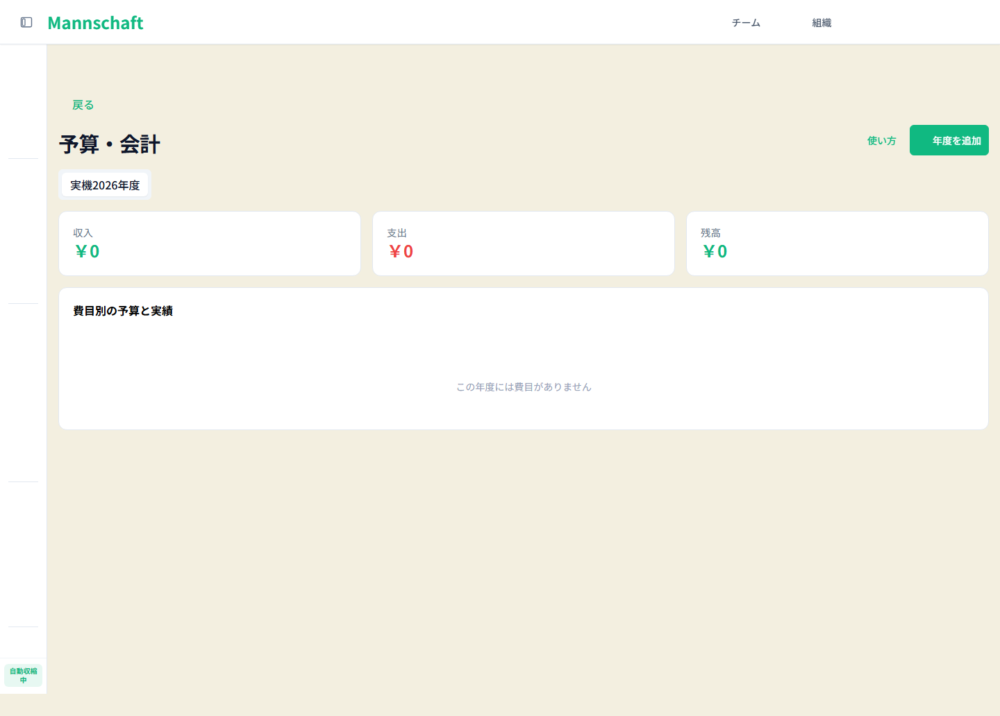
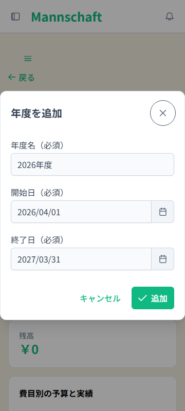
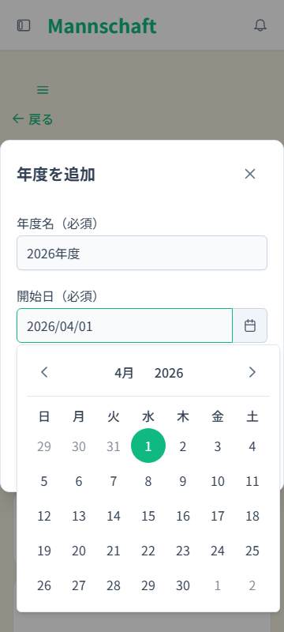
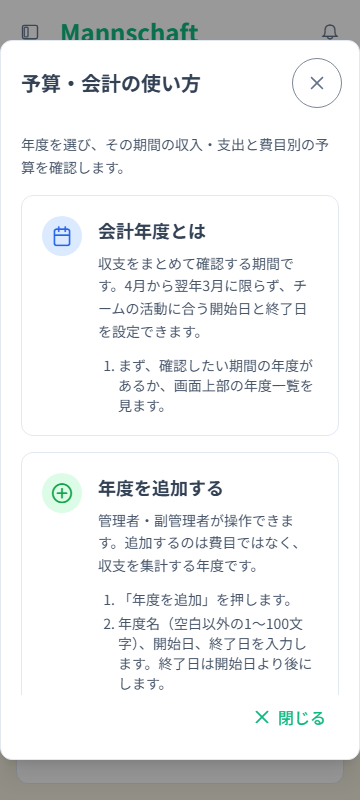

# チーム予算・会計の年度作成修正と使い方 — 検証報告

CMP-261017-1208 / 実装PR #3941 / 実装head `1730847bd4b9d8b4dba12d2bf08c8be49aa8a16d`。

実装PR #3941は2026-10-17T08:29:38Zに通常マージ済み。merge commit `3ce846b737113b872f0fad171999f5ee342dc569`。実装headのCIは成功26件・skip2件、失敗と未完了0件。完了文書PRのGitHub照合は別途CIで実施する。

## 修正と検分

チーム・組織の年度作成で画面が送る年度名・開始日・終了日を専用DTOで受け、保存先をURLから決定する契約へ修正した。集計URLとcategories契約を実APIへ合わせ、作成年度の選択、入力保持、二重送信防止、取得失敗時の再試行を確認した。使い方は年度の意味・作成・切替・集計・エラー対応の5カードを6言語で設置。

殿はBE/FE差分と呼出元、組織summary利用元、認可と祖先管理者、URLからの保存先決定、入力の空/0/null/100/101、重複・途中失敗・HTTP回数、仕様/OpenAPI/生成型とACを独立照合した。出荷を妨げる残存findingは0。最終review参照は実装PR #3941。

## API契約のred / green

実JWT・実Security・実MySQLの `backend/src/test/java/com/mannschaft/app/budget/ScopedFiscalYearCreateContractIT.java` を使用。

| 実行 | tests | failures | errors | skipped |
|---|---:|---:|---:|---:|
| 修正前契約試験 | 48 | 10 | 0 | 0 |
| 修正後契約試験 | 48 | 0 | 0 | 0 |
| 既存BudgetFiscalYearServiceTest | 2 | 0 | 0 | 0 |

TEAM/ORGANIZATIONの正常作成、保存と別TX再読込、本文によるスコープ偽装、同日・逆順等を検査。修正前の10件はassertion失敗であり、環境中断はredに数えていない。原本JUnit XMLの件数と失敗要素を証跡担当が読み取った。最少集計は `api-regression-summary.json`。

原本SHA256:

- red契約XML: `053640bb7b363a065a95c66de14cc23ba691258524562b8c42005d918ce03d31`
- green契約XML: `f356bc66e7b602bf4783c1cfed35200c821911dc21b224d333ac0fc993c7ee70`
- green既存2件XML: `fafce278c0c45ed65f32e9cc68cf97ba9c0437de19690c0dd927e20ab14df192`

green業務版は47bc7f2f40。以後のBE差分はSwagger required注記のみ。ローカルArchUnit凍結ストア検査はCIへ委ねた。最終CIはBE [39016603859](https://github.com/kenta-0420/mannschaft/actions/runs/39016603859)、FE [39016603854](https://github.com/kenta-0420/mannschaft/actions/runs/39016603854)ともsuccess。BE全6shard、Compile、NonJST、OpenAPI、Lighthouse、Smokeを含む検証が成功。

## 実機と版の対応

実BE・実FE・実DBのUI試験9項目をPASS（runner exit0）: 作成201とreload永続化、新年度の0円/費目なし、案内5カードと開閉、空白/同日/逆順拒否、重複400後入力保持と別期間再送信、実費目と集計表示、390pxの幅、一般メンバー・別チーム・匿名の直URL拒否と追加UIなし。reloadは年度一覧GET1・summary GET1・費目追加GET0。

主実機と3住民のFEは `50e54d91b6504932cb285a922a9a5071efc2a09e`。実施時661bとの差は非ja翻訳とdocsのみ。後続の局所タップ修正は下記の実機回帰と独立再現で確認した。実機jar SHA256は `f2facc9c8459ad8ce35e07474915ca7b3a587f724b19c2b0093bed9b3dc50f8d`。主実機の証跡時刻は2026-10-17T07:20:11.754Z〜07:38:22.719Z。プロセス開始時刻は未記録。

## 3住民による独立探索

runId `budget-261017-1208-exploratory`。独立アカウントとBrowserContext、目的のみを与えたUI探索。画像は各住民が実見し、終了済み。DB直接操作・mock・製品変更なし。

| persona / journey | 人格 × 攻め口 | 結果 |
|---|---|---|
| budget-admin-straight / budget-admin-2030 | 一般 × 素直 | 2030年度の作成201、reload・切替・案内読了 |
| budget-mobile-layout / budget-mobile-2032 | スマホ片手操作 × 表示崩れ | 390x844・360x800、isMobile/hasTouch=true。2032年度の作成201、入力エラー・案内・切替確認 |
| budget-member-gap / budget-member-permissions | 一般 × 隙間狙い | 本人・別チームの年度一覧403、追加UIなし。使い方とチーム4カテゴリを確認、業務書込0 |

4気づきを既存気づき箱overlayへ登録。登録元actual-resident-artifacts、trusted=false、observed-unverified、3persona/3journey。実ID・両軸・元runId・runtime sourceHead・証拠pathを保持した。予算独立keyが正本にないため既存team-modulesへ詳細「チーム予算・会計」で登録。公式validatorは不正8種類を拒否、隔離したボードコピーのIndexedDBで4件取り込み・reload後4件を確認。既存runner実行やB0 coverage合格を意味しない。

管理者の期間再確認導線未発見、メンバーの直打ち後「戻る」でabout:blank、案内冒頭の閲覧ロール説明は未実証観測として保持。仕様・原因を断定せずblockersへ昇格していない。モバイルタップ領域不足だけを殿が同条件で裏取りし、次節の回帰へ進めた。

## モバイル操作領域のred / greenと独立裏取り

追加回帰 `frontend/tests/e2e/real/budget-mobile-touch-targets.spec.ts` は修正前に閉じる幅のassertionがExpected >=44 / Received40で失敗。red原本の必要箇所を `mobile-regression-red.md`、greenを `mobile-regression-green.json` に保持。局所修正f266ae0421の最終PT後に1 passed、skip0・flaky0。360x800の8表示・142操作領域が44x44px以上、開始/終了の日・月・年pickerはいずれも幅334pxで画面内。対象単体22件と対象Lint・型検査exit0。

殿が別contextで最終状態を独立撮影・測定。フォームと案内の全対象領域が44px以上、calendar x21/y436/w334/h339。閉じるのsecondary/rounded/textクラスを保持。殿が採取した3画像を殿と証跡担当が実見した。詳細は `mobile-final-measurements.json`。

## 検証限界と残る確認

実スマホ端末、OSソフトキーボード、親指精度、desktop全標準サイズと125%実ズーム一式は未実施。住民はモバイルで全文を読め、ページ横パンなしと確認したが、実端末検証へ読み替えない。一般メンバー住民は作成UIがなく、未認可作成API直接試行は行っていない（認可契約はAPI試験で検査）。

最終CI BE39016603859 / FE39016603854はsuccess。実装PR #3941は通常マージ済み。所有合成データと専用環境の後始末は次節のとおり完了。完了JSONと台帳更新は実装マージ後の別docs-only PRで行う。

公開候補4画像はview_imageで実見済み。氏名・メール・認証情報・実運用データなし。表示は合成年度・日付・0円のみ。秘密を含み得るfixture、生ログ、DB dump、cookies、tokenは公開候補へ含めない。

## 所有データと専用環境の後始末

2026-10-17T08:29:57.630Zに完了。transaction1と年度2/3/4は正規APIでDELETE204、その後GET404を確認。category1の削除は既存配分1の外部キー制約 `fk_ba_category ON DELETE RESTRICT` によりAPI500となった。配分削除APIがないため直接SQLでの削除は行っていない。これは主実機試験後のcleanupで確認した既存削除制約であり、年度新規作成の修正へ範囲を広げず製品変更はしていない。

残る年度1・費目1・配分1と合成4account/2teamは、campaign label、DB UUID、container ID、mountとvolume排他を再確認した専用MySQL/Valkeyの2container・2volumeの廃棄で回収。第三者データ混入なし、廃棄後の専用container/volume不在を確認した。専用FE3001/API8081はcmdline/cwd/startTokenで所有PIDを確認して終了し、port消失を確認。別作業3004/PID6599と共有DBには触れていない。WSL全体の停止もしていない。

原本 `cleanup-report.json` のSHA256と最少集計は `cleanup-summary.json`。証跡archiveは135ファイル・277,544,716 bytes、全copy SHA一致。manifest SHA256 `632d34bc2c5a7ead12f0730e511ed38322a54544ebb4247dd52170d9e680c246`。fixture秘密はarchiveと公開候補へ追加していない。ローカルfixtureファイルは非公開領域に保全し、DB実体は消去済み。所有するLinux一時ディレクトリ4個も実path・非symlink・生存process無参照を確認して全撤去（skip0）。bounded keepaliveは殿の後段判断用に残っており、この報告では停止済みとしない。
