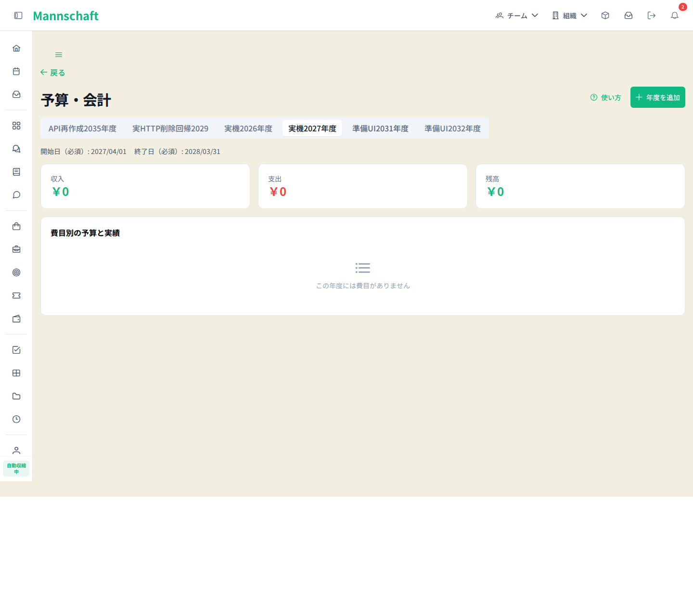
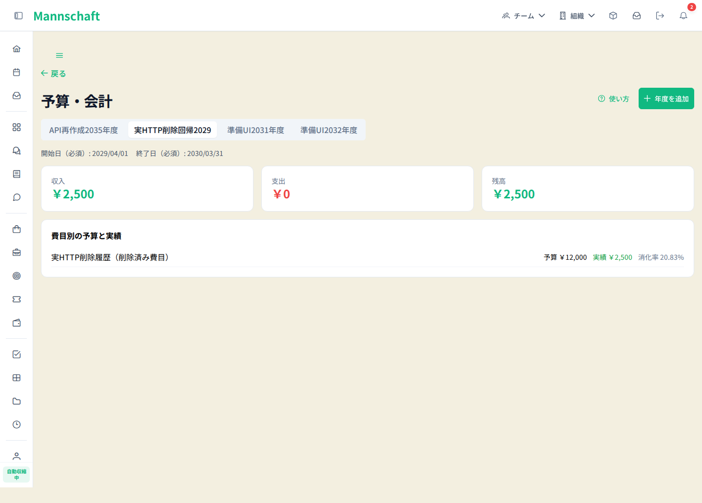

# CMP-261017-2047 予算会計の費目削除・年度期間・権限案内（完了報告）

実装PR [#3962](https://github.com/kenta-0420/mannschaft/pull/3962) は2026-10-18 08:10:02 UTCに通常squash mergeされました。実装headは `4ac82e6a0744a66884d846a7852ef4bd849beef6`、squash merge SHAは `27759534b5a0d0f94d63e84a4b95212c3dda2744` です。同headの[Backend CI](https://github.com/kenta-0420/mannschaft/actions/runs/39104125939)全6 shardとaggregate、および[Frontend CI](https://github.com/kenta-0420/mannschaft/actions/runs/39104125966)が成功しました。28 checksは26成功・正当なskip2・失敗/未完0です。検分・実機・探索は殿が最終照合してpassedと判断しました。

## 変更と受け入れ条件

配分のある費目DELETEが500となる経路を論理削除へ改め、配分・取引のIDと金額、削除済み費目の履歴参照を保持します。削除後の同名再作成は生存行だけの一意制約へ正規migrationで対応します。親NULLに対する従来の一意性の扱いは強化していません。認可の拡張は行いません。

予算画面は選択年度の開始・終了日を表示し、戻り先を対象チームへ固定します。使い方冒頭へ閲覧権限と一般メンバーの相談先を6言語で加えました。予算PageHeaderだけを折り返し可能にし、ヘルプを44×44px以上にしました。共有PageHeader全体のAPI変更はありません。

AC-1〜AC-14と最新headの正確なテスト名は、完了証拠の `CMP-261017-2047.json` に対応付けています。判定根拠は本報告と [安全なred/green集計](red-green-summary.json) です。

## 検証結果

| 範囲 | 結果と範囲 |
|---|---|
| 旧source BE局所テスト | 133成功・失敗0・error0・skip0。新契約23＋migration1＋既存認可等109。所有source835の対象treeは統合9daeと同等。全体CIや除外したArchUnit gateの代用ではありません。 |
| 旧source FE年度UX | assertion redは5失敗/9成功、修正後14成功/0skip。対象lint成功。 |
| 旧source モバイル実ブラウザ | 5本同run成功、失敗・skip・flaky 0。既存フォーム/日付選択142操作領域とja/de×360/390各12操作領域が44×44px以上。戻るは別途実寸assert。横溢れ、期間、ヘルプ/追加/戻る、ガイド下部・右上の通常closeを確認。 |
| 旧source 固定実機・実API | 管理者・副管理者・一般・別テナントを横断したUI10件成功。削除の実APIと履歴ブラウザreloadも成功。費目DELETEの製品UIがないため削除自体は実HTTPで確認しています。 |
| 殿の検分 | 旧source検分finding 0。新headの追加2製品差分もfinding 0。 |
| CI | 実装head4ac82のBackend39104125939全6 shard＋aggregate、Frontend39104125966が成功。28 checks中26成功・正当skip2・失敗/未完0。直前28648と1f381a8の成功は履歴として区別します。 |

BE redの24件は7成功/17失敗/0skipです。うちAC3の配分fixtureが必須monthを欠いた400対404の1失敗は製品redから除外し、有意味な製品redは16件（契約15＋migration1）です。**month=6を補ったAC3は修正後の契約23件greenに含まれます。**

実Flyway適用DBでのHTTP500再現は、この単体/契約red件数とは別証拠です。修正後はDELETE204となり、配分12,000円・取引2,500円と関連IDを保持しました。削除済み費目だけの年度削除、同名年度・同名子費目の再作成も実HTTPで確認しています。検証者による手動DDL/DML・手動repairは行っていません。既存の起動hookは自動repair後にmigrateを実行します。9dae実機の起動ログはfailedなし/repaired表示で、realign・checksum変更の行はありません。ただし起動前の全checksum snapshotを取得していないため、全既存checksumの不変は証明していません。今回の修正を通すため新たなrepair運用を加えたものではありません。

旧UI実機のBE sourceは `9dae0456e9a81c67e5e18c8c92e4a0b193172305`、jar SHA256は `13ffa6055375eea43ddb2db49cc3a4e25fc69a8333a896cab108eefbbfb1dab0` です。BE tree `6005377a7ca26098fd53e9858d3d4b6d5f76e43b` とFE app tree `f358c8aa24d9ca9ade2e71cb2bdae8805dbbffd1` の同等性は旧ab0との照合結果に限ります。1f381a8ではguard対応の2製品ファイルを変更し、固定jarによる別途実API検証を完了しました。main追従後は当PRの予算関連30パス全blobおよびBE予算subtreeが不変です。main先行24ファイルは予算外で当PRとの重複0ですが、FE app全tree不変とは主張しません。診断付きgreen5 specと一時debug除去後の恒久specのSHAは安全集計へ別記しています。

モバイルの途中試行では戻る待機失敗と、その後のFE全プロセス消滅・listener不在を観測しました。失敗クリック時の生存時系列がないため因果は確定していません。独立した有限寿命サーバーで両HTTP200を確認したgreen5は全通過し、戻る前後・終了時のPID/listenerを保持しました。ja360直後の匿名健康probe1回は5秒timeoutで、その後200へ戻っています。製品の戻る不具合が解消したという追加修正の主張はしていません。

## 新headのSQL時刻guard対応

旧ab0の全体BE CIでは、nativeQuery Repository内のHistoricalCategoryにある `LocalDateTime getDeletedAt` 宣言がRawSqlTimeColumnGuardTestで検出されました。新headはSQLで `deleted_at` のNULLを0、非NULLを1の `deletedFlag` へ変換し、Integer getterとserviceの1判定を使います。時刻をJavaへ取得せず、guard本体・凍結台帳は変更していません。

追加局所テストはguard本体2＋scanner10＋BudgetCategoryDeletionContractIT23の35件すべて成功し、failure/error/skipは0です。局所35件、1f381a8の全体CI成功、同source実API11件成功はそれぞれ別に確認しています。28648の固定jar実API11件成功と同head CI成功を確認し、最新4ac82の同head CIも成功しました。

## guard対応sourceの実APIとmain追従後の再確認

1f381a8の固定jar SHA256は `b0536e53474efc94772e1c76cedaa9cef05cb7f6d051b6878d3e228d447c0873`。全17,899 blobを照合し不一致0、実APIは11/11成功・completed=trueでした。削除済み費目ID1の名称注記と配分12,000・取引2,500の履歴を保持し、有効費目ID6の0円集計と削除済み費目が混在する通常APIも確認しました。検証後は所有JVMを停止し8081閉鎖を確認しています。

同起動前後のFlyway履歴は各1,220行、failed0、checksum合計一致です。これは個別versionのchecksum比較ではありません。検証者による手動DDL/DML・手動repairはなく、既存起動hookの自動repair後migrateが動作しました。以前の実証で未取得だった全checksum snapshotを遡って証明するものでもありません。

main `ad79885e0cb888aade6a9c64b3b3f8b5e1082d31` を取り込んだ直前headは `28648a49cca8fe9a4064b94a7e60112d421c4f3c` です。当PR30パス全blobとBE予算subtreeの不変を確認しました。main先行24ファイルとの重複は0です。28648の固定jar SHA256は `405bdb20eebed70acc691ad7dd2911d741ff47447dc7055a1a2490e78a358767`。全17,908 blob照合は不一致0、実API11/11成功・completed=trueです。有効費目ID6を再利用し、認証POSTとGETのみで予算更新は0件です。配分12,000・取引2,500の履歴IDと総計は不変でした。起動前後の全1,220版の順序付きversion/checksum行のSHA256は `033e38e02a5db6cc72c117595ad192d95ecf897e0416d9582be4073899c83931` で一致し、failed0でした。これはスキーマや業務データ全体の比較ではありません。既存の自動repair後migrateが動作し、検証者の手動DDL/DML・手動repairはありません。検証後は所有JVMを停止し、8081と3002の閉鎖を確認しました。28648の全体CI成功を確認しました。実装は通常squash merge済みです。

## 第2main追従と最新headの証拠継承

main `7f6e6852f0e9062f88e688abf7bff3ea44bc1457` を取り込んだ最新headは `4ac82e6a0744a66884d846a7852ef4bd849beef6` です。追加19ファイルは予定代理設定と文書など予算外で、殿のincoming実読はfinding0。当PR30パス全blobとBE予算subtreeの不変、自CMP行および上流CMP-261017-1726/2052/1443の保持を確認しました。実APIは28648の固定jarで実施した11/11成功を、最新4ac82の予算コード等価性に限定して継承します。新jar/APIの重複実行は不要との殿判断ですが、アプリ全体・jar全体の同一性は主張しません。最新headの全体CIは成功し、殿の受入stage最終照合もpassed、実装は通常squash merge済みです。

## 旧sourceの3住民探索と別観測

一般メンバーは予算403と会計情報の非漏洩を確認し、案内で管理者への相談先を理解してチームへ戻りました。モバイル住民は管理コンソールから予算へ到達し、ja/de・360/390で期間・案内・通常操作を確認しました。年度列は内部スクロールで、選択末尾は読める想定内の表示です。

デスクトップ住民はde・America/Los_Angelesで任意期間2040-02-29〜2040-03-11の年度を201作成しました（合成ID8）。画面の29.02.2040〜11.03.2040とAPIが一致し、期間の暦日ずれを観測していません。3住民は今回14 ACに関係する目標を達成し、殿も主要画像を実見しています。

de1152×720の通常start.click→fill/end.click→fillでは日付panelは常に1枚、Escape後は0枚となり、名前欄の通常clickも成功しました。殿が実画像2枚を含め裏取りしています。直接連続 `locator.fill` のみ2panelとclick interceptを再現しましたが、DatePicker定義はorigin/mainと同一の未変更です。今回の回帰・操作不能という確定指摘はなく、ハーネス/フォーカス依存の別観測として保全します。Tabがアイコンにも止まるkeyboard試行は有効な比較に採用しません。チームhomeのウィジェット設定35pxは、予算画面外の未確定候補として気づき箱inboxへ登録済みです。チーム戻りは期待URL到達を確認したもので、各画像がチーム内部loading終了までを証明するわけではありません。殿は14ACに対する探索・検分をpassed相当と判断しました。

## 気づき箱の確認

保存後の期間再確認、直URL後の戻る、冒頭の権限案内の元要求3 IDはdoneを保持し、元touch cardはinboxを保持しました。今回のカレンダーフォーカス観測は通常pointerでpanel1枚・Escape後0枚・名前click成功を整理し、UIでinbox→planned→doneへ移しました。製品を修正したという主張ではありません。新しいウィジェット設定35pxの観測は予算画面外の未確定候補としてinboxに残しています。

最終状態は6 cards＝4 done／2 inboxです。殿が取込後の画面を実見し、別ブラウザーで再開後も同じ6件・4 doneを確認しました。元3件に加えて新2件のbundleを書き出しました。専用persistent profileを使い、利用者profileは変更していません。元ID・メタデータとcanonical overlayのtrusted=false / observed-unverifiedを維持しています。

ボード基礎データの全体検証は未合格です。clean HEAD27dのbaselineはline37の「CMP正本行数と参照抽出数が一致しません」でexit1、生成copyはline46の「GitHubスナップショットの参照集合が正本と不一致です」でexit1でした。同じエラーと扱いません。既存overlay契約と自己試験の選択実行は実宣言を受け入れ、不正8件を拒否しました。共有dataは変更しておらず、この結果はrunner実行やcoverage合格とは別です。

## 公開する合成画像

以下2画像は旧BE9dae/FEbc15の実証です。画像は最新head全体の実証や新BEのAPI実証としては扱いません。

2点は殿が実見した合成データ画像です。秘密・認証情報・環境設定・fixture・生XML・trace・通信dump・個人絶対パスは公開候補へ含めません。
