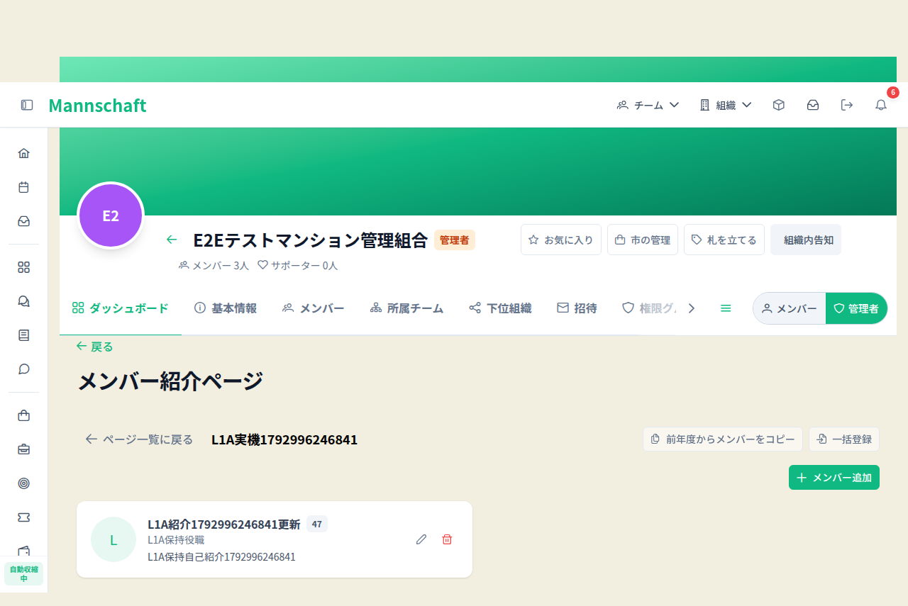
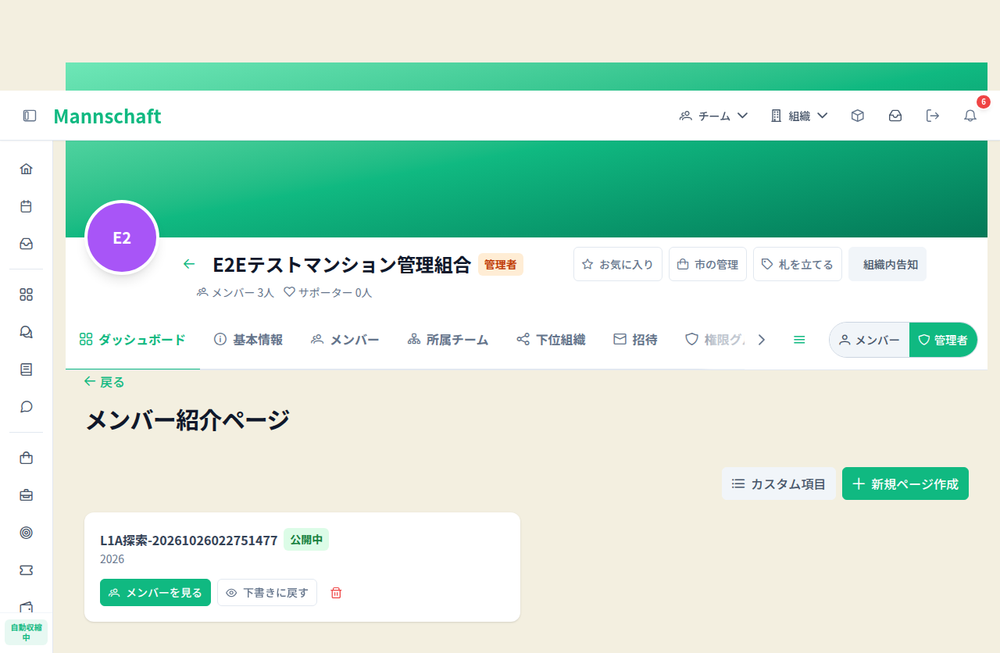
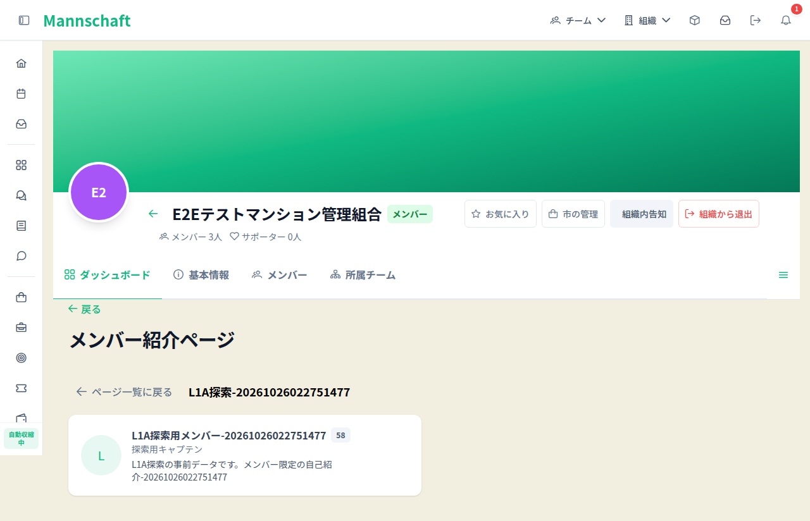

# CMP-261022-0914 検証記録

実装headはd6896776ade4e90283dcc77426c7b60034887039。root本人12AC検分passed/finding0。PR4049は2026-10-26T09:17:29Zに通常merge（admin未使用）され、mergeSHAは092ca37a587f6b589df9234126d6f43916c036cc。main統合Backend40298405982はattempt1failure履歴を保持し、attempt2 completed/successをroot API確認済み。製品AC/検分/実機/探索の合格と、完了記録PRの後続フローを区別して記録する。

## CI・復元成果物の独立照合

同head Backend40295398433 attempt1成功、OpenAPI40295516566 actualGenerate/Drift成功。全6shard :test、arch :archTest、Non-JST :testはFROM-CACHEで、新規全量実行ではなくGradle cacheからの結果復元。[小集計](ci-summary.json)に採取artifact IDs/digestと正確件数を記録した。

rootは新head原本ZIP1073XMLを独立再読：Scope159source全一致/各source actual>0、980XML/4384case、Arch46XML/347case、非Scope選択47headers actual/header一致、F/E/S/childbad0。新31、既存ACL58/membership9/MemberTX19、engine18class37（shard6/1/5/1/13/11）、Integrity各2/計12。[root最終検分](root-final-review.json)は12AC passed/finding0。

8store×6runner=48のGit canonicalが全一致。preL1 main17cab→d689の旧キーmultiset削減0、追加72。D3T7322→7352/+30、D3 1325→1346/+21、D5 1876→1897/+21、他5file不変。旧a363の[978XML履歴](historical-a363-ci-summary.json)と[66d validated履歴](validated-66d-ci-summary.json)は保持し、新d689の980XMLは採取成果物の実測値である。

## source bridgeと実機

r8 source33a→66dはdocs/task-list.mdのみ、66d→d689は他CMPのdocs7ファイルのみ。[source bridge](source-bridge.json)で製品コード・テストソース・ビルド設定の同一性を確認。task-listを読むguardもあるため全テスト/build入力同一とは断言しない。FE14d0とr8は全frontend同一であり全repo同一ではない。

r8 custom実UI12/12passed：ADMIN CRUD/optional保持reload/削除、MEMBER閲覧/管理UIなし、MEMBER/他tenant実在admin/settings直URL拒否・初期toast可視、秘密非表示。3contextclose/auth残0。プロフィール詳細固有URLはないため同URLの検証と同一視しない。変更したrepo admin-console実機specは型check/listのみであり、実行済みはcustom actualUI12件。

r7の10PASS/2FAILは親Suspense解決前app:mountedでToast購読開始前に通知消失した履歴。別PR4130のresolve+nextTick修正後、実VueSuspense red11/1→green12/0skip0、r8で拒否通知2件を含め成功した。

## 独立探索・cleanup

初回A/B/Cを並列起動し、Bはcapacity/namespace中断。旧B内部close値は未回収で保持し、rootが全Bownedprocess0確認後B2だけ別証跡で再開した。最終A/B2/Cはそれぞれ実DOMで手順を選択して目的達成/1contextclose後残0。最終3者が同時に重なったとは主張しない。root全画像視認済み。helper拒否は製品bugではなく制限、既存UI空表示/準備中文言は観測として保留、認可漏洩0。

[実機・探索・cleanup小集計](real-exploratory-summary.json)。fixtureはprivate DB/role0とexactGET二度→member4 DELETE204/GET404→page6空確認/DELETE204/GET404、APIcontext1close成功。初回offlineSQL shell引用失敗はauth0/delete0で停止、stdin最小修正後成功。r8 wrapper exit0/signalnull/error無し/cleanup removed/scratch不存在、driver/supervisor exit0/残server0/cleanupFailures0。driver時点dbRetainedStopped=trueは履歴。その後07:45:20〜07:46:26Z、所有照合済み専用container2・volume2だけ撤去し不存在確認、旧原本/旧r6scratch/images不変。

旧r6 copy run-55fg9Vはowner4a8a4e25-4100-45df-a5f9-55e32a3b5a98の旧実機失敗検証copy。EACCES process参照の安全確認不能のため保持。再確認期限2026-10-27 12:00 JST、既存権限内でcopy/生存processの所有・参照消滅確認後のみ撤去。sudo/WSL停止/新たな権限回避はしない。

## merge時点のAPI照合

origin/main092ca37のtrusted summarizeImplementationChecksを使用。filter=all＋paginateで25check、statuses paginate0件。mergedAt以前世代23件=success22/skipped1、失敗/未完了0、成功最低1件。changed_files21/listFiles21一致。小結果はCI集計へ保存し、raw APIは永続化しない。main統合CIは別mergeSHAのintegration metadataへ分離し、後記attempt2成功を確認。

実装d689とmerge092ca37の全repo treeはd7c96296a9c09a2ca8424f3979e746d9bcb36742で完全一致（root独立確認/準備担当再照合）。中間観測ではmain push Backend40298405982/attempt1の6shard actual Run testsが継続中でArchUnit成功、Gitleaks40298406051成功だった。最終結果は後記のfailureへ確定した。

Windowsの自己専有CI ZIP/XML展開28件（583,128,688 bytes）は2026-10-26T10:12:07.0979654Zに整理完了。rootが全28件不存在と独立照合JSON・finald689検分JSON・小検証結果の残存を確認した。旧r6 copyの保留パス・理由・期限・解除条件は変更しておらず、全資産片付け完了とはしない。

main統合CI最終結果（root gh独立確認）：exact092ca37/Backend40298405982/attempt1はcompleted/failure。Test shard3 job121490202537のRun tests step6がfailure、他5shard/ArchUnit/Detectはsuccess。後続Build & Deployはskippedで成功扱いしない。限定read-only調査は終了しroot検分済み。TX開始時接続取得timeoutまで確定し、active接続保持の根因は未解明。実装headのgreenと混同せず、当時は両台帳行を実装中のまま維持した。後続再試行結果は後記へ分離する。

main再実行を区別：attempt1 shard3の失敗はLoyaltyPointsWriterITのAC19（470行）でtransaction/JDBC接続取得例外、Hikari3047ms timeout（total33/active31/idle2/waiting45）。5650完了/1failed/2skipped。assertion expected/actual不一致ではなくプール待機集中は確定だが、active接続保持理由は未解明。限定read-only調査は終了しroot検分済み。

rootが同head092ca37でgh run rerun --failedを実行。コード/試験条件変更0、attempt2 shard3 job121528289673は2026-10-26T10:45:57Z開始、最終結果はcompleted/success。attempt1failure/Build & Deploy skippedを消さず、再実行成功でも根治済み/全初回成功とは書かない。当時の台帳は実装中/Draftを維持した。最終結果と記録フローは後記のsnapshotへ区別する。

限定調査の結論：TX開始時の接続取得timeoutまで確定。pool total33を上限50の枯渇と断定できず、max50は実既定値で実効最大値は未観測。リーク/deadlock/flake/間接影響皆無も断定不可。確認sourceblob範囲は一致、warmupなし、program/rule共有lock→本人排他→初回insertを1TXで行い、外部call/REQUIRES_NEWなし。規約min=max/connectionTimeout30000msと実既定10/50/3000msの既存不整合はユーザーへ報告済み・未解消。再実行成功だけを根治と扱わない。

## main統合最終結果と残存リスク

root APIでexact092ca37/40298405982 attempt2 completed/success、9jobs全success/Build & Deploy successを独立確認。--failedでshard3だけ再実行し、他5shard/ArchUnit等の成功出力は初回分を保持。全6shard :test/:archTestは実行成功でFROM-CACHE/UP-TO-DATEなし。新shard3 XML artifact12646658128（sha256:6addf392f9ca98953809384f74bf3d2cfd7f1ae55e837ab8d49a750d4f363c2a、38,942,083bytes、11:37:37Z）をIDで選択。root直接再検証でLoyaltyPointsWriterIT AC19 testcase1pass、suite49/0failure/0error/0skipを確認。旧失敗artifact12643503569は別履歴。初回failure/後続skip、active接続保持の未解明理由、既存pool規約/既定値不整合を保持し、根治やL1-A無関係を証明したとは称さない。

正本CLIの固定旧Draft検証（base bd573ee5 / head aebff0e8）は同Windows WTをLinux Node/Gitで1800秒有界実行し、1801.9秒で終了、stdout/stderr空・exitCode取得不能・完走未確認。Git差分不変。自己2証拠のtrusted validator成功をこの全履歴CLI成功へ代用しない。この30分未完了は履歴として保持し、後続baseline成功と混同しない。

## 完了記録フローのsnapshot

ledger更新前baseline（base a6ce007d24d918048ee611fbf0acce8eb810cfae / head d89fc197a636be2c68f277e11f18b4d36ee9c7ae）の正本CLIはnative object storeで53.377秒/exit0/stderr0。sourceblob52e1e567bc6bb7fe799880f003991ef95ac1d994、CLI source SHA256 6cf2ec4e7eb2f4671655c7a7c42dfb3fcb2b3ecfb1d7b599b7284535c33e558a。pack/import SHA256 929b80abd80742ee34be2af062bd318d4e69eb5488a3f94b051add3ca4818c74、22,142 OID・両全tree・6sampleを照合。snapshot projectionでparent historyのimportはせず、CLIの全台帳/証跡構造・参照検証範囲を維持した。source変更0、自己child残0、wrapper receipt exit0/cleanup removed、自己scratch不存在をroot確認。GitHub API状態はこのCLIの検証範囲外。旧30分不完走を成功に書き換えたものではない。

このbaselineは台帳変更後の新HEADを検証していない。残る記録フローは変更後の正本CLI exit0/root最終確認、完了記録PRのCI/merge、親完了・owner解放・自己merged資産片付けであり、製品AC未達を意味しない。旧r6 copy保持条件は別途継続する。
