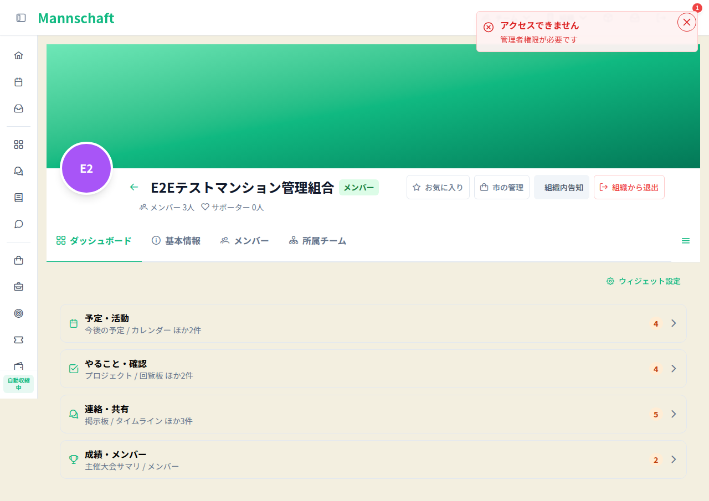
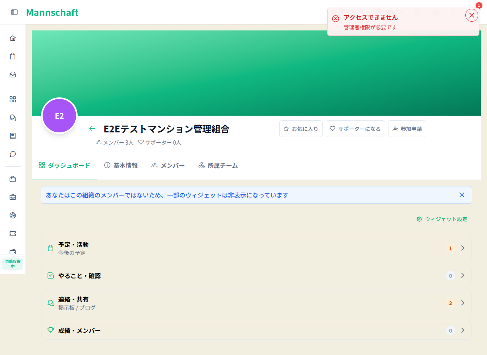

# CMP-261026-1344 完了証拠の配置準備

root本人review指摘0/passed、実機passed、探索passed。PR4130は17cab5899b86216190b2c13d31c19812d88593d5へ2026-10-26T07:02:49Zにmerge済み。配置・merged_at世代check/status照合済み。台帳完了更新はまだ実施していない。

r8 source 33a49406f8064ba60f199a3df860492c10329cae。manifest14一致。実UI12/12passed、3contextclosed/authremaining0。ADMIN CRUD/optional保持reload/削除、MEMBER閲覧・管理非表示、MEMBER/他tenant実在管理URL拒否+初期toast可視、秘密非表示。プロフィール詳細固有URLは存在せず、admin/settingsの実在URLを検証した範囲。

source-bridge.jsonでr8/FE14d0/main17cabの全frontend paths同一を確認した。r8統合sourceにはL1-Aを含むがFEbranchにはないため、全repo同一は主張しない。

r7は10PASS/2FAIL。app:mounted時点の親VueSuspense pendingでToast mounted未到達。最終specは実VueSuspense red11/1からapp:suspense:resolve+nextTick後flushでgreen12/0/skip0。前失敗を隠さない。

探索最終：A/B2/Cが目的達成、root全画像視認、最終各contextclose成功。B初回capacity/namespace中断・旧close内部値未回収は履歴。全Bownedprocess0確認後に1担当だけ再開。各agentは実DOMから行動を選択しfixedjourneyではない。helper limitationや既存UI文言を製品bugと断定せず、認可漏洩0。共有assetへ追加fixしない。

FE PR4130 head 14d0a37f6455b89eed2da596977750e25ecf7044、Frontend CI 40278560396 success。主Vitest706files/6953passed+5既存skip、nodeproject2files/27passed、新spec12/0skip0。別runのbaseline/main/旧attemptをciへ混ぜない。

AC1〜4は実Toast/Suspense spec12件、AC5はcustom actualUI r8 12/12。途中失敗は同一例外透過、初期のみO(n) queueでtimer/pollなし。root本人が最終判定し追加reviewerは起動しない。

root最終検分：4files/AC1〜5/実Vue12/同head CI4runs/実機12/3探索を確認しfinding0。Frontend40278560396、E2E40278560641、Lighthouse40278560419、secret40278560313は全て14d0/completed/successを原本照合。PR4130 merge確定。mainFrontend40283395071はexact merge17cab/completed/successをrootAPI最終実読。Install/Lint/Typecheck/unit、Docker Build frontend imageとRun container/HTTP/Docker health成功。BuildDeploy40283395163/gitleaks40283395199のsuccessはLuna報告。

## AC1〜4と実Vue/実Toastの個別green対応

AC-1（3件）

- (AC-1 回帰) 親 Suspense の解決前に app:mounted が発火しても通知を失わない
- (AC-1 境界) 同期 root が app:mounted より先に resolve しても保留通知を配信する
- (AC-1) 初期購読前の通知を実 Toast の mount 後に表示する

AC-2（3件）

- (AC-2) 複数通知の順序とオプション同一性を保ち再送しない
- (AC-2) mount 後の通知は次の mount hook を待たず表示する
- (AC-2) 内容が同じ別々の通知を勝手に間引かない

AC-3（1件）

- (AC-3) 空の保留通知は何も表示しない

AC-4（5件）

- (AC-4) mount 前の remove は対象通知だけを取り消す
- (AC-4) mount 前の removeGroup は指定グループだけを取り消す
- (AC-4) mount 前の removeAllGroups より後の通知は維持する
- (AC-4) mount 後も remove・removeGroup・removeAllGroups を実サービスへ渡す
- (AC-4) 配信先の例外を握りつぶさず既送通知を再送しない

AC5はcustom actualUI r8 12/12のnew org/直URL拒否と通知可視で実証。変更したadmin-console実機spec自体の実行結果ではない。同specは型check/list確認のみ。CI E2EはSmoke+I18N SSR/Cookieであり、admin-console実機specを実行したと称さない。

実認証のtoken/Cookie/storageState/HARは保存していない。永続証跡に認証情報を含めない。fixture cleanupは後述どおり成功。r8 wrapper cleanup removedをroot最終実読。専用DB container2つ・volume2つは後続の所有照合済み撤去を完了。旧r6 scratchは別資産として保持。

## cleanupの範囲
private DB/role0とexact GET二度を確認後、member4 DELETE204→GET404、page6空確認→DELETE204→GET404。API context1作成/close成功をrootが原本全文確認。初回offline-preflightはSQL shell引用で認証0/削除0停止し、stdin最小修正後に成功した履歴を保持する。root最終原本07:33:26Z：r8 wrapper exit0/signalnull/error無し/cleanup removed/scratch不存在、driverexit0/残server0/cleanupFailures0、supervisorexit0/deadlinefalse。当時のdriver記録dbRetainedStopped=trueは保持。その後07:45:20〜07:46:26Z、rootが所有照合済み専用container2つ・volume2つだけの計4操作を実行し、knownContainersAbsent2/knownVolumesAbsent2、status passedを原本確認。historicInputs不変、旧r6 scratchとimagesは未操作。旧r6 scratch EACCES保持は別資産であり、全cleanup済みとは称さない。

## 小証跡
[CI・回帰集計](ci-regression-summary.json)、[source bridge](source-bridge.json)、[実機・探索集計](real-exploratory-summary.json)。

source追加照合：r8runtime33a / FE実装14d0 / merge17cabのfrontend全treeはb08b83ebd2b833c46b6e0295d2766bdeb583a752で一致。全frontend paths同一。全repo同一は主張しない。mainFrontend40283395071はci配列へ混ぜずintegration metadataに分離した。

## マージ時点のGitHub照合
2026-10-26T07:51:20ZにPR4130の実装head14d0/mergedAt07:02:49Z/merge17cabをAPI照合。checksはfilter=all＋paginateで24件、commit statusesはpaginateで0件。origin/main0ab1e7d01333798c97d29f42d5ed9894123e41caのtrusted summarizeImplementationChecksをそのまま使用し、マージ時世代22件＝success15/skipped7、失敗・未完了なし、成功最低1件を確認。changed_files4とlistFiles全4件が一致。validateEvidenceへ同repo merged/完全一致head/判定済みcheck/file metadataを渡して合格。raw API原本は永続証跡へ複製せず、小結果のみ[CI・回帰集計](ci-regression-summary.json)へ保存。

旧r6 copy run-55fg9Vの保持：owner4a8a4e25-4100-45df-a5f9-55e32a3b5a98、用途は旧実機失敗検証。EACCES process参照の安全確認不能のため無差別削除しない。再確認期限2026-10-27 12:00 JST。既存権限内でcopy/生存processの所有と参照消滅を確認できた時のみ撤去する。sudo/WSL停止/新たな権限回避は行わない。

Windowsの自己専有CI ZIP/XML展開28件（583,128,688 bytes）は2026-10-26T10:12:07.0979654Zに整理完了。rootが全28件不存在と独立照合JSON・finald689検分JSON・小検証結果の残存を確認した。旧r6 copyの保留パス・理由・期限・解除条件は変更しておらず、全資産片付け完了とはしない。
